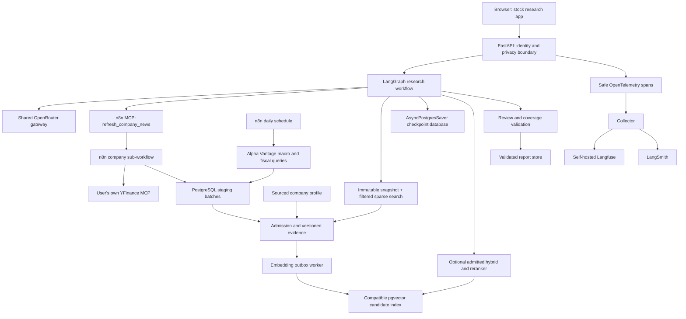

# Build the stock research application with Cursor

Planning baseline: 17 November 2026, Asia/Hong_Kong. This document is an implementation brief, not evidence that the planned application already works.

## 1. Give Cursor this instruction first

Copy this prompt into Cursor with this file attached:

```text
Use docs/CURSOR_STOCK_RESEARCH_BUILD_PLAN.md as the implementation brief.
Inspect AGENTS.md and the current repository before editing.
Start at Stage 00. Implement one stage at a time in dependency order.
Reuse verified integrations; do not rebuild the academy website as the application.
Write actual code, migrations, fixtures, and meaningful checks for the current stage.
Read the exit criteria before choosing the implementation.
Run the checks that can run locally. Report external checks as NOT RUN when unavailable.
Never mark an external integration complete from mocks, screenshots, or a model's opinion.
Update docs/stock-research-progress.md with files changed, commands, results, and remaining gaps.
Stop at the stage boundary and provide the next stage's exact starting prompt.
Do not implement later stages or silently change retrieval thresholds, budgets, or supported companies.
Keep secrets outside Git, the browser, prompts, checkpoints, and exported telemetry.
Do not deploy, publish traces publicly, or call paid models just to complete an offline stage.
```

For a later Cursor session, use:

```text
Read the build plan and docs/stock-research-progress.md.
Verify the last stage's artifacts against the repository; the progress note is not proof.
Continue with Stage NN only. Preserve existing user changes.
Complete its tasks and exit checks, record the evidence, and stop at the stage boundary.
```

Stage completion means the exit checks passed. A stage may have a working offline portion while its live checks remain NOT RUN. Dependent live stages cannot claim completion from that partial result.

## 2. Build this product

Build a private stock-news research application for MSFT, AAPL, and NVDA. A user chooses a company, question, outlook horizon, and automatic or evidence-review mode. The app refreshes company news through n8n, combines it with eligible daily economic news and a sourced company profile, freezes evidence, retrieves relevant passages, and produces a cited conditional outlook.

The user can review the evidence after ranking: highlight articles, exclude them from this report, and change the preferred discussion order. The app rechecks evidence sufficiency before generation. It preserves the original system ranking and never changes stored article text because of a user selection.

Support these outcomes explicitly:

- A supported report with facts, conditional scenarios, assumptions, limitations, citations, and a trace reference.
- An irrelevant request, without news or report calls.
- An ambiguous request that asks for clarification.
- Insufficient evidence, with dated supported facts and the missing information.
- Provider/database/model unavailability, distinct from zero search hits.
- Privacy rejection, expired review, safe interruption, and authorized recovery.

Do not build trading, portfolio management, order placement, a general browsing agent, or numerical price prediction into this release. Retrieval scores are not probabilities of a stock moving. No calibrated return/probability claim is permitted without separate forecasting validation.

### 2.1 Preserve the current work

Paths below are relative to the repository root. Inspect the current files before following an old guide.

| Current artifact | Reuse | What it does not prove |
| --- | --- | --- |
| Root `app/`, `lib/finance-*`, `public/downloads/` | Teaching pages, examples, diagram catalogs | A deployed research API |
| `integrations/n8n_stock_news/` | Generated n8n JSON, normalizers, retries, staging SQL, examples, local tests | Live n8n import, your MCP connectivity, reliable production recovery |
| `integrations/finance_openrouter/` | Shared gateway, closed schemas, three node bindings, HTTP-fixture tests | A durable call ledger, production sanitizer, live model quality |
| `integrations/yfinance/` | Optional reference bridge and contract examples | Your own MCP server's transport, tool name, or exact schema |
| `evals/finance/` | Frozen synthetic starter, policy, manifest, evaluator | Production retrieval quality or forecast accuracy |
| `docs/FINANCE_*`, `docs/FINANCIAL_REPORT_*` | Existing architecture and learning material | That every proposed file exists |
| `services/agent/` | Separate Agent Lab service | The finance research backend |
| `office/` on its branch | Static teaching bundle | Live Python, n8n, or database services |

Use the user's own YFinance MCP. Do not launch the reference third-party YFinance wrapper unless deliberately configured as an alternative. Do not overwrite generated finance guides by hand; their catalog generator owns them. This plan is independently authored and is not generated by `proposal:sync`.

Current choices supersede older SQLite, SqliteSaver, or simplified-scope descriptions: PostgreSQL, AsyncPostgresSaver, n8n, OpenRouter, and evaluated candidate hybrid retrieval are the target here.

### 2.2 Keep these invariants

1. Every accepted new live research request performs one logical `refresh_company_news` call through n8n MCP. n8n owns bounded provider retries. Resume reuses the original receipt.
2. Request at most three company articles per fetch. Keep `news` as an array. Accept a smaller or empty valid list without fabrication.
3. Daily macro/fiscal/geopolitical-candidate collection runs independently from user requests. Never fetch the shared daily feed again for each report.
4. Keep sourced company facts, collected news, immutable snapshot manifests, execution checkpoints, user selections, and generated reports as different records.
5. Store sanitized source versions before embedding. Embed only new/changed compatible chunks. Never embed a price observation as news.
6. PostgreSQL full-text search is the default until hybrid passes the frozen evaluation gates.
7. All generative calls use one server-owned OpenRouter gateway: `scope`, optional `refine`, and `report`. Embeddings and the cross-encoder remain separate model paths.
8. Persist limits and attempts before external work. A crash, pause, retry, or replay cannot reset them.
9. Only explicit human review pauses active processing time. Network waits, process outages, and recovery consume the saved allowance.
10. News, tool results, metadata, questions, and review text have no authority to change tools, prompts, budgets, credentials, permissions, or provider URLs.

## 3. Target architecture and folders

Use Node 22 for the live frontend and a separately managed Python research service. The existing local integration environment used Python 3.13; verify dependency compatibility and lock a supported interpreter in Stage 01. Choose reviewed exact package/container versions during implementation. Do not copy unverified latest versions from this plan.



Create these paths as stages require them. They are proposed paths, not a claim of existing code:

```text
apps/web/                         # Independent live frontend; root academy stays separate
  app/                           # Research form, run, review, report, history
  lib/api/                       # Generated API types and authenticated client
services/research/
  pyproject.toml                 # Exact dependency resolution plus lock file
  app/
    main.py                      # FastAPI lifespan, endpoints, dependencies
    contracts/                   # Pydantic boundary schemas and enums
    auth.py                      # Trusted owner identity, authorization
    privacy.py                   # Inbound/outbound privacy policy
    ledger.py                    # Durable budgets, attempts, safe result cache
    graph.py                     # StateGraph topology and typed state
    nodes/                       # Deterministic graph operations
    providers/                   # OpenRouter and n8n MCP clients
    ingestion/                   # Staging admission, version mapping, receipts
    profiles.py                  # Sourced profile revisions and exposure facts
    snapshots.py                 # Frozen evidence/model-readiness manifests
    retrieval/                   # Sparse, dense, fusion, rerank, eligibility
    coverage.py                  # Required facets and abstention
    selection.py                 # Candidate/selection revisions
    reports.py                   # Validation, storage, comparison
    export.py                    # Deterministic Markdown export
    checkpoints.py               # Saver lifecycle and recovery
    telemetry.py                 # Safe span schema and trace references
    workers/                     # Run executor and embedding outbox consumer
  migrations/                    # Research migrations; saver setup separately tracked
  tests/                         # Unit, database, contract, integration, acceptance
deploy/stock-research/            # Private local deployment and documented services
evals/finance/                   # Retain frozen starter; add versioned live datasets
docs/stock-research/              # ADRs, operations, API references, test evidence
docs/stock-research-progress.md   # Current verified status and next stage
integrations/n8n_stock_news/      # Owns reusable n8n template sources and exports
```

Keep the application stack small: FastAPI, LangGraph, PostgreSQL, the existing integrations, and one live frontend. A PostgreSQL-backed work queue is sufficient initially. Do not add Redis, Kafka, Kubernetes, or a second backend framework without a concrete requirement.

## 4. Freeze contracts before wiring services

### 4.1 Provider contract

The user's MCP returns this body. The MCP protocol may wrap it in `structuredContent` or a JSON text-content block:

```json
{
  "symbol": "MSFT",
  "news": [
    {
      "title": "Fictional article title",
      "summary": null,
      "publisher": "Demo publisher",
      "publishedAt": "2026-11-17T08:00:00Z",
      "url": "https://example.com/article",
      "content": "Fictional source excerpt."
    }
  ]
}
```

All six article keys are required. `summary`, `publisher`, `publishedAt`, and `url` are nullable. Do not treat the literal strings `"null"` or `"string or null"` as nulls. Verify the real request schema through tool discovery; `max_items: 3` is an example argument, not a verified name for this user's server. Reference fixture: `integrations/n8n_stock_news/examples/company-news.json`.

### 4.2 Proposed public API

Expose these through the live frontend's same-origin server boundary. Generate frontend types from the backend OpenAPI schema. Authentication determines the owner; never trust a client-supplied `owner_id`.

| Method and route | Contract |
| --- | --- |
| `GET /health` | Process liveness only; no paid calls |
| `GET /ready` | Required local dependencies; safe diagnostics |
| `POST /research` | Sanitized question, company, horizon, review mode, optional historical cutoff; required idempotency header; returns run ID/status |
| `GET /research/{run_id}` | Authorized safe progress, result reference, review/candidate revision, coverage/freshness and error category |
| `GET /research/{run_id}/evidence` | Authorized snapshot/candidate excerpts, dates, citation IDs, system ranks, user-selection revision |
| `POST /research/{run_id}/selection` | Expected candidate/selection revision, selected/highlighted/excluded IDs, duplicate-free discussion order; returns committed selection revision |
| `POST /research/{run_id}/resume` | Expected run revision and the committed selection revision when reviewing; idempotent continuation |
| `GET /reports/{report_id}` | Existing validated stored report and provenance |
| `GET /reports/{report_id}/export` | Deterministic Markdown from that report; no LLM call |
| `GET /reports/{report_id}/compare/{previous_id}` | Same-owner compatible reports; evidence/assumption differences with dates |
| `GET /runs` | Authorized paginated run history |

Use 202 for accepted asynchronous work, 400/422 for invalid input, 401 for unauthenticated access, 404 for inaccessible/unknown resources, 409 for revision/idempotency conflicts, and 410 for expired review. Keep business outcomes such as `insufficient` separate from transport failures. Return safe error categories and a run/correlation ID, never raw provider bodies.

First-run request example:

```json
{
  "company": "MSFT",
  "question": "How could recent policy changes affect margins?",
  "horizon": "30d",
  "review_mode": "manual",
  "as_of": null
}
```

`as_of: null` means current research: freeze the evidence cutoff after refresh. An explicit historical cutoff stays fixed; newly fetched later-known items cannot leak into it. Record the request time and selected cutoff separately.

### 4.3 Proposed persistence model

Use separate databases and credentials for n8n metadata, research application data, and LangGraph checkpoints. Separate databases can share a local PostgreSQL instance. Langfuse may require additional services/databases from its official deployment; do not assume the research database is sufficient for it.

| Record | Required fields and constraints |
| --- | --- |
| Owner/session | Server-resolved identity, expiry, role; server-only access to secrets |
| Research run | Owner, run/thread IDs, immutable sanitized request, request hash, idempotency key, status/revision, horizon/target date, remaining active time, deadline, review expiry |
| Acquisition | Run, stable batch key, n8n execution ID, status, known/unknown external outcome, counters, timestamps and validated receipt |
| Staging batch | Reuse `news_ingest.batches`; required query windows/configuration, pending/completed state, receipt |
| Staging evidence | Reuse `news_ingest.versions` and `members`; original first-seen timestamp and sanitized source version |
| Admitted evidence | Stable document/version IDs, staging origin ID, source URL, publication/first-seen/admission timestamps, permissions, company/topic/region/sector links, privacy policy |
| Profile version | Company, sourced facts/exposures, source-version IDs, effective/reporting/review dates, immutable revision |
| Economic observation | Metric, value, unit, geography, observation period, release time, vintage/first-seen time and source; separate from article summaries |
| Quote observation | Symbol, numeric price/currency, price timestamp, fetch time, session/delay status and source; outside the news vector index |
| Chunk | Source version, ordinal, sanitized exact excerpt, content hash, tokenizer/chunking policy; never silently change an old chunk |
| Embedding | Chunk, model ID/revision, dimension, normalization/prefix/policy identity, vector, ready time; unique compatible configuration key |
| Snapshot | Company, cutoff, exact eligible source/profile/chunk IDs, completed daily batch IDs, coverage, permission view, frozen vector-readiness/configuration manifest |
| Candidate revision | Run/snapshot/search round, immutable system ranks/scores, ordered IDs, retrieval configuration and fallback reason |
| Selection revision | Owner/run/snapshot/candidate, selected/highlighted/excluded IDs, user order, expected prior revision, limitations and timestamp |
| Model reservation | Run/role/configuration hash, unique attempt, start/deadline, status, safe usage, cached sanitized result reference or unknown outcome |
| Report | Run/snapshot/selection revision, exact question/horizon/target date, validated facts/scenarios/limitations/citations, prompt/model/config versions and trace references |
| Trace reference | Run/segment IDs, destination, access-tested URL or unavailable reason; no invented URL |

Add foreign keys, ownership predicates, uniqueness, bounded text/arrays, and allowed-state constraints in migrations. Enforce one snapshot per run and one finalized report per run initially. An evidence change requires a new run, not mutation of a finalized report.

Do not rename or directly edit LangGraph's internal checkpoint tables. Run the supported saver setup as a deployment migration and let the library own its schema.

### 4.4 Budget and state policy

Keep configuration in one typed, versioned policy and reference it from application code, tests, and documentation:

| Limit | Initial policy |
| --- | --- |
| Active research processing | 60 seconds total, persisted |
| Human review expiry | 15 minutes from first pause, absolute and never extended |
| Company acquisition | One logical refresh per accepted new live run; at most three provider attempts inside n8n |
| Company fetch result | At most three articles; fewer allowed |
| Search rounds | Two total, including failures |
| OpenRouter attempts | One `scope`, one optional `refine`, one `report`; three total maximum |
| Gateway role caps | Existing caps: scope 256 output tokens/10 s; refine 384/10 s; report 2048/25 s, clipped to saved remaining time |
| Retrieval candidates | Up to 20 per sparse/dense branch; fused shortlist 20; rerank top 10; final context at most six excerpts |
| Daily provider job | Separate scheduled-job budget; existing template has three queries, at most three attempts each and a nine-minute logical deadline |

These are ceilings, not a promise all worst-case stages fit in 60 seconds. Clip each operation to remaining time and preserve validation time. Missing evidence or time never authorizes another paid attempt.

Use separate execution status and outcome enums. Suggested execution states: `queued`, `running`, `awaiting_review`, `completed`, `stopped`. Outcomes include `report_ready`, `ambiguous`, `irrelevant`, `insufficient`, `unavailable`, `privacy_blocked`, `review_expired`, and `budget_exhausted`. Adapters translate legacy `privacy_stop` routes explicitly rather than creating duplicate meanings.

## 5. Build in these stages

Dependencies are intentional. Stages 00–09 deliver the automatic sparse-search report path. Stage 10 adds evidence review. Stages 11–12 evaluate retrieval improvements. Stages 13–16 complete comparison, observability, release validation, and operation. Stage 17 is optional future work.

### Stage 00: Audit the baseline and record decisions

**Outcome:** Cursor knows what exists and cannot confuse teaching demos with live integrations.

Tasks:

1. Read repository instructions, this plan, existing finance catalogs, n8n README/DESIGN, OpenRouter README, and evaluation policy/manifest.
2. Record current branches, worktree changes, runtime versions, existing integration tests, and known external dependencies. Preserve user changes.
3. Create `docs/stock-research-progress.md` with all stages initially unverified and a section for NOT RUN live checks.
4. Write six short ADRs under `docs/stock-research/adrs/`: acquisition ownership; sparse/hybrid admission; immutable evidence and conditional outlooks; OTel with two destinations; untrusted content and restricted authority; reproducible evaluation/release artifacts. Reuse the decisions in `lib/finance-assurance.ts` rather than inventing replacements.
5. Add an inventory of source-owned versus generated files and proposed versus existing runtime paths.

Exit checks:

- Run existing offline OpenRouter, n8n JavaScript, and synthetic evaluation tests where dependencies exist. Record failures rather than rewriting them to pass.
- Confirm all three n8n exports are inactive and no provider key is required for offline checks.
- Record that live research API, production budget/privacy services, and full application acceptance are not yet implemented.

Cursor prompt: `Implement Stage 00 only. Produce a verified baseline and six short ADRs. Do not build services yet.`

### Stage 01: Scaffold services and freeze boundary schemas

**Depends on:** 00.

Tasks:

1. Create `services/research` and `apps/web` without moving the root academy or altering Agent Lab behavior.
2. Lock Python/Node dependencies separately; add lint/type/check scripts and blank private-service configuration examples. Read this repository's bundled Next.js documentation before frontend code.
3. Define Pydantic schemas for request, run status, acquisition receipt, evidence, profile, snapshot, selection, report, errors, and quote observations. Use closed external schemas and explicit nullable fields.
4. Keep the supplied provider `news` contract distinct from admitted evidence and stored report contracts. Generate JSON Schema and frontend API types from authoritative backend models.
5. Establish mock transports and fictional fixtures for three articles, fewer articles, empty news, malformed response, irrelevant question, injection, and unavailable provider.
6. Add one liveness endpoint and a frontend page that can call it. No provider calls yet.

Exit checks:

- A valid fixture crosses the API boundary; wrong company, malformed `news`, oversized payload, and unknown fields fail deterministically.
- Frontend and backend use the same generated contracts; no hand-copied enums or `any` escape hatches.
- Academy build and Agent Lab entry points still resolve. Live application commands are documented separately from office commands.

Cursor prompt: `Implement Stage 01 only. Scaffold isolated services and contract generation; keep all providers mocked.`

### Stage 02: Add PostgreSQL infrastructure and migrations

**Depends on:** 01.

Tasks:

1. Add a private local Compose configuration for PostgreSQL and n8n using reviewed fixed images. Persist data and the n8n encryption key; keep secrets out of the file.
2. Provision research, checkpoint, and n8n metadata databases with distinct roles. Bind local administrative ports to loopback or a private network.
3. Add ordered migrations for research runs, reservations, acquisition metadata, admitted evidence, profiles, snapshots, selections, reports, and job/outbox tables. Add optional pgvector only when Stage 11 begins.
4. Reuse staging `schema.sql` through a tracked migration rather than installing competing collection tables.
5. Provide migration status, upgrade, blank-database bootstrap, and backup commands. Use schema-owner credentials only for migration.
6. Keep readiness checks bounded and free of provider/model requests.

Exit checks:

- Apply migrations to a blank real PostgreSQL database and apply again without data loss.
- Verify role restrictions: ingestion cannot write reports/checkpoints, the web frontend cannot access database credentials, and the worker cannot own schemas.
- Roll back a failed ingestion transaction and show no partial completed batch.
- Restore a small backup into an isolated database and verify its row counts.

Cursor prompt: `Implement Stage 02 only. Establish database ownership, tracked migrations, and a reproducible private local stack.`

### Stage 03: Implement identity, privacy, and durable execution limits

**Depends on:** 02. Complete before any real external calls.

Tasks:

1. Implement private single-user authentication with a server-resolved owner identity. Use secure sessions and CSRF/origin protection for state-changing browser routes. Public registration is outside this release.
2. Enforce ownership on every run, report, evidence, selection, export, trace-link, and resume endpoint.
3. Implement a tested sanitizer for email/card policy at API input, ingestion, tool/model result, review text, context, report persistence, and telemetry boundaries. Preserve financial amounts, dates, tickers, and legitimate citation URLs.
4. Replace the n8n template's broad long-number mask with a tested policy that does not destroy financial facts. Add encoded/nested PII fixtures; record safe counts/policy version only.
5. Implement atomic run creation and idempotency: same owner/key/request returns the existing run; same key/different request returns conflict.
6. Implement run leases and the reservation ledger. Validate authenticated ownership, lock/update the run atomically, debit budget, and insert a unique role attempt before dispatch.
7. Save sanitized external results durably before checkpoint advancement. Recover known results from this result store; an unknown paid-call outcome returns unavailable without another attempt.
8. Disable raw request/response capture before adding SDK or tracing instrumentation.

Exit checks:

- Two concurrent identical request submissions create one run; conflicting bodies cannot reuse a key.
- Two workers racing for the same model role cannot both reserve or call it.
- An interrupted reservation stays spent after process restart.
- Another owner's IDs reveal no evidence or report and cannot resume a run.
- Privacy failure makes zero external calls and writes no raw sensitive content to database, logs, or fixtures.

Cursor prompt: `Implement Stage 03 only. Prove ownership, sanitizer boundaries, atomic limits, and crash-safe reservations with real database races.`

### Stage 04: Connect and harden n8n collection

**Depends on:** 03.

Tasks:

1. Import the offline n8n example, then the company and daily templates. Verify node compatibility in the installed release.
2. Connect the user's network MCP endpoint and authenticated credential. Discover its actual news tool and argument schema. If stdio-only, configure an explicit private transport bridge; do not install a different server by assumption.
3. Request three articles and validate all required fields, symbol, timestamp format, response size, and MCP error envelopes. Keep a valid empty list distinct from a failed provider.
4. Expose the company sub-workflow through an authenticated n8n MCP Server Trigger plus allowlisted Workflow Tool called `refresh_company_news`. Do not add an AI Agent to choose the tool.
5. Restrict inputs to a run-scoped stable key, supported company, allowed count, trace correlation, and deadline. Do not accept a client URL, tool name, SQL, or raw credentials.
6. Configure Alpha Vantage macro/fiscal and broad candidate queries. Preserve query windows, quota limits, truncation/coverage warnings, UTC timestamps, and 08:00 Hong Kong schedule.
7. Add durable attempt counts, safe failure records, execution IDs, and an operator reconciliation path. The existing template leaves crashed claims pending; do not pretend it implements automatic recovery.
8. Make recovery single-owner: verify old execution termination before reclaiming work, retain spent attempts, and stop when outcome is uncertain. A new lease must not create a second active provider execution.
9. Keep all query results ineligible until required queries validate and the atomic commit succeeds. Do not call the job complete just because one feed succeeded.

Exit checks:

- Trace one successful company fetch returning three articles, another returning fewer, and an empty valid response.
- Replay and concurrently submit the same logical key; show no duplicate acquisition and one receipt.
- Test transient retry, 401, HTTP-200 quota/error body, malformed JSON, timeout, crash after claim, and crash after commit before response.
- Test one failing daily query: no partial batch is admitted and the previous batch keeps its original timestamp.
- Capture only sanitized live fixtures and provider request counts. Do not put keys or raw execution payloads in evidence files.

Cursor prompt: `Implement Stage 04 only. Connect my own MCP and harden the existing templates; demonstrate bounded retries and reconciliation.`

### Stage 05: Maintain sourced company profiles and quote observations

**Depends on:** 04.

Tasks:

1. Seed a reviewed versioned profile for each supported company: business segments, geographic exposure, suppliers/production exposure where sourced, revenue/cost drivers, reporting currency, recent financial statements, and guidance.
2. Attach primary source URLs, excerpts, reporting/effective dates, first-seen time, review date, and permissions to each material fact. Missing information stays unknown.
3. Implement a controlled profile-update command that creates a new version after validating sources. Daily economic news cannot overwrite company facts automatically.
4. Tag source-backed exposure links so a global policy article can be relevant to a company without mentioning its ticker.
5. If quotes are enabled, discover the user's quote tool separately. Define and validate a dedicated price schema; a news response does not imply a quote schema.
6. Store price timestamp, fetch time, currency, session, and known delay status. Unknown delay stays unknown.

Exit checks:

- A profile correction creates a new immutable version; the previous report still references its old one.
- A global event links to a sourced exposure without inventing a company's actual financial impact.
- Quote failure does not corrupt news coverage; a quote never appears as a news passage or embedding task.

Cursor prompt: `Implement Stage 05 only. Add sourced profile revisions and optional typed quotes; never rewrite facts from daily summaries.`

### Stage 06: Admit evidence and freeze reproducible snapshots

**Depends on:** 05.

Tasks:

1. Implement an admission worker that reads completed staging batches and creates admitted evidence/chunk records with stable origin mappings. Preserve original publication and first-seen dates.
2. Validate permissions, sanitization policy, source provenance, supported company links, and topic coverage. Quarantine invalid records with safe reasons.
3. Create deterministic chunk IDs and version hashes. Preserve exact excerpt offsets and source relationships; distinguish an Alpha Vantage summary from full article content.
4. Define an explicit policy for null publication dates. Such items cannot silently support a time-sensitive current claim.
5. Freeze company-news receipt versions, eligible completed daily batches, a profile version, exact chunks, cutoff, coverage, and retrieval configuration in one snapshot manifest.
6. For historical requests, enforce both publication and first-seen cutoff filters. Save admission time separately so live replay eligibility is explicit.
7. Freeze vector-ready membership/configuration even if embedding workers are still running. Later embeddings or new news cannot change this run's candidate pool.
8. Apply permission revocation at read time; an immutable snapshot does not preserve revoked access rights.

Exit checks:

- Refresh, freeze, ingest another article, and repeat search: the original manifest is unchanged.
- A future-dated or late-discovered article is absent from the historical run.
- Same article across macro/fiscal topics is one content version with multiple membership links.
- Resume uses the same snapshot, even after a new daily batch completes.

Cursor prompt: `Implement Stage 06 only. Build admission and immutable snapshots with timestamp, permission, and version tests.`

### Stage 07: Ship filtered sparse retrieval and freeze the baseline

**Depends on:** 06.

Tasks:

1. Implement PostgreSQL full-text retrieval with fixed configuration, stable tie-breaking, bounded queries, and shared eligibility predicates.
2. Search permitted company, shared macro/fiscal, geopolitical-candidate, and profile passages in the pinned snapshot. Use sourced exposures to expand relevant concepts deterministically where possible.
3. Preserve article/topic provenance and avoid duplicate chunks dominating all six context slots.
4. Add required-facet coverage checks for the question/horizon: evidence for the driver, company exposure, possible offsets/counter-evidence, and material limitations. A relevance score alone is not sufficiency.
5. Freeze synthetic fixtures using the existing manifest. Plan a separately licensed, independently labeled real-news holdout with query-level relevance grades and answerability labels.
6. Save baseline rankings and retrieval configurations before trying embeddings. Do not relabel the holdout after seeing candidate results.

Exit checks:

- Wrong-company, future, out-of-snapshot, revoked, and unavailable sources never reach candidates.
- Database outage returns unavailable; valid zero hits returns an evidence gap.
- Baseline recall@5/10 and nDCG@5/10 are reproducible, with empty-evidence cases reported separately.
- Real-news holdout work is explicitly NOT RUN until the corpus and independent labels exist.

Cursor prompt: `Implement Stage 07 only. Deliver the sparse baseline, deterministic coverage checks, and frozen evaluation inputs.`

### Stage 08: Wire every generative call through OpenRouter

**Depends on:** 07 and the Stage 03 ledger/privacy services.

Tasks:

1. Adapt `integrations/finance_openrouter` into the research service through one canonical module or a complete caller migration. Avoid divergent gateway copies.
2. Supply the real durable `reserve_call(owned_run_id, role, configuration_hash)` callback and production sanitizer. Keep the shared gateway in FastAPI lifespan and close it at shutdown.
3. Configure exact reviewed model/provider endpoints privately. Keep provider fallbacks and client retries disabled. Select models by actual schema, scope, abstention, and citation evaluations.
4. Persist sanitized results, usage, configuration fingerprints, and error categories. Unknown usage remains null; unknown external completion cannot trigger a replacement call.
5. Align report fields with the gateway: facts use `source_ids`; scenarios use `kind`, `inference`, `assumptions`, `invalidation_signals`, and `source_ids`. Version any schema expansion.
6. Enforce each role's prerequisites in code: scope before acquisition; refine only for missing facets with one search remaining; report only after coverage/selection checks.
7. Keep a buffered response and validate strict JSON, citation membership, source eligibility, output privacy, and material claim support before saving a report.

Exit checks:

- Offline fixtures cover every role and provider rejection without a hidden retry or repair call.
- A paid-call race makes at most one attempt for that role.
- Reserved-but-unknown attempts stop after a crash; cached known results are reused.
- An irrelevant question never reaches n8n/report; insufficient evidence never reaches report generation.
- Live schema/quality checks use approved credentials and a recorded spend cap; mark them NOT RUN if unavailable.

Cursor prompt: `Implement Stage 08 only. Wire the shared gateway to durable host services and prove there are no bypass model calls.`

### Stage 09: Execute the bounded graph with AsyncPostgresSaver

**Depends on:** 08.

Tasks:

1. Implement typed graph state and conditional edges using the current `lib/finance-graph.ts` design as a reference, not as executable backend code.
2. Connect the automatic path: privacy/auth → scope → refresh → snapshot → retrieve → coverage → context → report → validation → save. An evidence gap may refine once and repeat retrieval, within the original snapshot and limits.
3. Add explicit terminal routes for ambiguity, irrelevance, insufficient evidence, provider/database unavailability, privacy failure, and exhausted time.
4. Use `AsyncPostgresSaver` in service lifespan with server-resolved `thread_id`. Run supported saver setup as a tracked migration, not on every prompt.
5. Store sanitized state/reference IDs, counters, configuration versions, saved time, receipts, and candidate revisions. Do not use `_checkpoint` as an improvised news or long-term profile store.
6. Run work through a durable PostgreSQL job queue with leases. Do not rely on an untracked FastAPI background task surviving restart.
7. Handle the two-database boundary explicitly: a research result commit and saver write are not one transaction. Use durable result records/idempotent node reads to reconcile a checkpoint lag.
8. Make report insertion idempotent and reject invalid transitions; only one executor may advance a run at a time.

Exit checks:

- Produce one fictional automatic report from seeded PostgreSQL evidence through the actual graph, not a scripted frontend reducer.
- Restart at boundaries before/after acquisition, reservation, model result persistence, checkpoint write, and final report commit.
- Resume preserves the same snapshot/counters and never duplicates a paid or completed tool action.
- Unknown/incompatible checkpoint versions fail safely. A stopped run does not silently become a fresh run.

Cursor prompt: `Implement Stage 09 only. Complete the automatic sparse-report path with real PostgreSQL checkpoints and restart tests.`

### Stage 10: Add the live frontend and evidence review

**Depends on:** 09.

Tasks:

1. Build accessible company/question/horizon controls, progress states, source viewer, report view, history, and Markdown download in `apps/web`.
2. Show actual dates and coverage labels: provider fetch time, evidence cutoff, publication time, daily batch age, profile review date, and quote delay where applicable.
3. Add review mode after ranking and before the evidence gate. Show source title/excerpt/link, immutable system rank, relevance label, and a separate user discussion order.
4. Support select, highlight, exclude, move up/down, and reset locally. Submit one append-only revision per search round; never delete a stored article.
5. Validate snapshot/candidate membership, current permission, revision, ownership, disjoint selected/excluded IDs, selected-only highlights, and exact duplicate-free order.
6. Use a dedicated review node containing `interrupt()`. Put completed paid/tool work in earlier nodes because interrupted nodes can restart from their beginning on resume.
7. Commit selection before `Command(resume=...)`. Resume must reconcile a committed revision if checkpoint advancement fails. Repeated submissions cannot cause another model call.
8. Set a fixed first-pause expiry and pause only intentional review wait. Recheck coverage after exclusion. Preserve excluded counter-evidence as an explicit limitation.
9. Provide keyboard controls, readable mobile layout, safe rendered Markdown, validated HTTP(S) links, and no raw HTML execution from articles/model output.

Exit checks:

- Complete automatic and manual browser flows against the real service.
- Exclude the only required passage and observe insufficient evidence or one allowed refinement, never a fabricated report.
- Submit stale revisions, duplicate IDs, foreign-run IDs, forged order, double resume, and expired review; none advances the graph incorrectly.
- New evidence arriving during review does not change this snapshot.
- Export makes zero model/provider calls and matches the stored report.

Cursor prompt: `Implement Stage 10 only. Build the actual app UI and checkpointed source review with authorization and race checks.`

### Stage 11: Add the embedding outbox worker

**Depends on:** 10; sparse remains the active retrieval path.

Tasks:

1. Evaluate `intfloat/multilingual-e5-small` as the initial embedding candidate. Pin reviewed weights/tokenizer revision and configuration. The model card specifies 384 dimensions; preserve documented `query:` and `passage:` preprocessing and normalization.
2. Implement a worker that claims outbox jobs transactionally, reads sanitized admitted content, chunks by tokenizer limits, and writes compatible vectors idempotently before marking completion.
3. Never embed raw staging data that failed admission. Do not silently truncate financial passages or create embeddings from generated outlooks as primary evidence.
4. Use uniqueness on chunk/model revision/preprocessing policy and track vector-ready time. Handle retries, dead jobs, failed privacy checks, and concurrent consumers.
5. Keep each incompatible model configuration in a separate vector partition/table/index. Equal dimensions do not make model spaces compatible.
6. Implement exact dense search for experiments using the same snapshot/permission/time filters. Preserve the sparse default and expose readiness gaps honestly.

Exit checks:

- A duplicate worker delivery produces one vector per compatible chunk/configuration.
- Corrected content creates new chunks/vectors without changing old snapshot versions.
- A worker crash between vector write and outbox completion is safely replayable.
- Query and passage vectors have the same pinned configuration, expected dimensions, and finite normalized values.
- No retrieval promotion occurs from these correctness checks alone.

Cursor prompt: `Implement Stage 11 only. Add pinned E5 embeddings with idempotent outbox processing; keep production retrieval sparse.`

### Stage 12: Evaluate hybrid retrieval, reranking, and optional HNSW

**Depends on:** 11 and the frozen baseline from 07.

Tasks:

1. Compare sparse, sparse+dense RRF, and hybrid+cross-encoder on identical frozen evidence and relevance labels. Rank fusion combines ranks, not raw cosine scores and reranker logits.
2. Evaluate `BAAI/bge-reranker-v2-m3` as a separately pinned candidate. Feed sanitized raw question/passage pairs, not E5-prefixed text. Rerank only the shortlist.
3. Keep original candidates, ranking configuration, latency, and per-company metrics for each experiment. Record operational sparse fallback reasons.
4. Keep exact vector search as a reference. Add HNSW only when corpus/resource measurements justify it; build it outside request processing.
5. Evaluate ANN neighbor overlap against exact under the same filters, separately from semantic relevance recall. Tune search effort and iterative-scan caps on development data.
6. Implement feature flags keyed to an admitted evaluation/configuration version. A missing or failed gate keeps sparse active. A database outage is not a recoverable dense-only failure.

Mandatory promotion gate, inherited from `evals/finance/policy.json`:

- Absolute recall@10 gain of at least **+0.03** over sparse.
- Absolute nDCG@10 gain of at least **+0.05** over sparse.
- No per-company regression.
- Citation precision **at least 0.95**, with no decline from sparse.
- Material factual-claim citation coverage **1.0**.
- Safety, abstention, licensed real-news holdout, executed injection cases, and trace evidence pass.

Exit checks:

- Publish the ablation table with actual results, corpus/query counts, model revisions, machine/concurrency conditions, and limitations.
- Verify ANN filters and too-few-results behavior. HNSW speed alone cannot authorize semantic retrieval promotion.
- Switch the feature flag off and reproduce the working sparse path without data migration.
- Do not edit labels/margins to admit the candidate. A changed policy needs a new documented evaluation version.

Cursor prompt: `Implement Stage 12 only. Measure candidate retrieval honestly and admit it only if every existing gate passes.`

### Stage 13: Complete horizon-aware reports and comparisons

**Depends on:** 10; works with sparse or an admitted candidate from 12.

Tasks:

1. Support explicit horizons `30d`, `6mo`, and `1y`. Use the report cutoff to calculate and store a target date. Define calendar-month/year addition and end-of-month clipping in code and tests; six months is not silently 180 days.
2. Start with one horizon per run and one report call. Showing all three horizons means three separately budgeted runs unless a future ADR versions the combined report schema/budget.
3. Define horizon-specific evidence requirements: near-term catalysts for 30 days; earnings/guidance/demand/margins for six months; financial statements/investment/structural exposures for one year.
4. Add structured economic observations where necessary. Keep observation period, publication release time, first-seen time, and revision vintage separate to avoid hindsight leakage.
5. Preserve the gateway's bounded report schema. Store horizon/as-of/target-date/provenance outside the LLM payload when they can be computed deterministically.
6. Implement comparisons from stored reports: new/corrected evidence, changed assumptions, changed profile revision, selection differences, and unchanged conclusions. Use deterministic differences first; no hidden comparison LLM.
7. Never regenerate an old report on download. A user asking for latest news starts a new run/snapshot.

Exit checks:

- Test month-end/leap-year target dates and historical cutoff behavior.
- A 30-day horizon can include an older still-valid financial statement; it does not impose a 30-day-only evidence window.
- Unsupported long-horizon claims return limitations/insufficient evidence instead of fabricated probabilities or price targets.
- Comparing compatible reports uses saved data and makes zero paid calls.

Cursor prompt: `Implement Stage 13 only. Add precise horizon dates, horizon-specific coverage, and stored-report comparisons without extra model calls.`

### Stage 14: Complete observability with Langfuse and LangSmith

**Depends on:** 09–10; instrument safe boundaries earlier, complete the full trace path here.

Tasks:

1. Define one safe OTel attribute schema: run/trace/segment IDs, node/role, attempt number, configuration/version IDs, durations, error categories, input/output tokens, fallback reason, n8n execution ID, and safe ingestion counts.
2. Propagate trace context across API, MCP, n8n, provider calls, database operations, retrieval, reranking, validation, and workers. Instrument n8n explicitly; MCP does not guarantee automatic distributed trace continuity.
3. Export sanitized spans through a Collector to self-hosted Langfuse and the configured LangSmith destination. Verify each destination's current OTLP/authentication requirements and licensing/deployment options.
4. Give Langfuse operations ownership and LangSmith experiment/feedback ownership. Avoid duplicate SDK spans and never add the two destinations' token counts together.
5. End a processing segment before a human review wait and correlate resumed segments by run ID. Track processing, human wait, and total wall-clock durations separately.
6. Flush exporters, obtain an actual sanitized demo trace URL, and test reviewer access. Store URL/unavailable reason. Publishing publicly requires deliberate access configuration.
7. Record exporter failure without exposing raw payloads. A telemetry outage must be visible, never a fabricated healthy trace.

Exit checks:

- One demo run shows actual tool attempts, model usage, retrieval path, validation, and accessible trace reference.
- Scan both destinations and exporter logs for seeded secrets/PII; all are absent.
- Calculate p50/p95 only over a documented cohort of at least 30 completed live runs. Include failed-run counts/rates, sample size, concurrency, hardware, and warm/cold conditions.
- Report automatic/review cohorts separately. Initial processing p95 target is at most 60 seconds; a single demo has a duration, not its own p95.

Cursor prompt: `Implement Stage 14 only. Verify safe distributed traces and real destination access; do not invent metrics or share URLs.`

### Stage 15: Run the safety suite and publish an evaluation report card

**Depends on:** 13–14 and the selected retrieval configuration.

Tasks:

1. Extend existing fixtures with direct scope overrides, indirect article instructions, poisoned title/publisher/URL/summary, MCP error envelopes, encoded PII, forged citations, wrong company, future/late evidence, and unsupported outlooks.
2. Add attacks on budgets, resume, selection revision, role reservation, arbitrary URLs, unauthorized owners, and tool allowlists.
3. Execute fixtures against the actual application, not only a string classifier or frontend simulation. Use canary secrets and sandboxed fake exfiltration destinations; never send real secrets.
4. Independently judge citation support and material claims. Report disagreement and unmatched/unsupported claims; an ID-membership check is not factual grounding.
5. Evaluate real-news retrieval on held-out periods/events and split syndicated copies/events to reduce train/dev/test leakage. Freeze hashes before promotion.
6. Publish `docs/stock-research/eval-report.md`: configurations, dataset permissions/counts, metrics, per-company results, ablations, safety outcomes, abstention, latency, usage, actual trace references, failures, and NOT RUN checks.

Exit checks:

- Any unauthorized tool call, cross-owner access, secret leak, or raw-privacy fallback fails release.
- Retrieval gates from Stage 12 pass for any enabled candidate; otherwise release with sparse.
- No false claim of return prediction from recall/nDCG or synthetic fixtures.
- A reviewer can reproduce offline metrics and identify missing live evidence before reading implementation code.

Cursor prompt: `Implement Stage 15 only. Execute the real safety/evaluation suite and publish an honest report card, including failures.`

### Stage 16: Package, operate, and demonstrate the application

**Depends on:** 15.

Tasks:

1. Provide one documented private start path for web/API/workers/PostgreSQL/n8n and the chosen observability services. Separate fixture mode from live mode.
2. Fail startup for missing live configuration. Fixture mode must say fictional/offline and cannot silently fall back to made-up data after a live outage.
3. Apply migrations before service readiness, configure connection pools/timeouts, stop workers gracefully, and preserve committed results on shutdown.
4. Document backups/restores, secret rotation, schema upgrades, interrupted job reconciliation, quota exhaustion, profile review, permission revocation, and retention.
5. Add CI checks for backend contracts/tests, real PostgreSQL integration, n8n export/source synchronization, frontend checks/build, existing academy checks, and evaluation-manifest integrity. Paid/live checks remain explicit opt-in jobs.
6. Prepare demonstrations: supported automatic report, irrelevant request with no acquisition, insufficient evidence, manual exclusion/expiry, recovered run with unchanged counters, and a failed daily feed that preserves the prior timestamp.
7. Preserve the office edition as a static teaching bundle. If teaching source changes, use its documented rebuild process; never imply the office export runs Python/n8n services.
8. Synchronize authorized deliverables to both codex branches with their branch-specific packaging intact. Do not merge the office package scripts into the live frontend.

Exit checks:

- Start from a fresh checkout and empty volumes using the documented commands.
- Restore a backup and resume an eligible known-result run without duplicated external work.
- Browser verification covers mobile, keyboard review controls, all stop states, source links, and export.
- Published deployment, public trace sharing, and external access are clearly distinguished from a verified private local demo.

Cursor prompt: `Implement Stage 16 only. Prove clean startup, backup recovery, operational documentation, and end-to-end demonstrations.`

### Stage 17: Optional scheduled outlooks and event-driven updates

**Depends on:** successful release of 16. Do not implement as part of the first collection workflow.

Tasks:

1. Propose a new ADR for daily brief generation or material-event triggers. Define relevance rules, owner, spend cap, schedule, supported horizons, failure behavior, and evaluation.
2. Reuse completed evidence batches and sourced profiles. Create a new immutable snapshot/outlook version; never rewrite a previous forecast or company profile.
3. Give the scheduled model job its own durable budget and explicit OpenRouter role/schema. Do not reuse a human run's counters or add hidden calls to the existing daily collector.
4. Group repeated syndicated events for display while retaining independent source provenance.
5. Evaluate incremental usefulness and cost against on-demand reports. Keep the feature disabled when it does not justify the additional work.

Exit checks:

- A repeated schedule/event key creates one job and one outlook version.
- News with no relevant material change need not trigger a paid model call.
- Old and new outlooks remain comparable and retain their original evidence cutoffs.

Cursor prompt: `Plan Stage 17 against the released baseline first. Do not enable scheduled model generation without a separate versioned budget and evaluation.`

## 6. Use this stage evidence template

Create the progress file in Stage 00. Keep the following fields for every stage:

```markdown
### Stage NN: Name

- Status: NOT STARTED | IN PROGRESS | OFFLINE VERIFIED | LIVE VERIFIED | BLOCKED
- Commit/configuration: actual identifiers
- Implemented files: paths that exist
- Commands run: exact commands and runtime versions
- Results: actual pass/fail/counts; no expected values presented as measured
- External checks: completed evidence or NOT RUN with reason
- Database/model/provider changes: actual versions and migration state
- Safety/privacy regressions: findings and fixes
- Exit criteria still open: explicit list
- Next Cursor prompt: one stage only
```

Do not equate `OFFLINE VERIFIED` with production readiness. Record the first blocking external fact rather than asking the user to approve an imaginary complete integration.

## 7. Start with commands that already exist

Run from the repository root. Python integration commands require the appropriate existing virtual environment/dependencies; do not use the academy Node version as a Python runtime assumption.

```sh
# Existing checks: no provider calls required
python3 integrations/n8n_stock_news/build.py
node --test integrations/n8n_stock_news/tests/workflows.test.mjs
python3 -m unittest discover -s integrations/finance_openrouter/tests -v
python3 -m unittest discover -s evals/finance -p 'test_*.py'
npm run proposal:check
```

The staging SQL can be checked using the documented temporary PGlite command in the n8n README. Use real PostgreSQL for concurrency, roles, transaction isolation, and checkpoint integration checks.

After Stage 01 creates them, document exact commands for the new service environment, migrations, backend lint/type/tests, frontend checks, and startup. Do not write a fake passing transcript for commands whose scripts do not exist yet.

Only run the root academy's `npm run check` and `npm run build` when checking academy changes or release integration. Do not force a full website rebuild for an unrelated Markdown-only stage.

## 8. Handle these predictable failure cases

| Failure | Required behavior |
| --- | --- |
| Daily feed fails or truncates | Keep old completed batch timestamp; expose missing/limited coverage |
| Source returns zero articles | Save valid empty result; evaluate other permitted evidence; no invented article |
| MCP tool has different input names | Discover and map schema explicitly; no guess-and-retry loop |
| Acquisition claim remains pending | Reconcile execution and attempt budget before any recovery |
| Crash after model reservation | Attempt stays spent; recover known saved result or stop unavailable |
| Saver write lags result commit | Reuse durable result by run/role/configuration; never issue another paid call |
| Embedding/reranker unavailable | Use working sparse within remaining budget and record fallback |
| PostgreSQL unavailable | Return unavailable; both sparse and vector paths share that dependency |
| User excludes counter-evidence | Preserve exclusion limitation; recheck support before generation |
| User resumes another run or stale revision | Reject without graph advancement |
| New evidence arrives during review | Keep current snapshot; offer a separate new research request |
| Final model output fails schema/citation/privacy | Stop; no hidden repair model call or raw fallback |
| Trace exporter fails | Preserve safe run outcome and explicit telemetry-unavailable state |
| No credible long-horizon support | Return gaps/conditional limitations rather than a numeric forecast |

## 9. Read authoritative references during the relevant stage

These are implementation references checked while writing the plan, not automatic version pins. Verify exact package APIs in the installed versions before coding.

- [n8n standalone MCP Client](https://docs.n8n.io/integrations/builtin/core-nodes/n8n-nodes-langchain.mcpclient/) for deterministic MCP workflow steps; use the separate AI tool node only if a later approved agent requires it.
- [n8n Postgres](https://docs.n8n.io/integrations/builtin/app-nodes/n8n-nodes-base.postgres/) for bound parameters and query/transaction behavior.
- [Alpha Vantage NEWS_SENTIMENT](https://www.alphavantage.co/documentation/#news-sentiment) for available topics, query windows, limits, and response contracts.
- [LangGraph persistence](https://docs.langchain.com/oss/python/langgraph/persistence) for checkpointer scope, distinct from application evidence/profile storage.
- [LangGraph Postgres memory setup](https://docs.langchain.com/oss/python/langgraph/add-memory#use-in-production) for saver setup and lifecycle.
- [LangGraph interrupts](https://docs.langchain.com/oss/python/langgraph/interrupts) for `interrupt()`/`Command(resume=...)` and replay behavior.
- [OpenRouter provider routing](https://openrouter.ai/docs/guides/routing/provider-selection) for provider restrictions, supported parameters, privacy routing, and fallback configuration. Host validation remains required.
- [pgvector](https://github.com/pgvector/pgvector) for exact/approximate search, filtering, index configuration, and version-dependent iterative-scan behavior.
- [Multilingual E5 small model card](https://huggingface.co/intfloat/multilingual-e5-small) for dimensions, preprocessing, limits, and candidate configuration.
- [BGE reranker v2 M3 model card](https://huggingface.co/BAAI/bge-reranker-v2-m3) for pair scoring and model-specific inference. Scores are relevance, not return estimates.

The existing retrieval policy in `evals/finance/policy.json` and existing application budgets remain the local acceptance authority. External documentation explains APIs; it does not authorize weaker project gates.
