# Stock research workflow atlas / 股票研究流程圖集

Open `/finance-project/workflows` for the interactive mind map and fourteen connected diagrams, including Alpha Vantage daily news and document/query embeddings. These are proposed designs and offline teaching paths, not live service runs. Node names match the technical contracts; edge conditions and explanations are bilingual.

開啟 `/finance-project/workflows` 查看互動心智圖及十四張連線圖，包含 Alpha Vantage 每日新聞及文件／問題 embedding。這些是建議設計及離線教學路徑，並非真實服務執行；節點名稱沿用技術合約，條件及解說提供雙語。

Per run: 1 news refresh, 2 searches including failures, 6 source reads, at most 3 LLM calls and 60s active processing plus a 15-minute review window. No retry or resume resets the budget. Purple = bounded refinement/resume; amber = fallback; red = stop; teal = continue.

## n8n retries news providers / n8n 重試新聞供應商

One logical company refresh per run. n8n owns up to 3 transient provider attempts, with 1s then 2s backoff plus jitter. Clip each 10s attempt to the proposed 25s acquisition budget and the original run deadline. A host timeout triggers receipt reconciliation, not blind resubmission. Daily acquisition uses the same policy with its own job deadline.

每次任務一次邏輯公司刷新。n8n 最多嘗試供應商 3 次，等待 1 秒、2 秒加 jitter；每次 10 秒受建議 25 秒抓取預算及原任務時限限制。Host 超時先核對紀錄，不盲目再發送；每日抓取同樣有限重試，但使用獨立工作時限。

## Refine a weak search / 補查不足證據

At most one refined query: two searches total, including failures. Keep the company, original question, snapshot and remaining active budget. If evidence is still weak, return insufficient evidence.

最多一次修正查詢，包含失敗總共兩次搜尋。保留公司、原問題、快照及剩餘處理預算；仍不足就回傳證據不足。

## Fall back after a component failure / 元件失敗時回退

Use working sparse evidence when the vector/reranker path fails. Stay inside the same budget. If PostgreSQL is down, both retrieval paths fail: report unavailable; an outage is not “no news”.

向量／重排路徑失敗時用仍可用的 sparse，維持原預算。PostgreSQL 中斷則兩條檢索路徑均失敗，回服務不可用；故障不等於「沒有新聞」。

## Resume an interrupted run / 恢復中斷任務

Authenticate the owner and resume the same PostgreSQL checkpoint. Completed retrieval stays completed; an interrupted review node restarts at its beginning. Only explicit review wait pauses the 60s active budget. Persist the remainder and all counters; edits and refinement never extend the first-pause 15-minute review expiry. Crash recovery and network waits still consume active time.

驗證擁有者並恢復同一 PostgreSQL checkpoint。已完成檢索不重做；中斷覆核節點從頭重跑。只有刻意覆核等待暫停 60 秒處理預算；保存餘額及全部計數，編輯或補查不延長首次暫停起 15 分鐘期限。故障恢復及網絡等待仍計處理時間。

## Stop when a retry would be misleading / 不能靠重試解決就停止

Irrelevant prompts, failed authorization and invalid citations do not trigger automatic retries. There is one news refresh per new accepted prompt, and no automatic draft-repair loop in this design.

不相關問題、授權失敗及無效引用不會自動重試。每個新接納問題只刷新新聞一次；此設計沒有自動修補草稿迴圈。

## One question → one evidence-backed report / 一條問題 → 一份有證據報告

[English SVG](../public/downloads/finance-diagrams/overall-en.svg) · [繁體中文 SVG](../public/downloads/finance-diagrams/overall-zh.svg)

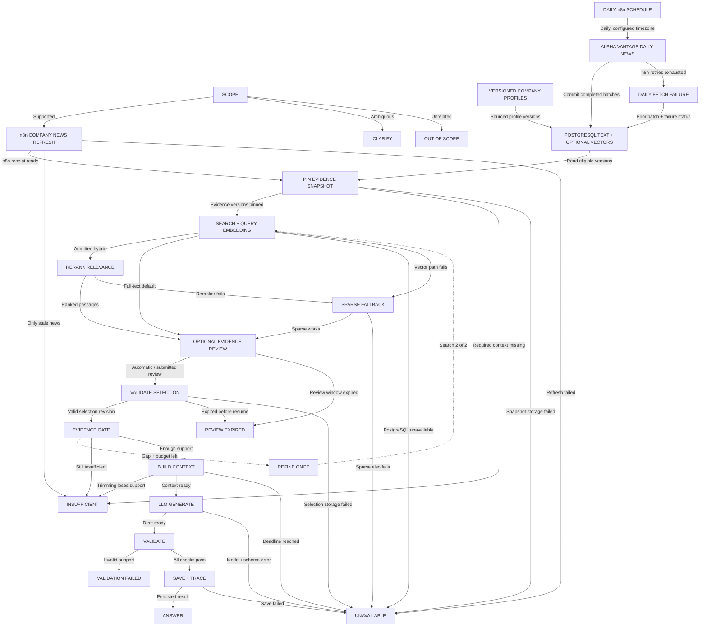

- **scope → refresh** — Supported / 範圍符合
  Call refresh_company_news through n8n MCP once per accepted prompt. n8n owns provider timeouts and bounded transient retries, validates and deduplicates records, then commits the evidence before returning a structured receipt. A host timeout reconciles the original execution. Daily global-news batches are acquired separately.
  每有效提示經 n8n MCP 邏輯呼叫 refresh_company_news 一次。n8n 控制供應商超時及有限暫時錯誤重試，驗證去重並提交證據後回傳結構化紀錄。Host 超時先核對原執行；每日全球新聞獨立抓取。

- **scope → clarify** — Ambiguous / 不明確
  Ask which supported company or horizon the user means. A clarified submission starts a new validated request.
  問清楚支援公司或研究期間；澄清後提交為新的已驗證請求。

- **scope → irrelevant** — Unrelated / 不相關
  Explain that the app researches supported companies and provide an example. No news, retrieval or report-generation calls.
  交代 app 研究支援公司並給問題例子；不呼叫新聞、檢索或報告生成。

- **refresh → snapshot** — n8n receipt ready / n8n 紀錄就緒
  Pin company news together with eligible completed macro/geopolitical batches and the sourced company-profile version. Preserve publication and first-seen cutoffs. For current research, freeze the evidence cutoff after refresh; an explicit historical cutoff remains fixed. Background ingestion continues independently. Refinement and resume reuse this manifest.
  將公司新聞、合資格完整宏觀／地緣批次及附來源公司背景版本固定成清單。檢查發布與首次取得截止；當前研究刷新後固定截止，指定歷史截止則保持原值。背景匯入獨立繼續；補查及恢復沿用此清單。

- **snapshot → retrieve** — Evidence versions pinned / 證據版本已固定
  Start with PostgreSQL full-text search. After hybrid admission, embed the query with the pinned model and frozen vector-readiness view, apply the same snapshot/company/time/permission filters to pgvector and full-text, and fuse the results by rank.
  預設使用 PostgreSQL 全文搜尋。混合准入後，以快照固定模型及向量就緒視圖轉換查詢，用相同快照／公司／時間／權限條件搜尋 pgvector 及全文，再按名次融合。

- **snapshot → insufficient** — Required context missing / 缺少所需背景
  Explain exactly what evidence is missing. Show supported facts and a useful next question; do not generate a forecast from the model’s memory.
  說明缺少哪項證據，展示有支持事實及有用下一題；不能靠模型記憶補預測。

- **snapshot → unavailable** — Snapshot storage failed / 快照儲存失敗
  Show the actual operational failure and safe retry option. Do not reset budgets on resume or claim that no relevant news exists.
  展示實際運作失敗及安全重試選項；恢復不能重設預算，亦不能聲稱沒有相關新聞。

- **refresh → insufficient** — Only stale news / 只有過期新聞
  Explain exactly what evidence is missing. Show supported facts and a useful next question; do not generate a forecast from the model’s memory.
  說明缺少哪項證據，展示有支持事實及有用下一題；不能靠模型記憶補預測。

- **refresh → unavailable** — Refresh failed / 刷新失敗
  Show the actual operational failure and safe retry option. Do not reset budgets on resume or claim that no relevant news exists.
  展示實際運作失敗及安全重試選項；恢復不能重設預算，亦不能聲稱沒有相關新聞。

- **retrieve → rerank** — Admitted hybrid / 已准入混合
  Score how well each passage addresses the question. Company news, macro, geopolitics and dated profile excerpts compete on relevance. Use question expansion from sourced company exposure where needed. Business-impact reasoning comes later in the LLM step; the relevance score does not estimate a stock return.
  評分每段原文與問題相關性；公司、宏觀、地緣及有日期背景按相關性排序。需要時按附來源公司曝險擴展查詢。業務影響推論由後面的 LLM 處理；相關分數不估計股票回報。

- **retrieve → review** — Full-text default / 預設全文搜尋
  All ranking paths enter here. Automatic mode keeps system recommendations. Review mode pauses with interrupt() after completed retrieval. Show original excerpts, dates, source links, relevance and counter-evidence. Show system rank beside your preferred order. Highlight, exclude, move up/down or reset locally, then submit once per search round. No source is deleted.
  所有排序路徑都經此處。自動模式沿用系統建議；覆核模式在已完成檢索後用 interrupt() 暫停。展示原文、日期、來源、相關性及反方證據；並列系統排名及你的次序，可標記、排除、上下移動或本機重設，每輪搜尋提交一次，不刪來源。

- **retrieve → unavailable** — PostgreSQL unavailable / PostgreSQL 中斷
  Show the actual operational failure and safe retry option. Do not reset budgets on resume or claim that no relevant news exists.
  展示實際運作失敗及安全重試選項；恢復不能重設預算，亦不能聲稱沒有相關新聞。

- **retrieve → fallback** — Vector path fails / 向量路徑失敗
  Use working PostgreSQL full-text search within the saved active budget. A PostgreSQL outage affects both paths and returns unavailable. If sparse also fails, stop as unavailable; never present a tool outage as zero search hits.
  剩餘處理預算內使用可用 PostgreSQL 全文；資料庫中斷會令兩路徑皆失效，回 unavailable；兩者皆失敗則回服務不可用，不能將工具中斷當零搜尋結果。

- **rerank → review** — Ranked passages / 已排序原文
  All ranking paths enter here. Automatic mode keeps system recommendations. Review mode pauses with interrupt() after completed retrieval. Show original excerpts, dates, source links, relevance and counter-evidence. Show system rank beside your preferred order. Highlight, exclude, move up/down or reset locally, then submit once per search round. No source is deleted.
  所有排序路徑都經此處。自動模式沿用系統建議；覆核模式在已完成檢索後用 interrupt() 暫停。展示原文、日期、來源、相關性及反方證據；並列系統排名及你的次序，可標記、排除、上下移動或本機重設，每輪搜尋提交一次，不刪來源。

- **rerank → fallback** — Reranker fails / 重排失敗
  Use working PostgreSQL full-text search within the saved active budget. A PostgreSQL outage affects both paths and returns unavailable. If sparse also fails, stop as unavailable; never present a tool outage as zero search hits.
  剩餘處理預算內使用可用 PostgreSQL 全文；資料庫中斷會令兩路徑皆失效，回 unavailable；兩者皆失敗則回服務不可用，不能將工具中斷當零搜尋結果。

- **fallback → review** — Sparse works / Sparse 可用
  All ranking paths enter here. Automatic mode keeps system recommendations. Review mode pauses with interrupt() after completed retrieval. Show original excerpts, dates, source links, relevance and counter-evidence. Show system rank beside your preferred order. Highlight, exclude, move up/down or reset locally, then submit once per search round. No source is deleted.
  所有排序路徑都經此處。自動模式沿用系統建議；覆核模式在已完成檢索後用 interrupt() 暫停。展示原文、日期、來源、相關性及反方證據；並列系統排名及你的次序，可標記、排除、上下移動或本機重設，每輪搜尋提交一次，不刪來源。

- **fallback → unavailable** — Sparse also fails / Sparse 亦失敗
  Show the actual operational failure and safe retry option. Do not reset budgets on resume or claim that no relevant news exists.
  展示實際運作失敗及安全重試選項；恢復不能重設預算，亦不能聲稱沒有相關新聞。

- **review → selection** — Automatic / submitted review / 自動／已提交覆核
  The API authenticates the owner and atomically validates run, thread, snapshot, candidate revision, IDs, permissions and expiry before resume. Require highlights to be selected, exclusions disjoint, and user order an exact duplicate-free permutation of selected IDs. Reject invalid or stale submissions without advancing the graph. Highlights prioritize supported discussion, never truth or confidence. Keep excluded counter-evidence visible as a selection limitation.
  API 在恢復前驗證擁有者，並以原子操作核對任務、thread、快照、候選版本、ID、權限及期限。標記須屬已選，排除不可重疊，用戶次序須完整不重複排列已選 ID；無效或舊版本不推進 graph；標記只優先討論有支持內容，不提升真實性或信心。被排除的反方證據仍顯示為選取限制。

- **review → review_expired** — Review window expired / 覆核期已過
  The proposed 15-minute review window starts at the first pause and is not extended by edits or refinement. Preserve the checkpoint for audit; require a new request and fresh evidence to continue.
  建議 15 分鐘覆核期從首次暫停起計，編輯或補查不延長。保留 checkpoint 供核對；繼續須新請求及新證據。

- **selection → gate** — Valid selection revision / 選取版本有效
  Recheck relevance, freshness, attribution and coverage after exclusions. Highlighting cannot waive missing support. Preserve opposing evidence and disclose selection limitations. Excluded counter-evidence must limit the affected conclusion; do not imply consensus. If a required facet is lost, refine once within budget or return insufficient; recheck again after context trimming.
  排除後重查相關性、新鮮度、來源及覆蓋；標記不能免除所需支持。保留反方證據及選取限制；缺少必要面向時預算內補查一次，否則回證據不足，context 裁剪後再次核對。

- **selection → review_expired** — Expired before resume / 恢復前已過期
  The proposed 15-minute review window starts at the first pause and is not extended by edits or refinement. Preserve the checkpoint for audit; require a new request and fresh evidence to continue.
  建議 15 分鐘覆核期從首次暫停起計，編輯或補查不延長。保留 checkpoint 供核對；繼續須新請求及新證據。

- **selection → unavailable** — Selection storage failed / 選取儲存失敗
  Show the actual operational failure and safe retry option. Do not reset budgets on resume or claim that no relevant news exists.
  展示實際運作失敗及安全重試選項；恢復不能重設預算，亦不能聲稱沒有相關新聞。

- **gate → refine** — Gap + budget left / 有缺口＋餘額
  Target the missing facet without changing the company or question. Retrieval increments attempts, including failed attempts; allow only two search rounds total.
  針對缺少面向補查，不改公司或原問題；檢索次數包含失敗嘗試，總共只准兩輪。

- **refine → retrieve** — Search 2 of 2 / 第 2／2 次搜尋
  Start with PostgreSQL full-text search. After hybrid admission, embed the query with the pinned model and frozen vector-readiness view, apply the same snapshot/company/time/permission filters to pgvector and full-text, and fuse the results by rank.
  預設使用 PostgreSQL 全文搜尋。混合准入後，以快照固定模型及向量就緒視圖轉換查詢，用相同快照／公司／時間／權限條件搜尋 pgvector 及全文，再按名次融合。

- **gate → insufficient** — Still insufficient / 仍不足
  Explain exactly what evidence is missing. Show supported facts and a useful next question; do not generate a forecast from the model’s memory.
  說明缺少哪項證據，展示有支持事實及有用下一題；不能靠模型記憶補預測。

- **gate → context** — Enough support / 支持足夠
  Fetch original excerpts, deduplicate by story, preserve dates/IDs and counter-evidence. Carry user discussion order separately from model ranks; it cannot override coverage. Reserve tokens for policy, question and output. Recheck coverage after trimming; if a required facet was removed, return insufficient.
  讀原文、按新聞去重、保留日期／ID 及反方證據；用戶討論次序與模型排名分開，不能推翻覆蓋；預留規則、問題及輸出 token。裁剪後重查覆蓋，若刪掉必要面向就回證據不足。

- **context → insufficient** — Trimming loses support / 裁剪後支持不足
  Explain exactly what evidence is missing. Show supported facts and a useful next question; do not generate a forecast from the model’s memory.
  說明缺少哪項證據，展示有支持事實及有用下一題；不能靠模型記憶補預測。

- **context → generate** — Context ready / 上下文就緒
  Supply excerpts as untrusted data, never as system messages. Require a direct answer, facts, conditional scenarios, assumptions and invalidation signals. Provider/schema failure is an error, not a prediction.
  節錄只作不可信資料，不放 system 訊息；要求直接答案、事實、條件式情境、假設及失效訊號。供應商／格式失敗是錯誤，不是預測。

- **context → unavailable** — Deadline reached / 到達時限
  Show the actual operational failure and safe retry option. Do not reset budgets on resume or claim that no relevant news exists.
  展示實際運作失敗及安全重試選項；恢復不能重設預算，亦不能聲稱沒有相關新聞。

- **generate → validate** — Draft ready / 草稿就緒
  Check schema, citation membership, company/time and claim support. No guessed URLs or unsupported factual claims. Invalid output is withheld rather than sent to the reader.
  核對 schema、引用集合、公司／時間及主張支持；不猜 URL 或輸出無根據事實；無效草稿不發布。

- **generate → unavailable** — Model / schema error / 模型／格式錯誤
  Show the actual operational failure and safe retry option. Do not reset budgets on resume or claim that no relevant news exists.
  展示實際運作失敗及安全重試選項；恢復不能重設預算，亦不能聲稱沒有相關新聞。

- **validate → blocked** — Invalid support / 支持無效
  Record why release was blocked. This bounded design does not add an unbudgeted repair loop.
  記錄阻擋發布原因；此有上限設計不新增無預算修正迴圈。

- **validate → save** — All checks pass / 檢查通過
  Commit the exact answer and source links in a PostgreSQL transaction. Flush sanitized traces to Langfuse/LangSmith; telemetry failure leaves the answer available but fails the observable-demo gate. Feedback is stored separately.
  以 PostgreSQL transaction 保存完整答案及引用；清理 traces 後送 Langfuse／LangSmith。追蹤失敗保留答案但 demo 驗收不通過；回饋另存。

- **save → answer** — Persisted result / 已保存結果
  Return the question-specific answer, uncertainty, sources, dates and trace status. Download reuses this saved result.
  回傳針對問題答案、不確定性、來源、日期及 trace 狀態；下載重用此結果。

- **save → unavailable** — Save failed / 保存失敗
  Show the actual operational failure and safe retry option. Do not reset budgets on resume or claim that no relevant news exists.
  展示實際運作失敗及安全重試選項；恢復不能重設預算，亦不能聲稱沒有相關新聞。

- **daily → global_news** — Daily, configured timezone / 每日，已設定時區
  Configure daily time and timezone in n8n. Acquisition runs independently of user prompts.
  n8n 設定每日時間及時區，抓取獨立於用戶問題。

- **global_news → evidence_pool** — Commit completed batches / 提交完整批次
  Fetch separate Alpha Vantage macro/fiscal queries and broad geopolitical candidates with n8n-owned bounded retries. Post-fetch geopolitical tagging has coverage limits; preserve provenance, dates and permissions.
  n8n 有限重試分開抓 Alpha Vantage 宏觀／財政及廣泛地緣候選；抓取後標記地緣，附覆蓋限制及來源、日期、權限。

- **global_news → daily_failure** — n8n retries exhausted / n8n 重試已用完
  n8n records exhausted/permanent failure. Retain the previous completed batch and its original fetched_at. Coverage checks decide whether its age is acceptable for this question.
  n8n 記錄重試用完／永久失敗；保留上一完整批次及原 fetched_at，再按問題檢查其時效是否足夠。

- **daily_failure → evidence_pool** — Prior batch + failure status / 舊批次＋失敗狀態
  n8n records exhausted/permanent failure. Retain the previous completed batch and its original fetched_at. Coverage checks decide whether its age is acceptable for this question.
  n8n 記錄重試用完／永久失敗；保留上一完整批次及原 fetched_at，再按問題檢查其時效是否足夠。

- **profiles → evidence_pool** — Sourced profile versions / 附來源背景版本
  MSFT / AAPL / NVDA profiles have sourced facts, reporting periods, effective dates and review dates. Update after material changes.
  MSFT／AAPL／NVDA 背景附來源、報告期間、生效及覆核日期；重大變化後更新。

- **evidence_pool → snapshot** — Read eligible versions / 讀取合資格版本
  Store committed daily/profile versions and full-text indexes. A separate chunk/hash → document embedding worker → pgvector job prepares optional vectors. Pin eligible evidence without waiting for vectors or the next daily schedule.
  存完整每日／背景版本及全文索引；獨立切段／hash → 文件 embedding worker → pgvector 建可選向量。固定證據毋須等向量或下次排程。

## Choose a supported company / 選擇支援公司

[English SVG](../public/downloads/finance-diagrams/company-en.svg) · [繁體中文 SVG](../public/downloads/finance-diagrams/company-zh.svg)

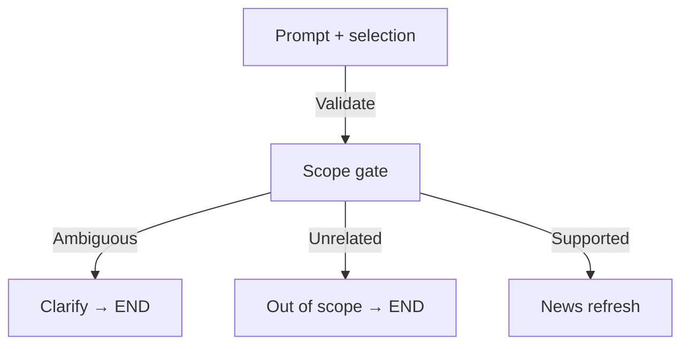

- **Prompt + selection → Scope gate** — Validate / 驗證
  Validate company, horizon and question intent. Handoff: Original question + canonical company + horizon
  驗證公司、期間及問題意圖。 交接資料：原問題＋標準公司＋期間

- **Scope gate → Clarify → END** — Ambiguous / 不明確
  Company or intent is ambiguous. Handoff: One clarification question; no news/retrieval calls
  公司或意圖不明確。 交接資料：一個澄清問題；不呼叫新聞或檢索

- **Scope gate → Out of scope → END** — Unrelated / 不相關
  Clearly unrelated or unsupported company. Handoff: Explain scope and show a supported example prompt
  明顯無關或公司未支援。 交接資料：交代範圍並提供支援問題例子

- **Scope gate → News refresh** — Supported / 範圍符合
  Supported company research question. Handoff: Validated ResearchRequest; unknown coverage may be refreshed
  支援公司研究問題。 交接資料：已驗證 ResearchRequest；未知覆蓋可刷新

## Refresh news through n8n MCP for every prompt / 每題經 n8n MCP 刷新新聞

[English SVG](../public/downloads/finance-diagrams/sources-en.svg) · [繁體中文 SVG](../public/downloads/finance-diagrams/sources-zh.svg)

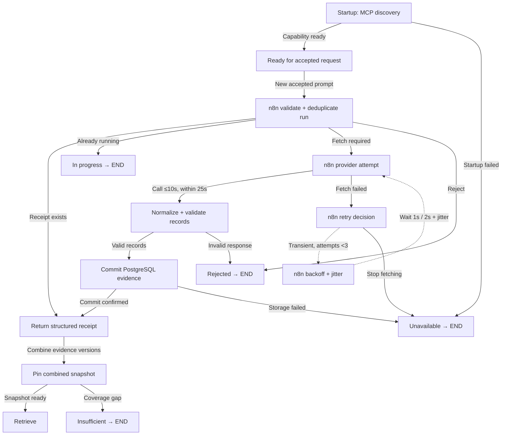

- **Startup: MCP discovery → Ready for accepted request** — Capability ready / 功能就緒
  Connect to n8n over Streamable HTTP, list tools and validate the refresh schema. Compile with PostgreSQL checkpoints. Handoff: Verified tool capability; startup performs no news acquisition
  以 Streamable HTTP 連接 n8n、列出及核對工具 schema，再以 PostgreSQL checkpoint 編譯。 交接資料：已核對工具功能；啟動階段不抓新聞

- **Startup: MCP discovery → Unavailable → END** — Startup failed / 啟動失敗
  Required tool or authenticated endpoint is unavailable. Handoff: Readiness diagnostic
  所需工具或已認證端點不可用。 交接資料：就緒診斷

- **Ready for accepted request → n8n validate + deduplicate run** — New accepted prompt / 新有效提示
  The host sends one logical refresh after scope acceptance. Handoff: company + original question + run_id + deadline
  Host 通過範圍檢查後發出一次邏輯刷新。 交接資料：公司＋原問題＋任務 ID＋時限

- **n8n validate + deduplicate run → Return structured receipt** — Receipt exists / 已有紀錄
  This run already committed its evidence. Handoff: Existing receipt; resume reuses completed work
  此任務已提交證據。 交接資料：原紀錄；恢復重用已完成工作

- **n8n validate + deduplicate run → In progress → END** — Already running / 已在執行
  An atomic run claim already belongs to a running execution; do not start another provider call. Handoff: Existing execution ID and pending status for reconciliation
  原子任務鍵已屬執行中的工作，不另開供應商呼叫。 交接資料：原執行 ID 及待完成狀態供核對

- **n8n validate + deduplicate run → n8n provider attempt** — Fetch required / 需要抓取
  Valid new acquisition, atomic run lease claimed, matching request fingerprint and time remaining. Handoff: Allowlisted source and bounded timeout
  有效新抓取、已原子取得任務 lease、請求指紋相符且仍有時間。 交接資料：核准來源及有限 timeout

- **n8n validate + deduplicate run → Rejected → END** — Reject / 拒絕
  Invalid arguments, unsupported company or failed authorization. Handoff: Typed non-retryable error
  參數無效、公司未支援或授權失敗。 交接資料：不重試結構化錯誤

- **n8n provider attempt → Normalize + validate records** — Call ≤10s, within 25s / 每次≤10秒，階段25秒
  Successful response, including a valid empty response. Cap each call at 10s and clip it to the remaining 25s acquisition phase and run deadline. Handoff: Raw records and provider status
  成功回應，包括有效空結果；每次最多 10 秒，受餘下 25 秒抓取階段及任務時限限制。 交接資料：原記錄及供應商狀態

- **n8n provider attempt → n8n retry decision** — Fetch failed / 抓取失敗
  Provider request failed. Handoff: Error class + attempt count + remaining time
  供應商請求失敗。 交接資料：錯誤分類＋次數＋剩餘時間

- **n8n retry decision → n8n backoff + jitter** — Transient, attempts <3 / 暫時錯誤，次數<3
  Transient error, fewer than 3 attempts and enough time for another attempt. Respect Retry-After. Handoff: Wait 1s then 2s plus jitter; clip to job deadline
  暫時錯誤、少於 3 次且仍有時間再試；遵守 Retry-After。 交接資料：等待 1 秒、2 秒加 jitter；受工作時限限制

- **n8n backoff + jitter → n8n provider attempt** — Wait 1s / 2s + jitter / 等待1／2秒＋jitter
  The bounded wait completes before the original deadline. Handoff: Same run_id; incremented attempt count
  有限等待在原時限內完成。 交接資料：相同 run_id；增加次數

- **n8n retry decision → Unavailable → END** — Stop fetching / 停止抓取
  Permanent failure, exhausted attempts or insufficient remaining time. Handoff: Provider unavailable; host does not blindly retry MCP
  永久失敗、次數用完或餘下時間不足。 交接資料：供應商不可用；Host 不盲目重試 MCP

- **Normalize + validate records → Commit PostgreSQL evidence** — Valid records / 有效記錄
  Validate source identity, dates and permissions; deduplicate syndicated stories and chunk permitted text. Handoff: Versioned company-news records + coverage status
  核對身份、日期及權限，轉載去重並切分允許原文。 交接資料：有版本公司新聞＋覆蓋狀態

- **Normalize + validate records → Rejected → END** — Invalid response / 回應無效
  Provider payload is malformed or violates the evidence contract. Handoff: Typed validation error
  供應商內容格式或證據合約無效。 交接資料：結構化驗證錯誤

- **Commit PostgreSQL evidence → Return structured receipt** — Commit confirmed / 提交確認
  Evidence and receipt are durably committed with an idempotency key. Handoff: company_news_version_ids + fetched_at + status + execution_id
  證據及紀錄用冪等鍵持久提交。 交接資料：公司新聞版本＋擷取時間＋狀態＋執行 ID

- **Commit PostgreSQL evidence → Unavailable → END** — Storage failed / 儲存失敗
  Storage failed or commit outcome needs reconciliation. Handoff: Storage error; no successful receipt claimed
  儲存失敗或須核對提交結果。 交接資料：儲存錯誤；不聲稱成功

- **Return structured receipt → Pin combined snapshot** — Combine evidence versions / 組合證據版本
  Host validates the receipt and reads eligible completed daily batches and the company-profile version. Handoff: Company + macro + geopolitical + profile version manifest
  Host 驗證紀錄，讀取合資格完整每日批次及公司背景版本。 交接資料：公司＋宏觀＋地緣＋背景版本清單

- **Pin combined snapshot → Retrieve** — Snapshot ready / 快照就緒
  Required coverage is available under the fixed cutoff and current permissions. Handoff: snapshot_id + version IDs + per-stream freshness
  固定截止及當前權限下所需覆蓋足夠。 交接資料：snapshot_id＋版本 ID＋各來源新鮮度

- **Pin combined snapshot → Insufficient → END** — Coverage gap / 覆蓋不足
  The question requires missing or stale evidence. Handoff: Coverage gap and dated supported facts
  問題所需證據缺少或過期。 交接資料：覆蓋缺口及有日期支持事實

## Retrieve, fuse and rerank evidence / 檢索、融合及重排證據

[English SVG](../public/downloads/finance-diagrams/retrieval-en.svg) · [繁體中文 SVG](../public/downloads/finance-diagrams/retrieval-zh.svg)

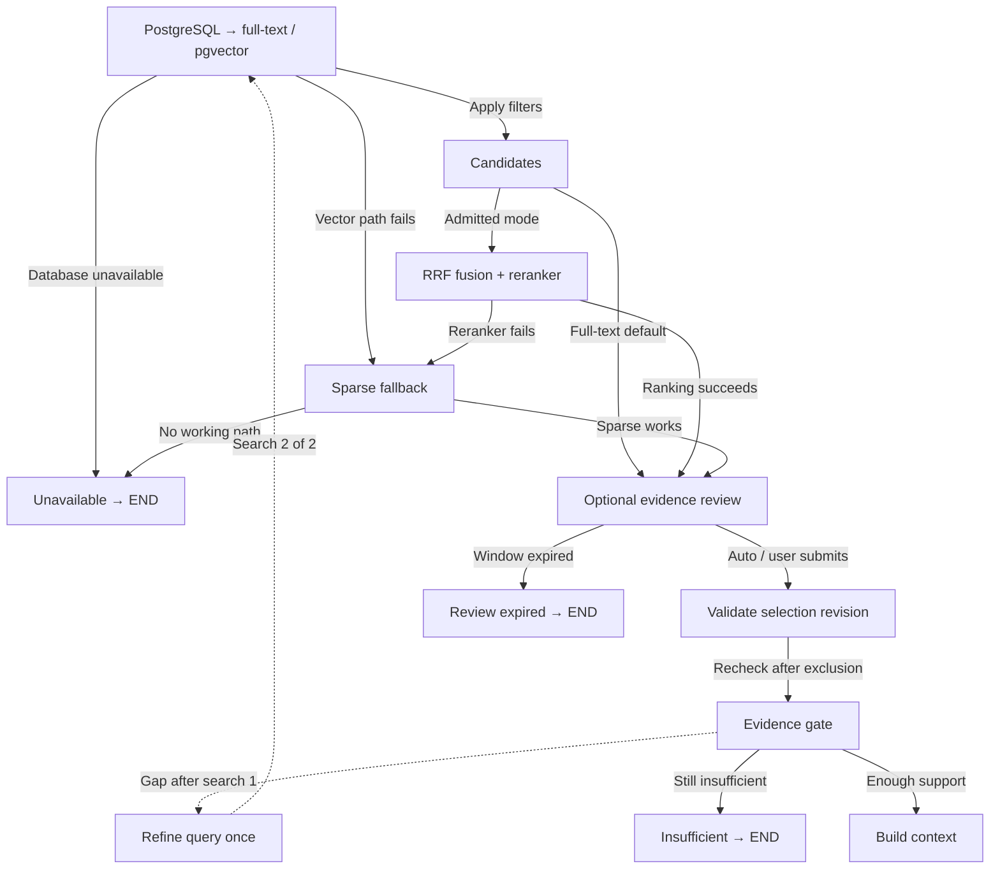

- **PostgreSQL → full-text / pgvector → Unavailable → END** — Database unavailable / 資料庫不可用
  The shared PostgreSQL service is unavailable; neither retrieval path can run. Handoff: Database failure; preserve the original deadline and counters
  共用 PostgreSQL 服務中斷，兩條檢索路徑均不可用。 交接資料：資料庫故障；保留原時限及計數

- **PostgreSQL → full-text / pgvector → Candidates** — Apply filters / 套用篩選
  Company, permissions and both timestamps pass. Handoff: 20 candidates per branch: chunk IDs + passages + original ranks
  公司、權限及兩個時間戳符合。 交接資料：每分支 20 候選：切段 ID＋原文＋初始排序

- **Candidates → Optional evidence review** — Full-text default / 預設全文搜尋
  Use the default full-text ranking while hybrid is blocked. Handoff: Ranked passages + sparse mode
  混合檢索未獲准入時採用預設全文排序。 交接資料：已排序原文＋sparse 模式

- **Candidates → RRF fusion + reranker** — Admitted mode / 已准入模式
  Use hybrid after it passes admission. Handoff: Deduplicated top 20 → cross-encoder top 10
  混合檢索通過准入後採用。 交接資料：去重前 20 → cross-encoder 前 10

- **RRF fusion + reranker → Optional evidence review** — Ranking succeeds / 排序成功
  Ranking succeeds using the admitted mode. Handoff: Ranked passages and actual mode
  使用已准入模式成功排序。 交接資料：已排序原文及實際模式

- **PostgreSQL → full-text / pgvector → Sparse fallback** — Vector path fails / 向量路徑失敗
  Vector retrieval fails but PostgreSQL full-text search remains available. Handoff: Same snapshot and deadline
  向量檢索失敗，但 PostgreSQL 全文搜尋仍可用。 交接資料：相同快照及時限

- **RRF fusion + reranker → Sparse fallback** — Reranker fails / 重排失敗
  Reranker fails while a working sparse path remains within the deadline. Handoff: Original question and snapshot; no fabricated scores
  重排失敗，但時限內 sparse 仍可用。 交接資料：原問題及快照；不捏造分數

- **Sparse fallback → Optional evidence review** — Sparse works / Sparse 可用
  Use the working sparse result within the original budget. Handoff: Passages + fallback_reason
  原預算內使用可用 sparse 結果。 交接資料：原文＋回退原因

- **Optional evidence review → Validate selection revision** — Auto / user submits / 自動／用戶提交
  Automatic mode uses system recommendations; review mode shows original ranks and proposed news, then pauses for highlights, exclusions or user discussion order. Handoff: Same snapshot; ID-only selection; saved remaining budget
  自動用系統建議；覆核展示原排名及建議新聞，可標記、排除或改討論次序。 交接資料：相同快照；只傳 ID 選取；保存剩餘預算

- **Optional evidence review → Review expired → END** — Window expired / 期限已過
  The absolute 15-minute window from the first pause has expired. Handoff: Preserved checkpoint; new request required
  首次暫停起 15 分鐘絕對期限已過。 交接資料：保留 checkpoint；須新請求

- **Validate selection revision → Evidence gate** — Recheck after exclusion / 排除後重查
  Owner, run, thread, snapshot, revision, permitted IDs and expiry pass API and graph checks. Handoff: Selected/highlighted/excluded IDs + system rank + validated user order; no changed truth scores
  API 及 graph 核對擁有者、任務、thread、快照、版本、可用 ID 及期限。 交接資料：已選／標記／排除 ID＋系統排名＋已核對用戶次序；不改真實分數

- **Sparse fallback → Unavailable → END** — No working path / 沒有可用路徑
  Sparse also fails or the deadline expires. Handoff: Dependency error, not an empty evidence claim
  Sparse 亦失敗或已超時。 交接資料：依賴錯誤，不聲稱沒有證據

- **Evidence gate → Refine query once** — Gap after search 1 / 首次搜尋有缺口
  First search lacks coverage and the original budget remains. Handoff: Missing facets; preserve company, cutoff and snapshot
  首次搜尋覆蓋不足，原預算仍有餘額。 交接資料：缺失面向；保留公司、截止及快照

- **Refine query once → PostgreSQL → full-text / pgvector** — Search 2 of 2 / 第 2／2 次搜尋
  Search again with a narrower query; at most two searches total, including failed attempts. Handoff: Same snapshot, new query, retained search counter
  收窄查詢再搜尋；包含失敗嘗試總共最多兩次。 交接資料：相同快照、新查詢、保留搜尋計數

- **Evidence gate → Insufficient → END** — Still insufficient / 仍不足
  The second search still lacks support, or no refinement budget remains. Handoff: Missing facets; no forecast
  第二次搜尋仍不足，或沒有補查預算。 交接資料：缺失面向；不作預測

- **Evidence gate → Build context** — Enough support / 支持足夠
  Relevant, current passages cover the question. Handoff: At most 6 excerpts, stable citation IDs and provenance
  相關且當前原文足以覆蓋問題。 交接資料：最多 6 節錄、穩定引用 ID 及來源記錄

## Run one bounded research agent / 運行一個有上限的研究 agent

[English SVG](../public/downloads/finance-diagrams/research-en.svg) · [繁體中文 SVG](../public/downloads/finance-diagrams/research-zh.svg)

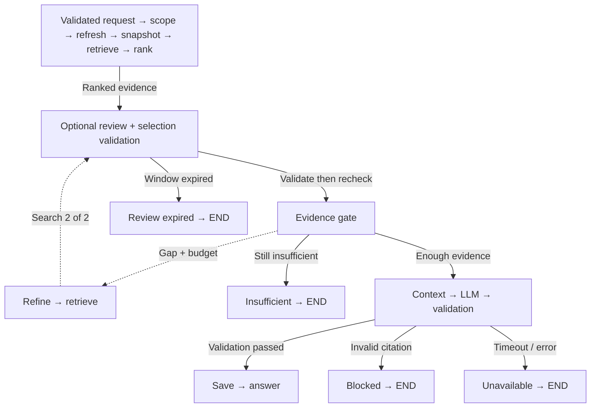

- **Validated request → scope → refresh → snapshot → retrieve → rank → Optional review + selection validation** — Ranked evidence / 已排序證據
  Code owns mandatory ordering and budgets. Sparse default also enters review. Handoff: Ranked candidates, fixed snapshot, review mode and candidate revision
  程式控制必需次序及預算；預設 sparse 亦經覆核。 交接資料：已排序候選、固定快照、覆核模式及候選版本

- **Optional review + selection validation → Evidence gate** — Validate then recheck / 驗證後重查
  Automatic selection or authenticated resume passes validation within the review window. Handoff: Selection revision, exclusions, highlights and remaining budgets
  自動選取或已驗證恢復在覆核期內通過核對。 交接資料：選取版本、排除、標記及剩餘預算

- **Optional review + selection validation → Review expired → END** — Window expired / 期限已過
  The review window is over; do not generate from this paused run. Handoff: Expired status and saved checkpoint
  覆核期已過，不能用暫停任務生成。 交接資料：過期狀態及已存 checkpoint

- **Evidence gate → Refine → retrieve** — Gap + budget / 缺口＋有預算
  First attempt only, and budget remains. Handoff: Refined query; same original question and snapshot
  只限首次嘗試，而且仍有預算。 交接資料：修正查詢；相同原問題及快照

- **Refine → retrieve → Optional review + selection validation** — Search 2 of 2 / 第 2／2 次搜尋
  Recheck the second retrieval under the same snapshot; retain known choices and review new candidates within the original window. Handoff: Updated candidates; attempts = 2; no reset of exclusions or budgets
  同一快照重查第二輪；保留已知選擇，原期限內覆核新候選。 交接資料：更新候選；次數 = 2；不重設排除或預算

- **Evidence gate → Insufficient → END** — Still insufficient / 仍不足
  Second attempt fails to cover the question. Handoff: Supported facts + missing facets; no forecast
  第二次仍未覆蓋問題。 交接資料：有支持事實＋缺失面向；不作預測

- **Evidence gate → Context → LLM → validation** — Enough evidence / 證據足夠
  All required facets have support; conflicts are retained. Handoff: Prompt-specific draft with citations and conditional scenarios
  所有所需面向有支持，矛盾證據保留。 交接資料：針對提示的草稿、引用及條件式情境

- **Context → LLM → validation → Save → answer** — Validation passed / 驗證通過
  Validation passes within the budget. Handoff: Validated cited answer
  預算內通過驗證。 交接資料：已驗證引用答案

- **Context → LLM → validation → Blocked → END** — Invalid citation / 引用無效
  Citation or support validation fails. Handoff: Withheld draft and validation errors
  引用或支持驗證失敗。 交接資料：不發布草稿及驗證錯誤

- **Context → LLM → validation → Unavailable → END** — Timeout / error / 超時／錯誤
  Deadline, call limit or dependency failure. Handoff: Typed error + resumable checkpoint when safe
  超時、超額或依賴失敗。 交接資料：結構化錯誤＋安全時可恢復 checkpoint

## Answer the prompt with conditional forecasts / 以條件式預測回答提示

[English SVG](../public/downloads/finance-diagrams/report-en.svg) · [繁體中文 SVG](../public/downloads/finance-diagrams/report-zh.svg)

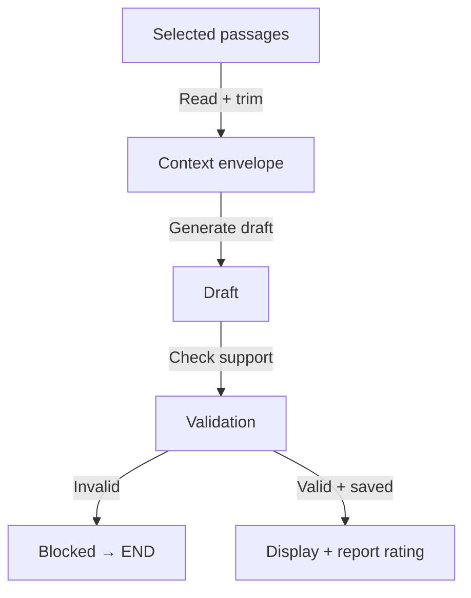

- **Selected passages → Context envelope** — Read + trim / 讀取＋裁剪
  Deduplicate, read original excerpts and enforce token budget. Handoff: Question, horizon, as_of, evidence[], missing_facets[], conflicts[]
  去重、讀原文並限制 token。 交接資料：問題、期間、截止、證據、缺失面向及矛盾

- **Context envelope → Draft** — Generate draft / 生成草稿
  System policy and user question stay separate from untrusted excerpts. Handoff: Direct answer + observed facts + conditional scenarios + citation IDs
  系統規則及使用者問題與不可信原文分開。 交接資料：直接答案＋觀察事實＋條件式情境＋引用 ID

- **Draft → Validation** — Check support / 核對支持
  Require claim support; a reranker score is not confidence. Handoff: Draft only; never stream an unvalidated recommendation
  要求主張支持；重排分數不是信心。 交接資料：只產生草稿；不串流未驗證建議

- **Validation → Blocked → END** — Invalid / 無效
  Unknown citation or unsupported factual claim. Handoff: Do not release draft
  未知引用或無支持事實。 交接資料：不發布草稿

- **Validation → Display + report rating** — Valid + saved / 有效＋已存
  Persist before exposing the final answer. Handoff: Report ID, trace URL/status; separate feedback linked to run_id
  先保存，再顯示最終答案。 交接資料：報告 ID、trace URL／狀態；回饋另存並連結 run_id

## Validate citations and tool boundaries / 驗證引用及工具邊界

[English SVG](../public/downloads/finance-diagrams/validation-en.svg) · [繁體中文 SVG](../public/downloads/finance-diagrams/validation-zh.svg)

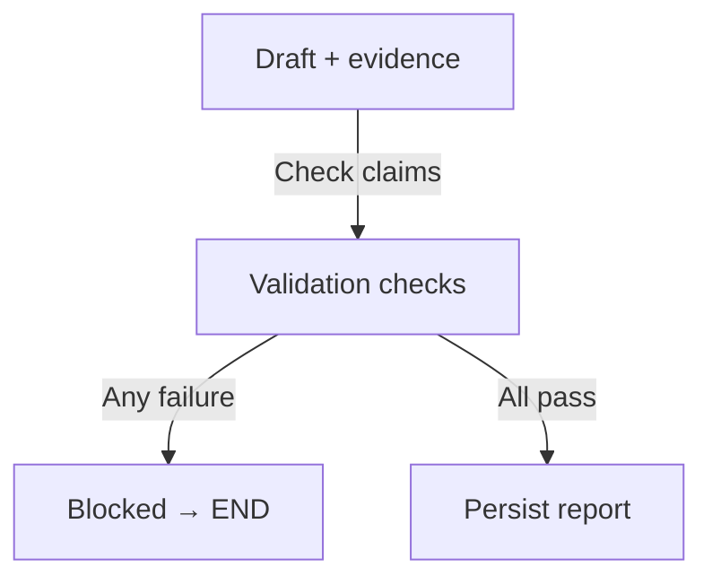

- **Draft + evidence → Validation checks** — Check claims / 核對主張
  Ignore embedded instructions; check IDs, dates, company, coverage and factual support. Handoff: Validation errors or a validated report
  忽略內嵌指令，檢查 ID、日期、公司、覆蓋及事實支持。 交接資料：驗證錯誤或已驗證報告

- **Validation checks → Blocked → END** — Any failure / 任一失敗
  A required validation fails. Handoff: validation_failed; no draft publication
  必要驗證失敗。 交接資料：validation_failed；不發布草稿

- **Validation checks → Persist report** — All pass / 全部通過
  Every material factual claim has excerpt support. Handoff: Validated result and source references
  所有重要事實主張有原文支持。 交接資料：已驗證結果及來源引用

## Save and download the report / 保存及下載報告

[English SVG](../public/downloads/finance-diagrams/export-en.svg) · [繁體中文 SVG](../public/downloads/finance-diagrams/export-zh.svg)

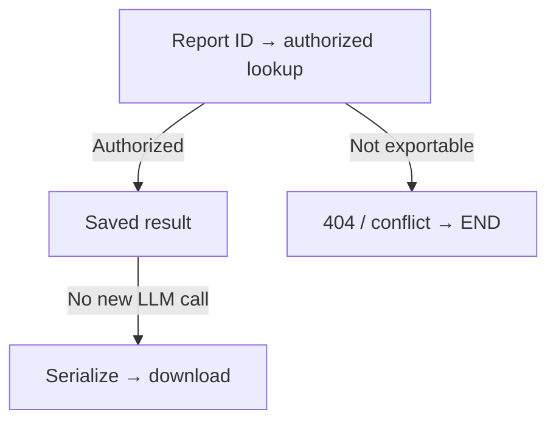

- **Report ID → authorized lookup → Saved result** — Authorized / 有權限
  Caller owns the report; ID exists. Handoff: Saved question, answer, sources, dates, trace status
  呼叫者擁有報告且 ID 存在。 交接資料：已存問題、答案、來源、日期及 trace 狀態

- **Report ID → authorized lookup → 404 / conflict → END** — Not exportable / 不能匯出
  No exportable validated record exists. Handoff: Typed error; no regeneration
  沒有可下載的已驗證紀錄。 交接資料：結構化錯誤；不重新生成

- **Saved result → Serialize → download** — No new LLM call / 不再呼叫 LLM
  Include insufficient status and fictional labels where applicable. Handoff: Markdown identical to displayed report; zero LLM calls
  適用時保留證據不足狀態及虛構標籤。 交接資料：與畫面相同 Markdown；零 LLM 呼叫

## Resume an interrupted research run / 恢復中斷研究任務

[English SVG](../public/downloads/finance-diagrams/recovery-en.svg) · [繁體中文 SVG](../public/downloads/finance-diagrams/recovery-zh.svg)

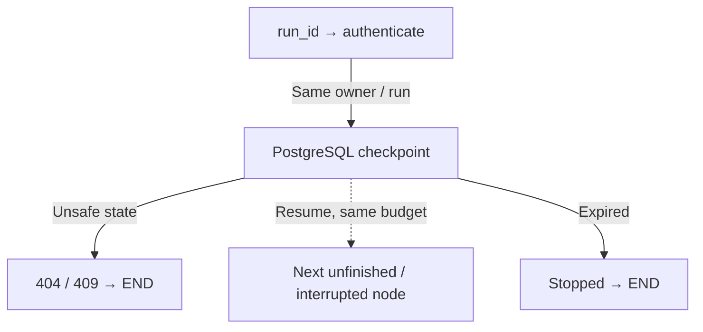

- **run_id → authenticate → PostgreSQL checkpoint** — Same owner / run / 相同擁有者／任務
  Resolve the same thread and original request. Handoff: Saved snapshot, completed node results, attempts and remaining budget
  解析相同 thread 及原請求。 交接資料：快照、已完成結果、次數及剩餘預算

- **PostgreSQL checkpoint → 404 / 409 → END** — Unsafe state / 狀態不安全
  Cannot safely resume the saved state. Handoff: Keep saved state; explain recovery failure
  無法安全恢復儲存狀態。 交接資料：保留狀態並交代恢復失敗

- **PostgreSQL checkpoint → Next unfinished / interrupted node** — Resume, same budget / 原預算恢復
  Active budget remains; review resumes also require a valid selection revision and unexpired review window. Interrupted nodes restart at their beginning; use idempotency keys for effects. Handoff: Same refresh receipt and search count; no budget reset
  仍有處理預算；覆核恢復另須有效選取版本及未過期覆核期。中斷節點從頭開始，副作用須用冪等鍵。 交接資料：相同刷新紀錄及搜尋次數；不重設預算

- **PostgreSQL checkpoint → Stopped → END** — Expired / 已過期
  A later fresh prompt requires a new run. Handoff: Supported partial findings and explicit expiry
  稍後新研究須建立新任務。 交接資料：有支持的部分發現及明確過期狀態

## Evaluate the agent before the interview / 面試前評估 agent

[English SVG](../public/downloads/finance-diagrams/evaluation-en.svg) · [繁體中文 SVG](../public/downloads/finance-diagrams/evaluation-zh.svg)

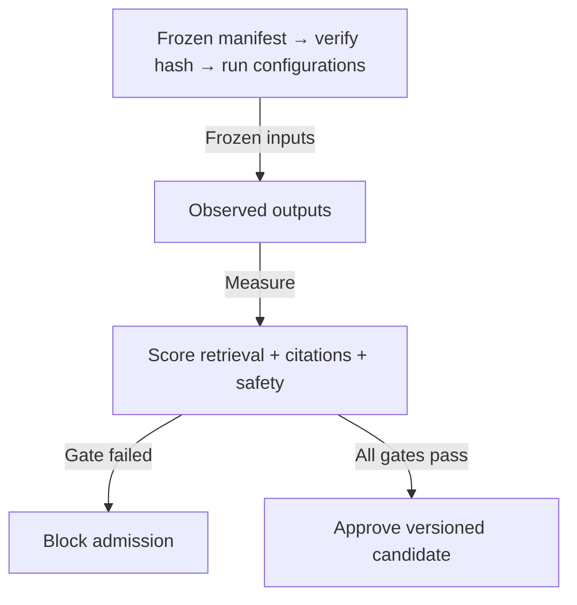

- **Frozen manifest → verify hash → run configurations → Observed outputs** — Frozen inputs / 凍結輸入
  Corpus, qrels and policy match the reviewed version. Handoff: Sparse, hybrid and reranked rankings on identical prompts
  語料、qrels 及政策符合已核對版本。 交接資料：相同提示的 sparse、混合及重排排序

- **Observed outputs → Score retrieval + citations + safety** — Measure / 量度
  Use actual outcomes and independently judged support. Handoff: recall/nDCG, citation precision, abstentions, injection outcomes
  使用實際結果及獨立支持度判斷。 交接資料：recall／nDCG、引用精準度、拒答及注入結果

- **Score retrieval + citations + safety → Block admission** — Gate failed / 未過門檻
  Synthetic-only, live checks missing or thresholds fail. Handoff: Sparse remains active; NOT RUN stays visible
  只有虛構測試、缺真實檢查或未達門檻。 交接資料：維持 sparse；明示 NOT RUN

- **Score retrieval + citations + safety → Approve versioned candidate** — All gates pass / 全部通過
  Real-news holdout, safety and tracing also pass. Handoff: Approved retrieval version + public report card
  真實新聞保留集、安全及追蹤亦通過。 交接資料：核准檢索版本＋公開成績表

## Trace each run in Langfuse and LangSmith / 在 Langfuse 及 LangSmith 追蹤每次任務

[English SVG](../public/downloads/finance-diagrams/observability-en.svg) · [繁體中文 SVG](../public/downloads/finance-diagrams/observability-zh.svg)

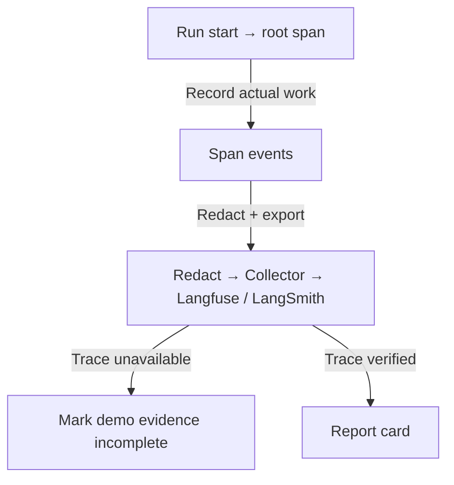

- **Run start → root span → Span events** — Record actual work / 記錄實際工作
  Propagate context into MCP and provider attempts. Handoff: trace_id, run_id, parent spans, errors and actual usage
  Context 傳入 MCP 及供應商嘗試。 交接資料：trace_id、run_id、父 spans、錯誤及實際用量

- **Span events → Redact → Collector → Langfuse / LangSmith** — Redact + export / 去敏感資料＋匯出
  Keep one instrumentation tree; do not double-count tokens. Handoff: Sanitized operational traces and experiment feedback
  保留一組 instrumentation；不重複計 token。 交接資料：清理後運行 traces 及實驗回饋

- **Redact → Collector → Langfuse / LangSmith → Mark demo evidence incomplete** — Trace unavailable / Trace 不可用
  Trace cannot be flushed or opened by a reviewer. Handoff: Preserved answer + unavailable trace status
  Trace 不能 flush 或審閱者無法開啟。 交接資料：保留答案＋trace 不可用狀態

- **Redact → Collector → Langfuse / LangSmith → Report card** — Trace verified / Trace 已核對
  At least 30 completed runs for latency percentiles. Handoff: One actual URL per demo; cohort p50/p95 with failures
  延遲百分位至少需要 30 次已完成任務。 交接資料：每 demo 一個實際 URL；樣本 p50／p95 及失敗數

## Package locally, then deploy privately / 本機包裝，再私人部署

[English SVG](../public/downloads/finance-diagrams/deployment-en.svg) · [繁體中文 SVG](../public/downloads/finance-diagrams/deployment-zh.svg)

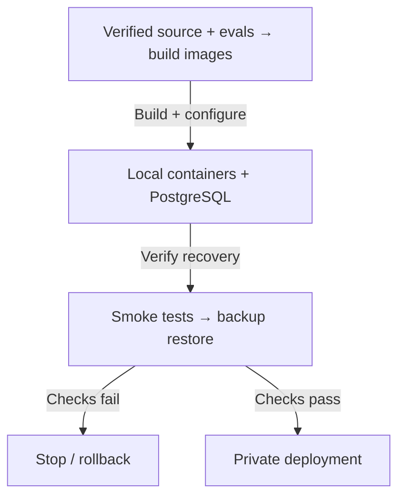

- **Verified source + evals → build images → Local containers + PostgreSQL** — Build + configure / 建置＋設定
  Configure private n8n, PostgreSQL and telemetry. Apply database and checkpoint migrations. Handoff: Versioned images and server-only configuration
  設定私人 n8n、PostgreSQL 及追蹤端點。執行資料庫及 checkpoint migrations。 交接資料：版本化映像及只供伺服器設定

- **Local containers + PostgreSQL → Smoke tests → backup restore** — Verify recovery / 驗證恢復
  Exercise normal, insufficient, irrelevant and outage paths. Handoff: Health, routing, persistence and recovery evidence
  測試正常、資料不足、無關及中斷路徑。 交接資料：健康、路由、持久性及恢復證據

- **Smoke tests → backup restore → Stop / rollback** — Checks fail / 檢查失敗
  Retain the last valid image and persistent data. Handoff: Failure reason and recovery action
  保留最後有效映像及持久資料。 交接資料：失敗原因及恢復動作

- **Smoke tests → backup restore → Private deployment** — Checks pass / 檢查通過
  Access control and backups verified. Handoff: Release ID + reproducible demo and trace URL
  已驗證訪問控制及備份。 交接資料：發布 ID＋可重現 demo 及 trace URL

## n8n daily Alpha Vantage news / n8n 每日 Alpha Vantage 新聞

[English SVG](../public/downloads/finance-diagrams/n8n_daily-en.svg) · [繁體中文 SVG](../public/downloads/finance-diagrams/n8n_daily-zh.svg)

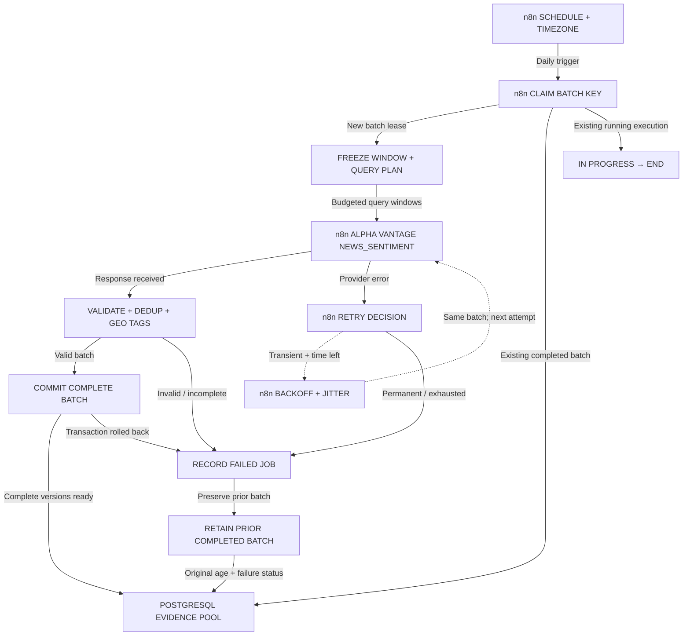

- **schedule → claim** — Daily trigger / 每日觸發
  Daily trigger
  每日觸發

- **claim → plan** — New batch lease / 新批次 lease
  New batch lease
  新批次 lease

- **plan → fetch** — Budgeted query windows / 有預算查詢視窗
  Budgeted query windows
  有預算查詢視窗

- **claim → pool** — Existing completed batch / 已有完整批次
  Existing completed batch
  已有完整批次

- **claim → pending** — Existing running execution / 已有執行中工作
  Existing running execution
  已有執行中工作

- **fetch → normalize** — Response received / 收到回應
  Response received
  收到回應

- **fetch → retry** — Provider error / 供應商錯誤
  Provider error
  供應商錯誤

- **retry → wait** — Transient + time left / 暫時錯誤＋有餘額
  Transient + time left
  暫時錯誤＋有餘額

- **wait → fetch** — Same batch; next attempt / 同批次下一嘗試
  Same batch; next attempt
  同批次下一嘗試

- **retry → failure** — Permanent / exhausted / 永久錯誤／用完
  Permanent / exhausted
  永久錯誤／用完

- **normalize → commit** — Valid batch / 批次有效
  Valid batch
  批次有效

- **normalize → failure** — Invalid / incomplete / 無效／未完整
  Invalid / incomplete
  無效／未完整

- **commit → pool** — Complete versions ready / 完整版本就緒
  Complete versions ready
  完整版本就緒

- **commit → failure** — Transaction rolled back / Transaction 已回滾
  Transaction rolled back
  Transaction 已回滾

- **failure → prior** — Preserve prior batch / 保留舊完整批次
  Preserve prior batch
  保留舊完整批次

- **prior → pool** — Original age + failure status / 原年齡＋失敗狀態
  Original age + failure status
  原年齡＋失敗狀態

## Where document and question embeddings happen / 文件及問題在哪一步 embedding

[English SVG](../public/downloads/finance-diagrams/embeddings-en.svg) · [繁體中文 SVG](../public/downloads/finance-diagrams/embeddings-zh.svg)

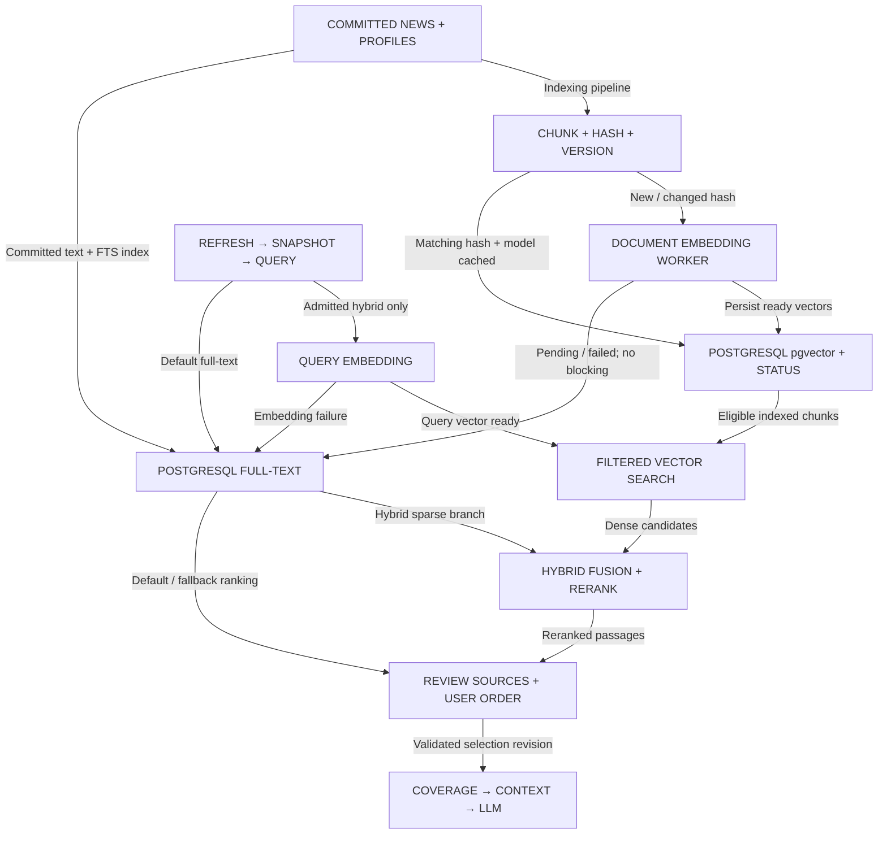

- **news → chunks** — Indexing pipeline / 索引流程
  Indexing pipeline
  索引流程

- **news → sparse** — Committed text + FTS index / 已提交文字及全文索引
  Committed text + FTS index
  已提交文字及全文索引

- **chunks → document_embed** — New / changed hash / 新增／改動 hash
  New / changed hash
  新增／改動 hash

- **chunks → vectors** — Matching hash + model cached / 相同 hash＋模型已快取
  Matching hash + model cached
  相同 hash＋模型已快取

- **document_embed → vectors** — Persist ready vectors / 保存就緒向量
  Persist ready vectors
  保存就緒向量

- **document_embed → sparse** — Pending / failed; no blocking / 待完成／失敗，不阻擋
  Pending / failed; no blocking
  待完成／失敗，不阻擋

- **question → query_embed** — Admitted hybrid only / 只限已准入混合
  Admitted hybrid only
  只限已准入混合

- **question → sparse** — Default full-text / 預設全文
  Default full-text
  預設全文

- **query_embed → dense** — Query vector ready / 查詢向量就緒
  Query vector ready
  查詢向量就緒

- **query_embed → sparse** — Embedding failure / 嵌入失敗
  Embedding failure
  嵌入失敗

- **vectors → dense** — Eligible indexed chunks / 合資格已索引段落
  Eligible indexed chunks
  合資格已索引段落

- **dense → fuse** — Dense candidates / 向量候選
  Dense candidates
  向量候選

- **sparse → fuse** — Hybrid sparse branch / 混合的稀疏分支
  Hybrid sparse branch
  混合的稀疏分支

- **sparse → review** — Default / fallback ranking / 預設／回退排序
  Default / fallback ranking
  預設／回退排序

- **fuse → review** — Reranked passages / 已重排原文
  Reranked passages
  已重排原文

- **review → gate** — Validated selection revision / 已驗證選取版本
  Validated selection revision
  已驗證選取版本
