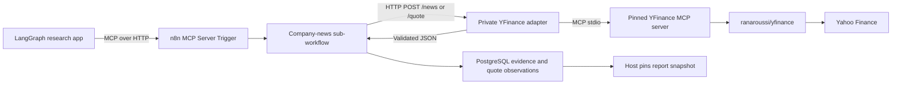

# YFinance integration for the Stock Research Agent

Use Python 3.11 or newer. The tested environment used Python 3.13. This package provides a private HTTP adapter that calls a real stdio MCP server. n8n controls the acquisition workflow and its retries.



## Library choice

`ranaroussi/yfinance` is the Python data library. An MCP server adds tool discovery and tool calls around the library. For this app, use the library underneath a small application interface with two exposed operations, news and quotes. This keeps your chosen MCP workflow and lets the app validate stable JSON contracts.

The adapter reuses the existing workspace draft's `rizkydwicmt/yfinance-mcp-server`, fixed at commit `5132e8de707435e715f4c1a89058cc0e9cac3d7b`, with `yfinance==1.8.0` and `mcp==1.26.0`. This is a selected third-party wrapper. Review dependency upgrades and rediscover tools before changing the pin. The library's authors describe it as an unofficial Yahoo research/educational client and direct users to the provider's data-use terms. Confirm data rights for public or commercial distribution.

The upstream quote tool selects fields from `Ticker.info`. Our small launcher retains `regularMarketPrice` and its matching `regularMarketTime`, plus session metadata. This lets the response preserve the observed price's timestamp. The adapter returns `delay_status: "unknown"` because an MCP tool description alone cannot establish a real-time market-data entitlement.

## Start locally

Run these commands from the academy repository root. The website and the adapter are separate processes.

```sh
python3.13 -m venv integrations/yfinance/.venv
source integrations/yfinance/.venv/bin/activate
python -m pip install -r integrations/yfinance/requirements.txt
cp integrations/yfinance/.env.example integrations/yfinance/.env.local
# Edit .env.local and set a service secret. Keep it out of Git.
python -m integrations.yfinance.client discover
python -m uvicorn integrations.yfinance.api:app \
  --env-file integrations/yfinance/.env.local --host 127.0.0.1 --port 8002
```

`discover` starts the pinned server, opens an MCP session and performs `tools/list`. It emits the two selected tools' actual input/output schemas. Discovery performs no Yahoo news or quote request. Each HTTP request then runs one MCP attempt in an isolated subprocess, with an eight-second deadline including process startup and capacity waiting. Concurrency is limited to two calls per adapter process. Use one Uvicorn worker for that stated limit.

The tool names are verified against this pinned wrapper:

| Upstream MCP tool | Arguments | Adapter endpoint |
| --- | --- | --- |
| `tool_get_news` | `symbol`, `max_items` | `POST /news` |
| `tool_get_stock_price` | `symbol` | `POST /quote` |

Only `MSFT`, `AAPL` and `NVDA` are accepted by the adapter. `max_items` defaults to 5 and accepts integers from 1 to 20. A provider may return fewer items.

## Configure n8n

1. Create an n8n Header Auth credential with header name `X-YFinance-Token` and the same secret as `YFINANCE_BRIDGE_TOKEN`.
2. Inside your existing `refresh_company_news` sub-workflow, validate the request and resolve `run_id` idempotency before contacting the adapter.
3. Add an HTTP Request node with method POST, URL `http://127.0.0.1:8002/news`, the Header Auth credential, JSON body `{"symbol":"MSFT","max_items":5}`, and a timeout that fits the remaining acquisition budget. Map `symbol` from the validated company field in a real run.
4. Include response status and body. Route adapter errors by `detail.retryable`. Keep the HTTP node's automatic retry disabled when using your explicit retry decision loop. n8n owns up to three attempts, waits of 1s then 2s plus jitter, and the original acquisition deadline. Retry 429/503/504 only when their returned policy and remaining time permit. Reconcile uncertain workflow completion by the same `run_id`.
5. Validate the response against `news-response.schema.json`, then store the normalized records. Return the committed version IDs and the acquisition receipt to the research app.
6. For a requested price, use a second HTTP Request node to POST `{"symbol":"MSFT"}` to `/quote`. Expose a separate `get_company_quote` workflow tool if the app needs to request prices independently. Record the quote's success/failure separately from news coverage.

The loopback URL above assumes n8n runs natively on the same host. For Dockerized n8n, run the adapter as a service on the same private Docker network, bind its process to `0.0.0.0:8002` inside the container, and use `http://yfinance-bridge:8002`. Install the pinned requirements and copy `integrations/` into that service image. Container `127.0.0.1` addresses the container itself. Configure the service credential server-side and keep the adapter port private.

For a manual HTTP check, set the token in your terminal environment and run:

```sh
curl --fail-with-body http://127.0.0.1:8002/news \
  -H "X-YFinance-Token: $YFINANCE_BRIDGE_TOKEN" \
  -H 'Content-Type: application/json' \
  -d '{"symbol":"MSFT","max_items":5}'
curl --fail-with-body http://127.0.0.1:8002/quote \
  -H "X-YFinance-Token: $YFINANCE_BRIDGE_TOKEN" \
  -H 'Content-Type: application/json' \
  -d '{"symbol":"MSFT"}'
```

## Three JSON layers

1. `tools/list` supplies the upstream MCP tool's `inputSchema` and `outputSchema`. The observed output schema is a string-result envelope.
2. The upstream tool's string contains provider-specific JSON, such as `articles[].publishedAt` or `regularMarketTime`.
3. The HTTP adapter parses that JSON into the application's Pydantic models and returns the generated application JSON Schema contracts. Use these response schemas for n8n validation, storage mapping and UI types.

Captured MCP discovery is downloadable as `public/downloads/yfinance/mcp-tools.json`. Generated contracts are `news-request.schema.json`, `news-response.schema.json`, `quote-request.schema.json`, `quote-response.schema.json` and `error-response.schema.json` in the same folder. `/openapi.json` on the running adapter describes both HTTP endpoints, including input validation errors.

### Fictional news response example

```json
{
  "schema_version": "1.0",
  "provider": "yfinance",
  "symbol": "MSFT",
  "status": "ok",
  "fetched_at": "2026-11-12T03:00:00Z",
  "articles": [{
    "article_id": "example-url-hash",
    "canonical_url": "https://example.com/fictional-cloud-news",
    "title": "Fictional cloud update",
    "publisher": "Fixture publisher",
    "summary": "A fictional permitted excerpt for teaching.",
    "published_at": "2026-11-12T02:00:00Z",
    "excerpt_hash": "example-content-hash"
  }]
}
```

Article identity is derived from its normalized URL. The excerpt hash is calculated from normalized title and summary text. Tracking parameters are removed while meaningful URL parameters are retained. The adapter removes exact duplicate versions within one response. PostgreSQL must additionally enforce uniqueness across requests using article identity and content hash, maintain `first_seen_at`/`last_seen_at`, and preserve revised versions. News may contain only a title and summary. Missing publication dates remain null and must be excluded from time-sensitive evidence unless independently resolved. The adapter does not fetch arbitrary article URLs or establish article-reuse permissions.

### Fictional quote response example

```json
{
  "schema_version": "1.0",
  "provider": "yfinance",
  "symbol": "MSFT",
  "price": 123.45,
  "currency": "USD",
  "exchange": "NMS",
  "price_basis": "regularMarketPrice",
  "market_timestamp": "2026-11-11T21:00:00Z",
  "timestamp_status": "provided",
  "fetched_at": "2026-11-12T03:00:00Z",
  "market_state": "POST",
  "exchange_timezone": "America/New_York",
  "previous_close": 120.0,
  "change": 3.45,
  "change_percent": 2.875,
  "delay_status": "unknown"
}
```

Prefer the regular-session price with its corresponding timestamp. A `currentPrice` fallback carries a null market timestamp. Display the returned price basis, timestamp and fetch time, especially when markets are closed. A newly fetched response can contain the previous session's observation. The quote is numerical report context, stored in a `quote_observations` table and optionally pinned by observation ID in the report snapshot. Keep price observations out of the news vector index. An old report retains its pinned price while a separate live-price panel may refresh.

For a historical research cutoff, exclude a present-day quote fetched after that cutoff. Historical prices require a dedicated, timestamp-filtered history integration. Daily macro/geopolitical acquisition continues through its approved sources, since a ticker's news feed does not establish complete global coverage. Company profiles retain their existing sourced, dated versioning workflow.

## Error behavior and verification

Authentication failure returns 401. Unsupported symbols or invalid arguments return FastAPI's 422 validation response before any provider call. The adapter's operational errors have the shape `{"detail":{"code":"provider_timeout","retryable":true}}`. An upstream outage does not become an empty successful article list. The adapter adds no retry loop. A process is started for each HTTP attempt, so a stalled stdio session can be torn down at the attempt boundary.

```sh
source integrations/yfinance/.venv/bin/activate
python -m pip install -r integrations/yfinance/requirements-test.txt
python -m unittest discover -s integrations/yfinance/tests -p 'test_*.py'
python -m integrations.yfinance.export_schemas --check
```

Regenerate contracts with `python -m integrations.yfinance.export_schemas`. Keep discovery metadata updated after an upstream upgrade. Offline tests cover schema validation, duplicate/revised articles, quote timestamps, invalid values, authorization, scope and error propagation. Live verification on 12 November 2026 discovered both MCP tools and successfully fetched MSFT news and a regular-session quote. This verifies the provider path. n8n orchestration, PostgreSQL writes and production traces remain application integration work.

## Sources

- [ranaroussi/yfinance](https://github.com/ranaroussi/yfinance)
- [Pinned YFinance MCP server source](https://github.com/rizkydwicmt/yfinance-mcp-server/tree/5132e8de707435e715f4c1a89058cc0e9cac3d7b)
- [yfinance news reference](https://ranaroussi.github.io/yfinance/reference/api/yfinance.Ticker.get_news.html)
- [Official MCP Python SDK](https://github.com/modelcontextprotocol/python-sdk)
- [n8n HTTP Request](https://docs.n8n.io/integrations/builtin/core-nodes/n8n-nodes-base.httprequest/)
