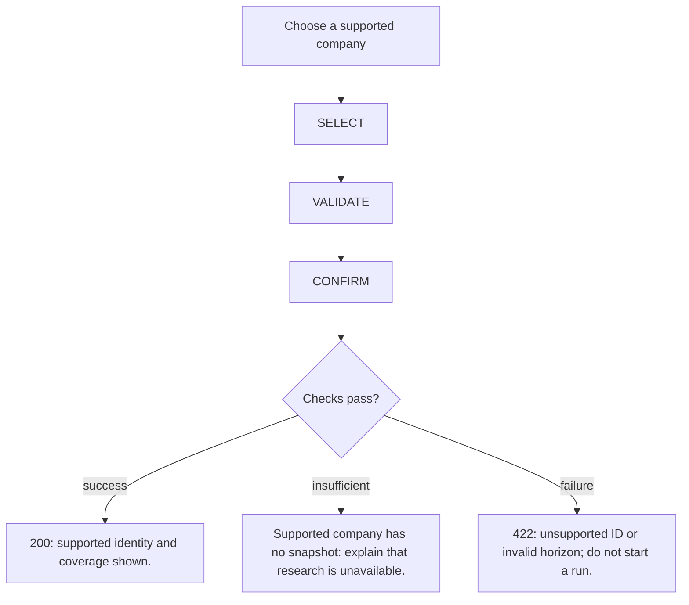
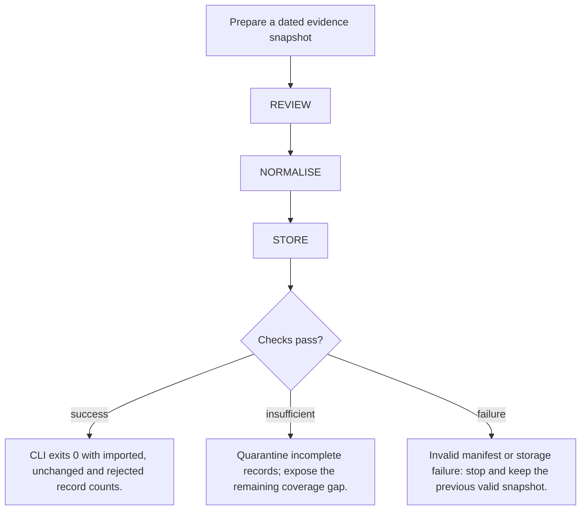
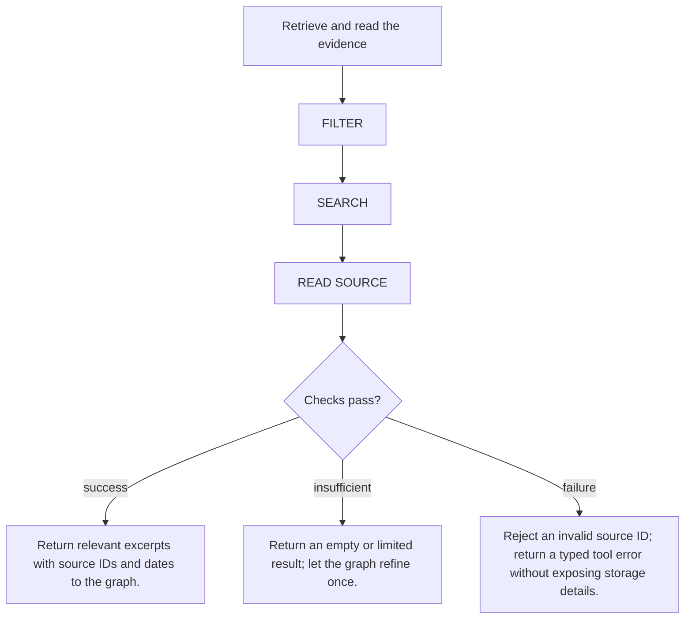
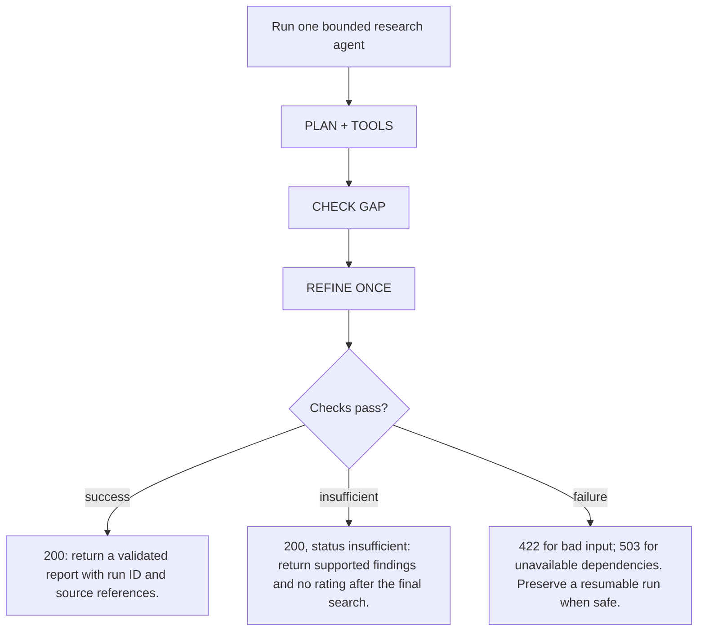
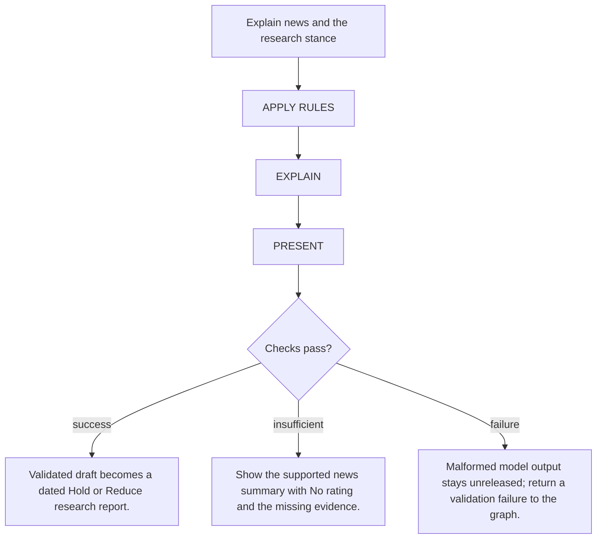
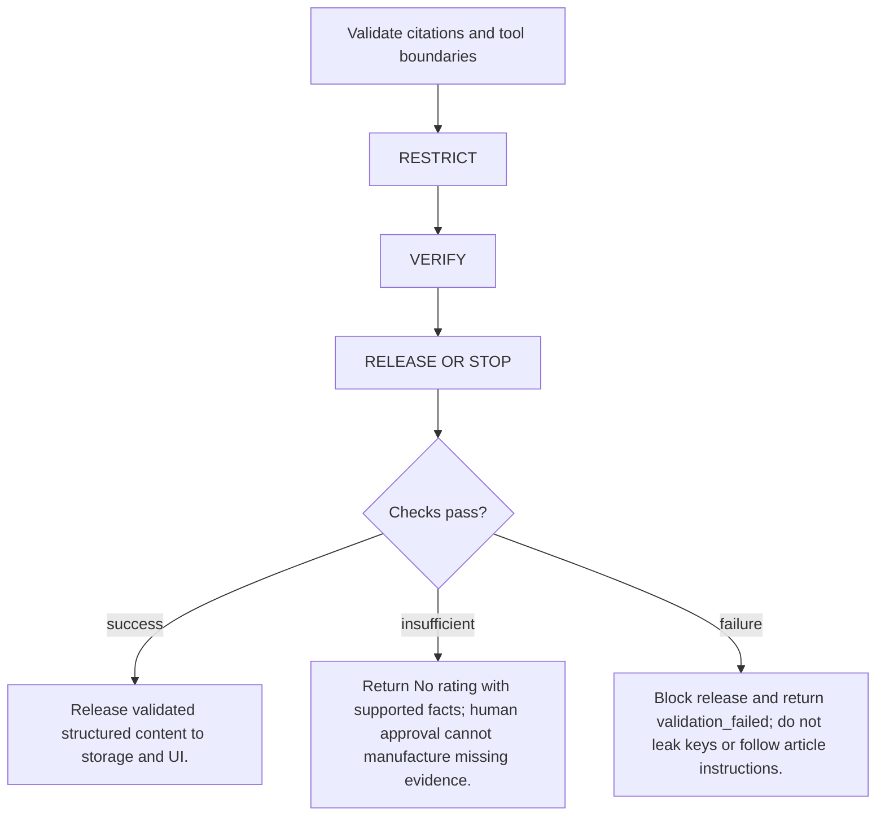
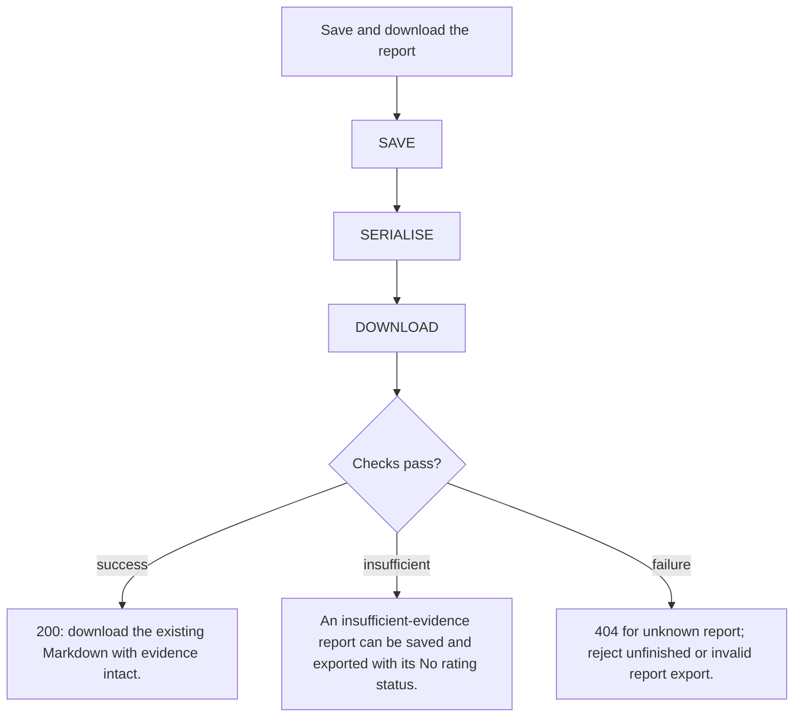
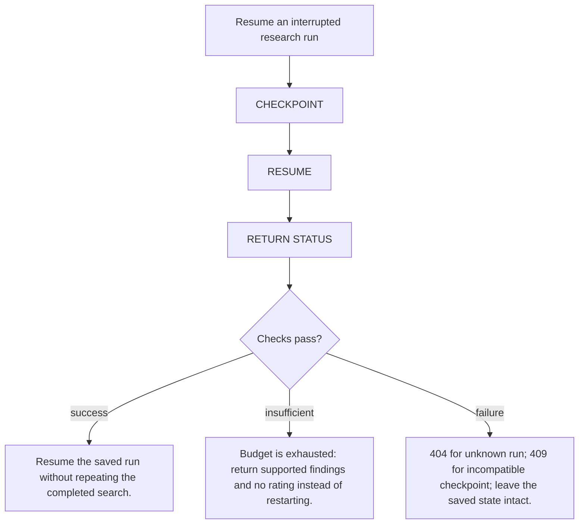
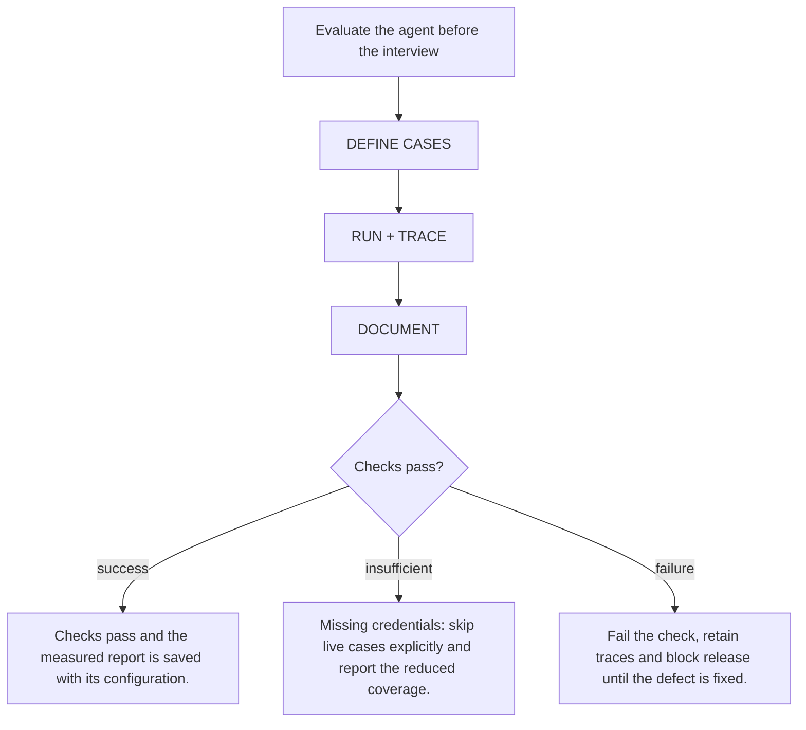
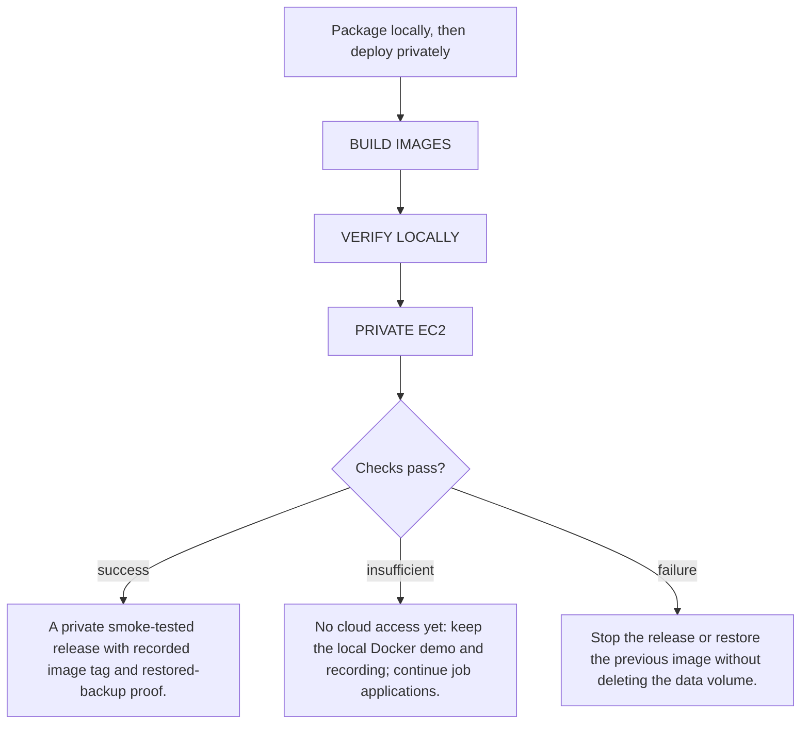

# Stock research assistant / 股票研究助手

Three supported companies, one bounded research agent, one cited report.

3 間公司、1 個有執行上限的研究 agent、1 頁有來源報告。

This academy contains a working offline teaching simulation and a proposed application design. It does not run a Python finance service, fetch current market news or issue real investment recommendations. All demo events, news and ratings are fictional.

此學習網站提供可操作的離線教學模擬及未來 app 設計，沒有運行 Python 金融服務或抓取即時新聞；示範事件、新聞及評級全部虛構。

Supported company identities: Microsoft (MSFT), Apple (AAPL), NVIDIA (NVDA). Real company identities do not make the demo fixtures real news.

Generated from `lib/finance-project.ts` and `lib/finance-proposal.ts`. Run `npm run proposal:sync`; do not edit the generated files.


## Scope and estimate / 範圍及工時

60–90 total hours at 15 hours per week, approximately 4–6 weeks. Core stages total 60 hours. The 30-hour reserve is included, not additional. Subjective difficulty: 5–6 / 10.

Planning estimate for one developer reusing the existing UI and a permitted, curated evidence snapshot. Allow 6–8 weeks if Python and asynchronous APIs are new. This is an interview demo, not a public global financial product.

以一位開發者、重用現有介面及已獲准使用的小型證據快照估算。如 Python 及非同步 API 都要邊做邊學，預留 6–8 星期。目標是面試示範，並非公開全球金融產品。

The first release uses a permitted, curated and dated evidence snapshot. Show its coverage date. Do not label snapshots as live news. Verify source identity, reuse permission and publication time before ingestion.

首版先用允許使用、有日期的小型證據快照，顯示覆蓋日期，不當作即時新聞。匯入前確認來源、使用範圍及發布時間。

## Delivery stages / 開發階段

### Week 1: Prepare evidence and the report contract / 準備證據及報告格式

15 hours

- Choose three companies and a permitted dated snapshot.
- 選定三間公司及允許使用的有日期快照。
- Define schemas, ingestion and the company selector.
- 定義 schema、匯入流程及公司選單。

Acceptance / 驗收:

Resolve a supported company and retrieve its stored evidence reproducibly.

可重現地選定支援公司並檢索其已儲存證據。

### Week 2: Complete the bounded research path / 完成有上限的研究路徑

15 hours

- Add two tools, one LangGraph agent and one model.
- 加入兩個工具、一個 LangGraph agent 及一個模型。
- Validate a sourced report and the insufficient-evidence path.
- 驗證有來源報告及證據不足路徑。

Acceptance / 驗收:

Produce one cited report or an honest no-rating result. Start applying with the project in progress.

產生有引用報告或誠實的無評級結果；可以進行中項目開始申請。

### Week 3: Polish one page and test failures / 完善一頁介面並測試失敗情境

15 hours

- Add source inspection, export and checkpoint recovery.
- 加入來源核對、下載及 checkpoint 恢復。
- Prepare about 15–20 concrete evaluation cases and record actual outcomes.
- 準備約 15–20 個明確評估案例，記錄真實結果。

Acceptance / 驗收:

Demonstrate success, missing evidence, injected instructions and recovery.

可展示正常、缺證據、注入指令及恢復情境。

### Week 4: Package and explain the work / 包裝並解釋作品

15 hours

- Verify Docker locally; add private EC2 deployment if ready.
- 本機驗證 Docker；準備好先加入私人 EC2 部署。
- Write the README and record a 2–3 minute walkthrough.
- 撰寫 README，錄製 2–3 分鐘示範。

Acceptance / 驗收:

A reviewer can run the app, understand its limits and reproduce the evaluation.

審閱者可運行 app、理解限制及重跑評估。

## Proposed file hierarchy and local startup / 建議檔案及本機啟動

This is the proposed standalone app. These services and commands are not implemented in this academy repository.

```text
stock-research-agent/                 # proposed standalone app
├── apps/web/
│   ├── app/page.tsx                    # selector + report
│   ├── app/api/[...path]/route.ts      # server-only API proxy
│   ├── components/research-report.tsx
│   ├── Dockerfile
│   └── package.json / package-lock.json
├── services/research/
│   ├── app/
│   │   ├── main.py / schemas.py / companies.py
│   │   ├── ingest.py / storage.py / retrieval.py
│   │   ├── graph.py / tools.py / checkpoints.py
│   │   ├── rules.py / report.py / prompts.py
│   │   └── validation.py / export.py / evaluate.py
│   ├── tests/test_research.py
│   ├── requirements.txt               # pinned dependencies
│   ├── .env.example                   # no secrets
│   └── Dockerfile
├── data/manifest.json / README.md      # approved, dated evidence
├── evals/cases.jsonl
├── deploy/
│   ├── compose.yaml
│   ├── research.env.example / README.md
│   └── research.env                   # ignored, server secrets
├── .github/workflows/check.yml
├── .gitignore                         # .env.local, data files, databases
└── README.md

Native local: browser :3000 → Next.js server → FastAPI 127.0.0.1:8000
Docker later: browser → controlled HTTPS → web → research:8000 → data volume
SQLite reports/checkpoints persist on the data volume. Provider keys remain server-side.
```

```sh
# Proposed application repository, after its scaffold exists.
# These commands do not start finance services in this academy repository.

# Terminal 1: Python API on loopback
cd services/research
python3 -m venv .venv
source .venv/bin/activate
python -m pip install -r requirements.txt
# Copy .env.example to .env.local; set the chosen provider key locally.
# Keep .env.local out of Git. The scaffold must load it server-side.
python -m app.ingest --manifest ../../data/manifest.json
python -m uvicorn app.main:app --env-file .env.local --host 127.0.0.1 --port 8000

# Terminal 2: Next.js UI
cd apps/web
npm ci
RESEARCH_API_URL=http://127.0.0.1:8000 npm run dev -- --hostname 127.0.0.1 --port 3000

# Terminal 3: verify before recording
cd services/research
source .venv/bin/activate
python -m pytest
python -m app.evaluate --cases ../../evals/cases.jsonl
```

## Technique ownership / 技術責任

### Frontend

Next.js · React · TypeScript

**How / 如何應用**

One selector and report page; server-side API proxy keeps the backend address and keys private.

一個選單及報告頁；伺服器 API 轉送避免向瀏覽器公開後端金鑰。

**Why / 為何使用**

Reuse existing web skills and keep the user journey short.

重用現有網頁能力，保持使用流程簡短。

### Backend

Python · FastAPI · Pydantic

**How / 如何應用**

Validate requests, expose the small API and own retrieval, rules, storage and exports.

驗證請求、提供少量 API，負責檢索、規則、儲存及下載。

**Why / 為何使用**

One backend reduces integration work while demonstrating the Python skills relevant to agent engineering.

一個後端減少整合工作，同時展示 agent 工程所需 Python 能力。

### Agent

LangGraph · one LLM

**How / 如何應用**

Keep typed state, conditional evidence checks, a single refinement and persistent checkpoints.

保存有型別狀態、條件式證據檢查、一次補查及持久 checkpoint。

**Why / 為何使用**

Demonstrate tool selection and controlled recovery rather than adding multiple agents without a need.

展示工具選擇及受控恢復，先減少沒有實際需要的多 agent。

### Evidence

SQLite · FTS5 · basic RAG

**How / 如何應用**

Filter company/date, retrieve approved excerpts and attach stable source IDs to the model context.

先過濾公司及日期，再檢索核准原文，將穩定來源 ID 放入模型上下文。

**Why / 為何使用**

Simple retrieval is sufficient for the small first corpus; vector search needs a measured reason to add it.

小型首版資料集先用簡單檢索；有量度依據後再加向量搜尋。

### Reliability

pytest · structured logs · GitHub Actions

**How / 如何應用**

Test source support, malicious text, budgets and recovery; record actual latency and usage.

測試來源支持、惡意文字、預算及恢復，記錄真實延遲及用量。

**Why / 為何使用**

Failure evidence helps a reviewer assess the system beyond a polished successful answer.

失敗處理證據讓審閱者評估系統，而不只看成功答案。

### Delivery

Docker Compose · EC2

**How / 如何應用**

Develop natively, verify containers locally, then deploy the same images privately.

原生本機開發、本機驗證容器，再私人部署相同映像。

**Why / 為何使用**

Show packaging and operations without making cloud setup a prerequisite for the first report.

展示包裝及運維，同時不讓雲端設定阻礙首份報告。

## Function contracts and individual workflows / 每項功能及獨立流程

## Choose a supported company / 選擇支援公司

Resolve the company before any research begins.

研究前先確定公司，避免搵錯標的。

**Input / 輸入**

A selection of MSFT, AAPL or NVDA. Research horizon: 1–3 months.

從 MSFT、AAPL、NVDA 選一間；研究範圍為未來 1–3 個月。

**Output / 輸出**

A canonical company ID and the evidence snapshot coverage date.

標準公司 ID 及證據快照覆蓋日期。

### Entry contract / 入口

```text
GET /api/companies
Next.js proxy → GET /companies → [{"id":"MSFT","name":"Microsoft"}, …]
```



### 1. SELECT

Show three supported identities in a selector.

選單列出三個支援身份。

Tools: Next.js · TypeScript

**How / 如何應用**

Render options from one company catalog and submit its ID, not an arbitrary name.

由同一公司清單產生選項，提交 ID 而非任意公司名。

**Why / 為何使用**

A fixed universe avoids ambiguous names and unsupported global coverage.

固定範圍可避免同名公司及未支援的全球標的。

Proposed files / 建議檔案: `apps/web/app/page.tsx`, `services/research/app/companies.py`

### 2. VALIDATE

Validate the selected company on the API boundary.

在 API 邊界驗證所選公司。

Tools: FastAPI · Pydantic

**How / 如何應用**

Accept only the three catalog IDs and a supported horizon. Reject any other input before tool access.

只接納清單內三個 ID 及支援的研究期間；工具執行前拒絕其他輸入。

**Why / 為何使用**

Browser controls do not prevent a caller from sending a forged request.

瀏覽器選單無法阻止偽造請求，後端仍須驗證。

Proposed files / 建議檔案: `services/research/app/main.py`, `services/research/app/schemas.py`

### 3. CONFIRM

Display identity and coverage before starting.

開始前顯示身份及資料覆蓋範圍。

Tools: Typed API response

**How / 如何應用**

Return company ID, display name and snapshot as-of date. Keep them with the run.

回傳公司 ID、名稱及快照日期，並與研究任務一起保存。

**Why / 為何使用**

Users can see exactly which company and dated information are being analysed.

使用者能確認研究哪間公司，以及資料截至何時。

Proposed files / 建議檔案: `apps/web/app/page.tsx`, `services/research/app/schemas.py`

### Return branches / 回傳分支

**success**

Required checks pass

所需檢查通過

200: supported identity and coverage shown.

200：顯示支援公司及覆蓋日期。

Return the validated output to the caller.

向呼叫者回傳已驗證結果。

**insufficient**

Valid request, incomplete evidence

請求有效，但證據未齊

Supported company has no snapshot: explain that research is unavailable.

支援公司尚無快照：交代暫時無法研究。

Explain the limitation and the next permitted step.

交代限制及下一個允許步驟。

**failure**

Invalid input or an operational error

輸入無效或程序出錯

422: unsupported ID or invalid horizon; do not start a run.

422：公司 ID 或期間無效，不啟動研究。

Return an explicit error. Keep the last valid state.

回傳明確錯誤，保留最後有效狀態。

### Acceptance / 驗收

- A forged unsupported ticker is rejected by the backend, not merely hidden in the UI.
- 偽造未支援 ticker 會由後端拒絕，不只在介面隱藏。

## Prepare a dated evidence snapshot / 準備有日期的證據快照

Start with a small reproducible corpus instead of building a global news crawler.

先做可重跑的小型資料集，減少建立全球新聞爬蟲的工作。

**Input / 輸入**

A developer-reviewed manifest of permitted company announcements or news excerpts.

開發者核對過、允許使用的公司公告或新聞節錄清單。

**Output / 輸出**

Stored evidence with source ID, company, URL, publication time and excerpt.

已儲存的來源 ID、公司、網址、發布時間及原文節錄。

### Entry contract / 入口

```text
python -m app.ingest --manifest ../../data/manifest.json
```



### 1. REVIEW

Choose a small set of sources for each supported company.

為每間支援公司選取少量來源。

Tools: Curated manifest · source review

**How / 如何應用**

Record the original URL, publication time, company and permitted reuse. Keep excerpts within the allowed scope.

記錄原網址、發布時間、公司及允許使用範圍；節錄遵守來源限制。

**Why / 為何使用**

A public page is not automatically a licence for full-text redistribution.

公開網頁不等於可以任意轉載全文。

Proposed files / 建議檔案: `data/manifest.json`, `data/README.md`

### 2. NORMALISE

Validate and deduplicate source records.

驗證並去除重複來源。

Tools: Python · Pydantic · content hash

**How / 如何應用**

Parse records at ingestion, reject missing dates or mismatched company IDs, and derive a stable source key.

匯入時解析欄位，拒絕缺日期或公司不符的紀錄，並產生穩定來源鍵。

**Why / 為何使用**

Repeated ingestion should not duplicate articles or change existing evidence silently.

重跑匯入不應產生重複文章或靜默改寫證據。

Proposed files / 建議檔案: `services/research/app/ingest.py`, `services/research/app/schemas.py`

### 3. STORE

Store approved excerpts and publish a coverage date.

儲存核准節錄，公布覆蓋日期。

Tools: SQLite · FTS5

**How / 如何應用**

Upsert approved records and index searchable text. Save the snapshot version and ingestion outcome.

以 upsert 儲存核准紀錄並建立文字索引，保存快照版本及匯入結果。

**Why / 為何使用**

A versioned local corpus makes the same interview case reproducible without live API access.

版本化本機資料集，讓面試案例可在沒有即時 API 下重跑。

Proposed files / 建議檔案: `services/research/app/storage.py`, `data/manifest.json`

### Return branches / 回傳分支

**success**

Required checks pass

所需檢查通過

CLI exits 0 with imported, unchanged and rejected record counts.

CLI 以 0 結束，列出新增、未改動及拒絕紀錄數。

Return the validated output to the caller.

向呼叫者回傳已驗證結果。

**insufficient**

Valid request, incomplete evidence

請求有效，但證據未齊

Quarantine incomplete records; expose the remaining coverage gap.

隔離不完整紀錄，顯示資料覆蓋缺口。

Explain the limitation and the next permitted step.

交代限制及下一個允許步驟。

**failure**

Invalid input or an operational error

輸入無效或程序出錯

Invalid manifest or storage failure: stop and keep the previous valid snapshot.

清單無效或儲存失敗：停止並保留上一個有效快照。

Return an explicit error. Keep the last valid state.

回傳明確錯誤，保留最後有效狀態。

### Acceptance / 驗收

- Running the same manifest twice produces no duplicate sources.
- 同一清單匯入兩次不會產生重複來源。

## Retrieve and read the evidence / 檢索及閱讀證據

Find relevant passages and retain their source identities for the report.

找相關原文，並保留來源身份供報告引用。

**Input / 輸入**

Validated company ID, research question and publication-date window.

已驗證公司 ID、研究問題及發布日期範圍。

**Output / 輸出**

Ranked source IDs and selected excerpts, or an explicit empty result.

排序後來源 ID 及節錄，或明確空結果。

### Entry contract / 入口

```text
LangGraph tool node
search_company_evidence(company_id, query, published_before) → source IDs
read_source(source_id) → approved excerpt + metadata
```



### 1. FILTER

Restrict evidence to the selected company and time window.

先限制所選公司及日期範圍。

Tools: SQLite · SQL parameters

**How / 如何應用**

Apply company and date filters before ranking. Query only approved snapshot records.

排序前先套用公司及日期條件，只查詢已核准快照紀錄。

**Why / 為何使用**

A relevant sentence about a different company or a later event is still wrong evidence.

另一間公司或未來事件的相關句子，仍然係錯誤證據。

Proposed files / 建議檔案: `services/research/app/retrieval.py`, `services/research/app/storage.py`

### 2. SEARCH

Search passages with a simple text index.

用簡單文字索引搜尋原文。

Tools: SQLite FTS5 · basic RAG

**How / 如何應用**

Rank matches for the question and return a small top-k with stable source IDs. Start without embeddings.

按問題排序文字匹配，回傳少量 top-k 及穩定來源 ID；首版先不用 embeddings。

**Why / 為何使用**

A small curated corpus can demonstrate retrieval grounding before adding vector infrastructure.

小型資料集已可展示檢索及證據支持，先減少向量基建工作。

Proposed files / 建議檔案: `services/research/app/retrieval.py`

### 3. READ SOURCE

Read a selected source through a restricted tool.

透過受限制工具讀取指定來源。

Tools: read_source · typed tool output

**How / 如何應用**

Resolve an allowed source ID from the database. Return its excerpt, URL and publication date; do not fetch arbitrary URLs.

從資料庫解析允許的來源 ID，回傳原文、網址及日期；不接受任意網址擷取。

**Why / 為何使用**

The model receives attributable evidence while the tool retains control over what can be read.

模型取得可追溯證據，工具仍控制可讀資料範圍。

Proposed files / 建議檔案: `services/research/app/tools.py`, `services/research/app/schemas.py`

### Return branches / 回傳分支

**success**

Required checks pass

所需檢查通過

Return relevant excerpts with source IDs and dates to the graph.

向 graph 回傳相關節錄、來源 ID 及日期。

Return the validated output to the caller.

向呼叫者回傳已驗證結果。

**insufficient**

Valid request, incomplete evidence

請求有效，但證據未齊

Return an empty or limited result; let the graph refine once.

回傳空或有限結果，由 graph 決定補查一次。

Explain the limitation and the next permitted step.

交代限制及下一個允許步驟。

**failure**

Invalid input or an operational error

輸入無效或程序出錯

Reject an invalid source ID; return a typed tool error without exposing storage details.

拒絕無效來源 ID，以結構化工具錯誤回覆，不公開儲存細節。

Return an explicit error. Keep the last valid state.

回傳明確錯誤，保留最後有效狀態。

### Acceptance / 驗收

- Wrong-company and future-dated records never enter the allowed evidence set.
- 其他公司及未來日期的紀錄不會進入允許證據集。

## Run one bounded research agent / 運行一個有上限的研究 agent

Let the agent select tools and fill an evidence gap within a controlled budget.

讓 agent 選擇工具及補足證據，同時限制執行預算。

**Input / 輸入**

Company ID, a news-research question and a snapshot date.

公司 ID、新聞研究問題及快照日期。

**Output / 輸出**

A validated research result or an explicit insufficient-evidence result.

已驗證研究結果，或明確證據不足結果。

### Entry contract / 入口

```text
POST /api/research
{"company_id":"MSFT","question":"Explain recent developments","horizon":"1-3m"}
Next.js proxy → POST /research → run_id + result
```



### 1. PLAN + TOOLS

Create typed run state and choose a permitted research tool.

建立有型別的任務狀態，選擇允許的研究工具。

Tools: LangGraph · one tool-capable LLM

**How / 如何應用**

Track identity, query, source IDs, evidence and budgets. Expose only search_company_evidence and read_source.

追蹤身份、查詢、來源、證據及預算，只提供兩個唯讀研究工具。

**Why / 為何使用**

A constrained tool boundary supports useful agent decisions without broad machine access.

受限制工具邊界支援 agent 判斷，同時避免取得廣泛系統權限。

Proposed files / 建議檔案: `services/research/app/graph.py`, `services/research/app/tools.py`

### 2. CHECK GAP

Assess whether the gathered evidence answers the question.

判斷已取得證據是否足以回答。

Tools: Conditional edges · structured output

**How / 如何應用**

Use code checks for company, dates and source presence. Let the model describe any remaining information gap in a schema.

以程式檢查公司、日期及來源；模型用固定格式描述尚欠資料。

**Why / 為何使用**

A fluent draft must not be treated as proof that the research is complete.

文字流暢不代表研究已完成。

Proposed files / 建議檔案: `services/research/app/graph.py`, `services/research/app/schemas.py`

### 3. REFINE ONCE

Refine once, or continue to reporting and validation.

最多修正查詢一次，再進入報告及驗證。

Tools: Bounded loop · timeout · SQLite checkpoint

**How / 如何應用**

Allow two search rounds total. Persist progress and stop at the configured time, tool or model budget. Return no rating if evidence remains inadequate.

總共最多兩輪搜尋；保存進度，到達時間、工具或模型上限就停止。仍不足則不評級。

**Why / 為何使用**

A bounded agent can recover and explain failure without looping or spending indefinitely.

有上限的 agent 能恢復及解釋失敗，避免無限循環及用量。

Proposed files / 建議檔案: `services/research/app/graph.py`, `services/research/app/checkpoints.py`

### Return branches / 回傳分支

**success**

Required checks pass

所需檢查通過

200: return a validated report with run ID and source references.

200：回傳已驗證報告、任務 ID 及來源引用。

Return the validated output to the caller.

向呼叫者回傳已驗證結果。

**insufficient**

Valid request, incomplete evidence

請求有效，但證據未齊

200, status insufficient: return supported findings and no rating after the final search.

200，狀態 insufficient：最後搜尋後只回傳有證據發現，不評級。

Explain the limitation and the next permitted step.

交代限制及下一個允許步驟。

**failure**

Invalid input or an operational error

輸入無效或程序出錯

422 for bad input; 503 for unavailable dependencies. Preserve a resumable run when safe.

輸入錯誤回 422；依賴不可用回 503。在安全情況保留可恢復任務。

Return an explicit error. Keep the last valid state.

回傳明確錯誤，保留最後有效狀態。

### Acceptance / 驗收

- The missing-evidence path performs at most one refinement and never invents the absent fact.
- 資料不足路徑最多補查一次，不能捏造缺失事實。

## Explain news and the research stance / 解釋新聞及研究觀點

Produce a readable Hold or Reduce view with evidence, risks and uncertainty.

以易讀方式呈現持有或減持觀點、證據、風險及不確定因素。

**Input / 輸入**

Approved evidence and the versioned research-rule result.

核准證據及有版本的研究規則結果。

**Output / 輸出**

Structured draft: stance, reasons, news impacts, citations and what to watch.

結構化草稿：觀點、原因、新聞影響、引用及後續觀察。

### Entry contract / 入口

```text
LangGraph report node
draft_report(evidence, rule_result) → ResearchReport draft
```



### 1. APPLY RULES

Determine a transparent research stance in Python.

由 Python 按透明規則產生研究觀點。

Tools: Pure Python · versioned rules

**How / 如何應用**

For the teaching rule, require demand, costs and outlook evidence. Maintained outlook gives Hold; lowered outlook gives Reduce; missing evidence gives no rating.

教學規則要求需求、成本及展望證據。展望維持為 Hold，下調為 Reduce，缺證據則不評級。

**Why / 為何使用**

An explainable rule is auditable. It is a teaching rule, not a validated profitable strategy.

可解釋規則方便核對；它是教學規則，並非已驗證盈利策略。

Proposed files / 建議檔案: `services/research/app/rules.py`

### 2. EXPLAIN

Ask one LLM to explain the evidence and possible effects.

由一個 LLM 解釋證據及可能影響。

Tools: One LLM · prompt template · Pydantic schema

**How / 如何應用**

Provide approved excerpts and the fixed rule result. Require source IDs, possible impact and uncertainty in each material explanation.

提供核准原文及固定規則結果；每項重要解釋須有來源 ID、可能影響及不確定因素。

**Why / 為何使用**

News sentiment alone does not establish price direction or causation; expectations may already be priced in.

新聞正負面不能單獨證明股價方向或因果，預期可能已反映在價格。

Proposed files / 建議檔案: `services/research/app/report.py`, `services/research/app/prompts.py`, `services/research/app/schemas.py`

### 3. PRESENT

Display the short research report after validation.

驗證後顯示簡短研究報告。

Tools: Next.js · typed response

**How / 如何應用**

Show the dated stance, related news, reasons, risks and source controls on one page. Keep detailed traces expandable.

同一頁展示有日期的觀點、新聞、原因、風險及來源；詳細執行記錄可展開。

**Why / 為何使用**

A reader can understand the conclusion first and inspect its evidence without reading a technical dashboard.

讀者先理解結論，再核對證據，毋須閱讀複雜技術儀表板。

Proposed files / 建議檔案: `apps/web/components/research-report.tsx`, `apps/web/app/page.tsx`

### Return branches / 回傳分支

**success**

Required checks pass

所需檢查通過

Validated draft becomes a dated Hold or Reduce research report.

已驗證草稿成為有日期的 Hold 或 Reduce 研究報告。

Return the validated output to the caller.

向呼叫者回傳已驗證結果。

**insufficient**

Valid request, incomplete evidence

請求有效，但證據未齊

Show the supported news summary with No rating and the missing evidence.

展示有證據的新聞摘要、無評級狀態及缺失資料。

Explain the limitation and the next permitted step.

交代限制及下一個允許步驟。

**failure**

Invalid input or an operational error

輸入無效或程序出錯

Malformed model output stays unreleased; return a validation failure to the graph.

模型格式無效則不發布草稿，向 graph 回傳驗證失敗。

Return an explicit error. Keep the last valid state.

回傳明確錯誤，保留最後有效狀態。

### Acceptance / 驗收

- Every news impact includes a source and uncertainty; no target price or invented confidence percentage appears.
- 每項新聞影響都有來源及不確定因素；不出現目標價或捏造信心百分比。

## Validate citations and tool boundaries / 驗證引用及工具邊界

Stop unsupported output and keep article text from becoming an instruction.

阻擋無根據輸出，避免文章文字變成系統指令。

**Input / 輸入**

Draft report, approved source set and immutable run limits.

報告草稿、核准來源集及不可由文章修改的任務上限。

**Output / 輸出**

A pass result, actionable validation errors or an insufficient-evidence response.

通過結果、可處理的驗證錯誤，或證據不足回覆。

### Entry contract / 入口

```text
Graph validation node and tool boundary
validate_report(draft, allowed_sources, rules) → valid | insufficient | errors
```



### 1. RESTRICT

Keep tool authority outside retrieved text.

將工具權限放在檢索文字之外控制。

Tools: Allowlisted tools · validated arguments

**How / 如何應用**

Treat article text as untrusted data. Permit only read-only tools and server-enforced source filters. Never put keys into prompts.

文章當作不可信資料，只允許唯讀工具及伺服器強制來源限制，金鑰不放進提示。

**Why / 為何使用**

Telling a model to ignore attacks is only one layer; code must enforce the accessible operations.

叫模型忽略攻擊只係其中一層，程式必須限制可執行動作。

Proposed files / 建議檔案: `services/research/app/tools.py`, `services/research/app/prompts.py`

### 2. VERIFY

Check structure, source membership, dates and rule agreement.

檢查格式、來源歸屬、日期及規則一致性。

Tools: Pydantic · deterministic checks

**How / 如何應用**

Reject unknown citations, wrong-company evidence, future information and a stance inconsistent with the rule result. Evaluate whether cited passages support factual claims.

拒絕未知引用、錯公司、未來資料及與規則不符的觀點，並評估原文是否支持事實主張。

**Why / 為何使用**

A source link can exist while failing to support the sentence next to it.

來源連結存在，仍可能不支持旁邊的句子。

Proposed files / 建議檔案: `services/research/app/validation.py`, `services/research/app/schemas.py`

### 3. RELEASE OR STOP

Release only the supported result and record failures.

只發布有支持的結果，並記錄失敗。

Tools: Graph conditional edge · structured trace

**How / 如何應用**

Return valid output, no rating for insufficient evidence, or a typed failure. Record source IDs and error categories without secrets.

有效則回傳，證據不足則不評級，其他情況回傳結構化失敗；記錄來源 ID 及錯誤類別，避免記錄秘密。

**Why / 為何使用**

Visible failure is more useful than silently presenting an unsupported recommendation.

明確交代失敗，能避免把無根據觀點當成已驗證建議。

Proposed files / 建議檔案: `services/research/app/validation.py`, `services/research/app/graph.py`

### Return branches / 回傳分支

**success**

Required checks pass

所需檢查通過

Release validated structured content to storage and UI.

將已驗證內容交給儲存及介面。

Return the validated output to the caller.

向呼叫者回傳已驗證結果。

**insufficient**

Valid request, incomplete evidence

請求有效，但證據未齊

Return No rating with supported facts; human approval cannot manufacture missing evidence.

回傳無評級及有證據事實；人工批准不能補出缺失證據。

Explain the limitation and the next permitted step.

交代限制及下一個允許步驟。

**failure**

Invalid input or an operational error

輸入無效或程序出錯

Block release and return validation_failed; do not leak keys or follow article instructions.

阻擋發布並回傳 validation_failed，不洩漏金鑰或執行文章指令。

Return an explicit error. Keep the last valid state.

回傳明確錯誤，保留最後有效狀態。

### Acceptance / 驗收

- An attack fixture asking for keys or STRONG BUY cannot change permitted tools or the rule result.
- 要求金鑰或 STRONG BUY 的攻擊範例，不能修改允許工具或規則結果。

## Save and download the report / 保存及下載報告

Keep the reviewed result and export exactly what the user saw.

保存已核對結果，下載內容與畫面一致。

**Input / 輸入**

A validated report ID and Markdown export request.

已驗證報告 ID 及 Markdown 下載請求。

**Output / 輸出**

A stored report or Markdown with its evidence, dates and limitations.

已儲存報告，或包含證據、日期及限制的 Markdown。

### Entry contract / 入口

```text
GET /api/reports/{report_id}/export
Next.js proxy → GET /reports/{report_id}/export
Content-Type: text/markdown; charset=utf-8
```



### 1. SAVE

Persist the final version with its research context.

連同研究背景保存最終版本。

Tools: SQLite · transactions

**How / 如何應用**

Save the validated report, rule version, source IDs, snapshot date and run ID together. Use a stable report ID.

一起保存報告、規則版本、來源 ID、快照日期及任務 ID，使用穩定報告 ID。

**Why / 為何使用**

A later export must refer to the same evidence instead of silently regenerating a new answer.

稍後下載應使用相同證據，不能靜默重新產生另一個答案。

Proposed files / 建議檔案: `services/research/app/storage.py`

### 2. SERIALISE

Render Markdown from the stored validated result.

從已儲存的驗證結果產生 Markdown。

Tools: Python serializer · no LLM call

**How / 如何應用**

Include stance, horizon, source URLs, publication dates, possible effects and uncertainty. Preserve demo labels for fixtures.

包含觀點、期間、來源網址、發布日期、可能影響及不確定因素；範例保留虛構標籤。

**Why / 為何使用**

Downloading an existing report requires no additional model usage and should preserve provenance.

下載已有報告不需額外模型用量，亦應保留來源記錄。

Proposed files / 建議檔案: `services/research/app/export.py`

### 3. DOWNLOAD

Return the file through the frontend route.

透過前端路由回傳檔案。

Tools: FastAPI response · Next.js proxy

**How / 如何應用**

Look up the report ID, set the Markdown content type and filename, and stream the existing text.

按報告 ID 查找，設定 Markdown 類型及檔名，再回傳已有文字。

**Why / 為何使用**

The first private single-user app needs one clear export path; public multi-user ownership checks come before sharing it.

私人單用戶首版只需一條下載路徑；公開多人使用前須加擁有權檢查。

Proposed files / 建議檔案: `services/research/app/main.py`, `apps/web/app/api/[...path]/route.ts`

### Return branches / 回傳分支

**success**

Required checks pass

所需檢查通過

200: download the existing Markdown with evidence intact.

200：下載保留證據的既有 Markdown。

Return the validated output to the caller.

向呼叫者回傳已驗證結果。

**insufficient**

Valid request, incomplete evidence

請求有效，但證據未齊

An insufficient-evidence report can be saved and exported with its No rating status.

證據不足報告可保存及下載，但必須保留無評級狀態。

Explain the limitation and the next permitted step.

交代限制及下一個允許步驟。

**failure**

Invalid input or an operational error

輸入無效或程序出錯

404 for unknown report; reject unfinished or invalid report export.

未知報告回 404；拒絕下載未完成或無效報告。

Return an explicit error. Keep the last valid state.

回傳明確錯誤，保留最後有效狀態。

### Acceptance / 驗收

- The downloaded report matches the displayed result and makes zero extra model calls.
- 下載報告與畫面一致，額外模型呼叫為零。

## Resume an interrupted research run / 恢復中斷研究任務

Recover completed work after a failure without starting the research again.

失敗後恢復已完成工作，避免全部重做。

**Input / 輸入**

A known run ID and its saved graph checkpoint.

已知任務 ID 及其 graph checkpoint。

**Output / 輸出**

A resumed run, a completed result, or a clear unavailable-checkpoint error.

已恢復任務、已完成結果，或明確無可用 checkpoint 錯誤。

### Entry contract / 入口

```text
POST /api/research/{run_id}/resume
Next.js proxy → POST /research/{run_id}/resume
Resume only the selected saved run, within its existing budget.
```



### 1. CHECKPOINT

Persist graph progress under the run ID.

按任務 ID 保存 graph 進度。

Tools: LangGraph checkpointer · SQLite

**How / 如何應用**

Save query, evidence references, tool results and remaining budget in the graph state. The Python app uses durable storage.

在 graph 狀態保存查詢、來源、工具結果及剩餘預算；Python app 使用持久儲存。

**Why / 為何使用**

Checkpointing remembers a run. It is different from long-term user memory or permission to take new actions.

Checkpoint 記住單次任務，不等於長期用戶記憶或執行新動作的權限。

Proposed files / 建議檔案: `services/research/app/checkpoints.py`, `services/research/app/graph.py`

### 2. RESUME

Load the matching checkpoint and continue safely.

載入相符 checkpoint 並安全繼續。

Tools: Run identity · idempotent source reads

**How / 如何應用**

Resolve the saved run, validate its status and resume with the same thread identity. Reuse completed tool results and remaining limits.

查找已儲存任務，核對狀態，以相同 thread 身份恢復；重用已完成工具結果及剩餘上限。

**Why / 為何使用**

Retries must not reset budgets, duplicate completed work or resume a different user’s run.

重試不能重設預算、重複已完成工作或恢復其他用戶任務。

Proposed files / 建議檔案: `services/research/app/checkpoints.py`, `services/research/app/main.py`

### 3. RETURN STATUS

Tell the user what resumed and what remains.

告知使用者已恢復及尚欠工作。

Tools: Typed response · Next.js status view

**How / 如何應用**

Return the resumed status or existing final result. Reject unknown or incompatible checkpoints instead of inventing a fresh run.

回傳恢復狀態或既有結果；拒絕未知或不相容 checkpoint，不靜默新開任務。

**Why / 為何使用**

A transparent recovery path is demonstrable engineering evidence for interviews.

清晰可核對的恢復路徑，係面試可展示的工程能力。

Proposed files / 建議檔案: `apps/web/app/page.tsx`, `services/research/app/main.py`

### Return branches / 回傳分支

**success**

Required checks pass

所需檢查通過

Resume the saved run without repeating the completed search.

恢復已儲存任務，不重複已完成搜尋。

Return the validated output to the caller.

向呼叫者回傳已驗證結果。

**insufficient**

Valid request, incomplete evidence

請求有效，但證據未齊

Budget is exhausted: return supported findings and no rating instead of restarting.

預算已用盡：回傳有證據發現及無評級，不重新開始。

Explain the limitation and the next permitted step.

交代限制及下一個允許步驟。

**failure**

Invalid input or an operational error

輸入無效或程序出錯

404 for unknown run; 409 for incompatible checkpoint; leave the saved state intact.

未知任務回 404；checkpoint 不相容回 409；保留儲存狀態。

Return an explicit error. Keep the last valid state.

回傳明確錯誤，保留最後有效狀態。

### Acceptance / 驗收

- Stop after the first search, resume, and show that the search count remains one.
- 第一次搜尋後停止再恢復，搜尋次數維持一次。

## Evaluation and interview evidence / 評估及面試證據

- Supported report: every material fact links to an allowed source and its publication date.
- 正常報告：每個重要事實都有允許使用的來源及發布時間。

- Insufficient evidence: use at most one additional search and return no rating when evidence remains inadequate.
- 資料不足：最多補查一次；仍不足就不輸出評級。

- Injected article: ignore instructions inside retrieved content, preserve legitimate evidence and record the blocked instruction.
- 惡意文章：忽略檢索內容內的指令，保留有效證據並記錄被阻擋的指令。

- Interrupted research: resume the correct run from a checkpoint without repeating the completed search.
- 研究中斷：由正確任務的 checkpoint 恢復，不重複已完成的搜尋。

Prepare about 15–20 cases and publish actual results with the dataset version and run command. Test factual support and failure behavior. A Hold label has no universal correct answer and is not proof of a profitable strategy.

準備約 15–20 個案例，附資料版本、執行命令及真實結果。評估事實支持度及失敗處理；Hold 標籤沒有普遍標準答案，亦不能證明策略盈利。

## Docker and EC2 / Docker 及 EC2

```yaml
# Proposed deploy/compose.yaml. Package after local checks pass.
# Copy deploy/research.env.example to deploy/research.env and set server secrets.
# Both container processes bind to 0.0.0.0 inside their private network.
# docker compose -f deploy/compose.yaml up -d --build
services:
  web:
    build: ../apps/web
    ports:
      - "127.0.0.1:3000:3000"
    environment:
      RESEARCH_API_URL: http://research:8000
    depends_on:
      - research
    restart: unless-stopped
  research:
    build: ../services/research
    env_file: research.env
    environment:
      DATA_DIR: /data
    volumes:
      - research-data:/data
    restart: unless-stopped
volumes:
  research-data:
```

- Build locally first. Run Next.js and FastAPI as native processes; Docker is a packaging stage after the research path passes its checks.
- 先本機開發。Next.js 與 FastAPI 用獨立程序運行；研究流程通過檢查後，先加入 Docker 包裝。

- In containers, the Next.js server forwards requests to http://research:8000. A browser cannot resolve the Compose service name. Provider keys stay in Python.
- 容器內由 Next.js 伺服器轉送至 http://research:8000。瀏覽器不能解析 Compose 服務名稱；供應商金鑰只留在 Python。

- On EC2, start the same images privately and verify health, the four scenarios and a restart. Use an access-controlled TLS tunnel for an interview, or add an HTTPS reverse proxy, access control and usage limits before public access.
- EC2 先以私人方式啟動相同映像，檢查健康狀態、四個情境及重啟。面試可用有訪問控制的 TLS 隧道；公開前須加入 HTTPS 反向代理、訪問控制及用量限制。

- The example binds the web port to loopback and does not expose port 8000. Restrict SSH to the operator. DNS is needed only for an optional public hostname; it resolves names and does not process report data.
- 範例只將網站連接埠綁定 loopback，不公開 8000。SSH 限制指定操作者；只有使用公開網域時才需要 DNS，DNS 解析名稱而不處理報告資料。

- Keep SQLite checkpoints and reports on the persistent volume. Back up with the SQLite backup mechanism and prove a restore. Keep the previous image tag for rollback without deleting the volume.
- SQLite checkpoint 及報告放在持久磁碟。用 SQLite 備份機制備份並實測還原；保留舊映像標籤供回退，勿刪持久磁碟。

- A restart policy is not a backup, access-control system or availability guarantee. Keep the first deployment small; Kubernetes is deferred.
- 重啟策略不等於備份、權限系統或可用性保證。首個部署保持簡單；Kubernetes 延後。

## Evaluate the agent before the interview / 面試前評估 agent

Demonstrate factual support and controlled failures with repeatable tests.

以可重跑測試展示事實支持度及受控失敗處理。

**Input / 輸入**

Versioned evidence and about 15–20 explicit evaluation cases.

版本化證據及約 15–20 個明確評估案例。

**Output / 輸出**

Actual case outcomes, tool traces, latency and model-usage records.

真實案例結果、工具記錄、延遲及模型用量。

### Entry contract / 入口

```text
python -m app.evaluate --cases ../../evals/cases.jsonl
```



### 1. DEFINE CASES

Cover successful and adversarial research paths.

涵蓋正常及對抗研究路徑。

Tools: JSONL fixtures · expected behaviors

**How / 如何應用**

Include wrong company, future date, missing outlook, forged citation, injected instruction and interrupted-run cases.

加入錯公司、未來日期、缺展望、偽造引用、注入指令及中斷任務案例。

**Why / 為何使用**

A happy-path screenshot alone does not establish how the app behaves when evidence is wrong.

只有成功畫面，無法展示證據有問題時 app 點處理。

Proposed files / 建議檔案: `evals/cases.jsonl`, `services/research/tests/test_research.py`

### 2. RUN + TRACE

Execute the graph and record real outcomes.

執行 graph 並記錄真實結果。

Tools: pytest · evaluation runner · structured logs

**How / 如何應用**

Assert citation membership, factual support, bounded tools and recovery. Measure actual latency and provider usage without logging secrets.

檢查引用、事實支持、工具上限及恢復；量度真實延遲及供應商用量，避免記錄秘密。

**Why / 為何使用**

Engineering metrics must describe work actually performed, including failures and retries.

工程指標須反映實際工作，包括失敗及重試。

Proposed files / 建議檔案: `services/research/app/evaluate.py`, `services/research/tests/test_research.py`

### 3. DOCUMENT

Publish the dataset version, rerun command and observed limits.

附資料版本、重跑命令及已觀察限制。

Tools: README · GitHub Actions

**How / 如何應用**

Run deterministic tests in CI and keep live-provider evaluations opt-in. Record actual results and the model/configuration used.

CI 跑確定性測試，真實供應商評估由操作者啟動；記錄真實結果及模型設定。

**Why / 為何使用**

Reviewers can reproduce the evidence without paying for unexpected model calls.

審閱者可重現結果，同時避免意外付費模型呼叫。

Proposed files / 建議檔案: `.github/workflows/check.yml`, `README.md`

### Return branches / 回傳分支

**success**

Required checks pass

所需檢查通過

Checks pass and the measured report is saved with its configuration.

檢查通過，量度報告連同設定保存。

Return the validated output to the caller.

向呼叫者回傳已驗證結果。

**insufficient**

Valid request, incomplete evidence

請求有效，但證據未齊

Missing credentials: skip live cases explicitly and report the reduced coverage.

沒有憑證：明確跳過真實呼叫案例並交代覆蓋限制。

Explain the limitation and the next permitted step.

交代限制及下一個允許步驟。

**failure**

Invalid input or an operational error

輸入無效或程序出錯

Fail the check, retain traces and block release until the defect is fixed.

檢查失敗，保留記錄，修正缺陷前阻擋發布。

Return an explicit error. Keep the last valid state.

回傳明確錯誤，保留最後有效狀態。

### Acceptance / 驗收

- Show success, missing evidence, injected instructions and recovery using the same rerunnable dataset.
- 用同一可重跑資料集展示正常、缺證據、注入指令及恢復四種情境。

## Package locally, then deploy privately / 本機包裝，再私人部署

Add Docker only after the native app works; keep the first EC2 release small.

本機 app 跑通後才加入 Docker，首個 EC2 發布保持簡單。

**Input / 輸入**

A tested source revision, Dockerfiles and private server environment.

已測試版本、Dockerfile 及私人伺服器環境。

**Output / 輸出**

The same tested images running with persistent data and a checked recovery path.

相同已測映像運行，並有持久資料及已核對恢復路徑。

### Entry contract / 入口

```text
docker compose -f deploy/compose.yaml up -d --build
```



### 1. BUILD IMAGES

Package the Next.js and Python services.

包裝 Next.js 及 Python 服務。

Tools: Docker · Compose

**How / 如何應用**

Create separate images, keep provider keys out of build layers, mount SQLite data and use the private research service name.

建立獨立映像，不將供應商金鑰寫入映像層，掛載 SQLite 資料，使用私人 research 服務名稱。

**Why / 為何使用**

Container packaging should preserve the working app instead of introducing a new orchestration platform.

容器包裝應保留已運作 app，避免同時引入新編排平台。

Proposed files / 建議檔案: `apps/web/Dockerfile`, `services/research/Dockerfile`, `deploy/compose.yaml`

### 2. VERIFY LOCALLY

Run the containers and test the four scenarios.

運行容器並檢查四種情境。

Tools: Health endpoints · smoke tests

**How / 如何應用**

Verify frontend-to-API forwarding, source access and recovery after restarting a container. Confirm no secrets are delivered to the browser.

核對前端轉送、來源存取及重啟後恢復，確認沒有秘密傳至瀏覽器。

**Why / 為何使用**

A successful image build does not prove that the services communicate or retain data.

映像建立成功，不代表服務能互通或資料能保存。

Proposed files / 建議檔案: `deploy/compose.yaml`, `services/research/tests/test_research.py`

### 3. PRIVATE EC2

Run the tested release on one private EC2 deployment.

將已測版本運行在一台私人 EC2 部署。

Tools: EC2 · persistent volume · controlled TLS access

**How / 如何應用**

Keep Python private, restrict SSH, require controlled HTTPS access, test SQLite backup/restore and retain a previous image tag.

Python 保持私人，限制 SSH，使用受控 HTTPS 存取，測試 SQLite 備份還原並保留舊映像標籤。

**Why / 為何使用**

The interview deployment needs a demonstrable operating and recovery procedure, not Kubernetes.

面試部署需要可展示的運維及恢復程序，首版不用 Kubernetes。

Proposed files / 建議檔案: `deploy/README.md`, `deploy/research.env.example`, `deploy/compose.yaml`

### Return branches / 回傳分支

**success**

Required checks pass

所需檢查通過

A private smoke-tested release with recorded image tag and restored-backup proof.

已完成私人 smoke test，記錄映像標籤及備份還原證據。

Return the validated output to the caller.

向呼叫者回傳已驗證結果。

**insufficient**

Valid request, incomplete evidence

請求有效，但證據未齊

No cloud access yet: keep the local Docker demo and recording; continue job applications.

暫無雲端：保留本機 Docker 示範及影片，繼續申請工作。

Explain the limitation and the next permitted step.

交代限制及下一個允許步驟。

**failure**

Invalid input or an operational error

輸入無效或程序出錯

Stop the release or restore the previous image without deleting the data volume.

停止發布或回退舊映像，不刪資料磁碟。

Return an explicit error. Keep the last valid state.

回傳明確錯誤，保留最後有效狀態。

### Acceptance / 驗收

- Restart retains data, backup restores, and the API port is not exposed publicly.
- 重啟保留資料、備份可還原，API 連接埠不公開。

## Deferred scope / 後續擴展

### Spring Boot · OAuth · multi-user ACL

Add for Java-focused roles or real shared workspaces. The first app is private and single-user. Public or multi-user access requires proper authorization first.

投 Java 職位或真正多人工作區時再加。首版私人單用戶；公開或多人使用前須完成適當授權。

### MCP · n8n · multi-agent

Add MCP for real tool interoperability, n8n for an actual schedule, and more agents only after demonstrating a benefit.

有跨工具接駁需要才加 MCP，有實際排程才用 n8n，多 agent 須先證明有幫助。

### Dense + sparse · HNSW · reranking

First measure retrieval errors on the small corpus. Add embeddings, hybrid ranking or ANN indexing only if they improve a documented evaluation.

先量度小型資料集檢索錯誤，再按評估改善加入 embeddings、混合排序或 ANN 索引。

### Model routing · fine-tuning

Start with one provider/model. Add routing only after traces reveal a cost or quality problem. Fine-tuning is not required for the first cited report.

先用一個供應商及模型；記錄顯示成本或品質問題後才加分流。首份有引用報告不需要微調。

### Global markets · forecasting · strategies

Global coverage, personal background searches, price targets, five strategy families, backtesting and the VIX filter are outside this job-first release.

全球市場、人物背景、目標價、五類策略、回測及 VIX 過濾器不屬於今次求職首版。

### PDF · UiPath · C# · Kubernetes

No PDF extraction is needed for the curated text snapshot. Add automation or another language in a focused project; postpone cluster operations.

文字快照不需抽取 PDF；自動化或另一語言可用獨立項目展示，叢集運維延後。

## References / 官方參考

- [LangGraph: workflows and agents](https://docs.langchain.com/oss/python/langgraph/workflows-agents)
- [LangGraph: persistence and checkpoints](https://docs.langchain.com/oss/python/langgraph/persistence)
- [FastAPI: typed request bodies](https://fastapi.tiangolo.com/tutorial/body/)
- [SQLite: FTS5 text search](https://www.sqlite.org/fts5.html)
- [Docker Compose: production deployment](https://docs.docker.com/compose/how-tos/production/)
