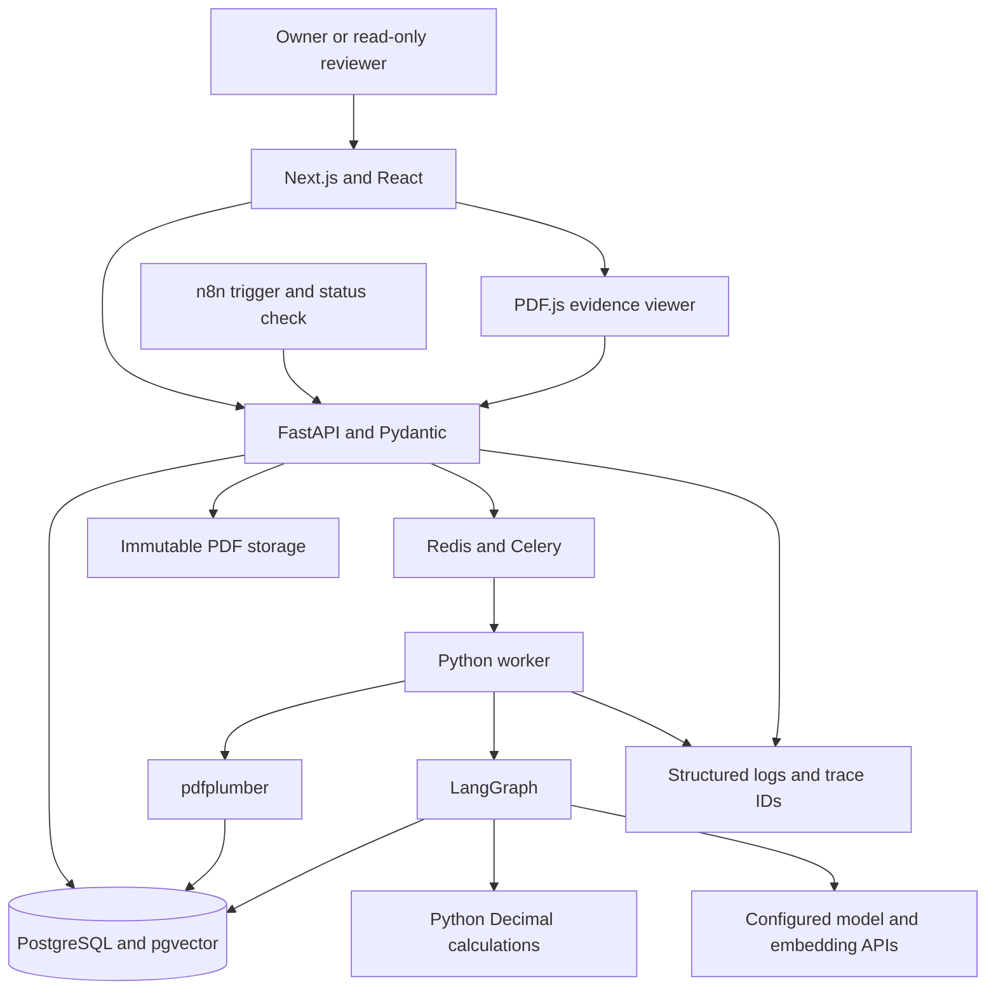
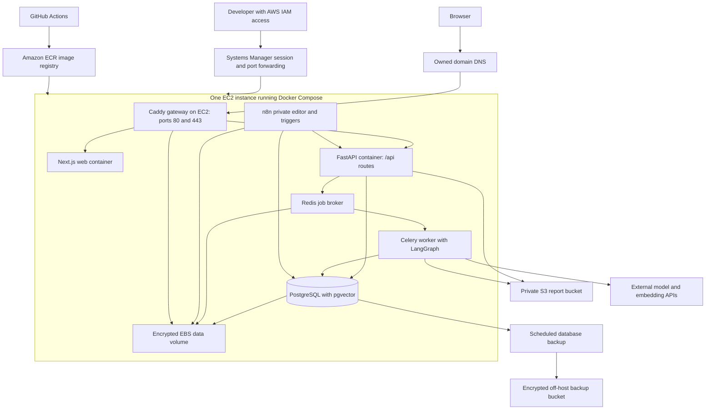

# Hong Kong Financial Report Analyst: development proposal

Date: 1 November 2026  
Status: Draft for review before implementation  
Developer capacity: One developer, 15 hours per week  
First-release goal: A working job-search portfolio demo  
Deployment decision: One AWS EC2 instance using Docker Compose; optional K3s extension later

## 1. Duration and assumptions

Budget **300 developer hours over 20 weeks**, approximately five months, for the portfolio release. This includes 240 hours of planned work and 60 hours of contingency for extraction problems, integration defects, and evaluation fixes.

Use **18 to 22 weeks** as the planning range if the scope stays fixed. These are engineering estimates, not measured delivery times or a guaranteed deadline. Re-estimate after the first real report passes extraction checks in stage 2.

| Milestone | Result | Estimated timing at 15 hours per week |
| --- | --- | --- |
| First working slice | Upload one report, review its cash-flow values, calculate a change, and open the source page | By week 5 or 6 |
| Core research demo | Compare reviewed facts and ask questions with citations in English or Traditional Chinese | By approximately week 16 |
| Portfolio release | Add a basic brief, one n8n workflow, evaluation evidence, deployment, and interview materials | Target week 20; planning range 18 to 22 weeks |
| Full 24-function extension | Complete the deeper revision, checkpoint approval, recovery, and operator interfaces in section 6 | Another 90 to 150 hours including contingency; approximately 26 to 30 weeks total from the start |

The full extension excludes OCR and public multi-user operation. Its additional hours apply after the 300-hour portfolio budget. The combined 26-to-30-week estimate uses the 20-week working target. Combining the first release's 18-to-22-week range with the extension gives a wider range of 24 to 32 weeks.

The EC2 and Docker Compose baseline uses the deployment allowance already in this estimate, provided deployment setup starts in stage 1. For a first EC2 deployment, allow another 12 to 24 hours, approximately one to two weeks. The optional Kubernetes extension in section 10 has a separate estimate.

The estimate assumes the following:

- You can already develop with React, APIs, SQL, and Python, and understand the academy's AI concepts. The budget covers implementation and debugging rather than introductory study.
- Report review, tests, documentation, and deployment share the 15-hour weekly budget. An example allocation is three hours on five days each week.
- The dataset contains three comparable HK-listed companies, two annual periods each, and six manually selected, text-based PDFs.
- Source reports are in English. Questions, answers, and the main interface support English and Traditional Chinese. Chinese-source extraction requires a separate trial.
- One chat model and one embedding model are configured. Comparing many providers is outside the first release.
- The public preview uses read-only seeded data. Uploads, edits, and paid model calls require owner sign-in.
- Credentials and hosting access are available before the relevant stages. Account delays, holidays, and missed development time extend the calendar.
- Existing diagrams and API examples reduce design work. The current academy finance page does not contain an operational finance backend.

## 2. Product outcome and release scope

A reviewer can select a company and reporting periods, inspect five reviewed metrics, and check the original PDF evidence behind an answer. Public visitors select precomputed example questions and inspect saved answers. The signed-in owner can submit live questions.

The main demonstration question is:

> Why did operating cash flow fall? Compare the two years and show the supporting report pages.

The app calculates the change in code. It attributes explanations to the report when supported. Without causal evidence, the app returns the supported figures and states what evidence is missing.

| Included in the portfolio release | Deferred work |
| --- | --- |
| Six selected text PDFs and manual upload | Arbitrary document layouts, scanned PDFs, and OCR |
| Revenue, net profit, operating cash flow, total assets, and total liabilities | Sector-specific metric libraries and forecasting |
| Reviewed facts, decimal arithmetic, comparisons, and basic charts | Automatic FX conversion, valuation, trading, and investment recommendations |
| Source-linked bilingual research answers | Fine-tuning, GraphRAG, autonomous web research, and multiple-agent systems |
| One owner and a read-only preview | Public registration, teams, tenant administration, and collaborative editing |
| One allowlisted n8n ingestion demonstration | Market-wide scraping and unrestricted URL downloads |
| A simple brief, persistent analysis state, and bounded retries | Rich document editing, exports, and all operator interfaces |
| A protected EC2 deployment with Docker Compose, CI checks, and a recorded demonstration | Kubernetes, production availability commitments, and large-scale infrastructure |

There are up to 30 selected company-period-metric cells to check manually. Record unavailable values as missing. Do not manufacture values to fill the dataset.

The README and CV description must distinguish completed features, limitations, and planned extensions.

## 3. Architecture and technology stack

Use one web application, one Python API, and a separate worker. Store financial facts and evidence in PostgreSQL. Keep original PDFs outside the database with immutable identifiers.



| Layer | Proposed tools | Developer responsibility | First introduced |
| --- | --- | --- | --- |
| Frontend | Next.js, React, TypeScript | Upload, review forms, comparisons, bilingual interface, and brief editing | Stage 1 |
| Charts and source viewer | Plotly.js, PDF.js | Show missing data and open the cited PDF version and page | Stages 2 and 4 |
| API | Python, FastAPI, Pydantic | Validate input, enforce access, and expose OpenAPI contracts | Stage 1 |
| Database | PostgreSQL, pgvector, SQLAlchemy, Alembic | Store metadata, facts, passages, vectors, jobs, and migrations | Stages 1 and 5 |
| Files | A storage adapter using a persistent local volume initially, then an S3 bucket when hosted | Preserve original bytes, hashes, and version links | Stages 1 and 7 |
| Extraction | pdfplumber first | Extract text and table candidates with page and coordinate references | Stage 2 |
| Jobs | Celery, Redis, and PostgreSQL job records | Execute slow work, track attempts, and recover bounded retries | Stage 2 |
| Analysis | LangGraph, Python Decimal | Coordinate retrieval, validation, calculation, drafting, verification, and saved state | Decimal in stage 2; LangGraph in stage 5 |
| Automation | n8n | Send an approved event, check job status, and record the outcome | Stage 6 |
| Verification and traces | pytest, Playwright, structured logs, Langfuse | Check arithmetic, user flows, model behavior, failures, and usage | Throughout; consolidated in stage 7 |
| Delivery | Docker Compose, Caddy, GitHub Actions, Amazon ECR, EC2, EBS, S3, and Systems Manager | Build immutable images, serve HTTPS, preserve data, deploy, and roll back | Stages 1 and 7 |

The parser choice remains provisional until the report trial. pdfplumber documents text and table extraction for machine-generated PDFs in its [official repository](https://github.com/jsvine/pdfplumber). PyMuPDF is an alternative if the trial identifies a need. Review its package and licensing requirements before adopting it.

Run heavy extraction and analysis outside the HTTP process. [FastAPI's background-task guidance](https://fastapi.tiangolo.com/tutorial/background-tasks/#caveat) discusses separate job tools for heavier computation. PostgreSQL records business job state; Redis alone does not define whether a document exists or a job completed.

Use a persistent LangGraph checkpointer. An in-memory checkpointer loses state on restart. See [LangGraph persistence](https://docs.langchain.com/oss/python/langgraph/persistence). The viewer uses [PDF.js](https://mozilla.github.io/pdf.js/), and the n8n container follows its [Docker installation guide](https://docs.n8n.io/hosting/installation/docker/).

Pin tested package versions and container tags during stage 1. Record them in lockfiles and deployment configuration. C#, Java, and UiPath remain optional integrations with their own scope and estimate.

## 4. Stages and effort budget

Each stage ends with a working demonstration and recorded acceptance results. Feature tests belong in their own stage. Stage 7 consolidates evaluation and release work.

| Stage | Planned hours | Indicative weeks | Deliverable |
| --- | ---: | --- | --- |
| 0. Confirm scope and sample reports | 12 | 1 | Dataset manifest, metric definitions, checked examples |
| 1. Establish the application and contracts | 24 | 2 to 3 | Running frontend, API, database, storage adapter, migrations |
| 2. Build one complete report journey | 30 | 4 to 6 | Upload, background extraction, review, calculation, source page |
| 3. Expand the library and verified facts | 42 | 7 to 9 | Six reports, reviewed facts, metadata, correction history |
| 4. Build comparisons and workspace | 30 | 10 to 12 | Compatible comparisons, charts, usable evidence viewer |
| 5. Add cited research and LangGraph | 48 | 13 to 16 | Bilingual answers, filtered retrieval, verification, saved state |
| 6. Add a brief and one n8n workflow | 24 | 17 to 18 | Saved research brief and ingestion replay demonstration |
| 7. Evaluate, deploy, and prepare the portfolio | 30 | 19 to 20 | Checked release, deployment, README, demonstration video |
| Implementation subtotal | 240 | | |
| Integration and correction reserve | 60 | Distributed within weeks 1 to 20 | Parser issues, evaluation fixes, deployment defects, usability corrections |
| Total working budget | 300 | 20 weeks at 15 hours per week | Portfolio release |

The week windows include the reserve. Do not add four more weeks of contingency to the 20-week target. The plan assumes sequential development, with test preparation and documentation alongside implementation.

### Stage 0. Confirm scope and sample reports

Developer tasks:

- Choose three companies in one sector with comparable reporting periods. Prefer non-financial companies for the initial metric definitions.
- Select two annual reports per company. Record source URLs, retrieval dates, fiscal dates, file hashes, currencies, and versions.
- Inspect income-statement, balance-sheet, and cash-flow pages before fixing the dataset.
- Define metrics, reporting bases, units, and period types. Separate the PDF page index from the printed page label.
- Choose a canonical source version for each company-period-metric cell. Annual reports can repeat comparative figures from earlier periods. Retain alternative and restated figures separately, and calculate using explicit fact IDs.
- Prepare ten initial evaluation questions before tuning prompts. Include supported questions, missing causes, and wrong-year traps.

Deliverables: A dataset manifest, metric dictionary, checked sample facts, and initial evaluation file.

Acceptance: Each report has extractable text. The developer can locate an example metric and its unit on the recorded page. Unknown values are labelled explicitly.

### Stage 1. Establish the application and contracts

Developer tasks:

- Create the finance application's structure, Docker Compose configuration, environment examples, migrations, and health checks.
- Prepare the EC2 deployment configuration, ECR image repositories, gateway routing, persistent-volume layout, and Systems Manager access described in section 10. Trial a placeholder image on EC2 early, then stop unused resources according to the spending plan.
- Model companies, documents, versions, evidence, candidates, facts, reviews, jobs, runs, and briefs.
- Add owner authentication and read-only preview permissions. Keep credentials on the server.
- Define request and response schemas, error codes, expected revisions, and job states. Generate OpenAPI documentation.
- Build navigation and the bilingual interface structure. Add initial CI checks and the file-storage adapter.

Deliverables: A reproducible application skeleton, migrations, and an API contract.

Acceptance: A clean checkout starts through documented commands. The API connects to PostgreSQL, the browser loads the app, and protected endpoints reject unauthenticated requests. No credential appears in browser code or tracked files.

### Stage 2. Build one complete report journey

Developer tasks:

- Upload one PDF with confirmed metadata, validate its type and size, hash it, and preserve the original.
- Record a durable job, enqueue extraction, and expose polling status.
- Extract current and comparative operating-cash-flow candidates from the selected report.
- Add a minimal review form that opens the source page and accepts or corrects each candidate.
- Calculate the change with Decimal after checking currency, scale, period, and reporting basis.
- Add bounded retries and useful failures. Repeat the upload to check deduplication.

Deliverables: A real report journey, two reviewed period values where available, a calculated change, and clickable evidence.

Acceptance: A reviewer completes the journey without manually inserting database rows. Duplicate upload creates no extra document. Failed extraction is visible and recoverable. Evidence opens the correct original version and page.

Scope checkpoint: If the layout requires extensive parser repair, simplify the dataset or revise the estimate. Adding OCR requires a separate estimate.

### Stage 3. Expand the library and verified facts

Developer tasks:

- Expand extraction to the five metrics across six reports.
- Add metadata editing, basic revision links, and parser configuration records.
- Store currency, scale, fiscal dates, metric definition, reporting basis, source wording, and evidence with accepted facts.
- Build the review queue and correction log. Keep candidates separate from accepted facts.
- Manually check up to 30 selected cells and record missing values.
- Add expected-revision checks so an old form cannot overwrite a newer review.

Deliverables: A report library, fact review screen, checked fixtures, and basic audit history.

Acceptance: Every accepted fixture value matches its source and metadata. Corrections retain the previous value and reviewer identity. Existing citations still work after a new PDF version is stored.

### Stage 4. Build comparisons and workspace

Developer tasks:

- Add company, metric, and period filters, comparison tables, and trend charts.
- Normalize compatible scales without inventing exchange rates.
- Block incompatible periods, currencies, definitions, and reporting bases. Explain the blocker.
- Keep missing values distinct from zero and keep missing chart points disconnected.
- Display formulas, input fact IDs, and original evidence for each numerical result.
- Define the negative-base policy. Initially, show the absolute movement and flag a non-positive prior value instead of presenting an ambiguous growth percentage.

Deliverables: A research workspace and deterministic calculation tests.

Acceptance: Arithmetic fixtures pass exactly before display rounding. Zero and negative bases, missing facts, interim-versus-annual periods, and unit mismatches produce the documented result or blocking state.

### Stage 5. Add cited research and LangGraph

Developer tasks:

- Create passages with document version and page provenance. Add embeddings and filtered vector and keyword retrieval.
- Enforce company, period, version, and access filters before returning evidence.
- Implement scope, retrieve, validate, calculate, draft, verify, and present as the LangGraph flow.
- Calculate numerical claims deterministically. Treat report text as untrusted evidence, including instructions embedded in PDFs.
- Support English and Traditional Chinese without changing metric definitions during translation.
- Attach evidence to material claims. Distinguish reported management commentary from interpretation.
- Save approved example questions and answers for the public preview. Restrict live research submissions to the signed-in owner.
- Persist graph state. Handle provider timeouts, missing evidence, and partial answers.

Deliverables: A cited research interface, saved graph state, retrieval traces, and a full question-to-answer demonstration.

Acceptance: Wrong-company and wrong-year distractors do not enter the answer. Unsupported explanations produce partial answers. Citations resolve correctly, and manual review checks claim support. A restart preserves saved state.

### Stage 6. Add a brief and one n8n workflow

Developer tasks:

- Save a basic editable brief with its source run, facts, citations, and revision checks.
- Export an n8n workflow that sends one event for a configured, approved report source.
- Authenticate the service request and validate the download destination on the backend, including redirects.
- Reuse a stable event key, create or reuse a job, poll its status, and record the outcome.
- Demonstrate success, failure, and replay. Keep credentials outside the workflow export.

Deliverables: A saved brief, credential-free n8n export, setup notes, and replay evidence.

Acceptance: Edits preserve evidence links. A repeated event creates one document and one logical ingestion job. Changed content with the same key is rejected. Completion is recorded only after processing finishes. Email and Slack notifications are optional extensions.

### Stage 7. Evaluate, deploy, and prepare the portfolio

Developer tasks:

- Expand and freeze at least 30 evaluation cases across facts, retrieval, arithmetic, support, missing evidence, and recovery.
- Keep a held-out subset outside prompt tuning. Record expected evidence, configuration, and actual case-level results.
- Add trace IDs, model usage, timings, and failures. Record cost as unknown if the pricing record is unavailable.
- Deploy the tested images to EC2 using Docker Compose and the runbook in section 10. Add HTTPS, protected owner access, and a read-only seeded preview. Apply request limits and model-usage limits.
- Check database backup and restore, persistent files, health checks, and rollback to the previous image.
- Prepare the README, architecture diagram, setup commands, API contract, evaluation report, limitations, screenshots, and a short demonstration video.

Deliverables: A tagged portfolio release, HTTPS deployment address, EC2 runbook, production Compose configuration, verified backup and rollback records, and interview evidence bundle.

Acceptance: Another developer can reproduce the checked journey from the README. The release checks in section 7 pass. The video includes a supported answer and a partial answer caused by missing evidence.

## 5. Developer contracts and repository structure

The academy contains 23 illustrative HTTP designs and a deployment workflow. Use those as starting points. The implemented OpenAPI contract becomes authoritative.

| Contract | Required behavior |
| --- | --- |
| Upload | `POST /api/v1/documents` stores an immutable version and returns a durable job reference |
| Status | `GET /api/v1/jobs/{jobId}` returns state, result, or structured failure; submission HTTP 202 means accepted, not complete |
| Review | Authorized reviewers accept, correct, or reject candidates; accepted facts retain the evidence and review identity |
| Calculation | Load reviewed facts, check compatibility, and calculate with Decimal |
| Research | `POST /api/v1/research/runs` creates a scoped run with complete, partial, or insufficient-evidence output |
| Evidence | Enforce access before returning metadata or PDF bytes for the immutable version |
| Automation | `POST /api/v1/ingestion/events` requires service authentication, source restrictions, and a stable event key |
| Editing | Expected revisions prevent overwriting newer metadata, facts, or briefs |
| Failures | Errors include codes and request IDs; bounded retries reuse operation identity |

Keep business job state separate from graph state. A job tracks attempts. A LangGraph checkpoint records analysis progress. Persistent checkpoints alone do not prevent duplicated external side effects.

Start the finance application in a separate repository unless you choose to keep it beside the academy. A proposed structure is:

```text
finance-report-analyst/
  apps/web/                 # Next.js interface
  services/api/             # FastAPI and access checks
  services/worker/          # Celery tasks and LangGraph
  packages/contracts/      # Generated API client
  db/migrations/           # Alembic migrations
  data/manifests/          # Source metadata and hashes
  evals/                   # Checked cases and recorded results
  workflows/n8n/           # Credential-free exports
  tests/                   # Integration and browser tests
  docs/                    # Architecture and runbook
  deploy/                   # EC2 Compose overrides, gateway, release files, runbook
  scripts/                  # Deploy, backup, restore, and smoke-check commands
  .github/workflows/        # Checks and container image publication
  compose.yaml
  .env.example
```

Record source URLs and hashes in the repository. Store originals in application storage. Redistribute reports only where their source permits it. Keep fixtures reproducible without committing credentials or personal documents.

For the existing academy, preserve the agreed branch roles:

- `codex/rich-animated-ts` is the main development branch.
- `codex/node18-office-bundle` is the side branch for the office edition.

The office edition retains the static guide. The finance backend needs its own services and credentials. The office edition's Node 18 packaging does not determine the new application's runtime. This proposal does not create a finance backend or provision cloud resources.

## 6. Coverage of all 24 functions and the later extension

The first release demonstrates all eight areas. Some functions have a limited implementation first. Do not describe the portfolio release as completing every aspect of all 24 functions.

| ID | Function | Portfolio scope and stage | Later extension |
| --- | --- | --- | --- |
| 01 | Upload annual-report PDFs | Validation, deduplication, status; stage 2 | Broader operational and recovery checks |
| 02 | Label company, period and source | Confirmed metadata, conflict checks; stages 0 and 3 | More report types and editing options |
| 03 | Keep originals and revisions | Immutable files, basic version links; stage 3 | Dependent-result invalidation and revision navigation |
| 04 | Extract text and financial tables | Selected layouts and candidates; stages 2 and 3 | Wider layout support after re-estimation |
| 05 | Retain page and table references | Page index, label, coordinates, version; stages 2 and 3 | Polished highlighting |
| 06 | Review uncertain values | Accept, reject, correct, record reviewer; stage 3 | Richer review controls |
| 07 | Start with five financial metrics | Five definitions and checked fixtures; stage 3 | Additional metrics need separate scope |
| 08 | Track currency, scale and period | Metadata and normalization; stages 3 and 4 | Broader compatibility explanations |
| 09 | Record corrections and restatements | Extraction corrections retain history; stage 3 | Issuer-restatement lineage and stale-result handling |
| 10 | Ask in English or Traditional Chinese | Both languages over English reports; stage 5 | Chinese-source parsing needs a new trial |
| 11 | Retrieve relevant report passages | Filtered vector and keyword retrieval; stage 5 | Evaluation-driven retrieval tuning |
| 12 | Cite evidence or say what is missing | Claim evidence, partial answers; stage 5 | Better reviewer controls |
| 13 | Calculate year-on-year change | Decimal and denominator policy; stages 2 and 4 | More formulas need separate scope |
| 14 | Compare companies side by side | Three companies and agreed periods; stage 4 | More flexible selections |
| 15 | Check periods and definitions | Mandatory compatibility rules; stage 4 | Richer blocker inspection |
| 16 | Dashboard and trend charts | Filters, tables, charts; stage 4 | More presentation options |
| 17 | Open the cited PDF page | Authorized correct-version viewer; stages 2 and 4 | Bounding-box highlighting |
| 18 | Save an editable research brief | Prose, citations, revision checks; stage 6 | Source-change warnings and richer history |
| 19 | LangGraph analysis checkpoints | Persistent state, restart check; stage 5 | Authorized human approval and resume interface |
| 20 | n8n ingestion triggers | One allowlisted event; stage 6 | Schedules and optional notifications |
| 21 | Retry jobs without duplicates | Bounded retry and replay checks; stages 2 and 6 | Concurrency, crash recovery, notification outbox |
| 22 | Manually checked evaluation cases | Versioned command and case results; stage 7 | Operator evaluation API and interface |
| 23 | Trace failures and model cost | Traces, usage, recorded pricing; stage 7 | Operator trace API and retention controls |
| 24 | Reproducible deployment and demo | Compose, CI, deployment, walkthrough; stage 7 | More complete release operations |

The later extension adds 70 to 120 implementation hours and 20 to 30 contingency hours. That is **90 to 150 hours**, or **6 to 10 weeks**, after the portfolio release. Re-estimate after release rather than treating this range as a fixed contract. Broader layouts, extra metrics, extra formulas, and Chinese-source parsing remain separate scope changes.

## 7. Portfolio acceptance checks

These are proposed targets, not achieved results. Report actual case counts and failures once the implementation exists.

- Every accepted fixture fact matches its checked amount, definition, currency, scale, period, reporting basis, and evidence page.
- All deterministic calculation and compatibility fixtures pass, including missing values, non-positive denominators, wrong years, and unit mismatches.
- Every demonstration citation opens the correct version and page. Manual review checks support separately from link existence.
- At least 30 frozen evaluation cases report extraction, retrieval, arithmetic, support, and missing-evidence behavior separately.
- No unresolved critical case remains in that release set. Critical failures include wrong-company disclosure, wrong-year numerical answers, fabricated inputs, and unsupported explanations stated as fact.
- Model-based evaluation supplements manual checking. A small passing set does not establish reliability for arbitrary reports.
- Replaying an upload or event creates no extra document or logical job. A worker restart leaves a recoverable job or an explicit terminal failure.
- Anonymous preview visitors cannot edit, upload, or trigger paid model calls.
- Key journeys work on desktop and mobile. Questions, evidence, and errors work in both interface languages.
- A fresh environment starts from the README. A recorded backup restores successfully, and the previous application image can be redeployed.

## 8. Risks and cost controls

| Risk | Delivery effect | Planned response |
| --- | --- | --- |
| Inconsistent PDF tables | Longer extraction work | Trial layouts early, restrict the dataset, retain manual review |
| Ambiguous accounting definitions | Misleading comparisons | Maintain the metric dictionary and block unknown bases |
| Sparse explanation evidence | Plausible unsupported answers | Demonstrate partial answers and evaluate claim support |
| Deployment integration | Local demo fails on EC2 | Trial EC2 in stage 1, containerize early, and reserve time for deployment fixes |
| Single EC2 host failure | All application containers become unavailable | Keep off-host backups and a tested replacement-host recovery procedure; accept demo downtime |
| Replayed work after a crash | Duplicate records or side effects | Persist identity, use idempotent handlers, test replay; do not promise exactly-once external delivery |
| Extra integrations | Longer schedule | Finish the selected dataset and core journey first |
| Missed weekly capacity | Later completion | Recalculate remaining hours divided by available weekly hours after each stage |

The proposal estimates developer time. Hosting, model usage, paid services, and taxes are excluded. Choose a monthly spending cap before connecting paid services. Use seeded examples, caching, bounded file sizes, model limits, and protected live calls. Verify vendor prices when choosing the provider and deployment.

For an earlier interview, reduce scope to one company, two periods, manual review, cited answers, and a source viewer. Defer automated ingestion, rich briefs, advanced revisions, and operator interfaces. Re-estimate that reduced scope before promising a date.

## 9. Handoff and remaining decisions

Start with stage 0. At each stage, record actual hours, open defects, acceptance evidence, and the revised estimate. Use the extraction result to decide whether to simplify the dataset.

The following defaults are sufficient for this proposal. Confirm each before its dependent work starts.

| Decision | Proposed default | Needed by |
| --- | --- | --- |
| Reports | English text PDFs for three comparable HK-listed non-financial companies | Stage 0 |
| Interface | English and Traditional Chinese | Stage 1 |
| Repository | A separate finance application repository | Stage 1 |
| Provider | One configurable model provider and embedding model | Stage 5 |
| Preview | Owner sign-in and read-only seeded access on EC2 | Stage 1 for access design; stage 7 for release |
| Deployment | Docker Compose on one EC2 instance; Kubernetes deferred | Confirmed by this proposal update |
| AWS region and domain | Choose a region with the required services and an owned DNS name before provisioning | Stage 1 |
| Running-cost ceiling | Owner selects a monthly cap after reviewing prices | Before paid services |
| Interview deadline | Relative weeks until a date is supplied | Before committing to calendar dates |

## 10. Deploy to EC2 with Docker Compose

### 10.1. Deployment choice

Use Docker Compose on one EC2 instance for the first release. Docker packages the services into images, and Compose starts and connects them on the host. Kubernetes also runs containers, but introduces a cluster control plane, manifests, ingress, and storage management.

[Docker documents Compose deployment on a single production server](https://docs.docker.com/compose/how-tos/production/). This fits the selected dataset and solo development budget. Use a production configuration with built images, persistent volumes, health checks, and restart policies.

| Option | Place in this proposal | Trade-off |
| --- | --- | --- |
| Docker Compose on EC2 | First release | One host to operate and a direct path from local development to deployment |
| K3s, a Kubernetes distribution, on EC2 | Optional learning extension | Adds Kubernetes experience and operating work; a single node still has a single point of failure |
| A multi-node cluster or Amazon EKS | Outside this release | Requires a separate availability design, operating budget, and estimate |

The EC2 baseline accepts short maintenance interruptions and host-failure downtime. It does not promise automatic failover or zero-downtime releases.

### 10.2. Hosted architecture



Keep the public browser on one HTTPS origin. Caddy explicitly denies `/api/internal` and `/api/internal/*` before routing the permitted `/api/*` paths to FastAPI. Route other application paths to Next.js. Preserve the `/api` prefix when proxying so `/api/v1/documents` reaches the expected API path. Keep API-side operator authorization even for internal paths. Run operator tasks through the protected SSM administration path. Keep n8n, trace administration, database connections, and the Docker daemon outside the public gateway routes.

### 10.3. Services, storage, and network rules

| Service | Container role | Public exposure | Durable data |
| --- | --- | --- | --- |
| `gateway` | Caddy reverse proxy and certificates | Host TCP 80 and 443 | Certificate state on encrypted EBS |
| `web` | Next.js production server | Reachable through Caddy only | No required local application state |
| `api` | FastAPI, access checks, resource API | Reachable through Caddy only | Records in PostgreSQL; PDFs in S3 |
| `worker` | Celery extraction and LangGraph processing | No published host port | Jobs, facts, and checkpoints in PostgreSQL |
| `postgres` | Application data, vectors, checkpoints, separate n8n database | No published host port | Explicit directory on encrypted EBS |
| `redis` | Job transport with configured persistence | No published host port | Redis persistence on EBS; PostgreSQL remains the job ledger |
| `n8n` | Manual or scheduled ingestion workflow | Host loopback only, reached through an SSM tunnel | Separate database and persisted n8n configuration and encryption key |
| `migrate` | One-shot database migration command | No published port | Updates the application schema and records its revision |

Use a separate database and credential for n8n. Do not let its normal database account read the application's financial facts. Reuse the backend image for `api`, `worker`, and `migrate`, with different startup commands.

Use Docker bridge networks to limit service connections. Do not publish PostgreSQL, Redis, the API server port, or the Next.js server port to the internet. The API, worker, and n8n need outbound access to their configured services. Do not attach them only to an `internal: true` network that blocks required external calls.

For the EC2 security group, allow inbound TCP 80 and 443. Use AWS Systems Manager for administration, with no inbound SSH rule. Allow the necessary outbound access for DNS, AWS APIs, image downloads, certificate issuance, and model calls. [Session Manager supports administration without inbound management ports and provides port forwarding](https://docs.aws.amazon.com/systems-manager/latest/userguide/session-manager.html).

Bind the n8n editor to host loopback, for example `127.0.0.1:5678:5678`, and access it through an SSM tunnel. Keep n8n authentication enabled. A scheduled or manually triggered demonstration does not require a public webhook endpoint.

### 10.4. AWS resources and initial capacity

Create the following resources in the selected AWS region:

1. One Linux EC2 instance in a VPC subnet with the internet routing required by this direct-gateway design.
2. A stable public address and a DNS record for an owned domain.
3. An encrypted EBS data volume mounted separately from the operating-system volume.
4. A private S3 report bucket with versioning and public access blocked.
5. An encrypted backup bucket or separately restricted backup prefix with retention rules.
6. Private ECR repositories for the web and backend images.
7. An EC2 instance role for the required S3, ECR pull, secrets, monitoring, and Systems Manager actions.
8. A GitHub Actions image-publishing role and the secrets configuration described below.

As a starting capacity assumption, assess an x86_64 instance with about 2 vCPUs and 8 GiB RAM, plus about 60 GiB of data storage. This is a sizing proposal, not a measured requirement. Start with worker concurrency of one and measure memory use during extraction and indexing. Resize if the agreed report fixtures cause memory pressure or unacceptable processing times.

Use external model APIs rather than running a local LLM on EC2. Keep a full self-hosted Langfuse stack outside this host's baseline capacity. Use structured logs and trace IDs, with a hosted tracing service if selected.

Enable log rotation, disk-use monitoring, instance health alarms, and a spending alert. Set retention for database dumps, container logs, checkpoints, and unused image versions. Record volume retention behavior when replacing or terminating the instance.

### 10.5. Credentials and persistent state

Use an EC2 instance role for temporary AWS credentials, scoped to the required resources. [AWS documents this role-based credential flow](https://docs.aws.amazon.com/AWSEC2/latest/UserGuide/iam-roles-for-amazon-ec2.html). Verify SDK access from the actual API and worker containers, including the chosen IMDSv2 and container-network settings. A shared instance role is not per-container IAM isolation.

Store the model key, database passwords, application session secret, n8n encryption key, and service token in AWS Secrets Manager or encrypted Systems Manager parameters. Fetch only required secrets during setup or deployment. Mount protected files only into their consuming services using Compose secrets or explicit read-only file mounts.

[Compose secrets mount files inside containers](https://docs.docker.com/compose/how-tos/use-secrets/). They do not replace an external secret store or encrypt the source files on the host. Keep those files outside Git on encrypted storage with restricted filesystem access. Do not put credentials into Docker image layers or browser configuration.

Use explicit bind-mount paths under the mounted EBS filesystem for PostgreSQL, Redis persistence, n8n configuration, and Caddy certificate state. For example, reserve `/srv/finance-data` as the data mount. On this dedicated host, gate the Docker daemon itself on that mount through a systemd mount dependency and an explicit mount-point check before startup. The documented setup can use `RequiresMountsFor=/srv/finance-data` with an appropriate mount-point check. Fail if the expected filesystem is absent. Gating only the Compose unit is insufficient because Docker restart policies can start existing containers as the daemon starts. This prevents a reboot from creating an empty database on the root disk.

Persist PostgreSQL roles and extension setup through reproducible initialization and migrations. Save application facts, reviews, briefs, jobs, and LangGraph checkpoints there. Keep original PDF object keys and hashes in the database and immutable bytes in S3. Configure Redis persistence and reconcile recoverable jobs from the PostgreSQL ledger after a failure.

### 10.6. Container build and release flow

The developer implements the following release path:

1. GitHub Actions runs type checks, tests, the production build, and the agreed evaluation gate.
2. Actions builds the web and backend images for the EC2 CPU architecture.
3. Actions publishes immutable commit tags to ECR and records image digests and the database schema revision in a release manifest.
4. The developer connects through Systems Manager, selects the tested release, and starts the deployment script.
5. The script validates configuration, authenticates to ECR, pulls the selected images, and checks prerequisites before changing running services.
6. The script pauses ingestion and writes, drains active workers within the configured shutdown policy, and takes a verified pre-migration backup.
7. The script runs the one-shot migration, starts the updated services, and checks readiness and the seeded demonstration.
8. The script resumes ingestion only after checks pass and records the release result.

Use GitHub's AWS OIDC integration for image publication instead of storing long-lived AWS access keys in repository secrets. Restrict the role trust to the intended repository and release branch or environment. See [GitHub's AWS OIDC guide](https://docs.github.com/en/actions/how-tos/secure-your-work/security-harden-deployments/oidc-in-aws).

Initial deployment can be started manually through SSM after CI publishes the images. Automated deployment through SSM Run Command is a later convenience, with its own restricted permissions. Do not install a public Docker API or an unrestricted self-hosted Actions runner on the EC2 host.

### 10.7. First deployment procedure

The stage 7 runbook must provide these steps and their expected results:

1. Provision EC2, IAM roles, security group, EBS, S3, and ECR. Record resource identifiers and the region.
2. Install Docker Engine, the Compose plugin, AWS CLI, and the Systems Manager agent where required, using official packages. Enable startup services.
3. Mount the data volume, establish the directory permissions, and verify a reboot remounts it before Compose starts.
4. Point the owned domain to the EC2 address. Configure Caddy with persistent certificate storage. Verify DNS and the public challenge ports required by the chosen HTTPS configuration.
5. Retrieve runtime secrets into protected files. Install the production Compose configuration and release manifest.
6. Authenticate to ECR with temporary credentials. Pull the recorded image versions.
7. Start PostgreSQL and Redis, run database initialization and migrations, and create the owner account through the documented protected setup command.
8. Start the API, worker, web, gateway, and n8n. Import the seeded dataset and the credential-free n8n workflow, then configure its credentials privately.
9. Verify HTTPS, public preview, owner actions, file access, job execution, and the recovery tests below. Enable the backup schedule and record the release.

[Caddy's automatic HTTPS requirements](https://caddyserver.com/docs/automatic-https) include correct DNS, reachable challenge ports, and writable persistent certificate storage. Use a real owned DNS name for this design.

The commands below illustrate the intended Compose workflow. They target the future finance repository and require its Dockerfiles, service definitions, secrets, and migrations. They are not runnable deployment files in the current academy repository.

```bash
# Authenticate Docker using the EC2 role. Set these non-secret values first.
aws ecr get-login-password --region "$AWS_REGION" \
	| docker login --username AWS --password-stdin "$ECR_REGISTRY"

# Resolve the configuration without printing runtime secrets.
docker compose --env-file deploy/production.env \
	-f compose.yaml -f deploy/compose.ec2.yaml config --quiet

# Pull the exact images recorded for this release.
docker compose --env-file deploy/production.env \
	-f compose.yaml -f deploy/compose.ec2.yaml pull

# On first installation, start the database and broker before migrations.
docker compose --env-file deploy/production.env \
	-f compose.yaml -f deploy/compose.ec2.yaml up -d --wait --wait-timeout 120 postgres redis

# After the database and broker pass their health checks, run migrations.
docker compose --env-file deploy/production.env \
	-f compose.yaml -f deploy/compose.ec2.yaml run --rm migrate

# Start the long-running services and inspect their status.
docker compose --env-file deploy/production.env \
	-f compose.yaml -f deploy/compose.ec2.yaml up -d \
	postgres redis api worker web gateway n8n

docker compose --env-file deploy/production.env \
	-f compose.yaml -f deploy/compose.ec2.yaml ps
```

`deploy/production.env` contains non-secret release configuration such as image references, domain, region, and bucket names. Secret values arrive through the protected file mounts. ECR authentication follows the [official registry authentication procedure](https://docs.aws.amazon.com/AmazonECR/latest/userguide/registry_auth.html).

Define container health checks and a backend readiness endpoint. Compose startup order alone does not prove the application can serve a request. Configure restart behavior and the Docker daemon's mount dependency before enabling boot-time startup. Start Compose through the documented system service after that prerequisite passes. Updates must use the maintenance and worker-drain procedure, rather than replaying the first-install commands against live writes.

### 10.8. Backup, rollback, and host recovery

| Item | Backup or recovery design | Evidence required |
| --- | --- | --- |
| PostgreSQL | Daily application-consistent logical dumps, plus a dump before schema migrations; include the application and n8n databases and role setup | Restore onto a separate database or host and open a checked fact, brief, and graph checkpoint |
| PDF originals | Private S3 objects with versioning, hashes, and retained immutable object references | Fetch a cited original after replacing the application host |
| n8n credentials | Preserve its database and configuration, and retain the encryption key in the external secrets store | Restore and run the ingestion demonstration without losing credential decryption |
| Proxy and runtime configuration | Versioned non-secret configuration plus protected persistent certificate data | Recreate HTTPS and owner access on the replacement host |
| Application release | Current and previous image digests, configuration, and schema-compatibility notes | Roll back a failed application release and pass the seeded smoke checks |

Upload database dumps to encrypted off-host storage. A dump kept only on the same EC2 disk is not a host-loss backup. Record backup timestamps, retention, verification results, and failure alerts. EBS snapshots can supplement the dumps, but a snapshot alone does not prove an application-consistent restore.

n8n encrypts stored credentials with its encryption key. Preserve the same key when restoring its database. See the [n8n encryption-key documentation](https://docs.n8n.io/hosting/configuration/configuration-examples/encryption-key/).

Proposed recovery targets for this demo are a recovery point of no more than 24 hours for scheduled database backups and restoration within four working hours once the operator starts recovery. These are acceptance targets to test, not an availability guarantee. Record the observed recovery time during the exercise.

Use backward-compatible database migrations where practical. Rolling back to a previous image is safe only if that image can use the current schema. If a destructive migration requires restoring the database, stop writes and treat that as a separate recovery action with possible loss of writes after the backup. Document it explicitly.

After host failure, provision a replacement, attach or restore the data volume, recover the databases and secrets, pull the recorded images, and check references to the S3 originals. Reassign the stable address or update DNS, then run the smoke checks. Do not remove persistent data volumes as part of a routine release or rollback.

### 10.9. Deployment acceptance checks

- The owned domain serves a valid HTTPS certificate and HTTP redirects to HTTPS.
- Only the intended gateway ports are publicly reachable. PostgreSQL, Redis, n8n administration, and container control are not publicly exposed. External requests to `/api/internal` and its subpaths are denied.
- Owner login, uploads, reviews, and live research work. Anonymous users can inspect only the seeded preview and cannot trigger paid calls.
- A cited PDF returns the right immutable object and page after an authorized request.
- A failed and replayed ingestion leaves the documented state without extra documents or logical jobs.
- Container recreation and an EC2 reboot preserve reports, facts, briefs, checkpoints, n8n state, and proxy certificate state.
- A missing EBS mount prevents startup rather than creating a fresh empty database.
- A backup restores on a separate target, including the n8n encryption key, required roles, and pgvector extension setup.
- A previous application image can be redeployed against a compatible schema, with the result recorded.
- Logs have trace IDs and retention limits. Disk, instance health, backup failures, and spending alerts reach the configured operator destination.

Stage 1 establishes the EC2 path. Stage 7 verifies and documents it. Reserve approximately 12 to 18 of stage 7's 30 planned hours for deployment and recovery checks, with the remaining time for final evaluation and portfolio packaging. Feature tests and infrastructure preparation must already exist from earlier stages. For a first-time EC2 operator, add the 12-to-24-hour allowance in section 1.

### 10.10. Optional Kubernetes extension on EC2

After the Compose release works, add a separate **25-to-45-hour K3s learning extension**, approximately two to three weeks at 15 hours per week. This is additional to both the portfolio budget and any chosen 24-function extension. It assumes familiarity with container deployment. Re-estimate if Kubernetes concepts are new.

Use K3s on EC2 rather than introducing EKS into this first-release design. Check the [K3s operating-system, resource, and networking requirements](https://docs.k3s.io/installation/requirements). Its control-plane requirements do not include application workload resources.

The extension delivers the following:

- A namespace and Deployments for web, API, and worker, using the same immutable images.
- Internal Services and an Ingress controller with one documented TLS strategy.
- Readiness and liveness probes, resource requests and limits, and explicit worker shutdown behavior.
- PersistentVolumeClaims with a documented EBS provisioning or restore path for stateful services, or a separately scoped move to managed data services.
- A secret-delivery design using the external store. A Kubernetes Secret manifest must not contain committed credentials.
- Kubernetes Jobs for migrations and manual backups, CronJobs for scheduled backups, and restricted cluster administration.
- A recorded rolling update, failed readiness check, rollback, and persistent-data restore.

Keep the Kubernetes API and cluster-internal ports private. Do not expose the API server to the internet for the demo. Do not run the Compose and Kubernetes production workloads against the same database data directory.

A single-node cluster can demonstrate Kubernetes deployment, but it cannot reschedule workloads onto another host when EC2 fails. If you later require multiple nodes or automatic failover, redesign storage, database availability, ingress, and recovery, then estimate that work separately.

Proposal basis: the [existing project blueprint](FINANCIAL_REPORT_PROJECT.md), [24-function catalog](../lib/finance-function-workflows.ts), and [illustrative API designs](../lib/finance-api-workflows.ts). Those files describe intended behavior. The stages above turn that design into a smaller portfolio release with explicit follow-up work.
