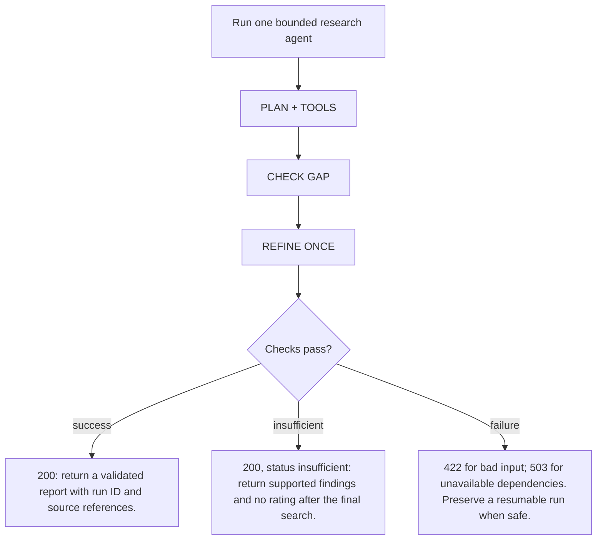
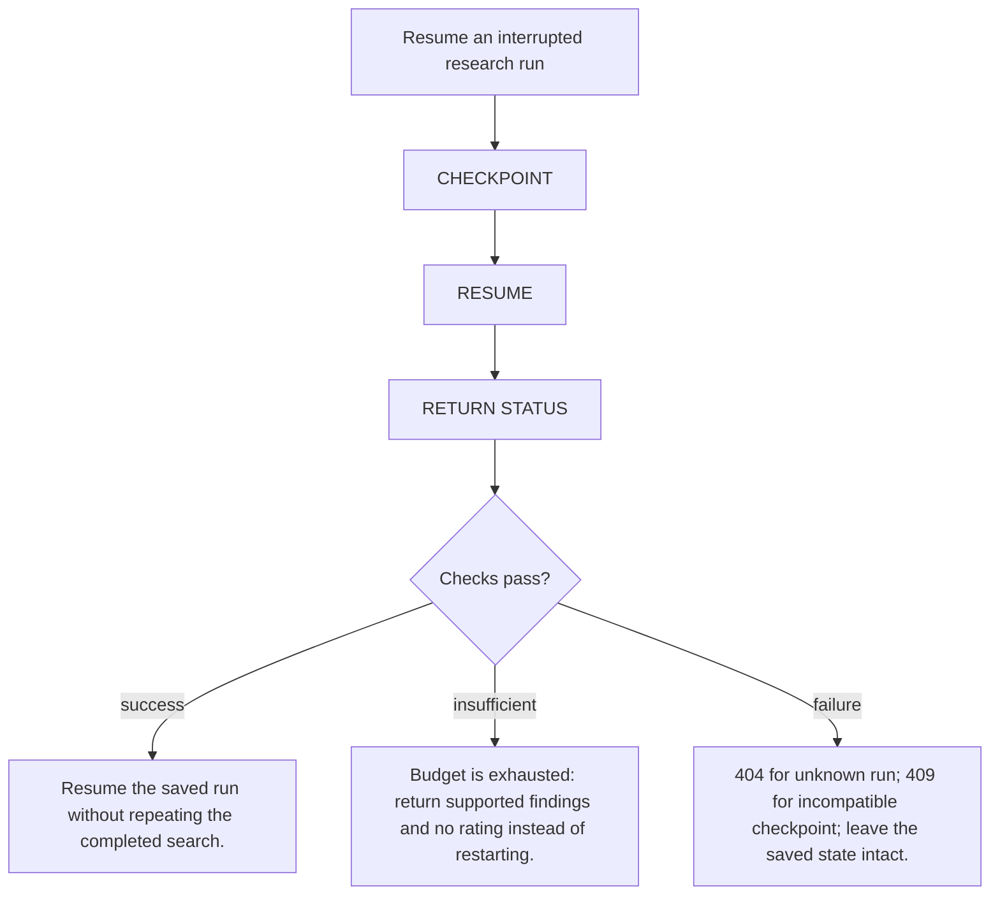

# Stock research assistant / 股票研究助手

Three supported companies, one bounded research agent, one cited report.

3 間公司、1 個有執行上限的研究 agent、1 頁有來源報告。

This academy contains a working offline teaching simulation and a proposed application design. It does not run a Python finance service, fetch current market news or issue real investment recommendations. All demo events, news and ratings are fictional.

此學習網站提供可操作的離線教學模擬及未來 app 設計，沒有運行 Python 金融服務或抓取即時新聞；示範事件、新聞及評級全部虛構。

Supported company identities: Microsoft (MSFT), Apple (AAPL), NVIDIA (NVDA). Real company identities do not make the demo fixtures real news.

Generated from `lib/finance-project.ts` and `lib/finance-proposal.ts`. Run `npm run proposal:sync`; do not edit the generated files.


## Bounded agent design / 有限研究流程

Use one research graph. A mandatory node calls refresh_company_news through n8n MCP for each new prompt before retrieval. The model then chooses between search_company_evidence and read_source. It may refine a query once. Keep company identity, dates, source IDs, evidence, attempted searches, validation errors and report status in typed run state.

使用一個研究 graph，每個新提示由固定節點先經 n8n MCP 呼叫 refresh_company_news；模型其後在兩個研究工具中選擇，最多修正搜尋一次。狀態保存公司、日期、來源、證據、搜尋次數、驗證錯誤及報告狀態。

Proposed limits: 2 searches, 6 source reads, 3 model calls and 60 seconds per run. Enforce budgets in code, not in article text.

Checkpoint state is run-scoped memory. Long-term user memory is deferred. Read-only source lookup does not need repeated human approval. Ask for clarification when identity is ambiguous; require explicit approval before any future externally visible action. The first release does not trade, send or publish reports automatically.

Checkpoint 保存單次研究進度，跨任務長期記憶延後。唯讀查詢不用逐次批准；公司不明確時先澄清。將來如有外發動作須先獲批准；首版不自動交易、發送或發布報告。

## Revised news, retrieval and observability requirements / 新版要求

Prompt + company + horizon → n8n MCP → refresh_company_news → Versioned evidence + time filters → Sparse / gated hybrid → rerank → Conditional forecast + citations → Validate → feedback + trace URL

### Fresh news for every prompt / 每個提示都取得新聞

Every new valid research prompt creates a run and must call refresh_company_news through the n8n MCP Server Trigger before retrieval. A deterministic graph node enforces this; the LLM cannot skip it. Resume reuses the same refresh receipt.

每個有效研究提示都建立任務，檢索前必須經 n8n MCP Server Trigger 呼叫 refresh_company_news。由固定 graph 節點強制執行，LLM 不能略過；恢復任務重用原刷新紀錄。

n8n exposes a Custom Workflow Tool for approved news APIs/RSS. Validate company, query, UTC window and result limit; use fixed provider URLs, server credentials, bounded retries and run_id idempotency. A schedule may warm the store but never replaces the per-prompt call.

n8n 以 Custom Workflow Tool 接駁核准新聞 API／RSS。驗證公司、問題、UTC 時段及筆數；使用固定供應商網址、伺服器憑證、有限重試及 run_id 冪等鍵。排程可預熱資料，但不能取代每個提示的呼叫。

Return source_id, canonical URL, published_at, first_seen_at, fetched_at, content hash, permitted excerpt, snapshot_id and provider status. Deduplicate syndicated stories. Outage, partial coverage or stale data is visible; never silently describe old news as fresh.

回傳來源 ID、原網址、發布／首次取得／擷取時間、內容 hash、允許節錄、快照 ID 及供應商狀態。同一轉載新聞去重；中斷、覆蓋不足或過期資料必須明示，不能將舊聞稱為即時。

### Measured retrieval / 有量度依據的檢索

Freeze corpus, prompts, graded relevance labels (0/1/2), expected abstentions and SHA-256 manifest before tuning. The checked-in v1 set has 18 fictional cases across three tickers and is a harness smoke test. A separate human-reviewed, licensed news holdout is required for production admission; do not tune on either test set.

調參前凍結語料、問題、0／1／2 相關性標籤、預期拒答及 SHA-256 清單。v1 有三個 ticker 共 18 個虛構案例，只驗證評估工具；正式准入另須人工核對、獲授權的新聞保留集，不能用測試集調參。

Compare SQLite FTS5/BM25 sparse, Qdrant dense + sparse with reciprocal rank fusion, and hybrid + a pinned cross-encoder reranker. Use identical chunks, company/permission/time filters and candidate budgets: 20 per branch, fuse to 20, rerank to 10, pass at most 6 excerpts to the model. Filter both published_at and first_seen_at at the as-of cutoff.

比較 SQLite FTS5／BM25、Qdrant dense＋sparse 的 RRF 混合檢索，以及加固定版本 cross-encoder 的混合檢索。共用切段、公司／權限／時間條件及預算：每分支 20、融合至 20、重排至 10、最多 6 段送模型。發布及首次取得時間都須早於截止點。

Report macro recall@5/10 and nDCG@5/10 on answerable cases; report empty-evidence cases separately. Before enabling hybrid + reranking, require absolute gains of at least +0.03 recall@10 and +0.05 nDCG@10 over sparse, no per-company regression, citation-precision ≥0.95 and no decline from sparse. These are proposed acceptance thresholds, not measured improvements.

可回答案例報告 macro recall@5／10 及 nDCG@5／10；無證據案例分開計算。啟用混合＋重排前，對 sparse 的 recall@10 須至少增加 0.03、nDCG@10 至少增加 0.05（絕對值），各公司不可倒退，引用精準度 ≥0.95 且不低於 sparse。這些是建議門檻，並非已量度提升。

Citation-precision means supported claim–source pairs / all emitted pairs, judged against the actual excerpt; an existing URL alone is insufficient. Also require 100% citation coverage for material factual claims, correct abstention on all no-evidence cases, and report sample counts. Zero citations means N/A, never a perfect score. Missing evidence blocks admission and keeps sparse active.

引用精準度＝原文支持的主張與來源配對／所有輸出配對；有網址並不足夠。重要事實須 100% 附引用、所有無證據案例正確拒答，並報告樣本數。零引用是 N/A，不能算滿分；未齊評估資料則不准入，維持 sparse。

### Observable runs · Langfuse + LangSmith / 可觀察任務 · Langfuse＋LangSmith

Create an OpenTelemetry root span per research run and child spans for MCP refresh, each provider attempt, ingestion, sparse/dense retrieval, fusion, reranking, every model/tool call, validation and export. Propagate W3C traceparent across HTTP; explicitly instrument the n8n workflow and correlate its execution ID when automatic context propagation is unavailable.

每次研究建立 OpenTelemetry 根 span，MCP 刷新、供應商每次嘗試、匯入、稀疏／向量檢索、融合、重排、每次模型／工具呼叫、驗證及下載都有子 span。HTTP 傳遞 W3C traceparent；n8n 工作流程須加 instrumentation，無自動傳遞時記錄 execution ID 關聯。

Self-hosted Langfuse owns operational traces. LangSmith adds dataset experiments, prompt comparisons and evaluator feedback. Export one instrumented span tree through a redacting OTel Collector to both backends; correlate run_id, trace_id, dataset hash, model/prompt/reranker versions. Do not double-instrument LangGraph or sum duplicate token counts across products.

自架 Langfuse 保存運行記錄；LangSmith 提供資料集實驗、提示比較及評估回饋。同一組 spans 經遮蔽敏感資料的 OTel Collector 分送兩邊，關聯任務／trace ID、資料 hash 及模型／提示／重排版本。避免重複 instrumentation 或將兩邊 token 相加。

Record actual input/output tokens (unknown stays null), tool errors/retries and end-to-end plus stage latency. Publish p50/p95 over at least 30 completed live runs with sample size, concurrency, warm/cold conditions and failed-run counts; a single demo has duration, not its own p95. Initial end-to-end p95 target: ≤60 s; separately report timeout rate.

記錄實際輸入／輸出 token（未知保留 null）、工具錯誤／重試、全程及各階段延遲。至少 30 次已完成真實任務才報 p50／p95，附樣本數、並行數、冷暖狀態及失敗數；單次 demo 只有耗時，沒有自己的 p95。初步全程 p95 目標 ≤60 秒，另報超時比例。

Every live demo must save one verified shareable trace URL in its report and report card. Exporters flush before resolving the link; verify that a reviewer can open it. Redact keys, personal prompts and restricted article text before export or sharing. Private production traces remain private; share sanitized demonstration runs. If export fails, retain the report but mark the observable-demo gate incomplete.

每次真實 demo 的報告及成績表須保存一條已驗證可分享 trace URL；先 flush 再取得連結，確認審閱者可開啟。匯出或分享前遮蔽金鑰、私人提示及受限文章；正式私人 trace 保持私人，只分享清理過的示範。匯出失敗可保留報告，但可觀察 demo 驗收仍未完成。

### Prompt-specific feedback and prediction / 針對提示的回饋及預測

Persist the original question, company, horizon, as-of time and refresh receipt with every answer. Return a direct answer, cited observed facts, base/upside/downside scenarios, assumptions, invalidation signals, conflicting evidence and limitations. Label forecasts as inference; citations support inputs, not guaranteed future outcomes.

每個答案保存原問題、公司、期間、截止時間及刷新紀錄。回傳直接答案、有引用事實、基本／上行／下行情境、假設、失效訊號、矛盾證據及限制。預測須標明推論；引用支持輸入事實，不能保證未來結果。

Example prompt: “How could rising costs affect MSFT margins over 1–3 months?” Discuss cost evidence and offsetting revenue or pricing evidence. Do not reuse a generic Hold/Reduce paragraph for every question. Missing current evidence returns insufficient evidence; unsupported calibrated probabilities or price targets are omitted.

例如「成本上升可能如何影響 MSFT 未來 1–3 個月利潤率？」應分析成本證據及收入／定價抵銷因素，不能每題重用同一段 Hold／Reduce。缺少當前證據就回覆不足，不輸出未驗證機率或目標價。

Store user helpfulness/correction feedback as a separate record tied to run_id and prompt_version. Feedback is not a market outcome label and never silently edits the frozen golden set. Predictive accuracy requires a later time-split outcome study with no future information leakage; retrieval scores do not establish trading performance.

用戶有用度／更正回饋另存，連結 run_id 及 prompt_version。回饋不是市場結果標籤，不能靜默更改凍結資料集。預測準確度須日後按時間切分、避免未來資料滲漏的結果研究；檢索分數不代表交易表現。

## Run one bounded research agent / 運行一個有上限的研究 agent

Let the agent select tools and fill an evidence gap within a controlled budget.

讓 agent 選擇工具及補足證據，同時限制執行預算。

**Input / 輸入**

Company ID, the original prompt, horizon, as-of time and a mandatory news refresh receipt.

公司 ID、原提示、期間、截止時間及必需新聞刷新紀錄。

**Output / 輸出**

A validated research result or an explicit insufficient-evidence result.

已驗證研究結果，或明確證據不足結果。

### Entry contract / 入口

```text
POST /api/research
{"company_id":"MSFT","question":"Explain recent developments","horizon":"1-3m"}
Next.js proxy → POST /research → run_id + result
```



### 1. PLAN + TOOLS

Create typed run state and choose a permitted research tool.

建立有型別的任務狀態，選擇允許的研究工具。

Tools: LangGraph · one tool-capable LLM

**How / 如何應用**

First require the n8n refresh receipt. Track original prompt, snapshot, source IDs, evidence, trace ID and budgets. The agent then chooses only search_company_evidence and read_source.

先要求 n8n 刷新紀錄，追蹤原提示、快照、來源、證據、trace ID 及預算；agent 只選擇兩個研究工具。

**Why / 為何使用**

A constrained tool boundary supports useful agent decisions without broad machine access.

受限制工具邊界支援 agent 判斷，同時避免取得廣泛系統權限。

Proposed files / 建議檔案: `services/research/app/graph.py`, `services/research/app/tools.py`

### 2. CHECK GAP

Assess whether the gathered evidence answers the question.

判斷已取得證據是否足以回答。

Tools: Conditional edges · structured output

**How / 如何應用**

Use code checks for company, dates and source presence. Let the model describe any remaining information gap in a schema.

以程式檢查公司、日期及來源；模型用固定格式描述尚欠資料。

**Why / 為何使用**

A fluent draft must not be treated as proof that the research is complete.

文字流暢不代表研究已完成。

Proposed files / 建議檔案: `services/research/app/graph.py`, `services/research/app/schemas.py`

### 3. REFINE ONCE

Refine once, or continue to reporting and validation.

最多修正查詢一次，再進入報告及驗證。

Tools: Bounded loop · timeout · SQLite checkpoint

**How / 如何應用**

Allow two search rounds total. Persist progress and stop at the configured time, tool or model budget. Return no rating if evidence remains inadequate.

總共最多兩輪搜尋；保存進度，到達時間、工具或模型上限就停止。仍不足則不評級。

**Why / 為何使用**

A bounded agent can recover and explain failure without looping or spending indefinitely.

有上限的 agent 能恢復及解釋失敗，避免無限循環及用量。

Proposed files / 建議檔案: `services/research/app/graph.py`, `services/research/app/checkpoints.py`

### Return branches / 回傳分支

**success**

Required checks pass

所需檢查通過

200: return a validated report with run ID and source references.

200：回傳已驗證報告、任務 ID 及來源引用。

Return the validated output to the caller.

向呼叫者回傳已驗證結果。

**insufficient**

Valid request, incomplete evidence

請求有效，但證據未齊

200, status insufficient: return supported findings and no rating after the final search.

200，狀態 insufficient：最後搜尋後只回傳有證據發現，不評級。

Explain the limitation and the next permitted step.

交代限制及下一個允許步驟。

**failure**

Invalid input or an operational error

輸入無效或程序出錯

422 for bad input; 503 for unavailable dependencies. Preserve a resumable run when safe.

輸入錯誤回 422；依賴不可用回 503。在安全情況保留可恢復任務。

Return an explicit error. Keep the last valid state.

回傳明確錯誤，保留最後有效狀態。

### Acceptance / 驗收

- The missing-evidence path performs at most one refinement and never invents the absent fact.
- 資料不足路徑最多補查一次，不能捏造缺失事實。

## Resume an interrupted research run / 恢復中斷研究任務

Recover completed work after a failure without starting the research again.

失敗後恢復已完成工作，避免全部重做。

**Input / 輸入**

A known run ID and its saved graph checkpoint.

已知任務 ID 及其 graph checkpoint。

**Output / 輸出**

A resumed run, a completed result, or a clear unavailable-checkpoint error.

已恢復任務、已完成結果，或明確無可用 checkpoint 錯誤。

### Entry contract / 入口

```text
POST /api/research/{run_id}/resume
Next.js proxy → POST /research/{run_id}/resume
Resume only the selected saved run, within its existing budget.
```



### 1. CHECKPOINT

Persist graph progress under the run ID.

按任務 ID 保存 graph 進度。

Tools: LangGraph checkpointer · SQLite

**How / 如何應用**

Save query, evidence references, tool results and remaining budget in the graph state. The Python app uses durable storage.

在 graph 狀態保存查詢、來源、工具結果及剩餘預算；Python app 使用持久儲存。

**Why / 為何使用**

Checkpointing remembers a run. It is different from long-term user memory or permission to take new actions.

Checkpoint 記住單次任務，不等於長期用戶記憶或執行新動作的權限。

Proposed files / 建議檔案: `services/research/app/checkpoints.py`, `services/research/app/graph.py`

### 2. RESUME

Load the matching checkpoint and continue safely.

載入相符 checkpoint 並安全繼續。

Tools: Run identity · idempotent source reads

**How / 如何應用**

Resolve the saved run, validate its status and resume with the same thread identity. Reuse completed tool results and remaining limits.

查找已儲存任務，核對狀態，以相同 thread 身份恢復；重用已完成工具結果及剩餘上限。

**Why / 為何使用**

Retries must not reset budgets, duplicate completed work or resume a different user’s run.

重試不能重設預算、重複已完成工作或恢復其他用戶任務。

Proposed files / 建議檔案: `services/research/app/checkpoints.py`, `services/research/app/main.py`

### 3. RETURN STATUS

Tell the user what resumed and what remains.

告知使用者已恢復及尚欠工作。

Tools: Typed response · Next.js status view

**How / 如何應用**

Return the resumed status or existing final result. Reject unknown or incompatible checkpoints instead of inventing a fresh run.

回傳恢復狀態或既有結果；拒絕未知或不相容 checkpoint，不靜默新開任務。

**Why / 為何使用**

A transparent recovery path is demonstrable engineering evidence for interviews.

清晰可核對的恢復路徑，係面試可展示的工程能力。

Proposed files / 建議檔案: `apps/web/app/page.tsx`, `services/research/app/main.py`

### Return branches / 回傳分支

**success**

Required checks pass

所需檢查通過

Resume the saved run without repeating the completed search.

恢復已儲存任務，不重複已完成搜尋。

Return the validated output to the caller.

向呼叫者回傳已驗證結果。

**insufficient**

Valid request, incomplete evidence

請求有效，但證據未齊

Budget is exhausted: return supported findings and no rating instead of restarting.

預算已用盡：回傳有證據發現及無評級，不重新開始。

Explain the limitation and the next permitted step.

交代限制及下一個允許步驟。

**failure**

Invalid input or an operational error

輸入無效或程序出錯

404 for unknown run; 409 for incompatible checkpoint; leave the saved state intact.

未知任務回 404；checkpoint 不相容回 409；保留儲存狀態。

Return an explicit error. Keep the last valid state.

回傳明確錯誤，保留最後有效狀態。

### Acceptance / 驗收

- Stop after the first search, resume, and show that the search count remains one.
- 第一次搜尋後停止再恢復，搜尋次數維持一次。

## Evaluation and interview evidence / 評估及面試證據

- Supported report: every material fact links to an allowed source and its publication date.
- 正常報告：每個重要事實都有允許使用的來源及發布時間。

- Insufficient evidence: use at most one additional search and return no rating when evidence remains inadequate.
- 資料不足：最多補查一次；仍不足就不輸出評級。

- Injected article: ignore instructions inside retrieved content, preserve legitimate evidence and record the blocked instruction.
- 惡意文章：忽略檢索內容內的指令，保留有效證據並記錄被阻擋的指令。

- Interrupted research: resume the correct run from a checkpoint without repeating the completed search.
- 研究中斷：由正確任務的 checkpoint 恢復，不重複已完成的搜尋。

Start with the frozen 18-case synthetic set and eight injection fixtures. Add a separately reviewed real-news holdout; publish actual results, dataset hashes and rerun commands. Test factual support and failure behavior. A Hold label has no universal correct answer and is not proof of a profitable strategy.

先用凍結 18 個虛構案例及八個注入 fixtures，再加獨立審閱真實新聞保留集；附資料 hash、執行命令及真實結果。評估事實支持度及失敗處理；Hold 標籤沒有普遍標準答案，亦不能證明策略盈利。

## References / 官方參考

- [n8n: MCP Server Trigger and workflow tools](https://docs.n8n.io/integrations/builtin/core-nodes/n8n-nodes-langchain.mcptrigger/)
- [Qdrant: hybrid and multi-stage queries](https://qdrant.tech/documentation/search/hybrid-queries/)
- [Langfuse: self-hosting architecture](https://langfuse.com/self-hosting)
- [Langfuse: OpenTelemetry ingestion](https://langfuse.com/integrations/native/opentelemetry)
- [LangSmith: OpenTelemetry and Collector fan-out](https://docs.langchain.com/langsmith/trace-with-opentelemetry)
- [LangSmith: sharing sanitized traces](https://docs.langchain.com/langsmith/manage-trace)
- [LangGraph: workflows and agents](https://docs.langchain.com/oss/python/langgraph/workflows-agents)
- [LangGraph: persistence and checkpoints](https://docs.langchain.com/oss/python/langgraph/persistence)
- [FastAPI: typed request bodies](https://fastapi.tiangolo.com/tutorial/body/)
- [SQLite: FTS5 text search](https://www.sqlite.org/fts5.html)
- [Docker Compose: production deployment](https://docs.docker.com/compose/how-tos/production/)
