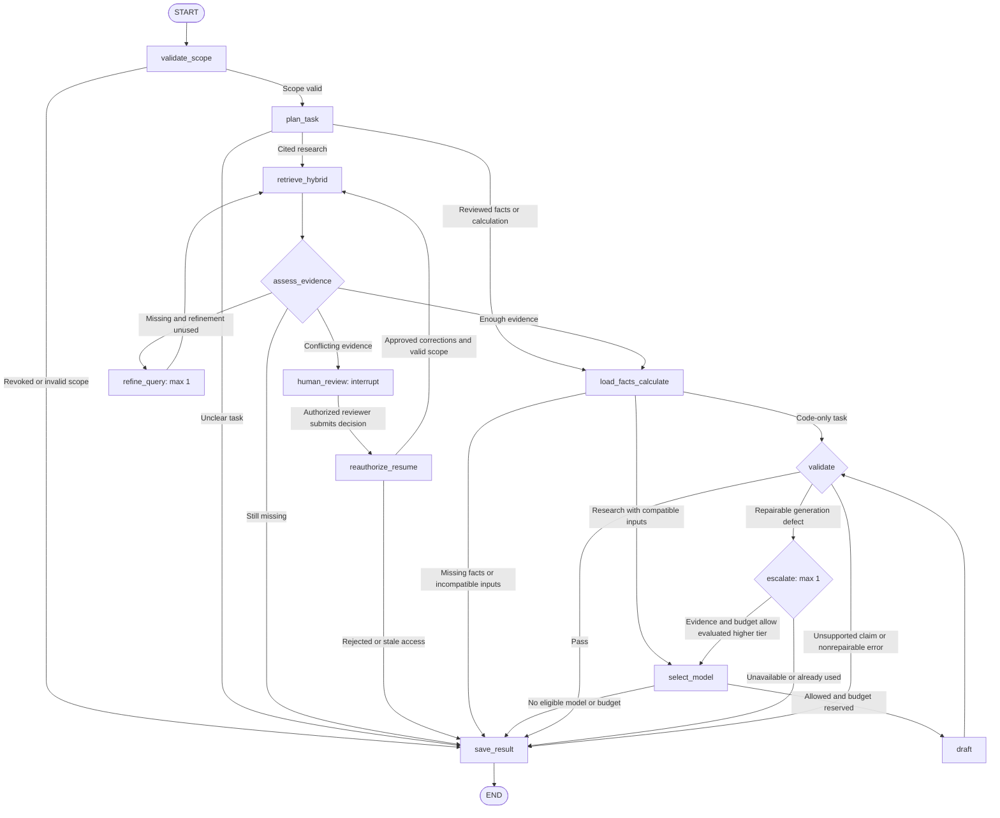

# Financial Report Analyst: LangGraph design

Date: 4 November 2026  
Status: Proposed design for the portfolio application  
Architecture: Next.js → Spring Boot → private Python

This document explains the analysis workflow and its implementation boundaries. The academy presents an offline mind map and walkthrough. It does not run this graph or call finance APIs.

## Service responsibilities

Spring owns login, API permissions, report metadata and report access rules. It validates research submissions before creating a durable run and returning HTTP 202. Private Python validates service identity and trusted report scope, then runs LangGraph through a background worker. The browser reads saved status through Spring.

Celery schedules work and supports the durable job contract. LangGraph controls analysis nodes and saved graph state. PostgreSQL stores the application run ledger and persistent checkpoints. A `thread_id` identifies state but grants no access by itself.

The read-only MCP tools `search_report_evidence`, `get_reviewed_facts` and `get_evidence` call scoped services directly. They do not automatically invoke the answer-generation graph. n8n handles ingestion triggers.

## Graph and conditional branches



`validate_scope` rechecks access after job acceptance. Spring rejects invalid initial submissions before a graph exists. A subsequent revocation becomes a saved failed run. `plan_task` chooses a code-only request, cited research or clarification. If a classifier model is needed, its authorized call counts toward the same run budget.

`retrieve_hybrid` combines scoped dense and lexical results with RRF. `assess_evidence` checks source coverage and conflicts, not merely similarity scores. `load_facts_calculate` loads approved numerical facts when required and uses Decimal for arithmetic. It never fills missing periods or guesses a unit.

`select_model` enforces provider eligibility, an allowlisted model, task capabilities, context limits and remaining budget. It reserves expected call cost before `draft`. `validate` checks the schema, financial values and support for material claims. `save_result` persists an outcome with sources and limitations, using a stable idempotency key.

## State fields

| Group | Fields | Ownership and limits |
| --- | --- | --- |
| Identity | `run_id`, `thread_id`, owner reference | Bind server-side to the authenticated owner; never trust model-provided identity |
| Scope | Company ID, periods, report version IDs, language | Immutable permitted scope; reauthorize on resume |
| Task | Task type, question, validated query variants | Classifier output cannot alter scope, tools or budgets |
| Evidence | Chunk IDs, evidence IDs, source pages, reviewed fact IDs | Keep provenance and index version; text remains untrusted data |
| Calculation | Requested metric, compatible inputs, Decimal result strings | Missing facts or incompatible periods return a limitation |
| Model | Selected provider, tier, exact model ID, prompt version | Server policy selects allowed values |
| Limits | `retrieval_refinements`, `paid_escalations`, deadline, reserved budget, actual usage | Persist limits across retries and resumes |
| Review | Review ID, verified reviewer reference, decision and correction evidence IDs | Only an authorized application action supplies a decision |
| Output | Draft claims, validation findings, outcome and result ID | Preserve supported partial results and clear failure reasons |
| Versions | Graph, prompt, embedding and retrieval-index versions | Reproduce the route and explain changes without storing raw model reasoning |

The production state schema should distinguish running, review-paused and terminal states. `awaiting_review` carries the review ID. A terminal outcome is `completed`, `partial`, `failed` or `cancelled`. No terminal outcome has a pending review action.

## Bounded recovery and review

- One retrieval refinement can repeat retrieval within the original authorized scope. If evidence is still absent, save a partial result or a missing-evidence outcome.
- One paid escalation can repair a generation defect when supporting evidence and budget exist. Persist its count before dispatch. Starting on the highest permitted tier leaves no escalation path.
- Provider transport retries have finite per-node limits. They consume the same deadline and total budget. An uncertain provider outcome requires reconciliation before a potentially duplicate paid call.
- Missing evidence, invalid permissions and incompatible financial inputs never trigger a stronger model.
- Conflicting sources pause at `human_review` using `interrupt()`. The pause saves `awaiting_review`; it does not mark the job completed.
- Spring authorizes a review submission. Resume uses the same thread with `Command(resume=...)`, but `reauthorize_resume` independently checks current access, reviewer identity and evidence versions.
- Approved corrections return to scoped retrieval. Rejection saves supported partial facts or cancellation. Remaining conflicts pause again or return a limitation instead of spinning automatically.

An interrupt node can restart on resume. Keep side effects outside the code before `interrupt()` or make them idempotent. Checkpoints alone do not guarantee exactly-once model calls, cost accounting or database writes. Use the durable run ledger, saved reservations, idempotent result writes and recovery checks.

## Proposed Python files

```text
services/finance/app/agents/
├── graph.py     # Build StateGraph, conditional edges and checkpointer
├── state.py     # State schema, statuses and allowed decision enums
├── nodes.py     # Scoped retrieval, facts, drafting and validation nodes
├── routing.py   # Route task, evidence, validation and bounded recovery
└── review.py    # Interrupt payload and verified resume contract
```

The existing `app/llm/router.py` selects a model under provider and budget policy. `agents/routing.py` selects graph transitions. `app/retrieval.py` owns hybrid search. Financial rules remain in `app/domain/calculations.py`; graph nodes call those rules rather than copying them.

API handlers translate validated requests into the run contract. Workers invoke the graph. Neither a public model prompt nor an MCP tool argument can supply arbitrary checkpoint keys, SQL, URLs, credentials or filesystem paths.

## Local development and deployment

Develop and inspect the Python graph locally after the Spring-to-Python contract works. Use persistent PostgreSQL checkpoints when testing restart and review resume. Keep the job status and graph checkpoint records distinct. At stage 7, package the same Python project for the private API and worker, with separate startup commands and persistent database storage.

Pin tested LangGraph and checkpointer package versions. Version graph state changes and test existing paused runs before changing their schema. Keep API keys outside checkpoints and logs. Trace node names, route reasons, source IDs, recorded usage and outcome codes.

## Demonstration and acceptance cases

1. A reviewed-fact calculation reaches validation and completes without an answer-model call.
2. A supported research question returns a cited answer with matching company, periods and source pages.
3. Missing causal evidence uses at most one retrieval refinement and returns a supported partial result.
4. Conflicting evidence pauses. An unauthorized reviewer cannot resume it, while a valid correction resumes the same thread.
5. A repairable generation failure uses at most one permitted escalation. Exhausted budget returns a clear limitation.
6. A restart preserves counters and review state. Replaying `save_result` does not duplicate the stored result.
7. A malicious PDF cannot change scope, tool permissions, model provider or spending limits.

These are proposed checks, not measured accuracy or recovery claims.

## Official references

- [LangGraph Graph API](https://docs.langchain.com/oss/python/langgraph/graph-api) describes state, nodes and control flow.
- [LangGraph persistence](https://docs.langchain.com/oss/python/langgraph/persistence) describes checkpointers and persistent state.
- [LangGraph interrupts](https://docs.langchain.com/oss/python/langgraph/interrupts) describes `interrupt()` and resume behavior.
