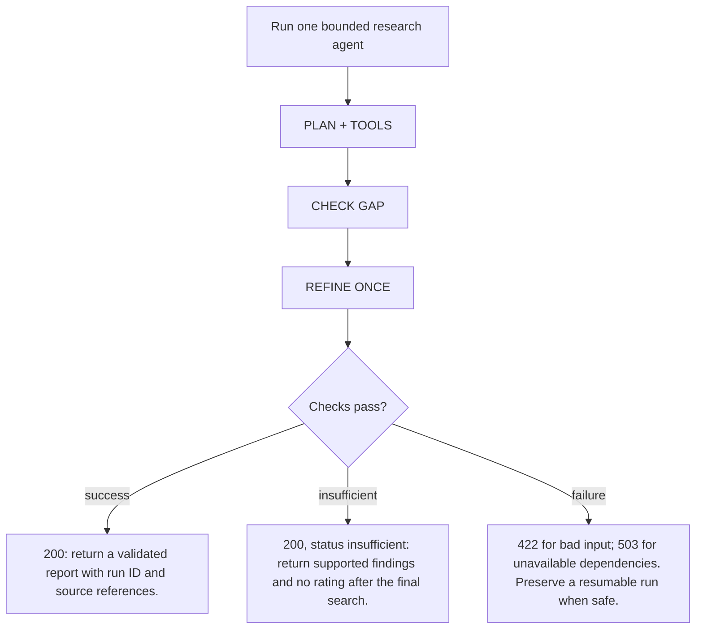
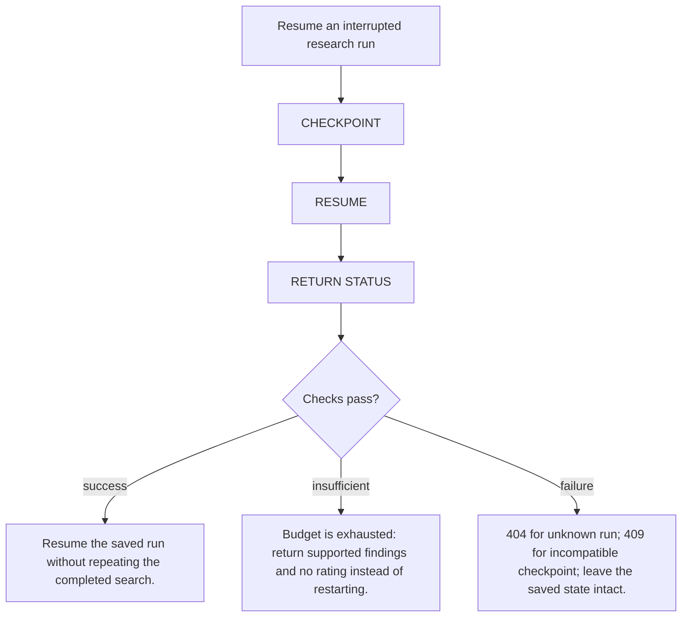

# Stock research assistant / 股票研究助手

Three supported companies, one bounded research agent, one cited report.

3 間公司、1 個有執行上限的研究 agent、1 頁有來源報告。

This academy contains a working offline teaching simulation and a proposed application design. It does not run a Python finance service, fetch current market news or issue real investment recommendations. All demo events, news and ratings are fictional.

此學習網站提供可操作的離線教學模擬及未來 app 設計，沒有運行 Python 金融服務或抓取即時新聞；示範事件、新聞及評級全部虛構。

Supported company identities: Microsoft (MSFT), Apple (AAPL), NVIDIA (NVDA). Real company identities do not make the demo fixtures real news.

Generated from `lib/finance-project.ts` and `lib/finance-proposal.ts`. Run `npm run proposal:sync`; do not edit the generated files.


## Bounded agent design / 有限研究流程

Use one research graph. The model may choose between search_company_evidence and read_source. It may refine a query once. Keep company identity, dates, source IDs, evidence, attempted searches, validation errors and report status in typed run state.

使用一個研究 graph，模型在兩個唯讀工具中選擇，最多修正搜尋一次。狀態保存公司、日期、來源、證據、搜尋次數、驗證錯誤及報告狀態。

Proposed limits: 2 searches, 6 source reads, 3 model calls and 60 seconds per run. Enforce budgets in code, not in article text.

Checkpoint state is run-scoped memory. Long-term user memory is deferred. Read-only source lookup does not need repeated human approval. Ask for clarification when identity is ambiguous; require explicit approval before any future externally visible action. The first release does not trade, send or publish reports automatically.

Checkpoint 保存單次研究進度，跨任務長期記憶延後。唯讀查詢不用逐次批准；公司不明確時先澄清。將來如有外發動作須先獲批准；首版不自動交易、發送或發布報告。

## Run one bounded research agent / 運行一個有上限的研究 agent

Let the agent select tools and fill an evidence gap within a controlled budget.

讓 agent 選擇工具及補足證據，同時限制執行預算。

**Input / 輸入**

Company ID, a news-research question and a snapshot date.

公司 ID、新聞研究問題及快照日期。

**Output / 輸出**

A validated research result or an explicit insufficient-evidence result.

已驗證研究結果，或明確證據不足結果。

### Entry contract / 入口

```text
POST /api/research
{"company_id":"MSFT","question":"Explain recent developments","horizon":"1-3m"}
Next.js proxy → POST /research → run_id + result
```



### 1. PLAN + TOOLS

Create typed run state and choose a permitted research tool.

建立有型別的任務狀態，選擇允許的研究工具。

Tools: LangGraph · one tool-capable LLM

**How / 如何應用**

Track identity, query, source IDs, evidence and budgets. Expose only search_company_evidence and read_source.

追蹤身份、查詢、來源、證據及預算，只提供兩個唯讀研究工具。

**Why / 為何使用**

A constrained tool boundary supports useful agent decisions without broad machine access.

受限制工具邊界支援 agent 判斷，同時避免取得廣泛系統權限。

Proposed files / 建議檔案: `services/research/app/graph.py`, `services/research/app/tools.py`

### 2. CHECK GAP

Assess whether the gathered evidence answers the question.

判斷已取得證據是否足以回答。

Tools: Conditional edges · structured output

**How / 如何應用**

Use code checks for company, dates and source presence. Let the model describe any remaining information gap in a schema.

以程式檢查公司、日期及來源；模型用固定格式描述尚欠資料。

**Why / 為何使用**

A fluent draft must not be treated as proof that the research is complete.

文字流暢不代表研究已完成。

Proposed files / 建議檔案: `services/research/app/graph.py`, `services/research/app/schemas.py`

### 3. REFINE ONCE

Refine once, or continue to reporting and validation.

最多修正查詢一次，再進入報告及驗證。

Tools: Bounded loop · timeout · SQLite checkpoint

**How / 如何應用**

Allow two search rounds total. Persist progress and stop at the configured time, tool or model budget. Return no rating if evidence remains inadequate.

總共最多兩輪搜尋；保存進度，到達時間、工具或模型上限就停止。仍不足則不評級。

**Why / 為何使用**

A bounded agent can recover and explain failure without looping or spending indefinitely.

有上限的 agent 能恢復及解釋失敗，避免無限循環及用量。

Proposed files / 建議檔案: `services/research/app/graph.py`, `services/research/app/checkpoints.py`

### Return branches / 回傳分支

**success**

Required checks pass

所需檢查通過

200: return a validated report with run ID and source references.

200：回傳已驗證報告、任務 ID 及來源引用。

Return the validated output to the caller.

向呼叫者回傳已驗證結果。

**insufficient**

Valid request, incomplete evidence

請求有效，但證據未齊

200, status insufficient: return supported findings and no rating after the final search.

200，狀態 insufficient：最後搜尋後只回傳有證據發現，不評級。

Explain the limitation and the next permitted step.

交代限制及下一個允許步驟。

**failure**

Invalid input or an operational error

輸入無效或程序出錯

422 for bad input; 503 for unavailable dependencies. Preserve a resumable run when safe.

輸入錯誤回 422；依賴不可用回 503。在安全情況保留可恢復任務。

Return an explicit error. Keep the last valid state.

回傳明確錯誤，保留最後有效狀態。

### Acceptance / 驗收

- The missing-evidence path performs at most one refinement and never invents the absent fact.
- 資料不足路徑最多補查一次，不能捏造缺失事實。

## Resume an interrupted research run / 恢復中斷研究任務

Recover completed work after a failure without starting the research again.

失敗後恢復已完成工作，避免全部重做。

**Input / 輸入**

A known run ID and its saved graph checkpoint.

已知任務 ID 及其 graph checkpoint。

**Output / 輸出**

A resumed run, a completed result, or a clear unavailable-checkpoint error.

已恢復任務、已完成結果，或明確無可用 checkpoint 錯誤。

### Entry contract / 入口

```text
POST /api/research/{run_id}/resume
Next.js proxy → POST /research/{run_id}/resume
Resume only the selected saved run, within its existing budget.
```



### 1. CHECKPOINT

Persist graph progress under the run ID.

按任務 ID 保存 graph 進度。

Tools: LangGraph checkpointer · SQLite

**How / 如何應用**

Save query, evidence references, tool results and remaining budget in the graph state. The Python app uses durable storage.

在 graph 狀態保存查詢、來源、工具結果及剩餘預算；Python app 使用持久儲存。

**Why / 為何使用**

Checkpointing remembers a run. It is different from long-term user memory or permission to take new actions.

Checkpoint 記住單次任務，不等於長期用戶記憶或執行新動作的權限。

Proposed files / 建議檔案: `services/research/app/checkpoints.py`, `services/research/app/graph.py`

### 2. RESUME

Load the matching checkpoint and continue safely.

載入相符 checkpoint 並安全繼續。

Tools: Run identity · idempotent source reads

**How / 如何應用**

Resolve the saved run, validate its status and resume with the same thread identity. Reuse completed tool results and remaining limits.

查找已儲存任務，核對狀態，以相同 thread 身份恢復；重用已完成工具結果及剩餘上限。

**Why / 為何使用**

Retries must not reset budgets, duplicate completed work or resume a different user’s run.

重試不能重設預算、重複已完成工作或恢復其他用戶任務。

Proposed files / 建議檔案: `services/research/app/checkpoints.py`, `services/research/app/main.py`

### 3. RETURN STATUS

Tell the user what resumed and what remains.

告知使用者已恢復及尚欠工作。

Tools: Typed response · Next.js status view

**How / 如何應用**

Return the resumed status or existing final result. Reject unknown or incompatible checkpoints instead of inventing a fresh run.

回傳恢復狀態或既有結果；拒絕未知或不相容 checkpoint，不靜默新開任務。

**Why / 為何使用**

A transparent recovery path is demonstrable engineering evidence for interviews.

清晰可核對的恢復路徑，係面試可展示的工程能力。

Proposed files / 建議檔案: `apps/web/app/page.tsx`, `services/research/app/main.py`

### Return branches / 回傳分支

**success**

Required checks pass

所需檢查通過

Resume the saved run without repeating the completed search.

恢復已儲存任務，不重複已完成搜尋。

Return the validated output to the caller.

向呼叫者回傳已驗證結果。

**insufficient**

Valid request, incomplete evidence

請求有效，但證據未齊

Budget is exhausted: return supported findings and no rating instead of restarting.

預算已用盡：回傳有證據發現及無評級，不重新開始。

Explain the limitation and the next permitted step.

交代限制及下一個允許步驟。

**failure**

Invalid input or an operational error

輸入無效或程序出錯

404 for unknown run; 409 for incompatible checkpoint; leave the saved state intact.

未知任務回 404；checkpoint 不相容回 409；保留儲存狀態。

Return an explicit error. Keep the last valid state.

回傳明確錯誤，保留最後有效狀態。

### Acceptance / 驗收

- Stop after the first search, resume, and show that the search count remains one.
- 第一次搜尋後停止再恢復，搜尋次數維持一次。

## Evaluation and interview evidence / 評估及面試證據

- Supported report: every material fact links to an allowed source and its publication date.
- 正常報告：每個重要事實都有允許使用的來源及發布時間。

- Insufficient evidence: use at most one additional search and return no rating when evidence remains inadequate.
- 資料不足：最多補查一次；仍不足就不輸出評級。

- Injected article: ignore instructions inside retrieved content, preserve legitimate evidence and record the blocked instruction.
- 惡意文章：忽略檢索內容內的指令，保留有效證據並記錄被阻擋的指令。

- Interrupted research: resume the correct run from a checkpoint without repeating the completed search.
- 研究中斷：由正確任務的 checkpoint 恢復，不重複已完成的搜尋。

Prepare about 15–20 cases and publish actual results with the dataset version and run command. Test factual support and failure behavior. A Hold label has no universal correct answer and is not proof of a profitable strategy.

準備約 15–20 個案例，附資料版本、執行命令及真實結果。評估事實支持度及失敗處理；Hold 標籤沒有普遍標準答案，亦不能證明策略盈利。

## References / 官方參考

- [LangGraph: workflows and agents](https://docs.langchain.com/oss/python/langgraph/workflows-agents)
- [LangGraph: persistence and checkpoints](https://docs.langchain.com/oss/python/langgraph/persistence)
- [FastAPI: typed request bodies](https://fastapi.tiangolo.com/tutorial/body/)
- [SQLite: FTS5 text search](https://www.sqlite.org/fts5.html)
- [Docker Compose: production deployment](https://docs.docker.com/compose/how-tos/production/)
