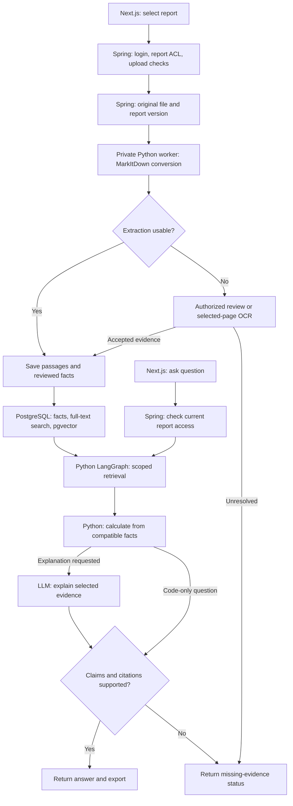

# Build report ingestion with MarkItDown

Use this guide to convert two text-based annual reports into Markdown before you build the full research application.
Start with one company and two reporting periods. Download the reports from an official company or HKEX source.

The academy website is an offline teaching tool. Its `/finance-project/demo` page uses fictional reports and scripted conversion, retrieval, and answers.
That demo does not upload your files, run MarkItDown, call an LLM, or implement Spring permissions.
The commands below run the real converter locally. The service architecture describes work to implement separately.

## 1. Run the converter locally

Use a supported Python version. Python 3.12 is a suitable starting point for this pilot.
Create a separate pilot directory and place your downloaded report there as `report.pdf`.

```bash
python3 -m venv .venv
source .venv/bin/activate
python -m pip install 'markitdown[pdf]'
markitdown report.pdf -o report.md
```

Open `report.md`. You should see extracted report content in a text editor.
An empty file, missing figures, or scrambled columns means the report has not passed the extraction check.
Record the package version that passed your checks and pin it in the future service's dependencies.

For a trusted local file, the Python API can write the same output:

```python
from pathlib import Path
from markitdown import MarkItDown

converter = MarkItDown(enable_plugins=False)
result = converter.convert_local("report.pdf")
Path("report.md").write_text(result.markdown, encoding="utf-8")
```

This example receives a file you already selected. It is not a public upload endpoint or an unrestricted URL downloader.

## 2. Check the extracted evidence

Compare the Markdown with the original PDF before you approve facts for analysis.

1. Locate revenue, profit, and operating cash flow where those metrics fit the selected company.
2. Check each figure's reporting period, currency, scale, sign, and table header.
3. Check whether a prior-year figure was restated.
4. Check the surrounding notes that explain a change.
5. Save the original page reference for each approved fact and passage.

MarkItDown does not guarantee that complex tables, charts, scanned pages, or original page numbers survive conversion correctly.
Preserve page mapping explicitly, for example through per-page conversion and a sidecar mapping from passages to original PDF pages.
Record the PDF page index separately from any printed page label. Verify that mapping against the original report.
If a page cannot be read reliably, mark it for review. Do not invent a value or approve an empty extraction.

## 3. Convert once and keep the source

For each immutable report version, retain these records:

- The original PDF, source URL, retrieval time, file hash, company, and reporting period.
- The converted Markdown, converter version, conversion settings, and extraction status.
- Passage IDs with original page references and report-version IDs.
- Reviewed facts with currency, units, period, source passage, and review decision.

Reuse a successful conversion for the same file hash and converter configuration.
Keep failed attempts and review outcomes visible. A newer converter or changed source creates a new recorded conversion.
Do not replace reviewed evidence silently when you rerun extraction.

## 4. Connect the application services

The selected architecture keeps Next.js, Spring Boot, and private Python services.



Spring owns report records, ACLs, original-file access, and version lifecycle.
The worker receives an authorized report reference through the private service contract.
For URL imports, the backend validates approved source destinations and limits redirects, response size, content type, and download time.
Pass the downloaded stream or controlled local file to the converter. Keep network-fetch policy outside model-generated tool arguments.

Python stores analysis artifacts in its analysis schema. Spring retains ownership of the reports schema.
Split Markdown into coherent passages, retain table context, and filter by report permissions before retrieval.
Read reviewed numbers from SQL and calculate with Python Decimal. Add full-text and vector retrieval for narrative evidence.
Start with exact vector search for the small pilot. Add HNSW only after a larger dataset demonstrates a need.

## 5. Keep model input focused

Standard local conversion uses local compute and requires no LLM tokens.
Markdown can remove formatting overhead, but a long Markdown file still consumes model context when you send it.
No fixed percentage saving is assumed here.

For each question, retrieve only the relevant passages and approved facts.
When an explanation is requested, send those passages, their source IDs, and the question to the answer model.
Calculate growth and totals in Python. Code-only requests skip the answer model. For explanations, have the model use only the supplied evidence.
Validate the claim, period, units, and citations before you return the answer.
Save the analysis with its evidence references so a repeated request can reuse an appropriate saved result.

Optional OCR, vision models, Azure Document Intelligence, and Azure Content Understanding can introduce separate charges.
Use them for selected difficult pages after checking the local conversion. Measure actual provider usage before comparing costs.

## 6. Add MCP only where an agent needs it

Call the Python library directly for the application's normal ingestion worker.
The optional `markitdown-mcp` package exposes `convert_to_markdown(uri)` for trusted local agents.
MCP is a tool interface. It does not compress documents, validate financial facts, or add OAuth and report ACLs automatically.

Keep the converter private. Its upstream MCP server is designed for trusted local use and has no built-in authentication.
The existing Spring MCP endpoint continues to expose authorized research tools through Spring's permission checks.
If you add a conversion tool, check the caller and report access, queue the job, and return an ID and status.
Provide selected evidence through a retrieval tool instead of returning the entire report on every question.

LangGraph can checkpoint routine progress automatically. Pause for a reviewer when extracted values conflict or a proposed correction needs approval.
Bind the decision to the exact report and conversion version. Recheck the reviewer and current ACL before resuming either approval or rejection.
If access was revoked, deny resume. Missing evidence can produce a partial answer without a paid model escalation.

## 7. Walk through the website demo

Open `/finance-project/demo` and follow its fictional report journey.
Choose a sample, inspect the simulated Markdown, and continue to indexing and a sample question.
Compare the retrieved evidence with the answer. Try a review or missing-evidence case, then download the displayed analysis.
The downloaded file is a teaching example. No real report was converted and no paid model ran.

In the real application, generate an analysis Markdown file from validated results.
A separate export renderer can create a PDF. MarkItDown's input conversion does not create a PDF analysis from Markdown.

Proposed additions to the separate finance application are:

```text
services/finance/app/
├── ingestion/markitdown_converter.py  # Conversion and conversion metadata
├── ingestion/page_map.py              # Verified passage-to-page references
├── jobs/tasks.py                      # Background job status and retries
├── retrieval.py                       # Scoped passage and fact retrieval
└── agents/graph.py                    # Evidence, review, and answer workflow
```

Develop these services locally first. Package the working services with Docker at the deployment stage, then verify the same journeys on EC2.
Finish the pilot when both reports have checked tables, working citations, one supported comparison, and one honest missing-evidence result.

Official references: [Microsoft MarkItDown](https://github.com/microsoft/markitdown), [MarkItDown MCP](https://github.com/microsoft/markitdown/tree/main/packages/markitdown-mcp).
