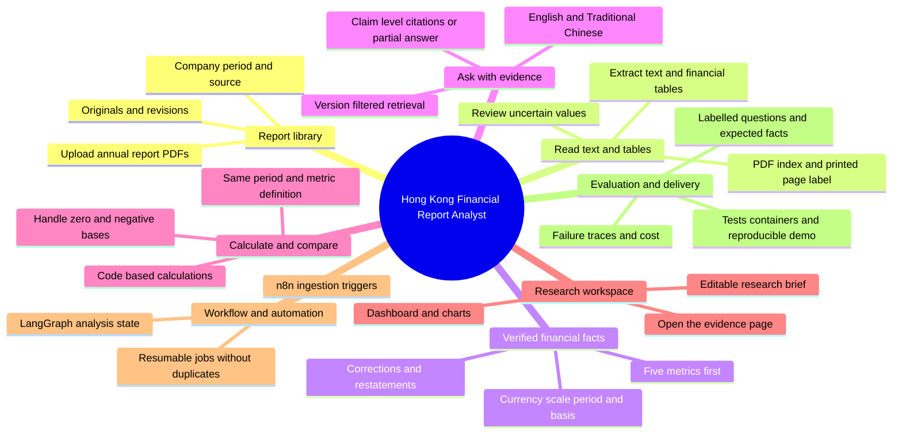

# Hong Kong Financial Report Analyst

This project blueprint combines financial-document research with an evidence-based AI application. A user selects companies and annual reporting periods, asks a question, compares figures and opens the original report pages behind the answer. The academy page at `/finance-project` is an offline guide with a selectable mind map and a seven-step walkthrough. It is not an implemented report-analysis backend; its DemoCo figures and page references are fictional.

## Mind map

## Function contracts

| Area | Input | Output and acceptance condition |
| --- | --- | --- |
| Library | Public PDF, company, fiscal period and source URL | Versioned report and original file. Duplicate upload does not create a second document. |
| Extraction | Text-based PDF, headings and notes | Candidate facts and passages linked to both PDF page index and printed page label. Uncertain extraction is flagged. |
| Facts | Revenue, net profit, operating cash flow, total assets and total liabilities | Reviewed facts with metric definition, period, currency, scale, consolidated basis, document version and source. Missing is distinct from zero. |
| Questions | Question plus selected company, periods, facts and passages | Cited answers with reported commentary distinguished from interpretation. Missing causal evidence produces a partial answer. |
| Comparison | Reviewed compatible facts | Reproducible formulas, inputs and charts. Block mismatched periods, currencies, scale or definitions rather than silently comparing them. |
| Workspace | Facts, chart series and cited answers | Dashboard, PDF evidence view and editable brief. Citation links open the correct document version and page. |
| Automation | Manual upload first; approved-source events later | Analysis status and resumable jobs. Retries do not duplicate documents or notifications. |
| Evaluation | Versioned reports, labelled questions, expected figures and citations | Per-case results, traces, configuration and rerun instructions. Report extraction, retrieval and answer quality separately. |

## Analysis flow

### Workflows for all 24 functions

Open `/finance-project#finance-functions`. Eight area buttons share the mind map selection. Each area exposes three expandable function guides. Every function has four ordered steps, the technology responsible at each step, an expected result and explicit failure handling. There are 96 processing steps across the complete catalog.

For example, **Upload annual-report PDFs** flows through:

1. Select a file and company; show upload status — **Next.js and React**.
2. Validate the file, size and metadata; compute a content hash — **FastAPI, Pydantic and Python hashlib**.
3. Store the original and versioned record with duplicate detection — **S3-compatible storage and PostgreSQL**.
4. Queue extraction and return the document ID and status — **FastAPI and a background worker**.

The expected result is a stored original with a stable ID and a queued extraction job. Invalid files are rejected, duplicate uploads reuse the existing document and partial failures retain recoverable state.

The same level of detail covers labelling, revisions, extraction, page references, human review, metric mapping, period/currency handling, restatements, bilingual questions, retrieval, citations, calculations, comparisons, compatibility checks, dashboards, PDF viewing, editable briefs, graph checkpoints, n8n triggers, retries, evaluation, tracing and deployment. These are proposed implementation workflows, not claims that the finance backend already exists.

### One question across the system

Scope the question → retrieve the relevant report evidence → validate facts and compatibility → calculate using code → draft an answer → verify figures and citations → present with source links.

LangGraph coordinates the analysis and its checkpoints. n8n handles surrounding ingestion triggers, scheduled checks and optional notifications. An LLM explains retrieved material; a deterministic calculation tool produces financial arithmetic. A matching keyword is not proof that a citation supports a claim.

The walkthrough has two scenarios: figures plus a management explanation, and figures without causal evidence. Both support the same numerical change; only the first supports attributing an explanation to management. Neither independently proves causation.

## Suggested stack

| Responsibility | Tools |
| --- | --- |
| Interface and charts | Next.js, React, TypeScript, Plotly.js |
| API and validation | Python, FastAPI, Pydantic |
| PDF processing | PyMuPDF, pdfplumber; OCR later |
| Facts, passages and files | PostgreSQL, pgvector, S3-compatible storage |
| Retrieval and analysis | Configurable LLM and embedding APIs, LangGraph, Python Decimal |
| Later automation | n8n, background worker, PostgreSQL checkpoints |
| Evaluation and delivery | pytest, Langfuse, Docker, GitHub Actions, AWS |

The on-page stack table includes an explicit data flow for each layer: interface action/request/result; upload/validation/extraction/review; passage storage/embedding/filtered retrieval; graph state/calculation/draft/verification; event/durable job/completion/notification; and tests/build/deployment/traces/regression. Tools at individual function steps show exactly where those layers meet.

Java, C# and UiPath are optional integration choices, rather than requirements for this project. GraphRAG, fine-tuning and multiple agents need a demonstrated use case before being added.

## Build stages

1. **Trust the source.** Three same-sector companies, two annual periods each, text-based PDFs and five metrics. Manually verify the facts and source links.
2. **Answer and compare.** Bilingual cited questions, deterministic calculations, comparisons and charts. Test absent evidence, wrong years, unit mismatches, restatements and zero denominators.
3. **Make the demo reviewable.** Add the LangGraph verification flow, evaluation results, traces, container setup and an editable brief. A reviewer must be able to rerun and diagnose a failure.
4. **Extend after the core works.** Add n8n schedules, watchlists, OCR, downloads and shared access as needed. A shared deployment requires authentication and per-user authorization.

## Academy implementation

- Content: `lib/finance-project.ts`.
- Function catalog: `lib/finance-function-workflows.ts`; the typed catalog is the single source for the 24 function names and their four-step workflows.
- Interface: `app/finance-project-content.tsx` and `app/finance-project.css`.
- Route: `app/finance-project/page.tsx`, using the existing academy language and shell.
- Discoverability: banners on the dashboard and concept-map page.
- Accessibility: native branch buttons, visible selected state, keyboard controls, responsive stacking, live detail announcements and reduced-motion support. Connections are decorative SVG; the content remains selectable HTML.
- Office edition: regenerate through `npm run office:build`; the guide has no live-service dependency.

Run `npm run check`, `npm run build`, `npm run office:build` and `npm run office:test` on Node 22.13 or newer when developing. The generated office package runs on Node 18.18 or newer. Test all eight workflow areas and 24 disclosures, both languages, both answer scenarios, keyboard use and narrow mobile layouts in the browser.
