# Stock research assistant / 股票研究助手

Three supported companies, one bounded research agent, one cited report.

3 間公司、1 個有執行上限的研究 agent、1 頁有來源報告。

This academy contains a working offline teaching simulation and a proposed application design. It does not run a Python finance service, fetch current market news or issue real investment recommendations. All demo events, news and ratings are fictional.

此學習網站提供可操作的離線教學模擬及未來 app 設計，沒有運行 Python 金融服務或抓取即時新聞；示範事件、新聞及評級全部虛構。

Supported company identities: Microsoft (MSFT), Apple (AAPL), NVIDIA (NVDA). Real company identities do not make the demo fixtures real news.

Generated from `lib/finance-project.ts` and `lib/finance-proposal.ts`. Run `npm run proposal:sync`; do not edit the generated files.


## Scope and estimate / 範圍及工時

120–180 total hours at 15 hours per week, approximately 8–12 weeks. Core stages total 120 hours. The 60-hour reserve is included, not additional. Subjective difficulty: 7–8 / 10.

Provisional estimate for one developer adding per-prompt n8n MCP news, measured hybrid RAG, self-hosted Langfuse and LangSmith. Re-estimate after the first live news-and-trace slice; Python learning, provider licensing and infrastructure may extend it. This remains an interview research app.

暫估一位開發者加入每題 n8n MCP 新聞、量度混合 RAG、自架 Langfuse 及 LangSmith。首條真實新聞與追蹤流程完成後重估；Python 學習、供應商授權及基建可能延長時間。目標仍是面試研究 app。

Each new prompt must refresh news through n8n MCP and pin its permitted evidence snapshot. Show provider status, publication/first-seen times and refresh time. An offline replay is not current news.

每個新提示須經 n8n MCP 刷新並固定允許使用的證據快照；顯示供應商狀態、發布／首次取得及刷新時間。離線重播不等於即時新聞。

## PostgreSQL database design / PostgreSQL 資料庫設計

One PostgreSQL service holds evidence, full-text indexes, optional pgvector embeddings, reports and feedback. LangGraph uses PostgreSQL checkpoints in a separate database. The browser simulation still stores only temporary page state.

一個 PostgreSQL 服務保存證據、全文索引、可選 pgvector 向量、報告及回饋；LangGraph 在獨立資料庫保存 PostgreSQL checkpoints。瀏覽器模擬仍只使用暫存頁面狀態。

See `/finance-project/n8n` and the [n8n integration guide](/downloads/stock-research-n8n-guide.md) for per-question acquisition, daily batches, PostgreSQL metadata isolation and the handoff to evidence review.

n8n → PostgreSQL snapshot → Full-text default · pgvector candidate → Admitted hybrid → RRF → reranker → Optional review → selection revision → evidence gate → LLM → validate → PostgreSQL report

### YFinance MCP integration / YFinance MCP 整合

Use ranaroussi/yfinance as the underlying Python data library. The selected YFinance MCP server wraps it with discoverable tools. This app adds a private HTTP adapter so deterministic n8n HTTP Request nodes can call the stdio server and receive validated JSON. n8n owns provider retries.

以 ranaroussi/yfinance 作底層 Python 資料擷取函式庫。所選 YFinance MCP server 包裝成可發現工具；app 加入私人 HTTP adapter，讓固定 n8n HTTP Request 節點呼叫 stdio server，取得已驗證 JSON。供應商重試由 n8n 控制。

Install the pinned Python requirements in integrations/yfinance/.venv. Copy .env.example to .env.local and set YFINANCE_BRIDGE_TOKEN. Run the discovery command to inspect the selected tool schemas.

在 integrations/yfinance/.venv 安裝固定 Python 依賴；複製 .env.example 至 .env.local，設定 YFINANCE_BRIDGE_TOKEN。先執行發現命令查看工具 schema。

Start the private adapter on port 8002. In n8n, create a Header Auth credential named X-YFinance-Token. POST validated company arguments to /news or /quote. For Dockerized n8n, use an adapter service on the same private network and its service hostname.

在 8002 啟動私人 adapter；n8n 建立 X-YFinance-Token Header Auth 憑證。將已驗證公司參數 POST 至 /news 或 /quote。n8n 若在 Docker，adapter 服務應在相同私人網絡，以服務名稱連接。

Keep the existing refresh_company_news workflow contract. Inside it, call /news, validate its response, deduplicate and commit evidence in PostgreSQL, then return the acquisition receipt. Request /quote separately when the report needs price context, and store its timestamped observation ID in the snapshot.

保留 refresh_company_news 流程合約，內部呼叫 /news、驗證回傳、去重並提交 PostgreSQL，最後交回擷取紀錄。報告需要價格時另行呼叫 /quote，將有時間戳的觀察 ID 保存至快照。

Use one adapter call per n8n attempt. Route errors by retryable and remaining time. HTTP 401/422 stops, while retryable 429/503/504 follows the existing bounded n8n retry loop. Daily macro/geopolitical sources and versioned company profiles continue through their own acquisition paths.

每次 n8n 嘗試只呼叫 adapter 一次；按 retryable 及餘下時間路由。HTTP 401／422 停止，可重試 429／503／504 沿用有限 n8n 回圈；每日宏觀／地緣及版本化公司背景使用各自擷取路徑。

## Optional evidence review / 可選證據覆核

Proposed design and offline teaching demo only; the live finance backend is not implemented.

建議設計及離線教學示範；真實金融後端尚未實作。

### Your feedback here means evidence review / 此處回饋指證據覆核

Before generation, show the news proposed for this report, original excerpts, source links/dates and the system relevance rank. You can exclude articles, highlight topics and change the discussion order. Call this evidence review so it is distinct from post-report ratings/corrections, which are stored separately. Exclusion changes this report selection and never deletes news from PostgreSQL.

生成前展示本報告建議新聞、原文、來源連結／日期及系統相關排序。你可排除文章、標記主題及改討論次序。將這步稱「證據覆核」，與報告生成後另存的評分／更正分開；排除只改本次選取，不刪 PostgreSQL 新聞。

### System rank and your order stay separate / 系統排名與你的次序分開

Preserve system_ordered_ids and reranker scores, then store user_ordered_ids as an exact, duplicate-free permutation of selected IDs in the selection revision. Order can affect what the model attends to and how the report is organized; treat it as presentation/emphasis preference, not a new relevance or truth score. Pass the preference alongside evidence to context assembly. Required facets and counter-evidence take priority over arbitrary trimming. Recheck coverage after trimming and disclose exclusions; never increase forecast confidence because an article moved up. Reordering alone makes no provider, search or embedding call.

保留 system_ordered_ids 及重排分數，再將 user_ordered_ids 存選取版本；它必須是所有已選 ID 的完整不重複排列。次序可影響模型注意及報告組織，只作呈現／重點偏好，不是新相關性或真實分數。建立 context 時連同證據傳入；必要面向及反方證據不能因裁剪優先次序而失去。裁剪後重查覆蓋並交代排除，不能因文章移前而提高信心；單純改次序不呼叫供應商、搜尋或 embedding。

### Where the review belongs / 覆核放在哪一步

Retrieve → rerank → optional evidence review → validate selection → evidence gate → context → LLM → validation. Default full-text search and sparse fallback enter the same review step. Choose automatic or review mode at request creation. Automatic mode uses the system selection and still passes all evidence checks.

檢索 → 重排 → 可選證據覆核 → 驗證選取 → 證據關卡 → context → LLM → 驗證。預設全文及 sparse 回退都經同一步。建立請求時選自動或覆核模式；自動沿用系統選取，仍須通過所有證據檢查。

### Highlight, exclude, reset, generate / 標記、排除、重設、生成

Highlight asks for more discussion of a supported topic. It does not raise relevance scores, factual reliability or forecast confidence. Exclude from report removes a passage from this report selection; it never deletes stored news. Move up/down sets your discussion order without changing system scores. Reset restores system recommendations and their order. Generate submits the selection for validation and coverage checks before the LLM is allowed to run.

標記要求多討論有證據支持的主題，不提高相關分數、真實性或預測信心。「排除此報告」只改本次選取，不刪新聞。上移／下移只改討論次序，不改系統分數；重設還原系統建議及次序；生成先提交選取，驗證及覆蓋檢查通過後才可呼叫 LLM。

### Coverage and confirmation bias / 覆蓋及確認偏誤

Show the question’s required facets, source dates, original excerpts, provenance and opposing evidence beside the controls. Recheck coverage after every submitted selection and after context trimming. An excluded dissenting source remains visible in the audit and report limitations; an exclusion cannot justify a broader claim. Missing required support triggers at most one refinement or an insufficient result. Highlighting an irrelevant passage does not make it admissible.

操作旁展示問題必要面向、日期、原文、來源及反方證據。每次提交及裁剪 context 後重查覆蓋；被排除的反方來源保留於核對紀錄及報告限制，不能因排除而擴大結論。必要支持不足最多補查一次，否則回證據不足；標記無關段落亦不能令它合資格。

### Snapshot and selection are different records / 快照與選取是不同紀錄

PostgreSQL keeps immutable news versions and the run’s frozen snapshot manifest. Add append-only evidence_selection_revisions keyed by owner_id, run_id, thread_id, snapshot_id, candidate_revision and selection_revision, with selected/highlighted/excluded IDs and timestamps. Store final selection_revision with the report. The authenticated server derives owner_id, validates IDs against permitted snapshot candidates, requires highlighted IDs to be selected and excluded IDs to be disjoint, and uses an atomic revision check so a second browser tab cannot overwrite a newer selection.

PostgreSQL 保存不可變新聞版本及任務固定快照。另加只追加 evidence_selection_revisions，以擁有者、run、thread、快照、候選及選取版本綁定，保存已選／標記／排除 ID 及時間；報告引用最終選取版本。伺服器從驗證身分取得 owner_id，核對 ID 屬可用候選、標記屬已選及排除不重疊，並以原子版本核對避免另一分頁覆蓋新選取。

### LangGraph pause and authenticated resume / LangGraph 暫停及身分驗證恢復

Use interrupt() in a dedicated review node after retrieval has completed, a PostgreSQL checkpointer and Command(resume=...) with the same authenticated thread. The interrupted node starts again from its beginning on resume: keep news fetching, retrieval and other expensive side effects outside it. Validate the submitted schema, ownership, revision, permissions and expiry at the API boundary, then recheck the saved selection in the graph. Never pass arbitrary client state or article instructions into Command.

檢索完成後由獨立覆核節點用 interrupt() 暫停，以 PostgreSQL checkpointer 保存；用相同已驗證 thread 及 Command(resume=...) 恢復。恢復會從中斷節點開頭重跑，新聞抓取、檢索及昂貴副作用須在節點外。API 邊界核對格式、擁有者、版本、權限及期限，再由 graph 核對已存選取；不能把任意 client 狀態或文章指令傳入 Command。

### Two clocks, bounded review / 兩個時鐘，有上限覆核

Proposed change: 60 seconds of active processing plus a 15-minute review window from the first pause. Persist the remaining active budget before waiting; only intentional review wait is excluded. Network waits and crash recovery still count. On resume use only the saved remainder, preserve the original evidence cutoff and all counters: one refresh, two searches, six source reads and three LLM calls. The review window is absolute and is not extended by edits or a second search. Expired review stops before generation and requires a new request. Report processing latency and review-wait/wall-clock latency separately; the 60s target applies to processing only.

建議改為 60 秒處理預算，加首次暫停起 15 分鐘覆核期。等待前保存剩餘處理預算，只有刻意覆核等待可扣除；網絡等待及故障恢復仍計時。恢復只用餘額，保留原證據截止及全部計數：一次刷新、兩次搜尋、六次來源讀取、三次 LLM。編輯或第二輪不延長覆核期；過期停止生成並須新請求。分開報處理延遲、覆核等待及總耗時，60 秒目標只適用處理。

### Refinement does not erase your choices / 補查不會抹掉選擇

Allow at most two candidate rounds and one submitted selection per round. Local edits before Generate need no graph loop. Refinement uses the same snapshot, preserves exclusions/highlights for known source IDs and exposes new candidates for a second review within the original window. Reset is explicit. New candidates are not silently approved, excluded sources are not silently reintroduced and no edit grants another refresh or search budget. After the second failed coverage check, stop as insufficient.

最多兩輪候選，每輪提交一次選取；生成前的本機編輯毋須 graph 迴圈。補查用相同快照，保留已知來源的排除／標記；原覆核期內展示新候選再覆核，重設須明確操作。不暗中批准新候選或重新加入被排除來源；編輯不增加刷新或搜尋預算。第二次覆蓋檢查仍不足就停止。

### Prompt injection stays outside the controls / 提示注入不能控制操作

Article text, highlighted passages and optional user notes remain untrusted data. They cannot change the company allowlist, scope route, budget, tool arguments or system policy. Selection controls submit source IDs and enumerated actions rather than executable instructions. Keep the scope gate before news access. Trace selection revisions, pause/resume and gate outcomes with redacted IDs; do not expose article text or private notes in public traces.

文章、標記原文及可選筆記仍是不可信資料，不能改公司清單、範圍路由、預算、工具參數或系統規則。操作只傳來源 ID 及固定動作，不傳可執行指令；scope gate 維持在新聞存取前。追蹤選取版本、暫停／恢復及關卡結果，公開 trace 只用清理 ID，不放文章或私人筆記。

### What must be verified in the future backend / 未來後端必須驗證甚麼

Live review checks are NOT RUN. Before enabling the feature, test another owner’s IDs, stale revisions, revoked permissions, duplicate/concurrent resumes, expiry during a pause, crash recovery and injection inside a highlighted article. Verify that no rejected submission advances the graph, no source is deleted, known exclusions survive refinement, completed acquisition is not repeated and all budgets only decrease. Evaluate automatic reports separately from user-curated selections on the frozen golden set; do not count human choices as a retrieval improvement.

真實覆核檢查為 NOT RUN。啟用前測其他擁有者 ID、舊版本、權限撤銷、重複／並行恢復、等待期間過期、故障恢復及標記文章內注入。核對被拒提交不推進 graph、不刪來源、補查保留排除、已完成抓取不重做，全部預算只減少。凍結 golden set 分開評估自動及人手選取報告，不能把人手選擇當檢索改善。

```json
{
  "disclosure": "Fictional proposed record; the academy has no live report backend",
  "owner_id": "server-derived-owner",
  "run_id": "example-run",
  "thread_id": "example-run",
  "snapshot_id": "snapshot-msft-example",
  "candidate_revision": 1,
  "selection_revision": 2,
  "selected_ids": [
    "costs-v1-c1",
    "demand-v2-c1"
  ],
  "highlighted_ids": [
    "costs-v1-c1"
  ],
  "system_ordered_ids": [
    "costs-v1-c1",
    "demand-v2-c1",
    "outlook-v1-c1"
  ],
  "user_ordered_ids": [
    "demand-v2-c1",
    "costs-v1-c1"
  ],
  "excluded_ids": [
    "outlook-v1-c1"
  ],
  "missing_facets": [
    "earnings outlook"
  ],
  "selection_limitations": [
    "The only outlook passage was excluded; no outlook forecast is supported."
  ],
  "remaining_active_ms": 32000,
  "review_expires_at": "2026-11-13T01:15:00Z"
}
```

```python
## Design sketch: API/storage/budget helpers must be implemented and tested.
from langgraph.types import interrupt, Command

def review_node(state):
    if state["review_mode"] == "automatic":
        return system_selection_update(state)  # Route to selection validation.
    if review_expired(state):
        return {"route": "review_expired"}
    # Candidate payload is already persisted. This node may execute twice.
    # The wrapper saves remaining active time once before the first interrupt.
    resume = interrupt(review_payload(state))
    # API has authenticated and atomically saved an ID-only selection revision.
    # Reload and validate the server record; do not trust client-provided state.
    return load_validated_selection_update(state, resume["selection_revision"])

## API resume sketch (server-owned config; never accept arbitrary thread state):
## owner = authenticate_request()
## selection = validate_and_commit_selection(owner, payload, expected_revision)
## graph.invoke(Command(resume={"selection_revision": selection.revision}),
##              {"configurable": {"thread_id": selection.thread_id}})
## Scope/news/retrieval are completed nodes and are not re-run on this resume.

```

[LangGraph interrupts documentation](https://docs.langchain.com/oss/python/langgraph/interrupts)

[Lost in the Middle: evidence-position effects in studied models](https://arxiv.org/abs/2307.03172)


### Document embeddings: during indexing / 文件 embedding：建立索引時

After company/daily news is validated, deduplicated and committed, split permitted text into versioned chunks. An indexing worker embeds new or changed chunks, then stores vectors with chunk ID, text hash, model/version and dimension in PostgreSQL pgvector. Company-profile excerpts use the same pipeline. This happens before those chunks can participate in vector search, rather than after reranking.

公司／每日新聞驗證、去重及提交後，將允許文字切成有版本段落。索引 worker 嵌入新增／改動段落，再把向量、chunk ID、文字 hash、模型／版本及維度存 PostgreSQL pgvector。公司背景原文亦經此流程；須先有向量才可向量搜尋，並非重排後才 embedding。

### Question embeddings: just before vector retrieval / 問題 embedding：向量檢索之前

On an accepted request, first refresh company news and pin the evidence snapshot. If the evaluated hybrid mode is enabled, encode the current query using the same compatible model/configuration as document vectors, then search pgvector under the snapshot, time and permission filters. Combine with full-text results and rerank question–passage pairs. A refined query needs its own query embedding; unchanged document chunks do not need another embedding.

有效請求先刷新公司新聞及固定快照。若已啟用通過評估的混合模式，用與文件向量相容的相同模型／設定編碼當前查詢，再在快照、時間及權限條件下搜尋 pgvector，合併全文結果後重排問題與原文配對。補查的新 query 須再編碼；未改動文件不須重嵌入。

### Pending vectors do not block sparse search / 向量未就緒不阻擋全文搜尋

Full-text indexing remains the default and uses no embeddings. Run document embedding as a separate idempotent indexing job keyed by chunk hash and model. Pin the model/version and vector-ready chunk IDs with the run snapshot; refinement/resume reuse that view. Newly completed embeddings become available to the next request. Do not label pending embeddings as a complete hybrid index. A candidate vector/model failure falls back to working full-text evidence within budget. Neither n8n acquisition success nor an evidence snapshot promises that its vectors are ready. Hybrid remains blocked until it beats the written frozen evaluation margins.

全文索引仍是預設，不用 embedding。文件嵌入作獨立冪等索引工作，以段落 hash 及模型為鍵，快照固定模型／版本及向量已就緒段落 ID，補查／恢復沿用此視圖；新完成向量供下次請求用，不能把待完成向量稱完整混合索引。向量／模型失敗可在預算內回退可用全文證據；n8n 抓取成功及固定快照不代表向量已就緒。混合模式仍須超越凍結評估書面門檻才准入。

### Embeddings, reranking and review do different jobs / Embedding、重排及覆核分工不同

Embeddings help find semantically similar passages. Reranking scores relevance to the exact question using the passage text. Evidence review shows the proposed sources and system rank, lets you exclude or reorder them, and records your preferred discussion order. None of these steps establishes factual support or predicts stock returns. The evidence gate and citation checks still decide which claims may be released.

Embedding 協助找語義相似段落；重排用原文評估對當前問題的相關性。證據覆核展示建議來源及系統排序，讓你排除或改討論次序。這些步驟本身都不證明事實支持或預測股票回報；證據關卡及引用驗證仍決定哪些主張可發布。

### Three evidence streams / 三條證據來源

Each accepted prompt refreshes company news through n8n MCP. A separate daily n8n Schedule Trigger calls Alpha Vantage NEWS_SENTIMENT for macro/fiscal news and a broad feed for geopolitical tagging, with explicit coverage limits, into shared PostgreSQL records. Maintain sourced, versioned profiles for MSFT, AAPL and NVDA: business segments, products, geographic and supply-chain exposure, and financial figures with reporting periods. Review profiles after filings or material changes. Configure the daily time and workflow timezone when publishing n8n.

每個有效提示經 n8n MCP 刷新公司新聞。獨立每日 n8n Schedule Trigger 經 Alpha Vantage NEWS_SENTIMENT 抓宏觀／財政及廣泛候選另作地緣標記，明示覆蓋限制，再存至 PostgreSQL 共用記錄。MSFT、AAPL、NVDA 各有附來源及版本背景：業務、產品、地域與供應鏈曝險，以及附報告期間財務數據。財報或重大變化後覆核背景；發布 n8n 時設定每日時間及時區。

### Snapshot = the evidence version used for this report / Snapshot＝這份報告使用的證據版本

Fetching acquires news. A snapshot pins a manifest of eligible source/chunk versions, completed daily batch IDs, company-profile version, cutoff and coverage status under snapshot_id. Retrieval selects passages from that fixed collection. Later news creates a version for the next run. Refinement and resume reuse the same snapshot. Permission revocations are still checked. This is a run-level evidence manifest rather than a full database backup.

抓取是取得新聞；snapshot 按 snapshot_id 固定可用來源／切段版本、完整每日批次 ID、公司背景版本、截止時間及覆蓋狀態。檢索從這份固定集合挑段落。新新聞供下一次任務使用；補查及恢復沿用原快照，撤銷使用權仍須檢查。這是任務證據清單，並非完整資料庫備份。

### Rerank = relevance to your question / Rerank＝與問題的相關性排序

For “How could export restrictions affect NVDA?”, the reranker compares the question with each candidate passage. It can put an export-policy article ahead of an unrelated earnings article. Its score measures relevance. The LLM then combines policy evidence with the dated company profile to explain a possible business-impact chain, assumptions, counter-evidence and uncertainty. Stock-return estimates require a separately validated model.

例如「出口限制可能如何影響 NVDA？」重排器比較問題與每段原文，可把出口政策文章排在無關財報文章前。分數量度相關性。LLM 再結合政策證據及有日期公司背景，解釋可能業務影響鏈、假設、反方證據及不確定性。股票回報估計須另行驗證模型。

### n8n owns acquisition retries / n8n 負責抓取重試

Proposed policy: at most 3 provider attempts, with 1s then 2s backoff plus jitter. Each attempt is capped at 10s and clipped to a 25s acquisition deadline and the remaining run deadline. Retry transient network failures, selected 5xx and rate limits only when Retry-After fits. Invalid arguments, authorization failures and malformed responses return typed errors. The host sends one logical refresh with a stable run_id. After an MCP timeout, reconcile the existing execution/receipt before resubmitting. Search refinement has its own two-search limit.

建議最多 3 次供應商嘗試，等待 1 秒、2 秒加 jitter。每次最多 10 秒，同時受 25 秒抓取階段及任務剩餘時限限制。只在餘額足夠時重試暫時網絡錯誤、指定 5xx 或限流。無效參數、授權或格式錯誤回傳結構化錯誤。Host 以固定 run_id 發出一次邏輯刷新；MCP 超時先核對原執行／紀錄。搜尋補查另有兩次上限。

### Show freshness for each stream / 各來源明示新鮮度

A daily batch is current as of its last successful fetch. Failed daily ingestion preserves the previous completed batch and records the failure. Show fetched_at, publication/first-seen times and coverage separately for company, macro, geopolitics and profiles. Retrieve shared news by topic, region, sector and a supported exposure mechanism. If the question needs a missing or stale stream, explain the gap and withhold that conclusion. Shared news can be relevant without naming a ticker.

每日批次只代表最後成功擷取時的資料；失敗保留上一完整批次並記錄失敗。公司、宏觀、地緣及背景各自顯示擷取、發布／首次取得時間及覆蓋。共用新聞按主題、地域、行業及有證據曝險關係檢索；所需來源缺少或過期就交代缺口。共用新聞即使沒有 ticker 仍可能相關。

### Fictional snapshot manifest / 虛構快照清單

```json
{
  "disclosure": "Fictional evidence-manifest example",
  "snapshot_id": "snapshot-nvda-example-001",
  "company": "NVDA",
  "as_of": "2026-11-11T01:00:00Z",
  "company_news_version_ids": [
    "nvda-news-v3"
  ],
  "daily_batch_ids": {
    "macro": "macro-batch-example",
    "geopolitics": "geo-batch-example"
  },
  "company_profile_version": "nvda-profile-v2",
  "retrieval_index": {
    "mode": "sparse",
    "embedding_model": null,
    "vector_ready_chunk_ids": []
  },
  "eligible_chunk_ids": [
    "nvda-news-v3-c1",
    "geo-policy-v1-c2",
    "nvda-profile-v2-c4"
  ],
  "coverage": {
    "company": "ok",
    "macro": "ok",
    "geopolitics": "ok",
    "profile": "reviewed"
  }
}
```

### evidence_selection_revisions (proposed extension)

Append a selection revision bound to the authenticated owner, run/thread, snapshot and candidate revision. Save selected/highlighted/excluded IDs, system ranks, validated user order, timestamps and selection limitations; the final report references that revision. Validate snapshot membership and permissions, require highlights to be selected and exclusions to be disjoint, and atomically check the expected revision. These records never modify stored news. Persist remaining active time and an absolute review expiry alongside checkpoints; do not hold a database transaction while awaiting the user.

選取版本以只追加紀錄綁定已驗證擁有者、run/thread、快照及候選版本，存已選／標記／排除 ID、系統排名、已驗證用戶次序、時間及限制；最終報告引用此版本。核對快照成員及權限、標記屬已選及排除不重疊，以原子操作核對預期版本。不改新聞原文；checkpoint 另存剩餘處理預算及絕對覆核期限，等待用戶時不持有 transaction。

### Shared news + versioned company profiles

Extend the evidence model with shared macro/geopolitical document versions and company-profile versions, plus explicit snapshot membership. Keep shared news tagged by topic, region and sector. A profile belongs to its company and keeps reporting/effective/review dates. Every run manifest records the selected versions. The SQL examples below demonstrate the company-news subset; shared-context membership and retrieval are part of the proposed backend extension.

證據模型擴展共用宏觀／地緣文件版本、公司背景版本及明確快照成員關聯。共用新聞按主題、地域、行業標記；公司背景保存所屬公司及報告／生效／覆核日期。任務清單記錄選用版本。下方 SQL 範例示範公司新聞子集；共用背景成員關聯及檢索屬未來後端擴展。

### snapshots + evidence_chunks

Store dated, versioned excerpts and their source URLs. Query one pinned snapshot with company, permission, publication and first-seen filters. Freeze content after publication; permission revocations still exclude sources.

保存有日期及版本的節錄和來源網址；查詢固定快照並檢查公司、權限、發布及首次取得時間。發布後凍結內容，撤銷權限仍須排除來源。

### tsvector + GIN + ts_rank_cd

The default sparse path is native PostgreSQL full-text search. GIN indexes lexemes and ts_rank_cd ranks matching passages by term coverage and proximity. The English configuration fits the initial English news corpus; other languages need separate evaluation.

預設 sparse 路徑用 PostgreSQL 原生全文搜尋；GIN 索引字詞，ts_rank_cd 按詞語覆蓋及距離排序匹配段落。English 設定適用首版英文新聞；其他語言須另行評估。

### pgvector → RRF → cross-encoder

pgvector adds vector columns and distance search inside PostgreSQL. Start with exact filtered search; measure before adding HNSW. Approximate filtering can return too few rows, so evaluate recall under the same filters. Fuse 20 candidates per path to 20, rerank to 10, and pass at most 6 excerpts to the LLM.

pgvector 在 PostgreSQL 內加入向量欄位及距離搜尋。先用過濾後精確搜尋，量度後再加 HNSW。近似搜尋過濾後可能不足筆數，須在相同條件下評估召回。每路徑取 20、融合成 20、重排成 10，最多 6 段送 LLM。

### runs + reports + report_sources + feedback

Persist the run owner, question, active deadline and remaining budget, counters, validated report and citation links. Save a report and its source links in one transaction. Unique run IDs make retries idempotent. Feedback is a separate record and never changes frozen evidence.

保存任務擁有者、問題、處理時限及剩餘預算、計數、已驗證報告及引用關聯。報告與來源關聯用同一 transaction 保存，唯一任務 ID 讓重試具冪等性；回饋另存，不改凍結證據。

### research_checkpoints · AsyncPostgresSaver

Use langgraph-checkpoint-postgres and a server-owned thread_id mapped to the authenticated run. Run setup once as a migration, keep the async saver open for the application lifespan, and resume with the saved counters and remaining active budget. Only explicit review wait pauses active time, with an absolute 15-minute review expiry. Checkpoints do not authorize a user or make external tool effects exactly-once.

使用 langgraph-checkpoint-postgres，thread_id 由伺服器建立並連結已認證任務。setup 作一次性 migration；async saver 在 app 生命週期保持開啟，恢復保留計數及剩餘處理預算；只有明確覆核等待暫停計時，另有 15 分鐘絕對覆核期限。Checkpoint 不負責授權，也不能保證外部工具只執行一次。

### Connections, retries and backups / 連線、重試及備份

Keep DATABASE_URL and CHECKPOINT_DATABASE_URL server-side. Use Psycopg 3 with bounded pools, parameterized SQL and short transactions. Set statement and pool timeouts within the remaining run deadline; never hold a transaction open while waiting for an LLM or news API.

DATABASE_URL 及 CHECKPOINT_DATABASE_URL 只留伺服器。用 Psycopg 3、有上限連線池、參數化 SQL 及短 transaction；SQL 和連線池 timeout 不超出任務剩餘時限，等 LLM 或新聞 API 時不保持 transaction。

Give n8n an ingestion-only role; keep report and checkpoint access in the research service. Use separate databases and roles for research, checkpoints, n8n internal state and Langfuse. Langfuse still needs its own ClickHouse, Redis/Valkey and object-storage services.

n8n 使用只供匯入的角色；報告及 checkpoint 權限留在研究服務。Research、checkpoints、n8n 內部狀態及 Langfuse 分別使用獨立資料庫與角色；Langfuse 仍需要 ClickHouse、Redis／Valkey 及物件儲存。

A vector or reranker failure may fall back to working PostgreSQL full-text search. If PostgreSQL is unavailable, both paths fail: return unavailable. Retry only a complete idempotent transaction for a transient error, with bounded backoff inside the original deadline. Never retry authorization or validation failures.

向量或重排失敗可回退可用的 PostgreSQL 全文搜尋。PostgreSQL 中斷會令兩路徑都失敗，回傳 unavailable。暫時錯誤只可在原時限內有限退避重試完整冪等 transaction；授權或驗證失敗不重試。

Use versioned SQL migrations. Pin the PostgreSQL major and pgvector extension version; keep database storage on a persistent volume or managed PostgreSQL. Back up each application/checkpoint database with pg_dump, test pg_restore into a separate database, and retain roles/configuration separately. A container restart is not a restore test.

使用版本化 SQL migration，固定 PostgreSQL 主版本及 pgvector 版本；資料放持久 volume 或託管 PostgreSQL。各 app／checkpoint 資料庫用 pg_dump 備份，pg_restore 還原至獨立資料庫實測，角色及設定另存。重啟容器不等於還原測試。

### Schema example / 資料表範例

```sql
-- Proposed finance schema; run once in an empty dedicated research database.
-- A migration role installs the extension; runtime roles do not need DDL rights.
CREATE EXTENSION IF NOT EXISTS vector;
CREATE SCHEMA research;

CREATE TABLE research.snapshots (
  snapshot_id uuid PRIMARY KEY,
  company text NOT NULL CHECK (company IN ('MSFT', 'AAPL', 'NVDA')),
  as_of timestamptz NOT NULL,
  refreshed_at timestamptz NOT NULL,
  UNIQUE (snapshot_id, company)
);
CREATE TABLE research.evidence_chunks (
  snapshot_id uuid NOT NULL,
  chunk_id text NOT NULL,
  company text NOT NULL,
  canonical_url text NOT NULL,
  published_at timestamptz NOT NULL,
  first_seen_at timestamptz NOT NULL,
  content_hash text NOT NULL,
  excerpt text NOT NULL,
  permitted boolean NOT NULL DEFAULT false,
  search_text tsvector GENERATED ALWAYS AS
    (to_tsvector('english'::regconfig, excerpt)) STORED,
  embedding vector(384), -- illustrative dimension; pin model + dimension before ingestion
  embedding_model text,
  PRIMARY KEY (snapshot_id, chunk_id),
  FOREIGN KEY (snapshot_id, company) REFERENCES research.snapshots (snapshot_id, company),
  CHECK ((embedding IS NULL) = (embedding_model IS NULL))
);
CREATE INDEX evidence_text_gin ON research.evidence_chunks USING gin(search_text);
-- No HNSW index yet: exact filtered vector search is the first candidate.

CREATE TABLE research.runs (
  run_id uuid PRIMARY KEY,
  owner_id text NOT NULL,
  question text NOT NULL,
  horizon text NOT NULL,
  snapshot_id uuid REFERENCES research.snapshots,
  deadline timestamptz NOT NULL, -- Active segment deadline, clipped to saved remainder.
  remaining_active_ms integer NOT NULL DEFAULT 60000 CHECK (remaining_active_ms BETWEEN 0 AND 60000),
  review_mode text NOT NULL DEFAULT 'automatic' CHECK (review_mode IN ('automatic', 'review')),
  review_expires_at timestamptz, -- First pause + 15 minutes; never extend on edits/refinement.
  search_attempts integer NOT NULL DEFAULT 0 CHECK (search_attempts BETWEEN 0 AND 2),
  UNIQUE (run_id, snapshot_id)
);
CREATE TABLE research.reports (
  run_id uuid PRIMARY KEY,
  snapshot_id uuid NOT NULL,
  body jsonb NOT NULL,
  trace_url text,
  UNIQUE (run_id, snapshot_id),
  FOREIGN KEY (run_id, snapshot_id) REFERENCES research.runs (run_id, snapshot_id)
);
CREATE TABLE research.report_sources (
  run_id uuid NOT NULL,
  snapshot_id uuid NOT NULL,
  chunk_id text NOT NULL,
  PRIMARY KEY (run_id, chunk_id),
  FOREIGN KEY (run_id, snapshot_id) REFERENCES research.reports (run_id, snapshot_id),
  FOREIGN KEY (snapshot_id, chunk_id) REFERENCES research.evidence_chunks (snapshot_id, chunk_id)
);
CREATE TABLE research.feedback (
  feedback_id uuid PRIMARY KEY,
  run_id uuid NOT NULL REFERENCES research.reports,
  correction text NOT NULL,
  created_at timestamptz NOT NULL DEFAULT now()
);
-- The saver owns checkpoint tables in a separate research_checkpoints database.
-- Ingestion must validate source company/time/permissions before publishing a snapshot.
-- This DDL does not implement app authorization, immutability or semantic citation validation.

```

### Retrieval query / 檢索查詢

```sql
-- Psycopg named parameters; never interpolate the question into SQL.
-- Use the same eligibility conditions for sparse and dense candidates.
WITH eligible AS (
  SELECT c.* FROM research.evidence_chunks c
  JOIN research.snapshots s USING (snapshot_id, company)
  WHERE c.snapshot_id = %(snapshot_id)s AND c.company = %(company)s
    AND c.permitted
    AND c.published_at >= %(published_after)s
    AND c.published_at <= s.as_of AND c.first_seen_at <= s.as_of
), query AS (
  SELECT websearch_to_tsquery('english', %(query)s) AS terms
)
SELECT chunk_id, excerpt, ts_rank_cd(search_text, terms) AS score
FROM eligible, query WHERE search_text @@ terms
ORDER BY score DESC, chunk_id COLLATE "C" LIMIT 20;

-- Dense candidate: reuse the exact eligible CTE above, with the same parameters.
-- The query vector must match the pinned model and dimension.
-- For the dense query, mark eligible AS MATERIALIZED to scan the filtered set exactly.
-- SELECT chunk_id, excerpt FROM eligible
-- WHERE embedding IS NOT NULL AND embedding_model = %(embedding_model)s
-- ORDER BY embedding <=> %(query_embedding)s::vector, chunk_id LIMIT 20;
-- RRF merges ranks, not incomparable text/vector score values.
-- Check the query plan with EXPLAIN before claiming a GIN or HNSW speedup.

```

### Checkpoint wiring / Checkpoint 接線

```python
# Proposed FastAPI lifespan wiring; build_graph supplies tested finance nodes.
import os
from contextlib import asynccontextmanager
from fastapi import FastAPI
from langgraph.checkpoint.postgres.aio import AsyncPostgresSaver
from app.graph import build_graph
from app.nodes import nodes  # Proposed, tested implementations of each finance node.

@asynccontextmanager
async def lifespan(app: FastAPI):
    async with AsyncPostgresSaver.from_conn_string(
        os.environ["CHECKPOINT_DATABASE_URL"]
    ) as saver:
        # Run await saver.setup() once in the deployment migration step.
        app.state.research_graph = build_graph(nodes=nodes, checkpointer=saver)
        yield

app = FastAPI(lifespan=lifespan)
# After authenticating the owner and validating the request:
# config = {"configurable": {"thread_id": str(server_owned_run_id)}}
# result = await app.state.research_graph.ainvoke(initial_state, config)
# Resume the SAME authorized run with ainvoke(None, config).
# Preserve counters and active-time remainder; only explicit review wait pauses time.
# Review expiry is absolute. Deduplicate external writes by run_id.

```

## Revised news, retrieval and observability requirements / 新版要求

Prompt + company + horizon → scope gate → n8n MCP → refresh_company_news → Versioned evidence + time filters → Sparse / gated hybrid → rank → Optional review → validate selection → evidence gate → Context → conditional forecast + citations → Validate → feedback + trace URL

### Fresh news for every prompt / 每個提示都取得新聞

n8n owns provider retries for company refresh and independent daily macroeconomic/geopolitical acquisition. Use stable execution keys and typed receipts. Each report pins company-news versions, eligible completed daily batches and a sourced company-profile version in its PostgreSQL evidence manifest.

n8n 負責公司刷新及獨立每日宏觀／地緣抓取的供應商重試；使用固定執行鍵及結構化紀錄。每份報告在 PostgreSQL 證據清單固定公司新聞版本、合資格完整每日批次及附來源公司背景版本。

Every new valid research prompt creates a run and must call refresh_company_news through the n8n MCP Server Trigger before retrieval. A deterministic graph node enforces this; the LLM cannot skip it. Resume reuses the same refresh receipt.

每個有效研究提示都建立任務，檢索前必須經 n8n MCP Server Trigger 呼叫 refresh_company_news。由固定 graph 節點強制執行，LLM 不能略過；恢復任務重用原刷新紀錄。

n8n exposes a Custom Workflow Tool for approved news APIs/RSS. Validate company, query, UTC window and result limit; use fixed provider URLs, server credentials, bounded retries and run_id idempotency. A schedule may warm the store but never replaces the per-prompt call.

n8n 以 Custom Workflow Tool 接駁核准新聞 API／RSS。驗證公司、問題、UTC 時段及筆數；使用固定供應商網址、伺服器憑證、有限重試及 run_id 冪等鍵。排程可預熱資料，但不能取代每個提示的呼叫。

Return source_id, canonical URL, published_at, first_seen_at, fetched_at, content hash, permitted excerpt, snapshot_id and provider status. Deduplicate syndicated stories. Outage, partial coverage or stale data is visible; never silently describe old news as fresh.

回傳來源 ID、原網址、發布／首次取得／擷取時間、內容 hash、允許節錄、快照 ID 及供應商狀態。同一轉載新聞去重；中斷、覆蓋不足或過期資料必須明示，不能將舊聞稱為即時。

### Measured retrieval / 有量度依據的檢索

Freeze corpus, prompts, graded relevance labels (0/1/2), expected abstentions and SHA-256 manifest before tuning. The checked-in v1 set has 18 fictional cases across three tickers and is a harness smoke test. A separate human-reviewed, licensed news holdout is required for production admission; do not tune on either test set.

調參前凍結語料、問題、0／1／2 相關性標籤、預期拒答及 SHA-256 清單。v1 有三個 ticker 共 18 個虛構案例，只驗證評估工具；正式准入另須人工核對、獲授權的新聞保留集，不能用測試集調參。

Compare PostgreSQL full-text search (tsvector + GIN + ts_rank_cd) sparse, pgvector dense + PostgreSQL full-text with reciprocal rank fusion, and hybrid + a pinned cross-encoder reranker. Use identical chunks, company/permission/time filters and candidate budgets: 20 per branch, fuse to 20, rerank to 10, pass at most 6 excerpts to the model. Filter both published_at and first_seen_at at the as-of cutoff.

比較 PostgreSQL 全文搜尋（tsvector＋GIN＋ts_rank_cd）、pgvector dense＋PostgreSQL 全文 的 RRF 混合檢索，以及加固定版本 cross-encoder 的混合檢索。共用切段、公司／權限／時間條件及預算：每分支 20、融合至 20、重排至 10、最多 6 段送模型。發布及首次取得時間都須早於截止點。

Report macro recall@5/10 and nDCG@5/10 on answerable cases; report empty-evidence cases separately. Before enabling hybrid + reranking, require absolute gains of at least +0.03 recall@10 and +0.05 nDCG@10 over sparse, no per-company regression, citation-precision ≥0.95 and no decline from sparse. These are proposed acceptance thresholds, not measured improvements.

可回答案例報告 macro recall@5／10 及 nDCG@5／10；無證據案例分開計算。啟用混合＋重排前，對 sparse 的 recall@10 須至少增加 0.03、nDCG@10 至少增加 0.05（絕對值），各公司不可倒退，引用精準度 ≥0.95 且不低於 sparse。這些是建議門檻，並非已量度提升。

Citation-precision means supported claim–source pairs / all emitted pairs, judged against the actual excerpt; an existing URL alone is insufficient. Also require 100% citation coverage for material factual claims, correct abstention on all no-evidence cases, and report sample counts. Zero citations means N/A, never a perfect score. Missing evidence blocks admission and keeps sparse active.

引用精準度＝原文支持的主張與來源配對／所有輸出配對；有網址並不足夠。重要事實須 100% 附引用、所有無證據案例正確拒答，並報告樣本數。零引用是 N/A，不能算滿分；未齊評估資料則不准入，維持 sparse。

### Observable runs · Langfuse + LangSmith / 可觀察任務 · Langfuse＋LangSmith

Create an OpenTelemetry root span per research run and child spans for MCP refresh, each provider attempt, ingestion, sparse/dense retrieval, fusion, reranking, every model/tool call, validation and export. Propagate W3C traceparent across HTTP; explicitly instrument the n8n workflow and correlate its execution ID when automatic context propagation is unavailable.

每次研究建立 OpenTelemetry 根 span，MCP 刷新、供應商每次嘗試、匯入、稀疏／向量檢索、融合、重排、每次模型／工具呼叫、驗證及下載都有子 span。HTTP 傳遞 W3C traceparent；n8n 工作流程須加 instrumentation，無自動傳遞時記錄 execution ID 關聯。

Self-hosted Langfuse owns operational traces. LangSmith adds dataset experiments, prompt comparisons and evaluator feedback. Export one instrumented span tree through a redacting OTel Collector to both backends; correlate run_id, trace_id, dataset hash, model/prompt/reranker versions. Do not double-instrument LangGraph or sum duplicate token counts across products.

自架 Langfuse 保存運行記錄；LangSmith 提供資料集實驗、提示比較及評估回饋。同一組 spans 經遮蔽敏感資料的 OTel Collector 分送兩邊，關聯任務／trace ID、資料 hash 及模型／提示／重排版本。避免重複 instrumentation 或將兩邊 token 相加。

Record actual input/output tokens (unknown stays null), tool errors/retries and end-to-end plus stage latency. Publish p50/p95 over at least 30 completed live runs with sample size, concurrency, warm/cold conditions and failed-run counts; a single demo has duration, not its own p95. Initial processing p95 target: ≤60 s; report review-wait duration, wall-clock latency, timeout rate and automatic/review cohorts separately. Do not keep a live root span open during human wait; correlate resumed segments by run_id.

記錄實際輸入／輸出 token（未知保留 null）、工具錯誤／重試、全程及各階段延遲。至少 30 次已完成真實任務才報 p50／p95，附樣本數、並行數、冷暖狀態及失敗數；單次 demo 只有耗時，沒有自己的 p95。初步處理 p95 目標 ≤60 秒；另報覆核等待、總耗時、超時比例，分開自動／覆核樣本。等待用戶時不保持 live root span，恢復片段以 run_id 關聯。

Every live demo must save one verified shareable trace URL in its report and report card. Exporters flush before resolving the link; verify that a reviewer can open it. Redact keys, personal prompts and restricted article text before export or sharing. Private production traces remain private; share sanitized demonstration runs. If export fails, retain the report but mark the observable-demo gate incomplete.

每次真實 demo 的報告及成績表須保存一條已驗證可分享 trace URL；先 flush 再取得連結，確認審閱者可開啟。匯出或分享前遮蔽金鑰、私人提示及受限文章；正式私人 trace 保持私人，只分享清理過的示範。匯出失敗可保留報告，但可觀察 demo 驗收仍未完成。

### Prompt-specific feedback and prediction / 針對提示的回饋及預測

Persist the original question, company, horizon, as-of time and refresh receipt with every answer. Return a direct answer, cited observed facts, base/upside/downside scenarios, assumptions, invalidation signals, conflicting evidence and limitations. Label forecasts as inference; citations support inputs, not guaranteed future outcomes.

每個答案保存原問題、公司、期間、截止時間及刷新紀錄。回傳直接答案、有引用事實、基本／上行／下行情境、假設、失效訊號、矛盾證據及限制。預測須標明推論；引用支持輸入事實，不能保證未來結果。

Example prompt: “How could rising costs affect MSFT margins over 1–3 months?” Discuss cost evidence and offsetting revenue or pricing evidence. Do not reuse a generic Hold/Reduce paragraph for every question. Missing current evidence returns insufficient evidence; unsupported calibrated probabilities or price targets are omitted.

例如「成本上升可能如何影響 MSFT 未來 1–3 個月利潤率？」應分析成本證據及收入／定價抵銷因素，不能每題重用同一段 Hold／Reduce。缺少當前證據就回覆不足，不輸出未驗證機率或目標價。

Store user helpfulness/correction feedback as a separate record tied to run_id and prompt_version. Feedback is not a market outcome label and never silently edits the frozen golden set. Predictive accuracy requires a later time-split outcome study with no future information leakage; retrieval scores do not establish trading performance.

用戶有用度／更正回饋另存，連結 run_id 及 prompt_version。回饋不是市場結果標籤，不能靜默更改凍結資料集。預測準確度須日後按時間切分、避免未來資料滲漏的結果研究；檢索分數不代表交易表現。

## Technique ownership / 技術責任

### News acquisition

n8n · MCP Server Trigger · approved APIs/RSS

**How / 如何應用**

Every new prompt calls the authenticated news workflow before snapshot retrieval.

每個新提示在快照檢索前呼叫已驗證新聞流程。

**Why / 為何使用**

The required refresh belongs in deterministic orchestration, with visible provider failures.

必要刷新由固定流程負責，供應商失敗須可見。

### Frontend

Next.js · React · TypeScript

**How / 如何應用**

One selector and report page; server-side API proxy keeps the backend address and keys private.

一個選單及報告頁；伺服器 API 轉送避免向瀏覽器公開後端金鑰。

**Why / 為何使用**

Reuse existing web skills and keep the user journey short.

重用現有網頁能力，保持使用流程簡短。

### Backend

Python · FastAPI · Pydantic

**How / 如何應用**

Validate requests, expose the small API and own retrieval, rules, storage and exports.

驗證請求、提供少量 API，負責檢索、規則、儲存及下載。

**Why / 為何使用**

One backend reduces integration work while demonstrating the Python skills relevant to agent engineering.

一個後端減少整合工作，同時展示 agent 工程所需 Python 能力。

### Agent

LangGraph · one LLM

**How / 如何應用**

Keep typed state, conditional evidence checks, a single refinement and persistent checkpoints.

保存有型別狀態、條件式證據檢查、一次補查及持久 checkpoint。

**Why / 為何使用**

Demonstrate tool selection and controlled recovery rather than adding multiple agents without a need.

展示工具選擇及受控恢復，先減少沒有實際需要的多 agent。

### Evidence

PostgreSQL FTS · pgvector · RRF · cross-encoder

**How / 如何應用**

Filter company/date, retrieve approved excerpts and attach stable source IDs to the model context.

先過濾公司及日期，再檢索核准原文，將穩定來源 ID 放入模型上下文。

**Why / 為何使用**

Sparse is the reference; a hybrid vector index and reranking must beat the written margins before activation.

Sparse 為參考，混合向量索引及重排須超越書面門檻才可啟用。

### Reliability

OpenTelemetry · self-hosted Langfuse · LangSmith · eval gates

**How / 如何應用**

Publish frozen retrieval metrics, injection outcomes, six ADRs and real trace links. Langfuse owns operations; LangSmith owns experiments and feedback.

公布凍結檢索指標、注入結果、六份 ADR 及真實 trace；Langfuse 管運維，LangSmith 管實驗及回饋。

**Why / 為何使用**

Failure evidence helps a reviewer assess the system beyond a polished successful answer.

失敗處理證據讓審閱者評估系統，而不只看成功答案。

### Delivery

Docker Compose · EC2

**How / 如何應用**

Develop natively, verify containers locally, then deploy the same images privately.

原生本機開發、本機驗證容器，再私人部署相同映像。

**Why / 為何使用**

Show packaging and operations without making cloud setup a prerequisite for the first report.

展示包裝及運維，同時不讓雲端設定阻礙首份報告。

## Choose a supported company / 選擇支援公司

Resolve the company before any research begins.

研究前先確定公司，避免搵錯標的。

**Input / 輸入**

A selection of MSFT, AAPL or NVDA. Research horizon: 1–3 months.

從 MSFT、AAPL、NVDA 選一間；研究範圍為未來 1–3 個月。

**Output / 輸出**

A canonical company ID and the evidence snapshot coverage date.

標準公司 ID 及證據快照覆蓋日期。

### Entry contract / 入口

```text
GET /api/companies
Next.js proxy → GET /companies → [{"id":"MSFT","name":"Microsoft"}, …]
```

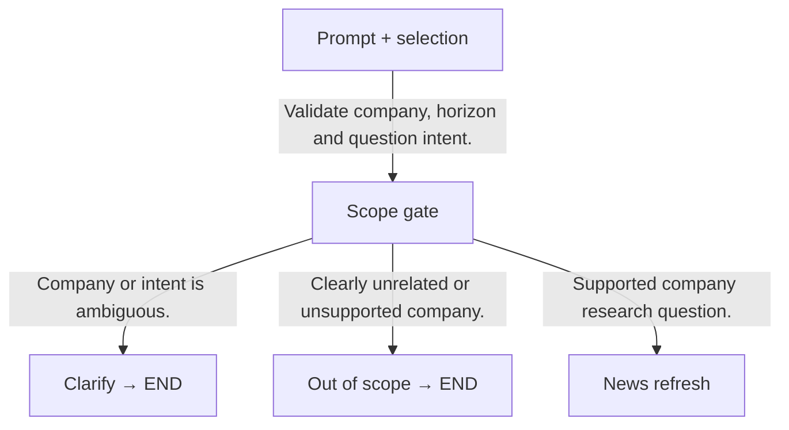

**Prompt + selection → Scope gate**

Validate company, horizon and question intent.

驗證公司、期間及問題意圖。

Handoff / 交接資料:

Original question + canonical company + horizon

原問題＋標準公司＋期間

**Scope gate → Clarify → END**

Company or intent is ambiguous.

公司或意圖不明確。

Handoff / 交接資料:

One clarification question; no news/retrieval calls

一個澄清問題；不呼叫新聞或檢索

**Scope gate → Out of scope → END**

Clearly unrelated or unsupported company.

明顯無關或公司未支援。

Handoff / 交接資料:

Explain scope and show a supported example prompt

交代範圍並提供支援問題例子

**Scope gate → News refresh**

Supported company research question.

支援公司研究問題。

Handoff / 交接資料:

Validated ResearchRequest; unknown coverage may be refreshed

已驗證 ResearchRequest；未知覆蓋可刷新

### 1. SELECT

Show three supported identities in a selector.

選單列出三個支援身份。

Tools: Next.js · TypeScript

**How / 如何應用**

Render options from one company catalog and submit its ID, not an arbitrary name.

由同一公司清單產生選項，提交 ID 而非任意公司名。

**Why / 為何使用**

A fixed universe avoids ambiguous names and unsupported global coverage.

固定範圍可避免同名公司及未支援的全球標的。

Proposed files / 建議檔案: `apps/web/app/page.tsx`, `services/research/app/companies.py`

### 2. VALIDATE

Validate the selected company on the API boundary.

在 API 邊界驗證所選公司。

Tools: FastAPI · Pydantic

**How / 如何應用**

Accept only the three catalog IDs and a supported horizon. Reject any other input before tool access.

只接納清單內三個 ID 及支援的研究期間；工具執行前拒絕其他輸入。

**Why / 為何使用**

Browser controls do not prevent a caller from sending a forged request.

瀏覽器選單無法阻止偽造請求，後端仍須驗證。

Proposed files / 建議檔案: `services/research/app/main.py`, `services/research/app/schemas.py`

### 3. CONFIRM

Display identity and coverage before starting.

開始前顯示身份及資料覆蓋範圍。

Tools: Typed API response

**How / 如何應用**

Return company ID, display name and snapshot as-of date. Keep them with the run.

回傳公司 ID、名稱及快照日期，並與研究任務一起保存。

**Why / 為何使用**

Users can see exactly which company and dated information are being analysed.

使用者能確認研究哪間公司，以及資料截至何時。

Proposed files / 建議檔案: `apps/web/app/page.tsx`, `services/research/app/schemas.py`

### Return branches / 回傳分支

**success**

Required checks pass

所需檢查通過

200: supported identity and coverage shown.

200：顯示支援公司及覆蓋日期。

Return the validated output to the caller.

向呼叫者回傳已驗證結果。

**insufficient**

Valid request, incomplete evidence

請求有效，但證據未齊

No prior snapshot: show coverage unknown, then let the first prompt refresh news.

尚無快照：顯示覆蓋未知，再由首個提示刷新新聞。

Explain the limitation and the next permitted step.

交代限制及下一個允許步驟。

**failure**

Invalid input or an operational error

輸入無效或程序出錯

422: unsupported ID or invalid horizon; do not start a run.

422：公司 ID 或期間無效，不啟動研究。

Return an explicit error. Keep the last valid state.

回傳明確錯誤，保留最後有效狀態。

### Acceptance / 驗收

- A forged unsupported ticker is rejected by the backend, not merely hidden in the UI.
- 偽造未支援 ticker 會由後端拒絕，不只在介面隱藏。

## Refresh news through n8n MCP for every prompt / 每題經 n8n MCP 刷新新聞

Refresh company news with n8n-owned retries, then pin it with completed daily macro/geopolitical batches and a sourced company-profile version.

n8n 負責公司新聞刷新及重試，再與完整每日宏觀／地緣批次及附來源公司背景版本固定快照。

**Input / 輸入**

Validated company, original question, UTC date window and run_id.

已驗證公司、原問題、UTC 日期範圍及 run_id。

**Output / 輸出**

Refresh receipt, provider statuses, dated source records and immutable snapshot_id.

刷新紀錄、供應商狀態、有日期來源及不可變 snapshot_id。

### Entry contract / 入口

```text
Mandatory LangGraph refresh node → n8n MCP Server Trigger
refresh_company_news(company, query, as_of, run_id, deadline) → company_news_version_ids + fetched_at + provider_status
Host pins those versions + completed daily batches + company-profile version → snapshot_id
```

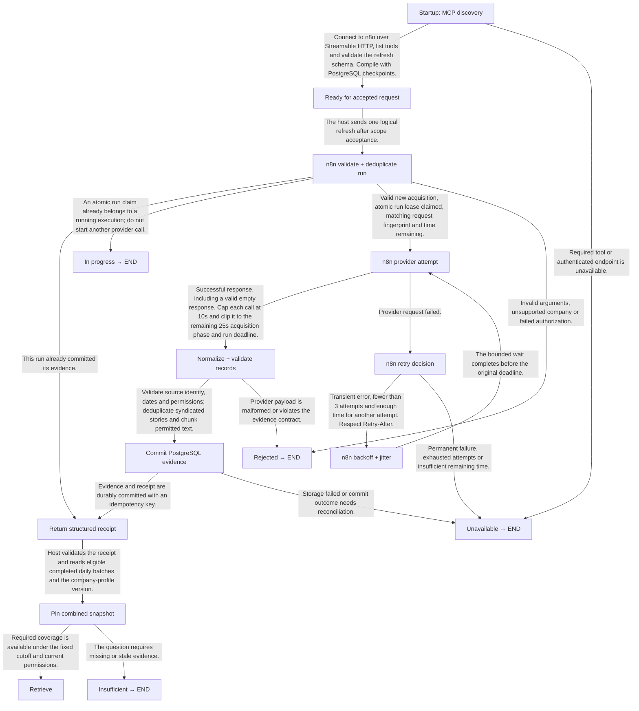

**Startup: MCP discovery → Ready for accepted request**

Connect to n8n over Streamable HTTP, list tools and validate the refresh schema. Compile with PostgreSQL checkpoints.

以 Streamable HTTP 連接 n8n、列出及核對工具 schema，再以 PostgreSQL checkpoint 編譯。

Handoff / 交接資料:

Verified tool capability; startup performs no news acquisition

已核對工具功能；啟動階段不抓新聞

**Startup: MCP discovery → Unavailable → END**

Required tool or authenticated endpoint is unavailable.

所需工具或已認證端點不可用。

Handoff / 交接資料:

Readiness diagnostic

就緒診斷

**Ready for accepted request → n8n validate + deduplicate run**

The host sends one logical refresh after scope acceptance.

Host 通過範圍檢查後發出一次邏輯刷新。

Handoff / 交接資料:

company + original question + run_id + deadline

公司＋原問題＋任務 ID＋時限

**n8n validate + deduplicate run → Return structured receipt**

This run already committed its evidence.

此任務已提交證據。

Handoff / 交接資料:

Existing receipt; resume reuses completed work

原紀錄；恢復重用已完成工作

**n8n validate + deduplicate run → In progress → END**

An atomic run claim already belongs to a running execution; do not start another provider call.

原子任務鍵已屬執行中的工作，不另開供應商呼叫。

Handoff / 交接資料:

Existing execution ID and pending status for reconciliation

原執行 ID 及待完成狀態供核對

**n8n validate + deduplicate run → n8n provider attempt**

Valid new acquisition, atomic run lease claimed, matching request fingerprint and time remaining.

有效新抓取、已原子取得任務 lease、請求指紋相符且仍有時間。

Handoff / 交接資料:

Allowlisted source and bounded timeout

核准來源及有限 timeout

**n8n validate + deduplicate run → Rejected → END**

Invalid arguments, unsupported company or failed authorization.

參數無效、公司未支援或授權失敗。

Handoff / 交接資料:

Typed non-retryable error

不重試結構化錯誤

**n8n provider attempt → Normalize + validate records**

Successful response, including a valid empty response. Cap each call at 10s and clip it to the remaining 25s acquisition phase and run deadline.

成功回應，包括有效空結果；每次最多 10 秒，受餘下 25 秒抓取階段及任務時限限制。

Handoff / 交接資料:

Raw records and provider status

原記錄及供應商狀態

**n8n provider attempt → n8n retry decision**

Provider request failed.

供應商請求失敗。

Handoff / 交接資料:

Error class + attempt count + remaining time

錯誤分類＋次數＋剩餘時間

**n8n retry decision → n8n backoff + jitter**

Transient error, fewer than 3 attempts and enough time for another attempt. Respect Retry-After.

暫時錯誤、少於 3 次且仍有時間再試；遵守 Retry-After。

Handoff / 交接資料:

Wait 1s then 2s plus jitter; clip to job deadline

等待 1 秒、2 秒加 jitter；受工作時限限制

**n8n backoff + jitter → n8n provider attempt**

The bounded wait completes before the original deadline.

有限等待在原時限內完成。

Handoff / 交接資料:

Same run_id; incremented attempt count

相同 run_id；增加次數

**n8n retry decision → Unavailable → END**

Permanent failure, exhausted attempts or insufficient remaining time.

永久失敗、次數用完或餘下時間不足。

Handoff / 交接資料:

Provider unavailable; host does not blindly retry MCP

供應商不可用；Host 不盲目重試 MCP

**Normalize + validate records → Commit PostgreSQL evidence**

Validate source identity, dates and permissions; deduplicate syndicated stories and chunk permitted text.

核對身份、日期及權限，轉載去重並切分允許原文。

Handoff / 交接資料:

Versioned company-news records + coverage status

有版本公司新聞＋覆蓋狀態

**Normalize + validate records → Rejected → END**

Provider payload is malformed or violates the evidence contract.

供應商內容格式或證據合約無效。

Handoff / 交接資料:

Typed validation error

結構化驗證錯誤

**Commit PostgreSQL evidence → Return structured receipt**

Evidence and receipt are durably committed with an idempotency key.

證據及紀錄用冪等鍵持久提交。

Handoff / 交接資料:

company_news_version_ids + fetched_at + status + execution_id

公司新聞版本＋擷取時間＋狀態＋執行 ID

**Commit PostgreSQL evidence → Unavailable → END**

Storage failed or commit outcome needs reconciliation.

儲存失敗或須核對提交結果。

Handoff / 交接資料:

Storage error; no successful receipt claimed

儲存錯誤；不聲稱成功

**Return structured receipt → Pin combined snapshot**

Host validates the receipt and reads eligible completed daily batches and the company-profile version.

Host 驗證紀錄，讀取合資格完整每日批次及公司背景版本。

Handoff / 交接資料:

Company + macro + geopolitical + profile version manifest

公司＋宏觀＋地緣＋背景版本清單

**Pin combined snapshot → Retrieve**

Required coverage is available under the fixed cutoff and current permissions.

固定截止及當前權限下所需覆蓋足夠。

Handoff / 交接資料:

snapshot_id + version IDs + per-stream freshness

snapshot_id＋版本 ID＋各來源新鮮度

**Pin combined snapshot → Insufficient → END**

The question requires missing or stale evidence.

問題所需證據缺少或過期。

Handoff / 交接資料:

Coverage gap and dated supported facts

覆蓋缺口及有日期支持事實

### 1. MCP REFRESH

Call the approved n8n news workflow for every new prompt.

每個新提示呼叫核准 n8n 新聞流程。

Tools: MCP client · n8n MCP Server Trigger · Custom Workflow Tool

**How / 如何應用**

A deterministic node calls the authenticated MCP endpoint before retrieval. The workflow searches fixed news API/RSS providers with validated arguments and a bounded deadline; run_id prevents duplicate acquisition on resume.

固定節點在檢索前呼叫已驗證 MCP 端點；工作流程用已驗證參數及時限搜尋固定新聞 API／RSS，run_id 避免恢復時重複擷取。

**Why / 為何使用**

Per-prompt refresh is a product requirement and must not depend on optional LLM tool selection or a scheduled crawl.

每題刷新是產品要求，不能依賴 LLM 選擇工具或排程爬取。

Proposed files / 建議檔案: `workflows/n8n/news-refresh.json`, `services/research/app/news.py`, `services/research/app/graph.py`

### 2. NORMALISE

Validate, deduplicate and record provenance.

驗證、去重及記錄來源。

Tools: Pydantic · canonical URL · content hash

**How / 如何應用**

Keep source ID, company, URL, permitted excerpt, published_at, first_seen_at and fetched_at. Quarantine invalid records; group syndicated duplicates. Keep article text outside instruction messages.

保存來源 ID、公司、網址、允許節錄及發布／首次取得／擷取時間；隔離無效資料及分組轉載；文章不可進入指令訊息。

**Why / 為何使用**

A timestamp alone does not prove the information was available at the forecast cutoff.

只有發布時間，不能證明預測截止時已取得資料。

Proposed files / 建議檔案: `services/research/app/ingest.py`, `services/research/app/schemas.py`

### 3. PIN SNAPSHOT

Pin the evidence version and return refresh status.

固定證據版本並回傳刷新狀態。

Tools: PostgreSQL versioned evidence · optional pgvector

**How / 如何應用**

Insert content-addressed source versions and commit a pinned PostgreSQL snapshot. Index permitted excerpts with tsvector/GIN; add model-versioned pgvector embeddings for the gated candidate. Record provider failure, partial coverage and freshness; never claim a failed refresh is current news.

按內容 hash 插入來源版本並提交固定 PostgreSQL 快照；允許節錄用 tsvector／GIN，候選向量以 pgvector 記錄模型版本；記錄供應商失敗、部分覆蓋及新鮮度，刷新失敗不能稱為即時新聞。

**Why / 為何使用**

Each answer remains reproducible even when a later prompt finds newer news.

下一題取得更新新聞後，上一題答案仍可重現。

Proposed files / 建議檔案: `services/research/app/storage.py`, `services/research/app/indexing.py`

### Return branches / 回傳分支

**success**

Required checks pass

所需檢查通過

Return a new refresh receipt and pinned snapshot before research.

研究前回傳新刷新紀錄及固定快照。

Return the validated output to the caller.

向呼叫者回傳已驗證結果。

**insufficient**

Valid request, incomplete evidence

請求有效，但證據未齊

Partial or stale coverage: label it and abstain from an unsupported current forecast.

部分或過期覆蓋：明示限制，拒絕無證據當前預測。

Explain the limitation and the next permitted step.

交代限制及下一個允許步驟。

**failure**

Invalid input or an operational error

輸入無效或程序出錯

News service unavailable: return a typed error or explicitly dated replay; never silently bypass refresh.

新聞服務不可用：回傳結構化錯誤或明確有日期重播，不能靜默略過刷新。

Return an explicit error. Keep the last valid state.

回傳明確錯誤，保留最後有效狀態。

### Acceptance / 驗收

- Two new prompts produce two MCP refresh receipts; resuming one run reuses its receipt and snapshot.
- 兩個新提示產生兩份 MCP 刷新紀錄；恢復任務重用原紀錄及快照。

## Retrieve, fuse and rerank evidence / 檢索、融合及重排證據

Use a measured retrieval policy to select attributable context for the exact prompt.

以已量度的檢索策略，為當前提示選取可追溯上下文。

**Input / 輸入**

Original question, company, snapshot_id, cutoff and approved retrieval configuration.

原問題、公司、snapshot_id、截止時間及已核准檢索設定。

**Output / 輸出**

Ranked evidence with source/chunk IDs, original rank, rerank score and configuration version.

排序證據附來源／切段 ID、原排序、重排分數及設定版本。

### Entry contract / 入口

```text
LangGraph tool node
search_company_evidence(company_id, query, snapshot_id, as_of) → ranked IDs
read_source(source_id, snapshot_id) → permitted excerpt + metadata
```

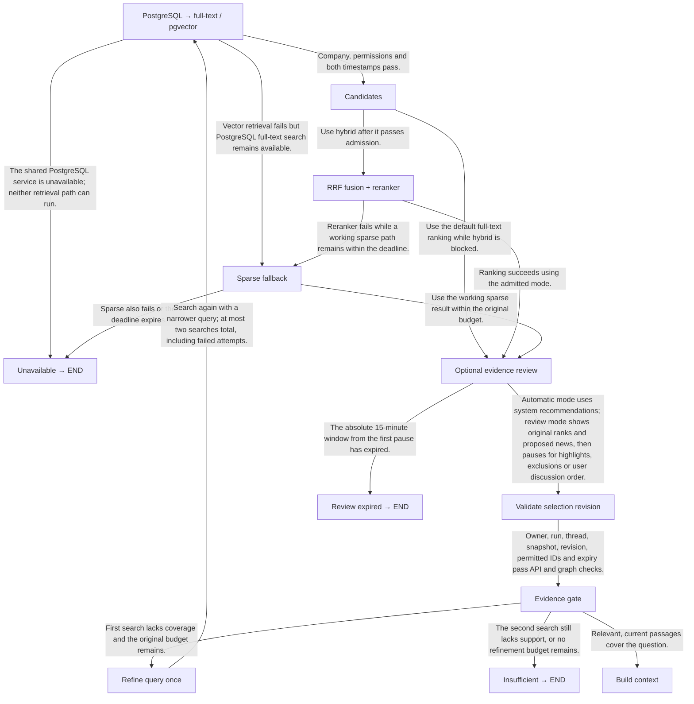

**PostgreSQL → full-text / pgvector → Unavailable → END**

The shared PostgreSQL service is unavailable; neither retrieval path can run.

共用 PostgreSQL 服務中斷，兩條檢索路徑均不可用。

Handoff / 交接資料:

Database failure; preserve the original deadline and counters

資料庫故障；保留原時限及計數

**PostgreSQL → full-text / pgvector → Candidates**

Company, permissions and both timestamps pass.

公司、權限及兩個時間戳符合。

Handoff / 交接資料:

20 candidates per branch: chunk IDs + passages + original ranks

每分支 20 候選：切段 ID＋原文＋初始排序

**Candidates → Optional evidence review**

Use the default full-text ranking while hybrid is blocked.

混合檢索未獲准入時採用預設全文排序。

Handoff / 交接資料:

Ranked passages + sparse mode

已排序原文＋sparse 模式

**Candidates → RRF fusion + reranker**

Use hybrid after it passes admission.

混合檢索通過准入後採用。

Handoff / 交接資料:

Deduplicated top 20 → cross-encoder top 10

去重前 20 → cross-encoder 前 10

**RRF fusion + reranker → Optional evidence review**

Ranking succeeds using the admitted mode.

使用已准入模式成功排序。

Handoff / 交接資料:

Ranked passages and actual mode

已排序原文及實際模式

**PostgreSQL → full-text / pgvector → Sparse fallback**

Vector retrieval fails but PostgreSQL full-text search remains available.

向量檢索失敗，但 PostgreSQL 全文搜尋仍可用。

Handoff / 交接資料:

Same snapshot and deadline

相同快照及時限

**RRF fusion + reranker → Sparse fallback**

Reranker fails while a working sparse path remains within the deadline.

重排失敗，但時限內 sparse 仍可用。

Handoff / 交接資料:

Original question and snapshot; no fabricated scores

原問題及快照；不捏造分數

**Sparse fallback → Optional evidence review**

Use the working sparse result within the original budget.

原預算內使用可用 sparse 結果。

Handoff / 交接資料:

Passages + fallback_reason

原文＋回退原因

**Optional evidence review → Validate selection revision**

Automatic mode uses system recommendations; review mode shows original ranks and proposed news, then pauses for highlights, exclusions or user discussion order.

自動用系統建議；覆核展示原排名及建議新聞，可標記、排除或改討論次序。

Handoff / 交接資料:

Same snapshot; ID-only selection; saved remaining budget

相同快照；只傳 ID 選取；保存剩餘預算

**Optional evidence review → Review expired → END**

The absolute 15-minute window from the first pause has expired.

首次暫停起 15 分鐘絕對期限已過。

Handoff / 交接資料:

Preserved checkpoint; new request required

保留 checkpoint；須新請求

**Validate selection revision → Evidence gate**

Owner, run, thread, snapshot, revision, permitted IDs and expiry pass API and graph checks.

API 及 graph 核對擁有者、任務、thread、快照、版本、可用 ID 及期限。

Handoff / 交接資料:

Selected/highlighted/excluded IDs + system rank + validated user order; no changed truth scores

已選／標記／排除 ID＋系統排名＋已核對用戶次序；不改真實分數

**Sparse fallback → Unavailable → END**

Sparse also fails or the deadline expires.

Sparse 亦失敗或已超時。

Handoff / 交接資料:

Dependency error, not an empty evidence claim

依賴錯誤，不聲稱沒有證據

**Evidence gate → Refine query once**

First search lacks coverage and the original budget remains.

首次搜尋覆蓋不足，原預算仍有餘額。

Handoff / 交接資料:

Missing facets; preserve company, cutoff and snapshot

缺失面向；保留公司、截止及快照

**Refine query once → PostgreSQL → full-text / pgvector**

Search again with a narrower query; at most two searches total, including failed attempts.

收窄查詢再搜尋；包含失敗嘗試總共最多兩次。

Handoff / 交接資料:

Same snapshot, new query, retained search counter

相同快照、新查詢、保留搜尋計數

**Evidence gate → Insufficient → END**

The second search still lacks support, or no refinement budget remains.

第二次搜尋仍不足，或沒有補查預算。

Handoff / 交接資料:

Missing facets; no forecast

缺失面向；不作預測

**Evidence gate → Build context**

Relevant, current passages cover the question.

相關且當前原文足以覆蓋問題。

Handoff / 交接資料:

At most 6 excerpts, stable citation IDs and provenance

最多 6 節錄、穩定引用 ID 及來源記錄

### 1. FILTER

Apply identical company, permission and time constraints in both branches.

兩分支套用相同公司、權限及時間條件。

Tools: Psycopg parameters · PostgreSQL snapshot joins

**How / 如何應用**

Restrict to the pinned snapshot and require published_at and first_seen_at ≤ as_of. Filter before both sparse and dense search; recheck returned IDs before context assembly.

限制固定快照，發布及首次取得時間均須 ≤ 截止；稀疏及向量搜尋前都過濾，組合上下文前再核對 ID。

**Why / 為何使用**

Dense similarity cannot excuse wrong-company, unlicensed or future evidence.

向量相似度不能合理化錯公司、未授權或未來證據。

Proposed files / 建議檔案: `services/research/app/retrieval.py`, `services/research/app/storage.py`

### 2. SEARCH + FUSE

Keep sparse as default; trial the hybrid vector index behind its admission gate.

預設使用 sparse；混合向量索引須通過准入。

Tools: PostgreSQL FTS · pgvector · RRF

**How / 如何應用**

Retrieve 20 candidates per branch, fuse duplicate chunk IDs with reciprocal rank fusion and retain 20. Compare sparse, hybrid and hybrid+rerank on frozen labels. Admission requires +0.03 recall@10 and +0.05 nDCG@10 plus the citation and safety gates.

每分支取 20 候選，以 RRF 融合重複切段 ID 並保留 20；用凍結標籤比較三種配置。准入須 recall@10 +0.03、nDCG@10 +0.05 及引用與安全達標。

**Why / 為何使用**

Vector indexing and reranking need measured benefit over the PostgreSQL full-text baseline.

向量索引及重排須以超越 PostgreSQL 全文基線的量度效益支持。

Proposed files / 建議檔案: `services/research/app/retrieval.py`, `services/research/app/indexing.py`, `evals/retrieval-policy.json`

### 3. RERANK

Rescore query–passage pairs and read the selected sources.

重評問題與原文配對，再讀取選中來源。

Tools: Pinned cross-encoder · read_source

**How / 如何應用**

Rerank the fused 20 to top 10; supply at most 6 permitted excerpts within the token budget. Store model version and ranks. On candidate failure use sparse with a visible fallback flag; never substitute fabricated scores.

將融合 20 筆重排成前 10，token 預算內最多提供 6 段；記錄模型版本及排序。候選失敗明示回退 sparse，不能捏造分數。

**Why / 為何使用**

Retrieval recall and answer context have different budgets; reranking must prove it improves useful evidence.

檢索召回與答案上下文有不同預算；重排須證明改善可用證據。

Proposed files / 建議檔案: `services/research/app/rerank.py`, `services/research/app/tools.py`

### 4. REVIEW + RECHECK

Show proposed news and system rank, let users exclude, highlight or reorder, then recheck support.

展示建議新聞及系統排名，讓用戶排除、標記或改次序，再重查支持。

Tools: LangGraph interrupt / Command · PostgreSQL selection revisions

**How / 如何應用**

Sparse default, admitted reranking and fallback share this step. Automatic mode keeps system recommendations. Review mode persists the selection separately from the immutable snapshot; verify owner, run, candidate revision and permitted IDs on resume. Highlights affect emphasis only. Exclusions recheck required facets, conflicting evidence and report limitations before context assembly.

預設 sparse、已准入重排及回退共用此步。自動用系統建議；覆核選取獨立於不可變快照保存，恢復核對擁有者、任務、候選版本及可用 ID。標記只改重點；排除後在 context 前重查面向、矛盾證據及報告限制。

**Why / 為何使用**

Human control is useful only if missing support still blocks a forecast.

讓人選擇重點，同時保留支持不足就不預測的限制。

Proposed files / 建議檔案: `services/research/app/selection.py`, `services/research/app/graph.py`, `apps/web/app/evidence-review.tsx`

### Return branches / 回傳分支

**success**

Required checks pass

所需檢查通過

Return attributable top-k evidence and the actual retrieval mode.

回傳可追溯 top-k 證據及實際檢索模式。

Return the validated output to the caller.

向呼叫者回傳已驗證結果。

**insufficient**

Valid request, incomplete evidence

請求有效，但證據未齊

Empty or weak evidence: refine once, then return insufficient evidence.

無或弱證據：補查一次，再回傳證據不足。

Explain the limitation and the next permitted step.

交代限制及下一個允許步驟。

**failure**

Invalid input or an operational error

輸入無效或程序出錯

Candidate unavailable or not admitted: use sparse and record the reason; invalid sources stay excluded.

候選不可用或未准入：使用 sparse 並記錄原因；無效來源保持排除。

Return an explicit error. Keep the last valid state.

回傳明確錯誤，保留最後有效狀態。

### Acceptance / 驗收

- Published metrics, fixed dataset hashes and the written margins are required before enabling the candidate; missing scores never count as a pass.
- 啟用候選前須公布指標、固定資料 hash 及書面門檻；缺少分數不能當通過。

## Run one bounded research agent / 運行一個有上限的研究 agent

Route each prompt through scope checks, retrieval, reranking and evidence gates within a controlled budget.

每個提示經範圍檢查、檢索、重排及證據檢查，同時限制執行預算。

**Input / 輸入**

Company ID, the original prompt, horizon, as-of time and a mandatory news refresh receipt.

公司 ID、原提示、期間、截止時間及必需新聞刷新紀錄。

**Output / 輸出**

A validated research result or an explicit insufficient-evidence result.

已驗證研究結果，或明確證據不足結果。

### Entry contract / 入口

```text
POST /api/research
{"company_id":"MSFT","question":"Explain recent developments","horizon":"1-3m"}
Next.js proxy → POST /research → run_id + result
```

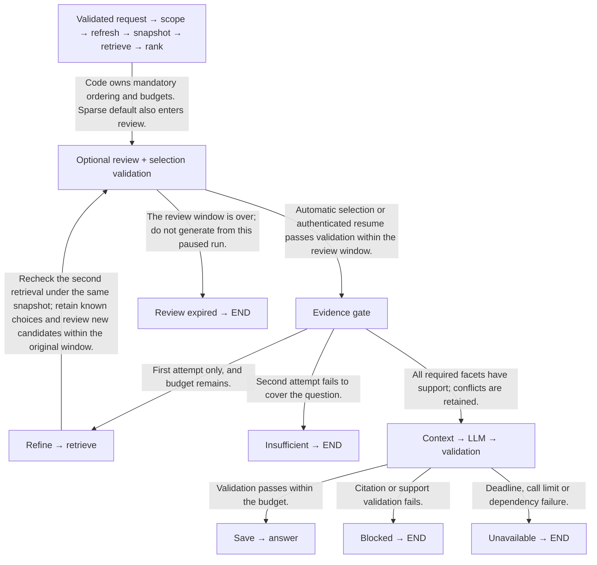

**Validated request → scope → refresh → snapshot → retrieve → rank → Optional review + selection validation**

Code owns mandatory ordering and budgets. Sparse default also enters review.

程式控制必需次序及預算；預設 sparse 亦經覆核。

Handoff / 交接資料:

Ranked candidates, fixed snapshot, review mode and candidate revision

已排序候選、固定快照、覆核模式及候選版本

**Optional review + selection validation → Evidence gate**

Automatic selection or authenticated resume passes validation within the review window.

自動選取或已驗證恢復在覆核期內通過核對。

Handoff / 交接資料:

Selection revision, exclusions, highlights and remaining budgets

選取版本、排除、標記及剩餘預算

**Optional review + selection validation → Review expired → END**

The review window is over; do not generate from this paused run.

覆核期已過，不能用暫停任務生成。

Handoff / 交接資料:

Expired status and saved checkpoint

過期狀態及已存 checkpoint

**Evidence gate → Refine → retrieve**

First attempt only, and budget remains.

只限首次嘗試，而且仍有預算。

Handoff / 交接資料:

Refined query; same original question and snapshot

修正查詢；相同原問題及快照

**Refine → retrieve → Optional review + selection validation**

Recheck the second retrieval under the same snapshot; retain known choices and review new candidates within the original window.

同一快照重查第二輪；保留已知選擇，原期限內覆核新候選。

Handoff / 交接資料:

Updated candidates; attempts = 2; no reset of exclusions or budgets

更新候選；次數 = 2；不重設排除或預算

**Evidence gate → Insufficient → END**

Second attempt fails to cover the question.

第二次仍未覆蓋問題。

Handoff / 交接資料:

Supported facts + missing facets; no forecast

有支持事實＋缺失面向；不作預測

**Evidence gate → Context → LLM → validation**

All required facets have support; conflicts are retained.

所有所需面向有支持，矛盾證據保留。

Handoff / 交接資料:

Prompt-specific draft with citations and conditional scenarios

針對提示的草稿、引用及條件式情境

**Context → LLM → validation → Save → answer**

Validation passes within the budget.

預算內通過驗證。

Handoff / 交接資料:

Validated cited answer

已驗證引用答案

**Context → LLM → validation → Blocked → END**

Citation or support validation fails.

引用或支持驗證失敗。

Handoff / 交接資料:

Withheld draft and validation errors

不發布草稿及驗證錯誤

**Context → LLM → validation → Unavailable → END**

Deadline, call limit or dependency failure.

超時、超額或依賴失敗。

Handoff / 交接資料:

Typed error + resumable checkpoint when safe

結構化錯誤＋安全時可恢復 checkpoint

### 1. PLAN + TOOLS

Create typed state, screen the prompt and route accepted research.

建立型別狀態、檢查提示範圍，路由已接納研究。

Tools: LangGraph · one tool-capable LLM

**How / 如何應用**

Reject irrelevant intent or clarify ambiguous company before news access. For accepted prompts require n8n refresh, then code-owned retrieval/ranking, optional evidence review, selection validation, evidence gate and context nodes. Track original question, snapshot, facets, attempts, deadline and trace ID.

新聞存取前拒絕無關意圖或澄清公司。接納提示須先 n8n 刷新，再由程式節點檢索／排序、可選覆核、驗證選取、證據檢查及組合 context；追蹤原問題、快照、面向、次數、時限及 trace ID。

**Why / 為何使用**

A constrained tool boundary supports useful agent decisions without broad machine access.

受限制工具邊界支援 agent 判斷，同時避免取得廣泛系統權限。

Proposed files / 建議檔案: `services/research/app/graph.py`, `services/research/app/tools.py`

### 2. CHECK GAP

Assess whether the gathered evidence answers the question.

判斷已取得證據是否足以回答。

Tools: Conditional edges · structured output

**How / 如何應用**

Use code checks for company, dates and source presence. Let the model describe any remaining information gap in a schema.

以程式檢查公司、日期及來源；模型用固定格式描述尚欠資料。

**Why / 為何使用**

A fluent draft must not be treated as proof that the research is complete.

文字流暢不代表研究已完成。

Proposed files / 建議檔案: `services/research/app/graph.py`, `services/research/app/schemas.py`

### 3. REFINE ONCE

Refine once, or continue to reporting and validation.

最多修正查詢一次，再進入報告及驗證。

Tools: Bounded loop · timeout · PostgreSQL checkpoint

**How / 如何應用**

Allow two search rounds total. Persist progress and stop at the configured time, tool or model budget. Return no rating if evidence remains inadequate.

總共最多兩輪搜尋；保存進度，到達時間、工具或模型上限就停止。仍不足則不評級。

**Why / 為何使用**

A bounded agent can recover and explain failure without looping or spending indefinitely.

有上限的 agent 能恢復及解釋失敗，避免無限循環及用量。

Proposed files / 建議檔案: `services/research/app/graph.py`, `services/research/app/checkpoints.py`

### Return branches / 回傳分支

**success**

Required checks pass

所需檢查通過

200: return a validated report with run ID and source references.

200：回傳已驗證報告、任務 ID 及來源引用。

Return the validated output to the caller.

向呼叫者回傳已驗證結果。

**insufficient**

Valid request, incomplete evidence

請求有效，但證據未齊

200, status insufficient: return supported findings and no rating after the final search.

200，狀態 insufficient：最後搜尋後只回傳有證據發現，不評級。

Explain the limitation and the next permitted step.

交代限制及下一個允許步驟。

**failure**

Invalid input or an operational error

輸入無效或程序出錯

422 for bad input; 503 for unavailable dependencies. Preserve a resumable run when safe.

輸入錯誤回 422；依賴不可用回 503。在安全情況保留可恢復任務。

Return an explicit error. Keep the last valid state.

回傳明確錯誤，保留最後有效狀態。

### Acceptance / 驗收

- The missing-evidence path performs at most one refinement and never invents the absent fact.
- 資料不足路徑最多補查一次，不能捏造缺失事實。

## Answer the prompt with conditional forecasts / 以條件式預測回答提示

Answer the exact question with cited facts, conditional scenarios and explicit uncertainty.

以引用事實、條件式情境及明確不確定性，回答當前問題。

**Input / 輸入**

Original prompt, horizon, as-of time, approved evidence and optional teaching-rule result.

原提示、期間、截止時間、核准證據及可選教學規則結果。

**Output / 輸出**

Structured draft: direct answer, facts, base/upside/downside scenarios, assumptions, citations and invalidation signals.

結構化草稿：直接答案、事實、基本／上行／下行情境、假設、引用及失效訊號。

### Entry contract / 入口

```text
LangGraph report node
draft_report(question, horizon, as_of, evidence, optional_rule_result) → ResearchReport draft
```

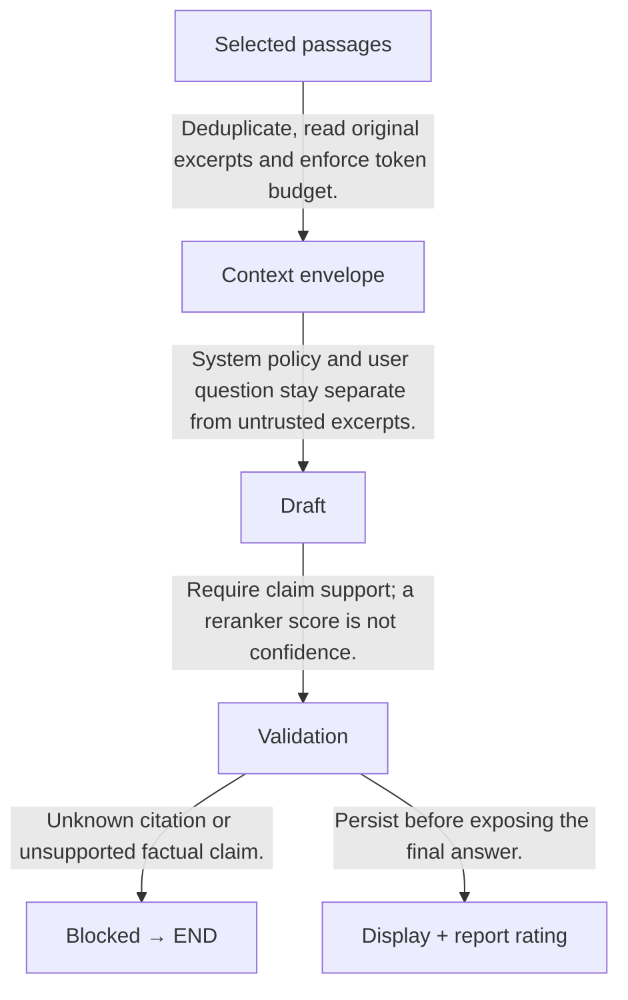

**Selected passages → Context envelope**

Deduplicate, read original excerpts and enforce token budget.

去重、讀原文並限制 token。

Handoff / 交接資料:

Question, horizon, as_of, evidence[], missing_facets[], conflicts[]

問題、期間、截止、證據、缺失面向及矛盾

**Context envelope → Draft**

System policy and user question stay separate from untrusted excerpts.

系統規則及使用者問題與不可信原文分開。

Handoff / 交接資料:

Direct answer + observed facts + conditional scenarios + citation IDs

直接答案＋觀察事實＋條件式情境＋引用 ID

**Draft → Validation**

Require claim support; a reranker score is not confidence.

要求主張支持；重排分數不是信心。

Handoff / 交接資料:

Draft only; never stream an unvalidated recommendation

只產生草稿；不串流未驗證建議

**Validation → Blocked → END**

Unknown citation or unsupported factual claim.

未知引用或無支持事實。

Handoff / 交接資料:

Do not release draft

不發布草稿

**Validation → Display + report rating**

Persist before exposing the final answer.

先保存，再顯示最終答案。

Handoff / 交接資料:

Report ID, trace URL/status; separate feedback linked to run_id

報告 ID、trace URL／狀態；回饋另存並連結 run_id

### 1. APPLY RULES

Apply the optional teaching stance only when the question calls for it.

只有問題需要時才套用可選教學評級。

Tools: Pure Python · versioned rules

**How / 如何應用**

For the teaching rule, require demand, costs and outlook evidence. Maintained outlook gives Hold; lowered outlook gives Reduce; missing evidence gives no rating.

教學規則要求需求、成本及展望證據。展望維持為 Hold，下調為 Reduce，缺證據則不評級。

**Why / 為何使用**

An explainable rule is auditable. It is a teaching rule, not a validated profitable strategy.

可解釋規則方便核對；它是教學規則，並非已驗證盈利策略。

Proposed files / 建議檔案: `services/research/app/rules.py`

### 2. EXPLAIN

Ask one LLM to explain the evidence and possible effects.

由一個 LLM 解釋證據及可能影響。

Tools: One LLM · prompt template · Pydantic schema

**How / 如何應用**

Provide the original question, horizon, refreshed excerpts and optional teaching-rule result. Separate observed facts from conditional forecasts; include base/upside/downside scenarios, assumptions, source IDs and what would invalidate each view.

提供原問題、期間、刷新節錄及可選教學規則結果；分清事實與條件式預測，列基本／上行／下行情境、假設、來源及失效訊號。

**Why / 為何使用**

News sentiment alone does not establish price direction or causation; expectations may already be priced in.

新聞正負面不能單獨證明股價方向或因果，預期可能已反映在價格。

Proposed files / 建議檔案: `services/research/app/report.py`, `services/research/app/prompts.py`, `services/research/app/schemas.py`

### 3. PRESENT

Display the short research report after validation.

驗證後顯示簡短研究報告。

Tools: Next.js · typed response

**How / 如何應用**

Show the prompt-specific answer, scenarios and cited news on one page, with as-of date and one verified demo trace URL. Save helpfulness or correction feedback separately by run_id and prompt_version.

同頁展示針對問題的答案、情境、引用新聞、截止日期及已驗證 demo trace URL；有用度或更正回饋按 run_id 及 prompt_version 另存。

**Why / 為何使用**

A reader can understand the conclusion first and inspect its evidence without reading a technical dashboard.

讀者先理解結論，再核對證據，毋須閱讀複雜技術儀表板。

Proposed files / 建議檔案: `apps/web/components/research-report.tsx`, `apps/web/app/page.tsx`

### Return branches / 回傳分支

**success**

Required checks pass

所需檢查通過

Validated draft becomes a dated, prompt-specific scenario report; the teaching stance is optional.

已驗證草稿成為有日期、針對提示的情境報告；教學評級為可選。

Return the validated output to the caller.

向呼叫者回傳已驗證結果。

**insufficient**

Valid request, incomplete evidence

請求有效，但證據未齊

Show the supported news summary with No rating and the missing evidence.

展示有證據的新聞摘要、無評級狀態及缺失資料。

Explain the limitation and the next permitted step.

交代限制及下一個允許步驟。

**failure**

Invalid input or an operational error

輸入無效或程序出錯

Malformed model output stays unreleased; return a validation failure to the graph.

模型格式無效則不發布草稿，向 graph 回傳驗證失敗。

Return an explicit error. Keep the last valid state.

回傳明確錯誤，保留最後有效狀態。

### Acceptance / 驗收

- Every news impact includes a source and uncertainty; no target price or invented confidence percentage appears.
- 每項新聞影響都有來源及不確定因素；不出現目標價或捏造信心百分比。

## Validate citations and tool boundaries / 驗證引用及工具邊界

Stop unsupported output and keep article text from becoming an instruction.

阻擋無根據輸出，避免文章文字變成系統指令。

**Input / 輸入**

Draft report, approved source set and immutable run limits.

報告草稿、核准來源集及不可由文章修改的任務上限。

**Output / 輸出**

A pass result, actionable validation errors or an insufficient-evidence response.

通過結果、可處理的驗證錯誤，或證據不足回覆。

### Entry contract / 入口

```text
Graph validation node and tool boundary
validate_report(draft, allowed_sources, rules) → valid | insufficient | errors
```

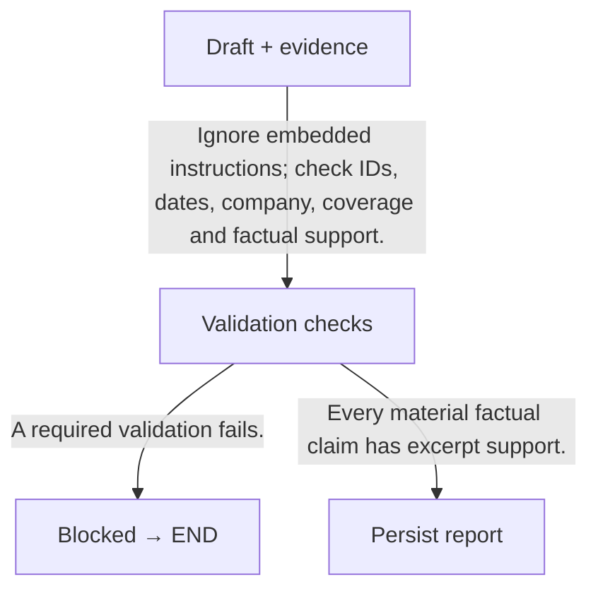

**Draft + evidence → Validation checks**

Ignore embedded instructions; check IDs, dates, company, coverage and factual support.

忽略內嵌指令，檢查 ID、日期、公司、覆蓋及事實支持。

Handoff / 交接資料:

Validation errors or a validated report

驗證錯誤或已驗證報告

**Validation checks → Blocked → END**

A required validation fails.

必要驗證失敗。

Handoff / 交接資料:

validation_failed; no draft publication

validation_failed；不發布草稿

**Validation checks → Persist report**

Every material factual claim has excerpt support.

所有重要事實主張有原文支持。

Handoff / 交接資料:

Validated result and source references

已驗證結果及來源引用

### 1. RESTRICT

Keep tool authority outside retrieved text.

將工具權限放在檢索文字之外控制。

Tools: Allowlisted tools · validated arguments

**How / 如何應用**

Treat article text as untrusted data. Permit only read-only tools and server-enforced source filters. Never put keys into prompts.

文章當作不可信資料，只允許唯讀工具及伺服器強制來源限制，金鑰不放進提示。

**Why / 為何使用**

Telling a model to ignore attacks is only one layer; code must enforce the accessible operations.

叫模型忽略攻擊只係其中一層，程式必須限制可執行動作。

Proposed files / 建議檔案: `services/research/app/tools.py`, `services/research/app/prompts.py`

### 2. VERIFY

Check structure, source membership, dates and rule agreement.

檢查格式、來源歸屬、日期及規則一致性。

Tools: Pydantic · deterministic checks

**How / 如何應用**

Reject unknown citations, wrong-company evidence, future information and a stance inconsistent with the rule result. Evaluate whether cited passages support factual claims.

拒絕未知引用、錯公司、未來資料及與規則不符的觀點，並評估原文是否支持事實主張。

**Why / 為何使用**

A source link can exist while failing to support the sentence next to it.

來源連結存在，仍可能不支持旁邊的句子。

Proposed files / 建議檔案: `services/research/app/validation.py`, `services/research/app/schemas.py`

### 3. RELEASE OR STOP

Release only the supported result and record failures.

只發布有支持的結果，並記錄失敗。

Tools: Graph conditional edge · structured trace

**How / 如何應用**

Return valid output, no rating for insufficient evidence, or a typed failure. Record source IDs and error categories without secrets.

有效則回傳，證據不足則不評級，其他情況回傳結構化失敗；記錄來源 ID 及錯誤類別，避免記錄秘密。

**Why / 為何使用**

Visible failure is more useful than silently presenting an unsupported recommendation.

明確交代失敗，能避免把無根據觀點當成已驗證建議。

Proposed files / 建議檔案: `services/research/app/validation.py`, `services/research/app/graph.py`

### Return branches / 回傳分支

**success**

Required checks pass

所需檢查通過

Release validated structured content to storage and UI.

將已驗證內容交給儲存及介面。

Return the validated output to the caller.

向呼叫者回傳已驗證結果。

**insufficient**

Valid request, incomplete evidence

請求有效，但證據未齊

Return No rating with supported facts; human approval cannot manufacture missing evidence.

回傳無評級及有證據事實；人工批准不能補出缺失證據。

Explain the limitation and the next permitted step.

交代限制及下一個允許步驟。

**failure**

Invalid input or an operational error

輸入無效或程序出錯

Block release and return validation_failed; do not leak keys or follow article instructions.

阻擋發布並回傳 validation_failed，不洩漏金鑰或執行文章指令。

Return an explicit error. Keep the last valid state.

回傳明確錯誤，保留最後有效狀態。

### Acceptance / 驗收

- An attack fixture asking for keys or STRONG BUY cannot change permitted tools or the rule result.
- 要求金鑰或 STRONG BUY 的攻擊範例，不能修改允許工具或規則結果。

## Save and download the report / 保存及下載報告

Keep the reviewed result and export exactly what the user saw.

保存已核對結果，下載內容與畫面一致。

**Input / 輸入**

A validated report ID and Markdown export request.

已驗證報告 ID 及 Markdown 下載請求。

**Output / 輸出**

A stored report or Markdown with its evidence, dates and limitations.

已儲存報告，或包含證據、日期及限制的 Markdown。

### Entry contract / 入口

```text
GET /api/reports/{report_id}/export
Next.js proxy → GET /reports/{report_id}/export
Content-Type: text/markdown; charset=utf-8
```

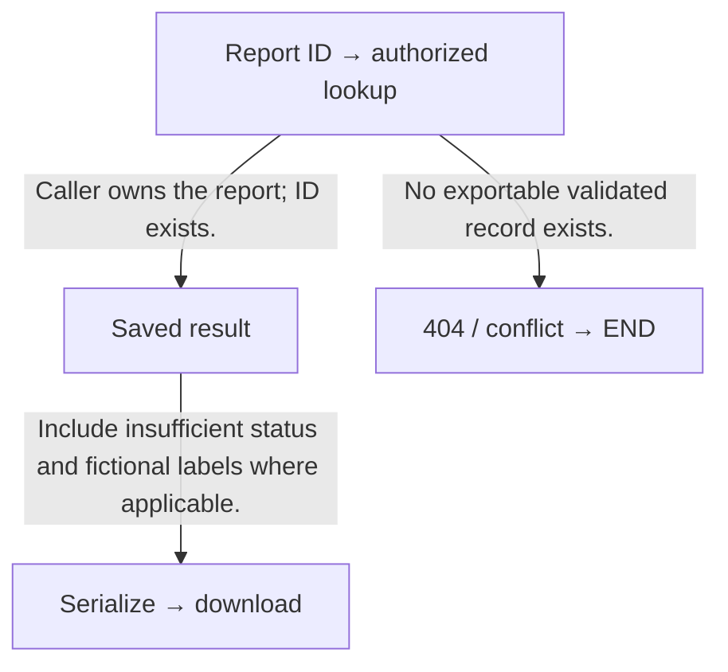

**Report ID → authorized lookup → Saved result**

Caller owns the report; ID exists.

呼叫者擁有報告且 ID 存在。

Handoff / 交接資料:

Saved question, answer, sources, dates, trace status

已存問題、答案、來源、日期及 trace 狀態

**Report ID → authorized lookup → 404 / conflict → END**

No exportable validated record exists.

沒有可下載的已驗證紀錄。

Handoff / 交接資料:

Typed error; no regeneration

結構化錯誤；不重新生成

**Saved result → Serialize → download**

Include insufficient status and fictional labels where applicable.

適用時保留證據不足狀態及虛構標籤。

Handoff / 交接資料:

Markdown identical to displayed report; zero LLM calls

與畫面相同 Markdown；零 LLM 呼叫

### 1. SAVE

Persist the final version with its research context.

連同研究背景保存最終版本。

Tools: PostgreSQL · transactions

**How / 如何應用**

Save the original question, horizon, validated scenarios, source IDs, snapshot, prompt/model versions, refresh receipt, run ID and trace URL. Feedback records reference the run without changing the frozen evidence.

一起保存原問題、期間、驗證情境、來源、快照、提示／模型版本、刷新紀錄、任務 ID 及 trace URL；回饋關聯任務但不能改凍結證據。

**Why / 為何使用**

A later export must refer to the same evidence instead of silently regenerating a new answer.

稍後下載應使用相同證據，不能靜默重新產生另一個答案。

Proposed files / 建議檔案: `services/research/app/storage.py`

### 2. SERIALISE

Render Markdown from the stored validated result.

從已儲存的驗證結果產生 Markdown。

Tools: Python serializer · no LLM call

**How / 如何應用**

Include the original question, scenarios, horizon, source URLs/dates, assumptions, uncertainty and actual trace URL. Preserve fictional labels and unavailable telemetry status in offline fixtures.

包含原問題、情境、期間、來源網址／日期、假設、不確定性及真實 trace URL；離線範例保留虛構標籤及未有追蹤狀態。

**Why / 為何使用**

Downloading an existing report requires no additional model usage and should preserve provenance.

下載已有報告不需額外模型用量，亦應保留來源記錄。

Proposed files / 建議檔案: `services/research/app/export.py`

### 3. DOWNLOAD

Return the file through the frontend route.

透過前端路由回傳檔案。

Tools: FastAPI response · Next.js proxy

**How / 如何應用**

Look up the report ID, set the Markdown content type and filename, and stream the existing text.

按報告 ID 查找，設定 Markdown 類型及檔名，再回傳已有文字。

**Why / 為何使用**

The first private single-user app needs one clear export path; public multi-user ownership checks come before sharing it.

私人單用戶首版只需一條下載路徑；公開多人使用前須加擁有權檢查。

Proposed files / 建議檔案: `services/research/app/main.py`, `apps/web/app/api/[...path]/route.ts`

### Return branches / 回傳分支

**success**

Required checks pass

所需檢查通過

200: download the existing Markdown with evidence intact.

200：下載保留證據的既有 Markdown。

Return the validated output to the caller.

向呼叫者回傳已驗證結果。

**insufficient**

Valid request, incomplete evidence

請求有效，但證據未齊

An insufficient-evidence report can be saved and exported with its No rating status.

證據不足報告可保存及下載，但必須保留無評級狀態。

Explain the limitation and the next permitted step.

交代限制及下一個允許步驟。

**failure**

Invalid input or an operational error

輸入無效或程序出錯

404 for unknown report; reject unfinished or invalid report export.

未知報告回 404；拒絕下載未完成或無效報告。

Return an explicit error. Keep the last valid state.

回傳明確錯誤，保留最後有效狀態。

### Acceptance / 驗收

- The downloaded report matches the displayed result and makes zero extra model calls.
- 下載報告與畫面一致，額外模型呼叫為零。

## Resume an interrupted research run / 恢復中斷研究任務

Recover completed work after a failure without starting the research again.

失敗後恢復已完成工作，避免全部重做。

**Input / 輸入**

A known run ID and its saved graph checkpoint.

已知任務 ID 及其 graph checkpoint。

**Output / 輸出**

A resumed run, a completed result, or a clear unavailable-checkpoint error.

已恢復任務、已完成結果，或明確無可用 checkpoint 錯誤。

### Entry contract / 入口

```text
POST /api/research/{run_id}/resume
Next.js proxy → POST /research/{run_id}/resume
Resume only the selected saved run, within its existing budget.
```

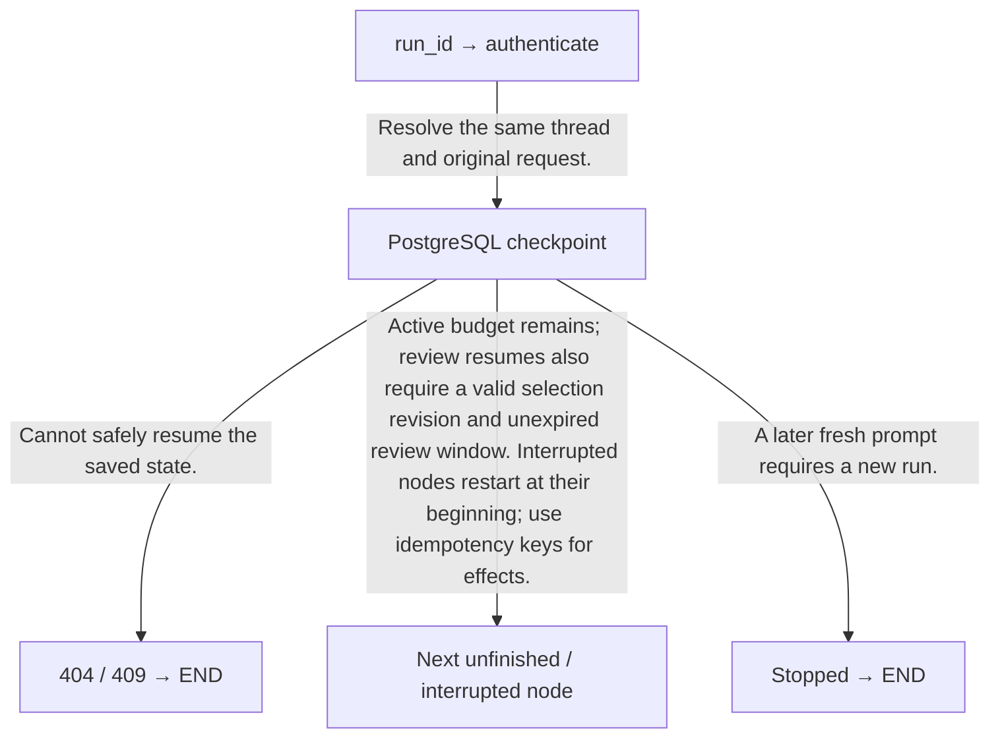

**run_id → authenticate → PostgreSQL checkpoint**

Resolve the same thread and original request.

解析相同 thread 及原請求。

Handoff / 交接資料:

Saved snapshot, completed node results, attempts and remaining budget

快照、已完成結果、次數及剩餘預算

**PostgreSQL checkpoint → 404 / 409 → END**

Cannot safely resume the saved state.

無法安全恢復儲存狀態。

Handoff / 交接資料:

Keep saved state; explain recovery failure

保留狀態並交代恢復失敗

**PostgreSQL checkpoint → Next unfinished / interrupted node**

Active budget remains; review resumes also require a valid selection revision and unexpired review window. Interrupted nodes restart at their beginning; use idempotency keys for effects.

仍有處理預算；覆核恢復另須有效選取版本及未過期覆核期。中斷節點從頭開始，副作用須用冪等鍵。

Handoff / 交接資料:

Same refresh receipt and search count; no budget reset

相同刷新紀錄及搜尋次數；不重設預算

**PostgreSQL checkpoint → Stopped → END**

A later fresh prompt requires a new run.

稍後新研究須建立新任務。

Handoff / 交接資料:

Supported partial findings and explicit expiry

有支持的部分發現及明確過期狀態

### 1. CHECKPOINT

Persist graph progress under the run ID.

按任務 ID 保存 graph 進度。

Tools: LangGraph AsyncPostgresSaver · PostgreSQL

**How / 如何應用**

Use AsyncPostgresSaver in the application lifespan; run setup once during migration. Save query, evidence references, tool receipts and remaining budget under the authorized run thread_id in the checkpoint database.

App 生命週期使用 AsyncPostgresSaver，migration 執行一次 setup；查詢、來源、工具紀錄及剩餘預算按已授權任務 thread_id 保存至 checkpoint 資料庫。

**Why / 為何使用**

Checkpointing remembers a run. It is different from long-term user memory or permission to take new actions.

Checkpoint 記住單次任務，不等於長期用戶記憶或執行新動作的權限。

Proposed files / 建議檔案: `services/research/app/checkpoints.py`, `services/research/app/graph.py`

### 2. RESUME

Load the matching checkpoint and continue safely.

載入相符 checkpoint 並安全繼續。

Tools: Run identity · idempotent source reads

**How / 如何應用**

Resolve the saved run, validate its status and resume with the same thread identity. Reuse completed tool results and remaining limits.

查找已儲存任務，核對狀態，以相同 thread 身份恢復；重用已完成工具結果及剩餘上限。

**Why / 為何使用**

Retries must not reset budgets, duplicate completed work or resume a different user’s run.

重試不能重設預算、重複已完成工作或恢復其他用戶任務。

Proposed files / 建議檔案: `services/research/app/checkpoints.py`, `services/research/app/main.py`

### 3. RETURN STATUS

Tell the user what resumed and what remains.

告知使用者已恢復及尚欠工作。

Tools: Typed response · Next.js status view

**How / 如何應用**

Return the resumed status or existing final result. Reject unknown or incompatible checkpoints instead of inventing a fresh run.

回傳恢復狀態或既有結果；拒絕未知或不相容 checkpoint，不靜默新開任務。

**Why / 為何使用**

A transparent recovery path is demonstrable engineering evidence for interviews.

清晰可核對的恢復路徑，係面試可展示的工程能力。

Proposed files / 建議檔案: `apps/web/app/page.tsx`, `services/research/app/main.py`

### Return branches / 回傳分支

**success**

Required checks pass

所需檢查通過

Resume the saved run without repeating the completed search.

恢復已儲存任務，不重複已完成搜尋。

Return the validated output to the caller.

向呼叫者回傳已驗證結果。

**insufficient**

Valid request, incomplete evidence

請求有效，但證據未齊

Budget is exhausted: return supported findings and no rating instead of restarting.

預算已用盡：回傳有證據發現及無評級，不重新開始。

Explain the limitation and the next permitted step.

交代限制及下一個允許步驟。

**failure**

Invalid input or an operational error

輸入無效或程序出錯

404 for unknown run; 409 for incompatible checkpoint; leave the saved state intact.

未知任務回 404；checkpoint 不相容回 409；保留儲存狀態。

Return an explicit error. Keep the last valid state.

回傳明確錯誤，保留最後有效狀態。

### Acceptance / 驗收

- Stop after the first search, resume, and show that the search count remains one.
- 第一次搜尋後停止再恢復，搜尋次數維持一次。

## Proposed file hierarchy and local startup / 建議檔案及本機啟動

This is the proposed standalone app. These services and commands are not implemented in this academy repository.

```text
stock-research-agent/                 # proposed standalone app
├── apps/web/
│   ├── app/page.tsx                    # selector + report
│   ├── app/api/[...path]/route.ts      # server-only API proxy
│   ├── components/research-report.tsx
│   ├── Dockerfile
│   └── package.json / package-lock.json
├── services/research/
│   ├── app/
│   │   ├── main.py / schemas.py / companies.py
│   │   ├── ingest.py / storage.py / retrieval.py
│   │   ├── news.py / indexing.py / rerank.py / telemetry.py
│   │   ├── graph.py / tools.py / checkpoints.py
│   │   ├── rules.py / report.py / prompts.py
│   │   └── validation.py / export.py / evaluate.py
│   ├── migrations/001_research.sql     # PostgreSQL schema + pgvector extension
│   ├── tests/test_research.py
│   ├── requirements.txt               # pinned dependencies
│   ├── .env.example                   # no secrets
│   └── Dockerfile
├── data/manifest.json / README.md      # approved, dated evidence
├── workflows/n8n/news-refresh.json     # MCP workflow export, no credentials
├── integrations/yfinance/              # copy the academy's runnable provider adapter
├── evals/golden.json / injections.json / retrieval-policy.json
├── docs/adr/001–006.md / eval-report.md
├── deploy/
│   ├── compose.yaml / otel-collector.yaml
│   ├── research.env.example / README.md
│   └── research.env                   # ignored, server secrets
├── .github/workflows/check.yml
├── .gitignore                         # .env.local, data files, databases
└── README.md

Native local: browser :3000 → Next.js server → FastAPI 127.0.0.1:8000
Docker later: browser → controlled HTTPS → web → research:8000 → private PostgreSQL
PostgreSQL evidence/reports and the separate checkpoint database use durable DB storage. Provider keys remain server-side.
Dependencies: private n8n MCP, PostgreSQL with optional pgvector, OTel Collector, official self-hosted
Langfuse stack and configured LangSmith project. These are not provisioned by this guide.
```

```sh
# Proposed application repository, after its scaffold exists.
# These commands do not start finance services in this academy repository.
# Configure private n8n MCP and approved news-provider credentials first.
# Start PostgreSQL 18 with pgvector (candidate retrieval), OTel Collector and the official Langfuse stack
# separately; configure LangSmith server credentials. Dependencies may use Docker.
# Keep retrieval_mode=sparse until real-news evaluation and safety gates pass.

# Terminal 1: Python API on loopback
cd services/research
python3 -m venv .venv
source .venv/bin/activate
python -m pip install -r requirements.txt
# Copy .env.example to .env.local; set the chosen provider key locally.
# Set DATABASE_URL and CHECKPOINT_DATABASE_URL for separate research/checkpoint DBs.
# Keep .env.local out of Git. The scaffold must load it server-side.
# Apply versioned SQL migrations and AsyncPostgresSaver.setup() before ingestion.
python -m app.ingest --manifest ../../data/manifest.json
python -m uvicorn app.main:app --env-file .env.local --host 127.0.0.1 --port 8000

# Terminal 2: Next.js UI
cd apps/web
npm ci
RESEARCH_API_URL=http://127.0.0.1:8000 npm run dev -- --hostname 127.0.0.1 --port 3000

# Terminal 3: verify before recording
cd services/research
source .venv/bin/activate
python -m pytest
python -m app.evaluate --golden ../../evals/golden.json --injections ../../evals/injections.json --policy ../../evals/retrieval-policy.json
```

## Delivery stages / 開發階段

### Week 1: Contracts and frozen evaluation / 合約及凍結評估

15 hours

- Freeze permitted evidence, qrels and the retrieval margins; write ADRs 001–003.
- 凍結允許證據、qrels 及檢索門檻，撰寫 ADR 001–003。

Acceptance / 驗收:

Sparse baseline and a rerunnable report card with honest missing results.

Sparse 基線及可重跑、誠實交代缺項的成績表。

### Week 2: Per-prompt n8n MCP refresh / 每題 n8n MCP 刷新

15 hours

- Connect approved providers, validate records and pin each run snapshot.
- 接駁核准供應商、驗證紀錄並固定每次快照。

Acceptance / 驗收:

Two prompts produce separate refresh receipts; timeout and replay are explicit.

兩題各有刷新紀錄，超時及重播明確交代。

### Week 3: Bounded prompt-specific research / 有上限且針對提示的研究

15 hours

- Complete the graph, question-specific scenarios, citations and abstention.
- 完成 graph、針對問題的情境、引用及拒答。

Acceptance / 驗收:

One cited answer or an explicit insufficient-evidence response.

一份有引用答案或明確證據不足回覆。

### Week 4: Hybrid vector index and reranking / 混合向量索引及重排

15 hours

- Build PostgreSQL full-text + pgvector retrieval and a pinned reranker. Compare sparse, hybrid and hybrid with reranking.
- 建立 PostgreSQL 全文＋pgvector 及固定版本重排。比較 sparse、混合及混合加重排。

Acceptance / 驗收:

Publish the margin comparison; keep sparse if hybrid fails admission.

公布門檻比較，混合未准入則保持 sparse。

### Week 5: OpenTelemetry and both trace backends / OpenTelemetry 及兩個追蹤平台

15 hours

- Self-host Langfuse; connect LangSmith experiments via the shared trace pipeline.
- 自架 Langfuse；經共用追蹤流程接駁 LangSmith 實驗。

Acceptance / 驗收:

One accessible sanitized demo trace; actual token and latency records.

一條可開啟、清理後 demo trace，以及實際 token／延遲紀錄。

### Week 6: Safety suite and recovery / 安全套件及恢復

15 hours

- Run injection fixtures, validate citation support and prove checkpoint recovery.
- 跑注入 fixtures、驗證引用支持及 checkpoint 恢復。

Acceptance / 驗收:

No unauthorized actions in the executed suite; publish failures and coverage limits.

已執行套件無越權動作，公布失敗及覆蓋限制。

### Week 7: Feedback and public reviewer artifacts / 回饋及公開審閱材料

15 hours

- Complete feedback/export, six ADRs, real-news holdout evaluation and report card.
- 完成回饋／下載、六份 ADR、真實新聞保留集評估及成績表。

Acceptance / 驗收:

A reviewer can reproduce results and follow one trace per recorded demo.

審閱者可重現結果，並查看每個已錄 demo 的 trace。

### Week 8: Package and demonstrate / 包裝及示範

15 hours

- Verify app containers and dependency backups; deploy privately if ready.
- 驗證 app 容器及依賴備份，準備好再私人部署。

Acceptance / 驗收:

Record a walkthrough, recovery proof and a measured latency cohort.

錄製示範、恢復證據及已量度延遲樣本。

## Evaluate the agent before the interview / 面試前評估 agent

Demonstrate factual support and controlled failures with repeatable tests.

以可重跑測試展示事實支持度及受控失敗處理。

**Input / 輸入**

Frozen corpus, graded qrels, 18 synthetic starter cases, eight injection fixtures and a separate real-news holdout.

凍結語料、分級 qrels、18 個虛構種子案例、八個注入 fixtures 及獨立真實新聞保留集。

**Output / 輸出**

Actual case outcomes, tool traces, latency and model-usage records.

真實案例結果、工具記錄、延遲及模型用量。

### Entry contract / 入口

```text
python -m app.evaluate --golden ../../evals/golden.json --injections ../../evals/injections.json --policy ../../evals/retrieval-policy.json
```

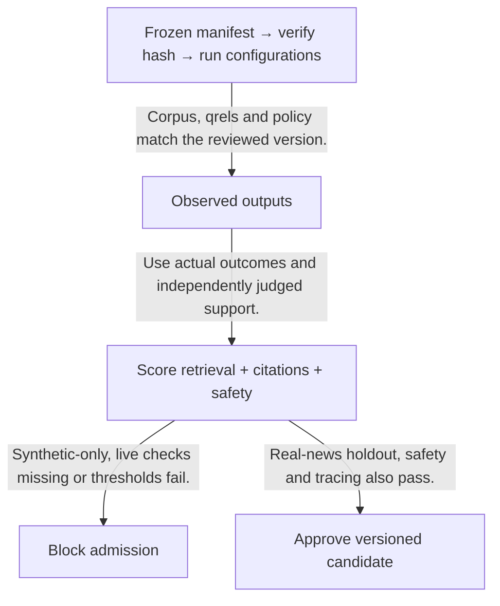

**Frozen manifest → verify hash → run configurations → Observed outputs**

Corpus, qrels and policy match the reviewed version.

語料、qrels 及政策符合已核對版本。

Handoff / 交接資料:

Sparse, hybrid and reranked rankings on identical prompts

相同提示的 sparse、混合及重排排序

**Observed outputs → Score retrieval + citations + safety**

Use actual outcomes and independently judged support.

使用實際結果及獨立支持度判斷。

Handoff / 交接資料:

recall/nDCG, citation precision, abstentions, injection outcomes

recall／nDCG、引用精準度、拒答及注入結果

**Score retrieval + citations + safety → Block admission**

Synthetic-only, live checks missing or thresholds fail.

只有虛構測試、缺真實檢查或未達門檻。

Handoff / 交接資料:

Sparse remains active; NOT RUN stays visible

維持 sparse；明示 NOT RUN

**Score retrieval + citations + safety → Approve versioned candidate**

Real-news holdout, safety and tracing also pass.

真實新聞保留集、安全及追蹤亦通過。

Handoff / 交接資料:

Approved retrieval version + public report card

核准檢索版本＋公開成績表

### 1. DEFINE CASES

Cover successful and adversarial research paths.

涵蓋正常及對抗研究路徑。

Tools: JSONL fixtures · expected behaviors

**How / 如何應用**

Include wrong company, future date, missing outlook, forged citation, injected instruction and interrupted-run cases.

加入錯公司、未來日期、缺展望、偽造引用、注入指令及中斷任務案例。

**Why / 為何使用**

A happy-path screenshot alone does not establish how the app behaves when evidence is wrong.

只有成功畫面，無法展示證據有問題時 app 點處理。

Proposed files / 建議檔案: `evals/golden.json`, `evals/injections.json`, `services/research/tests/test_research.py`

### 2. RUN + TRACE

Execute the graph and record real outcomes.

執行 graph 並記錄真實結果。

Tools: pytest · evaluation runner · structured logs

**How / 如何應用**

Measure recall@5/10, nDCG@5/10 and independently judged citation-precision. Compare sparse / hybrid / hybrid+rerank; apply the written admission margin. Run injection fixtures against the actual agent and record unauthorized actions, leaks, latency and token usage.

量度 recall@5／10、nDCG@5／10 及獨立評審引用精準度，按書面門檻比較三配置；對真實 agent 跑注入 fixtures，記錄越權、外洩、延遲及 token。

**Why / 為何使用**

Engineering metrics must describe work actually performed, including failures and retries.

工程指標須反映實際工作，包括失敗及重試。

Proposed files / 建議檔案: `services/research/app/evaluate.py`, `services/research/tests/test_research.py`

### 3. DOCUMENT

Publish the dataset version, rerun command and observed limits.

附資料版本、重跑命令及已觀察限制。

Tools: README · GitHub Actions

**How / 如何應用**

Publish six ADRs, frozen hashes, the injection suite and a public eval report card with per-case outcomes and demo trace URLs. CI runs the local harness; absent live-provider or vector results remain NOT RUN and block candidate admission.

公布六份 ADR、凍結 hash、注入套件及公開成績表，附逐案結果與 demo trace URL；CI 跑本機工具，缺少真實供應商或向量結果須標 NOT RUN 並阻擋准入。

**Why / 為何使用**

Reviewers can reproduce the evidence without paying for unexpected model calls.

審閱者可重現結果，同時避免意外付費模型呼叫。

Proposed files / 建議檔案: `.github/workflows/check.yml`, `README.md`

### Return branches / 回傳分支

**success**

Required checks pass

所需檢查通過

Checks pass and the measured report is saved with its configuration.

檢查通過，量度報告連同設定保存。

Return the validated output to the caller.

向呼叫者回傳已驗證結果。

**insufficient**

Valid request, incomplete evidence

請求有效，但證據未齊

Missing credentials: skip live cases explicitly and report the reduced coverage.

沒有憑證：明確跳過真實呼叫案例並交代覆蓋限制。

Explain the limitation and the next permitted step.

交代限制及下一個允許步驟。

**failure**

Invalid input or an operational error

輸入無效或程序出錯

Fail the check, retain traces and block release until the defect is fixed.

檢查失敗，保留記錄，修正缺陷前阻擋發布。

Return an explicit error. Keep the last valid state.

回傳明確錯誤，保留最後有效狀態。

### Acceptance / 驗收

- Show success, missing evidence, injected instructions and recovery using the same rerunnable dataset.
- 用同一可重跑資料集展示正常、缺證據、注入指令及恢復四種情境。

## Trace each run in Langfuse and LangSmith / 在 Langfuse 及 LangSmith 追蹤每次任務

Make the evidence path, cost and failures inspectable from one demo trace URL.

從一條 demo trace URL 核對證據流程、用量及失敗。

**Input / 輸入**

Run ID, trace context, tool/model events and sanitized metadata.

任務 ID、trace context、工具／模型事件及清理後 metadata。

**Output / 輸出**

A correlated span tree, usage and latency metrics, and a verified shareable demo link.

可關聯 span tree、用量與延遲指標，以及已驗證可分享 demo 連結。

### Entry contract / 入口

```text
Research lifecycle and instrumented n8n workflow
trace(run_id) → OTel spans → redacting Collector → Langfuse + LangSmith
```

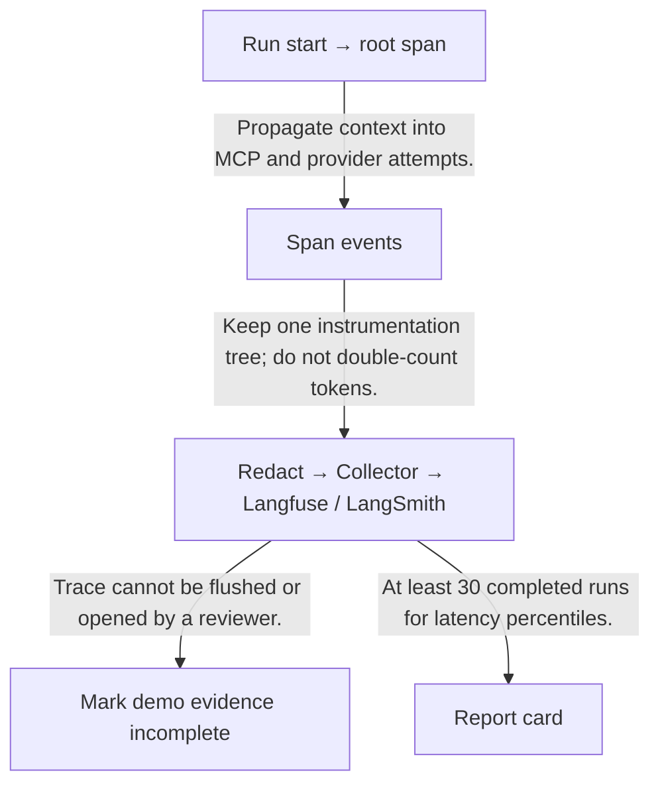

**Run start → root span → Span events**

Propagate context into MCP and provider attempts.

Context 傳入 MCP 及供應商嘗試。

Handoff / 交接資料:

trace_id, run_id, parent spans, errors and actual usage

trace_id、run_id、父 spans、錯誤及實際用量

**Span events → Redact → Collector → Langfuse / LangSmith**

Keep one instrumentation tree; do not double-count tokens.

保留一組 instrumentation；不重複計 token。

Handoff / 交接資料:

Sanitized operational traces and experiment feedback

清理後運行 traces 及實驗回饋

**Redact → Collector → Langfuse / LangSmith → Mark demo evidence incomplete**

Trace cannot be flushed or opened by a reviewer.

Trace 不能 flush 或審閱者無法開啟。

Handoff / 交接資料:

Preserved answer + unavailable trace status

保留答案＋trace 不可用狀態

**Redact → Collector → Langfuse / LangSmith → Report card**

At least 30 completed runs for latency percentiles.

延遲百分位至少需要 30 次已完成任務。

Handoff / 交接資料:

One actual URL per demo; cohort p50/p95 with failures

每 demo 一個實際 URL；樣本 p50／p95 及失敗數

### 1. INSTRUMENT

Create one root and spans for every actual stage and attempt.

建立根 span，記錄每個實際階段及嘗試。

Tools: OpenTelemetry · W3C traceparent

**How / 如何應用**

Propagate context across MCP/HTTP, instrument n8n explicitly and correlate execution IDs. Include retrieval, rerank, tools, model usage and validation; never infer tokens from text length.

跨 MCP／HTTP 傳 context，明確 instrument n8n 並關聯 execution ID；記錄檢索、重排、工具、模型用量及驗證，不能以文字長度估 token。

**Why / 為何使用**

A complete trace explains where time and evidence were spent.

完整 trace 解釋時間及證據用在何處。

Proposed files / 建議檔案: `services/research/app/telemetry.py`, `workflows/n8n/news-refresh.json`

### 2. REDACT + EXPORT

Send one span tree to the two configured destinations.

同一 span tree 傳送兩個已設定平台。

Tools: OTel Collector · self-hosted Langfuse · LangSmith

**How / 如何應用**

Redact secrets and restricted content before fan-out. Keep common run IDs and prompt/dataset versions; avoid duplicate SDK instrumentation. Langfuse serves operations, LangSmith serves experiments and feedback.

分送前遮蔽秘密及受限內容；共用任務 ID 及提示／資料版本，避免重複 SDK instrumentation；Langfuse 管運維，LangSmith 管實驗及回饋。

**Why / 為何使用**

Explicit ownership prevents duplicate token accounting and disconnected traces.

清楚責任避免重複計算 token 及斷裂 trace。

Proposed files / 建議檔案: `deploy/otel-collector.yaml`, `services/research/app/telemetry.py`

### 3. VERIFY LINK

Verify a sanitized demo trace and publish actual measurements.

驗證清理後 demo trace，公布真實量度。

Tools: Trace share API/UI · report card

**How / 如何應用**

Flush exporters, obtain an actual share URL and test reviewer access. Record per-run duration and token usage. Compute p50/p95 only over a documented live cohort of at least 30 completed runs, with failures reported separately.

Flush 後取得真實分享 URL 並測試審閱者存取；記錄單次耗時及 token。至少 30 次已完成真實任務才計 p50／p95，另報失敗。

**Why / 為何使用**

A local trace ID is not a shareable link, and one duration is not a percentile distribution.

本機 trace ID 不是可分享連結，一次耗時亦不是百分位分佈。

Proposed files / 建議檔案: `services/research/app/evaluate.py`, `docs/eval-report.md`

### Return branches / 回傳分支

**success**

Required checks pass

所需檢查通過

Report includes one verified demo trace URL and actual usage.

報告附一條已驗證 demo trace URL 及實際用量。

Return the validated output to the caller.

向呼叫者回傳已驗證結果。

**insufficient**

Valid request, incomplete evidence

請求有效，但證據未齊

Too few runs: publish durations and sample count, mark p50/p95 cohort incomplete.

任務不足：公布耗時及樣本數，標明 p50／p95 樣本未齊。

Explain the limitation and the next permitted step.

交代限制及下一個允許步驟。

**failure**

Invalid input or an operational error

輸入無效或程序出錯

Exporter unavailable: retain research output, record telemetry failure and fail the observable-demo gate.

Exporter 不可用：保留研究結果，記錄追蹤失敗，demo 可觀察驗收不通過。

Return an explicit error. Keep the last valid state.

回傳明確錯誤，保留最後有效狀態。

### Acceptance / 驗收

- A reviewer opens a sanitized trace with MCP, retrieval, rerank, model and validation spans; no invented links or token totals.
- 審閱者可開啟包含 MCP、檢索、重排、模型及驗證的清理 trace，沒有捏造連結或 token 總數。

## Package locally, then deploy privately / 本機包裝，再私人部署

Package the native app after checks; configure private news, index and telemetry dependencies.

本機 app 通過檢查後才包裝；設定私人新聞、索引及追蹤依賴。

**Input / 輸入**

A tested source revision, Dockerfiles and private server environment.

已測試版本、Dockerfile 及私人伺服器環境。

**Output / 輸出**

The same tested images running with persistent data and a checked recovery path.

相同已測映像運行，並有持久資料及已核對恢復路徑。

### Entry contract / 入口

```text
docker compose -f deploy/compose.yaml up -d --build
```

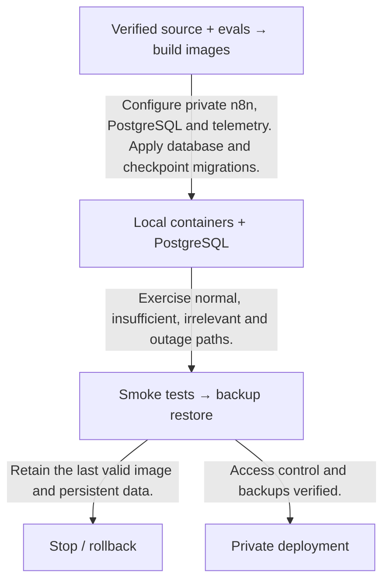

**Verified source + evals → build images → Local containers + PostgreSQL**

Configure private n8n, PostgreSQL and telemetry. Apply database and checkpoint migrations.

設定私人 n8n、PostgreSQL 及追蹤端點。執行資料庫及 checkpoint migrations。

Handoff / 交接資料:

Versioned images and server-only configuration

版本化映像及只供伺服器設定

**Local containers + PostgreSQL → Smoke tests → backup restore**

Exercise normal, insufficient, irrelevant and outage paths.

測試正常、資料不足、無關及中斷路徑。

Handoff / 交接資料:

Health, routing, persistence and recovery evidence

健康、路由、持久性及恢復證據

**Smoke tests → backup restore → Stop / rollback**

Retain the last valid image and persistent data.

保留最後有效映像及持久資料。

Handoff / 交接資料:

Failure reason and recovery action

失敗原因及恢復動作

**Smoke tests → backup restore → Private deployment**

Access control and backups verified.

已驗證訪問控制及備份。

Handoff / 交接資料:

Release ID + reproducible demo and trace URL

發布 ID＋可重現 demo 及 trace URL

### 1. BUILD IMAGES

Package the Next.js and Python services.

包裝 Next.js 及 Python 服務。

Tools: Docker · Compose

**How / 如何應用**

Create separate app images; provision private n8n, PostgreSQL with optional pgvector, Collector and the official Langfuse dependency stack. Keep keys out of images and mount persistent storage; configure LangSmith credentials.

建立獨立 app 映像，設定私人 n8n、PostgreSQL 及可選 pgvector、Collector 及官方 Langfuse 依賴；金鑰不入映像，掛載持久儲存並設定 LangSmith 憑證。

**Why / 為何使用**

Container packaging should preserve the working app instead of introducing a new orchestration platform.

容器包裝應保留已運作 app，避免同時引入新編排平台。

Proposed files / 建議檔案: `apps/web/Dockerfile`, `services/research/Dockerfile`, `deploy/compose.yaml`

### 2. VERIFY LOCALLY

Run the containers and test the four scenarios.

運行容器並檢查四種情境。

Tools: Health endpoints · smoke tests

**How / 如何應用**

Verify frontend-to-API forwarding, source access and recovery after restarting a container. Confirm no secrets are delivered to the browser.

核對前端轉送、來源存取及重啟後恢復，確認沒有秘密傳至瀏覽器。

**Why / 為何使用**

A successful image build does not prove that the services communicate or retain data.

映像建立成功，不代表服務能互通或資料能保存。

Proposed files / 建議檔案: `deploy/compose.yaml`, `services/research/tests/test_research.py`

### 3. PRIVATE EC2

Run the tested release on one private EC2 deployment.

將已測版本運行在一台私人 EC2 部署。

Tools: EC2 · persistent volume · controlled TLS access

**How / 如何應用**

Keep Python private, restrict SSH, require controlled HTTPS access, test PostgreSQL backup/restore and retain a previous image tag.

Python 保持私人，限制 SSH，使用受控 HTTPS 存取，測試 PostgreSQL 備份還原並保留舊映像標籤。

**Why / 為何使用**

The interview deployment needs a demonstrable operating and recovery procedure, not Kubernetes.

面試部署需要可展示的運維及恢復程序，首版不用 Kubernetes。

Proposed files / 建議檔案: `deploy/README.md`, `deploy/research.env.example`, `deploy/compose.yaml`

### Return branches / 回傳分支

**success**

Required checks pass

所需檢查通過

A private smoke-tested release with recorded image tag and restored-backup proof.

已完成私人 smoke test，記錄映像標籤及備份還原證據。

Return the validated output to the caller.

向呼叫者回傳已驗證結果。

**insufficient**

Valid request, incomplete evidence

請求有效，但證據未齊

No cloud access yet: keep the local Docker demo and recording; continue job applications.

暫無雲端：保留本機 Docker 示範及影片，繼續申請工作。

Explain the limitation and the next permitted step.

交代限制及下一個允許步驟。

**failure**

Invalid input or an operational error

輸入無效或程序出錯

Stop the release or restore the previous image without deleting the data volume.

停止發布或回退舊映像，不刪資料磁碟。

Return an explicit error. Keep the last valid state.

回傳明確錯誤，保留最後有效狀態。

### Acceptance / 驗收

- Restart retains data, backup restores, and the API port is not exposed publicly.
- 重啟保留資料、備份可還原，API 連接埠不公開。

## Deferred scope / 後續擴展

### Spring Boot · OAuth · multi-user ACL

Add for Java-focused roles or real shared workspaces. The first app is private and single-user. Public or multi-user access requires proper authorization first.

投 Java 職位或真正多人工作區時再加。首版私人單用戶；公開或多人使用前須完成適當授權。

### Model routing · fine-tuning

Start with one provider/model. Add routing only after traces reveal a cost or quality problem. Fine-tuning is not required for the first cited report.

先用一個供應商及模型；記錄顯示成本或品質問題後才加分流。首份有引用報告不需要微調。

### Global markets · calibrated price forecasts · strategies

Conditional news scenarios are included. Global coverage, calibrated price targets, automated trading and strategy backtesting remain outside this release.

包含條件式新聞情境；全球市場、經校準目標價、自動交易及策略回測仍不屬此版。

### PDF · UiPath · C# · Kubernetes

No PDF extraction is needed for the curated text snapshot. Add automation or another language in a focused project; postpone cluster operations.

文字快照不需抽取 PDF；自動化或另一語言可用獨立項目展示，叢集運維延後。

## References / 官方參考

- [n8n: MCP Server Trigger and workflow tools](https://docs.n8n.io/integrations/builtin/core-nodes/n8n-nodes-langchain.mcptrigger/)
- [pgvector: vector and hybrid search](https://github.com/pgvector/pgvector#hybrid-search)
- [Langfuse: self-hosting architecture](https://langfuse.com/self-hosting)
- [Langfuse: OpenTelemetry ingestion](https://langfuse.com/integrations/native/opentelemetry)
- [LangSmith: OpenTelemetry and Collector fan-out](https://docs.langchain.com/langsmith/trace-with-opentelemetry)
- [LangSmith: sharing sanitized traces](https://docs.langchain.com/langsmith/manage-trace)
- [LangGraph: Graph API, state and conditional edges](https://docs.langchain.com/oss/python/langgraph/graph-api)
- [LangGraph: workflows and agents](https://docs.langchain.com/oss/python/langgraph/workflows-agents)
- [LangGraph: persistence and checkpoints](https://docs.langchain.com/oss/python/langgraph/persistence)
- [FastAPI: typed request bodies](https://fastapi.tiangolo.com/tutorial/body/)
- [PostgreSQL: full-text search and ranking](https://www.postgresql.org/docs/current/textsearch-controls.html)
- [PostgreSQL: backup and restore](https://www.postgresql.org/docs/current/backup-dump.html)
- [LangGraph: PostgreSQL checkpoint setup](https://docs.langchain.com/oss/python/langgraph/add-memory)
- [Docker Compose: production deployment](https://docs.docker.com/compose/how-tos/production/)
