# Stock research assistant / 股票研究助手

Three supported companies, one bounded research agent, one cited report.

3 間公司、1 個有執行上限的研究 agent、1 頁有來源報告。

This academy contains a working offline teaching simulation and a proposed application design. It does not run a Python finance service, fetch current market news or issue real investment recommendations. All demo events, news and ratings are fictional.

此學習網站提供可操作的離線教學模擬及未來 app 設計，沒有運行 Python 金融服務或抓取即時新聞；示範事件、新聞及評級全部虛構。

Supported company identities: Microsoft (MSFT), Apple (AAPL), NVIDIA (NVDA). Real company identities do not make the demo fixtures real news.

Generated from `lib/finance-project.ts` and `lib/finance-proposal.ts`. Run `npm run proposal:sync`; do not edit the generated files.


## Scope and estimate / 範圍及工時

120–180 total hours at 15 hours per week, approximately 8–12 weeks. Core stages total 120 hours. The 60-hour reserve is included, not additional. Subjective difficulty: 7–8 / 10.

Provisional estimate for one developer adding per-prompt n8n MCP news, measured hybrid RAG, self-hosted Langfuse and LangSmith. Re-estimate after the first live news-and-trace slice; Python learning, provider licensing and infrastructure may extend it. This remains an interview research app.

暫估一位開發者加入每題 n8n MCP 新聞、量度混合 RAG、自架 Langfuse 及 LangSmith。首條真實新聞與追蹤流程完成後重估；Python 學習、供應商授權及基建可能延長時間。目標仍是面試研究 app。

Each new prompt must refresh news through n8n MCP and pin its permitted evidence snapshot. Show provider status, publication/first-seen times and refresh time. An offline replay is not current news.

每個新提示須經 n8n MCP 刷新並固定允許使用的證據快照；顯示供應商狀態、發布／首次取得及刷新時間。離線重播不等於即時新聞。

## Revised news, retrieval and observability requirements / 新版要求

Prompt + company + horizon → n8n MCP → refresh_company_news → Versioned evidence + time filters → Sparse / gated hybrid → rerank → Conditional forecast + citations → Validate → feedback + trace URL

### Fresh news for every prompt / 每個提示都取得新聞

Every new valid research prompt creates a run and must call refresh_company_news through the n8n MCP Server Trigger before retrieval. A deterministic graph node enforces this; the LLM cannot skip it. Resume reuses the same refresh receipt.

每個有效研究提示都建立任務，檢索前必須經 n8n MCP Server Trigger 呼叫 refresh_company_news。由固定 graph 節點強制執行，LLM 不能略過；恢復任務重用原刷新紀錄。

n8n exposes a Custom Workflow Tool for approved news APIs/RSS. Validate company, query, UTC window and result limit; use fixed provider URLs, server credentials, bounded retries and run_id idempotency. A schedule may warm the store but never replaces the per-prompt call.

n8n 以 Custom Workflow Tool 接駁核准新聞 API／RSS。驗證公司、問題、UTC 時段及筆數；使用固定供應商網址、伺服器憑證、有限重試及 run_id 冪等鍵。排程可預熱資料，但不能取代每個提示的呼叫。

Return source_id, canonical URL, published_at, first_seen_at, fetched_at, content hash, permitted excerpt, snapshot_id and provider status. Deduplicate syndicated stories. Outage, partial coverage or stale data is visible; never silently describe old news as fresh.

回傳來源 ID、原網址、發布／首次取得／擷取時間、內容 hash、允許節錄、快照 ID 及供應商狀態。同一轉載新聞去重；中斷、覆蓋不足或過期資料必須明示，不能將舊聞稱為即時。

### Measured retrieval / 有量度依據的檢索

Freeze corpus, prompts, graded relevance labels (0/1/2), expected abstentions and SHA-256 manifest before tuning. The checked-in v1 set has 18 fictional cases across three tickers and is a harness smoke test. A separate human-reviewed, licensed news holdout is required for production admission; do not tune on either test set.

調參前凍結語料、問題、0／1／2 相關性標籤、預期拒答及 SHA-256 清單。v1 有三個 ticker 共 18 個虛構案例，只驗證評估工具；正式准入另須人工核對、獲授權的新聞保留集，不能用測試集調參。

Compare SQLite FTS5/BM25 sparse, Qdrant dense + sparse with reciprocal rank fusion, and hybrid + a pinned cross-encoder reranker. Use identical chunks, company/permission/time filters and candidate budgets: 20 per branch, fuse to 20, rerank to 10, pass at most 6 excerpts to the model. Filter both published_at and first_seen_at at the as-of cutoff.

比較 SQLite FTS5／BM25、Qdrant dense＋sparse 的 RRF 混合檢索，以及加固定版本 cross-encoder 的混合檢索。共用切段、公司／權限／時間條件及預算：每分支 20、融合至 20、重排至 10、最多 6 段送模型。發布及首次取得時間都須早於截止點。

Report macro recall@5/10 and nDCG@5/10 on answerable cases; report empty-evidence cases separately. Before enabling hybrid + reranking, require absolute gains of at least +0.03 recall@10 and +0.05 nDCG@10 over sparse, no per-company regression, citation-precision ≥0.95 and no decline from sparse. These are proposed acceptance thresholds, not measured improvements.

可回答案例報告 macro recall@5／10 及 nDCG@5／10；無證據案例分開計算。啟用混合＋重排前，對 sparse 的 recall@10 須至少增加 0.03、nDCG@10 至少增加 0.05（絕對值），各公司不可倒退，引用精準度 ≥0.95 且不低於 sparse。這些是建議門檻，並非已量度提升。

Citation-precision means supported claim–source pairs / all emitted pairs, judged against the actual excerpt; an existing URL alone is insufficient. Also require 100% citation coverage for material factual claims, correct abstention on all no-evidence cases, and report sample counts. Zero citations means N/A, never a perfect score. Missing evidence blocks admission and keeps sparse active.

引用精準度＝原文支持的主張與來源配對／所有輸出配對；有網址並不足夠。重要事實須 100% 附引用、所有無證據案例正確拒答，並報告樣本數。零引用是 N/A，不能算滿分；未齊評估資料則不准入，維持 sparse。

### Observable runs · Langfuse + LangSmith / 可觀察任務 · Langfuse＋LangSmith

Create an OpenTelemetry root span per research run and child spans for MCP refresh, each provider attempt, ingestion, sparse/dense retrieval, fusion, reranking, every model/tool call, validation and export. Propagate W3C traceparent across HTTP; explicitly instrument the n8n workflow and correlate its execution ID when automatic context propagation is unavailable.

每次研究建立 OpenTelemetry 根 span，MCP 刷新、供應商每次嘗試、匯入、稀疏／向量檢索、融合、重排、每次模型／工具呼叫、驗證及下載都有子 span。HTTP 傳遞 W3C traceparent；n8n 工作流程須加 instrumentation，無自動傳遞時記錄 execution ID 關聯。

Self-hosted Langfuse owns operational traces. LangSmith adds dataset experiments, prompt comparisons and evaluator feedback. Export one instrumented span tree through a redacting OTel Collector to both backends; correlate run_id, trace_id, dataset hash, model/prompt/reranker versions. Do not double-instrument LangGraph or sum duplicate token counts across products.

自架 Langfuse 保存運行記錄；LangSmith 提供資料集實驗、提示比較及評估回饋。同一組 spans 經遮蔽敏感資料的 OTel Collector 分送兩邊，關聯任務／trace ID、資料 hash 及模型／提示／重排版本。避免重複 instrumentation 或將兩邊 token 相加。

Record actual input/output tokens (unknown stays null), tool errors/retries and end-to-end plus stage latency. Publish p50/p95 over at least 30 completed live runs with sample size, concurrency, warm/cold conditions and failed-run counts; a single demo has duration, not its own p95. Initial end-to-end p95 target: ≤60 s; separately report timeout rate.

記錄實際輸入／輸出 token（未知保留 null）、工具錯誤／重試、全程及各階段延遲。至少 30 次已完成真實任務才報 p50／p95，附樣本數、並行數、冷暖狀態及失敗數；單次 demo 只有耗時，沒有自己的 p95。初步全程 p95 目標 ≤60 秒，另報超時比例。

Every live demo must save one verified shareable trace URL in its report and report card. Exporters flush before resolving the link; verify that a reviewer can open it. Redact keys, personal prompts and restricted article text before export or sharing. Private production traces remain private; share sanitized demonstration runs. If export fails, retain the report but mark the observable-demo gate incomplete.

每次真實 demo 的報告及成績表須保存一條已驗證可分享 trace URL；先 flush 再取得連結，確認審閱者可開啟。匯出或分享前遮蔽金鑰、私人提示及受限文章；正式私人 trace 保持私人，只分享清理過的示範。匯出失敗可保留報告，但可觀察 demo 驗收仍未完成。

### Prompt-specific feedback and prediction / 針對提示的回饋及預測

Persist the original question, company, horizon, as-of time and refresh receipt with every answer. Return a direct answer, cited observed facts, base/upside/downside scenarios, assumptions, invalidation signals, conflicting evidence and limitations. Label forecasts as inference; citations support inputs, not guaranteed future outcomes.

每個答案保存原問題、公司、期間、截止時間及刷新紀錄。回傳直接答案、有引用事實、基本／上行／下行情境、假設、失效訊號、矛盾證據及限制。預測須標明推論；引用支持輸入事實，不能保證未來結果。

Example prompt: “How could rising costs affect MSFT margins over 1–3 months?” Discuss cost evidence and offsetting revenue or pricing evidence. Do not reuse a generic Hold/Reduce paragraph for every question. Missing current evidence returns insufficient evidence; unsupported calibrated probabilities or price targets are omitted.

例如「成本上升可能如何影響 MSFT 未來 1–3 個月利潤率？」應分析成本證據及收入／定價抵銷因素，不能每題重用同一段 Hold／Reduce。缺少當前證據就回覆不足，不輸出未驗證機率或目標價。

Store user helpfulness/correction feedback as a separate record tied to run_id and prompt_version. Feedback is not a market outcome label and never silently edits the frozen golden set. Predictive accuracy requires a later time-split outcome study with no future information leakage; retrieval scores do not establish trading performance.

用戶有用度／更正回饋另存，連結 run_id 及 prompt_version。回饋不是市場結果標籤，不能靜默更改凍結資料集。預測準確度須日後按時間切分、避免未來資料滲漏的結果研究；檢索分數不代表交易表現。

## Technique ownership / 技術責任

### News acquisition

n8n · MCP Server Trigger · approved APIs/RSS

**How / 如何應用**

Every new prompt calls the authenticated news workflow before snapshot retrieval.

每個新提示在快照檢索前呼叫已驗證新聞流程。

**Why / 為何使用**

The required refresh belongs in deterministic orchestration, with visible provider failures.

必要刷新由固定流程負責，供應商失敗須可見。

### Frontend

Next.js · React · TypeScript

**How / 如何應用**

One selector and report page; server-side API proxy keeps the backend address and keys private.

一個選單及報告頁；伺服器 API 轉送避免向瀏覽器公開後端金鑰。

**Why / 為何使用**

Reuse existing web skills and keep the user journey short.

重用現有網頁能力，保持使用流程簡短。

### Backend

Python · FastAPI · Pydantic

**How / 如何應用**

Validate requests, expose the small API and own retrieval, rules, storage and exports.

驗證請求、提供少量 API，負責檢索、規則、儲存及下載。

**Why / 為何使用**

One backend reduces integration work while demonstrating the Python skills relevant to agent engineering.

一個後端減少整合工作，同時展示 agent 工程所需 Python 能力。

### Agent

LangGraph · one LLM

**How / 如何應用**

Keep typed state, conditional evidence checks, a single refinement and persistent checkpoints.

保存有型別狀態、條件式證據檢查、一次補查及持久 checkpoint。

**Why / 為何使用**

Demonstrate tool selection and controlled recovery rather than adding multiple agents without a need.

展示工具選擇及受控恢復，先減少沒有實際需要的多 agent。

### Evidence

SQLite FTS5/BM25 · Qdrant · RRF · cross-encoder

**How / 如何應用**

Filter company/date, retrieve approved excerpts and attach stable source IDs to the model context.

先過濾公司及日期，再檢索核准原文，將穩定來源 ID 放入模型上下文。

**Why / 為何使用**

Sparse is the reference; a hybrid vector index and reranking must beat the written margins before activation.

Sparse 為參考，混合向量索引及重排須超越書面門檻才可啟用。

### Reliability

OpenTelemetry · self-hosted Langfuse · LangSmith · eval gates

**How / 如何應用**

Publish frozen retrieval metrics, injection outcomes, six ADRs and real trace links. Langfuse owns operations; LangSmith owns experiments and feedback.

公布凍結檢索指標、注入結果、六份 ADR 及真實 trace；Langfuse 管運維，LangSmith 管實驗及回饋。

**Why / 為何使用**

Failure evidence helps a reviewer assess the system beyond a polished successful answer.

失敗處理證據讓審閱者評估系統，而不只看成功答案。

### Delivery

Docker Compose · EC2

**How / 如何應用**

Develop natively, verify containers locally, then deploy the same images privately.

原生本機開發、本機驗證容器，再私人部署相同映像。

**Why / 為何使用**

Show packaging and operations without making cloud setup a prerequisite for the first report.

展示包裝及運維，同時不讓雲端設定阻礙首份報告。

## Choose a supported company / 選擇支援公司

Resolve the company before any research begins.

研究前先確定公司，避免搵錯標的。

**Input / 輸入**

A selection of MSFT, AAPL or NVDA. Research horizon: 1–3 months.

從 MSFT、AAPL、NVDA 選一間；研究範圍為未來 1–3 個月。

**Output / 輸出**

A canonical company ID and the evidence snapshot coverage date.

標準公司 ID 及證據快照覆蓋日期。

### Entry contract / 入口

```text
GET /api/companies
Next.js proxy → GET /companies → [{"id":"MSFT","name":"Microsoft"}, …]
```

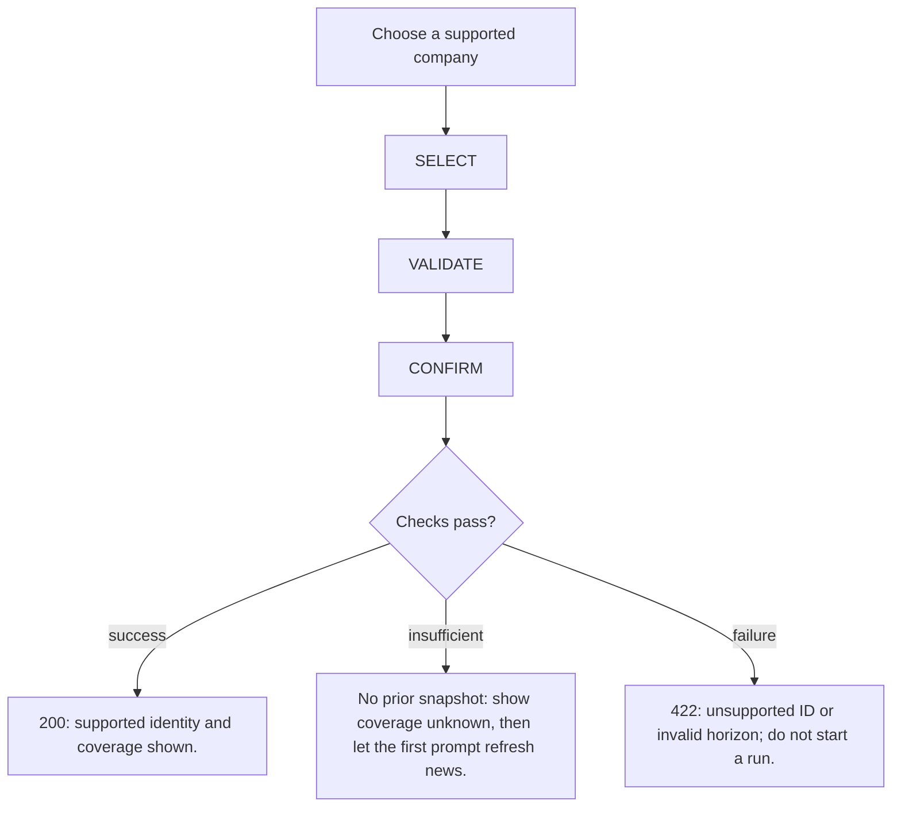

### 1. SELECT

Show three supported identities in a selector.

選單列出三個支援身份。

Tools: Next.js · TypeScript

**How / 如何應用**

Render options from one company catalog and submit its ID, not an arbitrary name.

由同一公司清單產生選項，提交 ID 而非任意公司名。

**Why / 為何使用**

A fixed universe avoids ambiguous names and unsupported global coverage.

固定範圍可避免同名公司及未支援的全球標的。

Proposed files / 建議檔案: `apps/web/app/page.tsx`, `services/research/app/companies.py`

### 2. VALIDATE

Validate the selected company on the API boundary.

在 API 邊界驗證所選公司。

Tools: FastAPI · Pydantic

**How / 如何應用**

Accept only the three catalog IDs and a supported horizon. Reject any other input before tool access.

只接納清單內三個 ID 及支援的研究期間；工具執行前拒絕其他輸入。

**Why / 為何使用**

Browser controls do not prevent a caller from sending a forged request.

瀏覽器選單無法阻止偽造請求，後端仍須驗證。

Proposed files / 建議檔案: `services/research/app/main.py`, `services/research/app/schemas.py`

### 3. CONFIRM

Display identity and coverage before starting.

開始前顯示身份及資料覆蓋範圍。

Tools: Typed API response

**How / 如何應用**

Return company ID, display name and snapshot as-of date. Keep them with the run.

回傳公司 ID、名稱及快照日期，並與研究任務一起保存。

**Why / 為何使用**

Users can see exactly which company and dated information are being analysed.

使用者能確認研究哪間公司，以及資料截至何時。

Proposed files / 建議檔案: `apps/web/app/page.tsx`, `services/research/app/schemas.py`

### Return branches / 回傳分支

**success**

Required checks pass

所需檢查通過

200: supported identity and coverage shown.

200：顯示支援公司及覆蓋日期。

Return the validated output to the caller.

向呼叫者回傳已驗證結果。

**insufficient**

Valid request, incomplete evidence

請求有效，但證據未齊

No prior snapshot: show coverage unknown, then let the first prompt refresh news.

尚無快照：顯示覆蓋未知，再由首個提示刷新新聞。

Explain the limitation and the next permitted step.

交代限制及下一個允許步驟。

**failure**

Invalid input or an operational error

輸入無效或程序出錯

422: unsupported ID or invalid horizon; do not start a run.

422：公司 ID 或期間無效，不啟動研究。

Return an explicit error. Keep the last valid state.

回傳明確錯誤，保留最後有效狀態。

### Acceptance / 驗收

- A forged unsupported ticker is rejected by the backend, not merely hidden in the UI.
- 偽造未支援 ticker 會由後端拒絕，不只在介面隱藏。

## Refresh news through n8n MCP for every prompt / 每題經 n8n MCP 刷新新聞

Acquire prompt-relevant news before the agent searches a pinned evidence snapshot.

Agent 搜尋固定證據快照前，先取得與提示相關新聞。

**Input / 輸入**

Validated company, original question, UTC date window and run_id.

已驗證公司、原問題、UTC 日期範圍及 run_id。

**Output / 輸出**

Refresh receipt, provider statuses, dated source records and immutable snapshot_id.

刷新紀錄、供應商狀態、有日期來源及不可變 snapshot_id。

### Entry contract / 入口

```text
Mandatory LangGraph refresh node → n8n MCP Server Trigger
refresh_company_news(company_id, query, as_of, run_id, limit) → snapshot_id + sources + provider_status
```

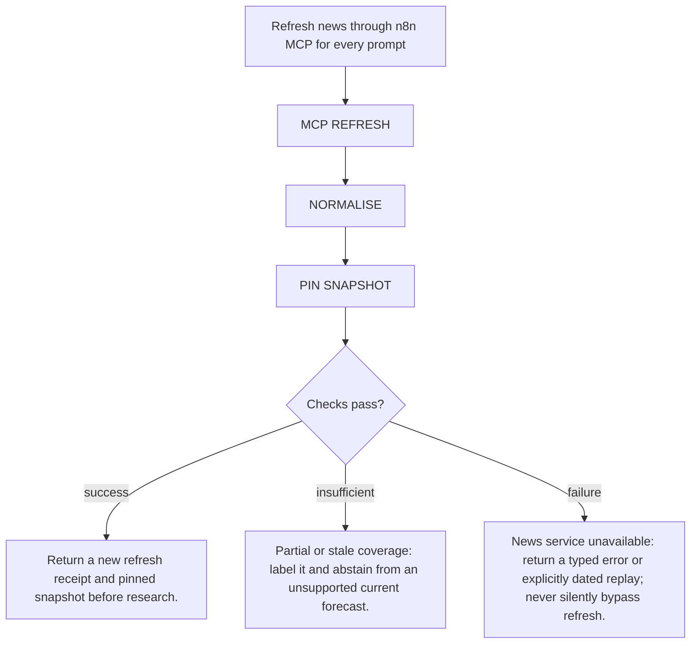

### 1. MCP REFRESH

Call the approved n8n news workflow for every new prompt.

每個新提示呼叫核准 n8n 新聞流程。

Tools: MCP client · n8n MCP Server Trigger · Custom Workflow Tool

**How / 如何應用**

A deterministic node calls the authenticated MCP endpoint before retrieval. The workflow searches fixed news API/RSS providers with validated arguments and a bounded deadline; run_id prevents duplicate acquisition on resume.

固定節點在檢索前呼叫已驗證 MCP 端點；工作流程用已驗證參數及時限搜尋固定新聞 API／RSS，run_id 避免恢復時重複擷取。

**Why / 為何使用**

Per-prompt refresh is a product requirement and must not depend on optional LLM tool selection or a scheduled crawl.

每題刷新是產品要求，不能依賴 LLM 選擇工具或排程爬取。

Proposed files / 建議檔案: `workflows/n8n/news-refresh.json`, `services/research/app/news.py`, `services/research/app/graph.py`

### 2. NORMALISE

Validate, deduplicate and record provenance.

驗證、去重及記錄來源。

Tools: Pydantic · canonical URL · content hash

**How / 如何應用**

Keep source ID, company, URL, permitted excerpt, published_at, first_seen_at and fetched_at. Quarantine invalid records; group syndicated duplicates. Keep article text outside instruction messages.

保存來源 ID、公司、網址、允許節錄及發布／首次取得／擷取時間；隔離無效資料及分組轉載；文章不可進入指令訊息。

**Why / 為何使用**

A timestamp alone does not prove the information was available at the forecast cutoff.

只有發布時間，不能證明預測截止時已取得資料。

Proposed files / 建議檔案: `services/research/app/ingest.py`, `services/research/app/schemas.py`

### 3. PIN SNAPSHOT

Pin the evidence version and return refresh status.

固定證據版本並回傳刷新狀態。

Tools: SQLite source store · candidate Qdrant collection

**How / 如何應用**

Upsert source versions, create an immutable run snapshot and index only permitted excerpts. Record provider failure, partial coverage and freshness; never claim a failed refresh is current news.

Upsert 來源版本並建立不可變任務快照，只索引允許節錄；記錄供應商失敗、部分覆蓋及新鮮度，刷新失敗不能稱為即時新聞。

**Why / 為何使用**

Each answer remains reproducible even when a later prompt finds newer news.

下一題取得更新新聞後，上一題答案仍可重現。

Proposed files / 建議檔案: `services/research/app/storage.py`, `services/research/app/indexing.py`

### Return branches / 回傳分支

**success**

Required checks pass

所需檢查通過

Return a new refresh receipt and pinned snapshot before research.

研究前回傳新刷新紀錄及固定快照。

Return the validated output to the caller.

向呼叫者回傳已驗證結果。

**insufficient**

Valid request, incomplete evidence

請求有效，但證據未齊

Partial or stale coverage: label it and abstain from an unsupported current forecast.

部分或過期覆蓋：明示限制，拒絕無證據當前預測。

Explain the limitation and the next permitted step.

交代限制及下一個允許步驟。

**failure**

Invalid input or an operational error

輸入無效或程序出錯

News service unavailable: return a typed error or explicitly dated replay; never silently bypass refresh.

新聞服務不可用：回傳結構化錯誤或明確有日期重播，不能靜默略過刷新。

Return an explicit error. Keep the last valid state.

回傳明確錯誤，保留最後有效狀態。

### Acceptance / 驗收

- Two new prompts produce two MCP refresh receipts; resuming one run reuses its receipt and snapshot.
- 兩個新提示產生兩份 MCP 刷新紀錄；恢復任務重用原紀錄及快照。

## Retrieve, fuse and rerank evidence / 檢索、融合及重排證據

Use a measured retrieval policy to select attributable context for the exact prompt.

以已量度的檢索策略，為當前提示選取可追溯上下文。

**Input / 輸入**

Original question, company, snapshot_id, cutoff and approved retrieval configuration.

原問題、公司、snapshot_id、截止時間及已核准檢索設定。

**Output / 輸出**

Ranked evidence with source/chunk IDs, original rank, rerank score and configuration version.

排序證據附來源／切段 ID、原排序、重排分數及設定版本。

### Entry contract / 入口

```text
LangGraph tool node
search_company_evidence(company_id, query, snapshot_id, as_of) → ranked IDs
read_source(source_id, snapshot_id) → permitted excerpt + metadata
```

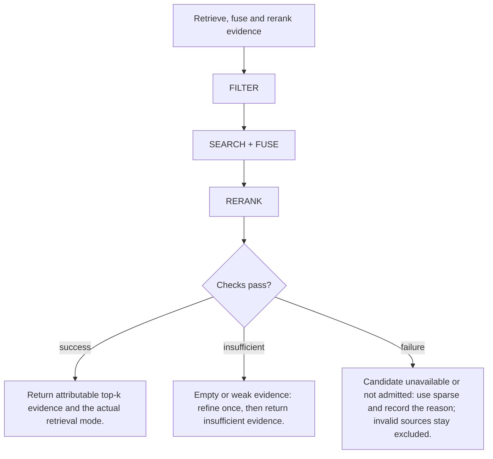

### 1. FILTER

Apply identical company, permission and time constraints in both branches.

兩分支套用相同公司、權限及時間條件。

Tools: SQL parameters · Qdrant payload filters

**How / 如何應用**

Restrict to the pinned snapshot and require published_at and first_seen_at ≤ as_of. Filter before both sparse and dense search; recheck returned IDs before context assembly.

限制固定快照，發布及首次取得時間均須 ≤ 截止；稀疏及向量搜尋前都過濾，組合上下文前再核對 ID。

**Why / 為何使用**

Dense similarity cannot excuse wrong-company, unlicensed or future evidence.

向量相似度不能合理化錯公司、未授權或未來證據。

Proposed files / 建議檔案: `services/research/app/retrieval.py`, `services/research/app/storage.py`

### 2. SEARCH + FUSE

Keep sparse as default; trial the hybrid vector index behind its admission gate.

預設使用 sparse；混合向量索引須通過准入。

Tools: SQLite FTS5/BM25 · Qdrant dense + sparse · RRF

**How / 如何應用**

Retrieve 20 candidates per branch, fuse duplicate chunk IDs with reciprocal rank fusion and retain 20. Compare sparse, hybrid and hybrid+rerank on frozen labels. Admission requires +0.03 recall@10 and +0.05 nDCG@10 plus the citation and safety gates.

每分支取 20 候選，以 RRF 融合重複切段 ID 並保留 20；用凍結標籤比較三種配置。准入須 recall@10 +0.03、nDCG@10 +0.05 及引用與安全達標。

**Why / 為何使用**

Vectors and extra infrastructure need measured benefit over the sparse baseline.

向量及額外基建須以超越 sparse 基線的量度效益支持。

Proposed files / 建議檔案: `services/research/app/retrieval.py`, `services/research/app/indexing.py`, `evals/retrieval-policy.json`

### 3. RERANK

Rescore query–passage pairs and read the selected sources.

重評問題與原文配對，再讀取選中來源。

Tools: Pinned cross-encoder · read_source

**How / 如何應用**

Rerank the fused 20 to top 10; supply at most 6 permitted excerpts within the token budget. Store model version and ranks. On candidate failure use sparse with a visible fallback flag; never substitute fabricated scores.

將融合 20 筆重排成前 10，token 預算內最多提供 6 段；記錄模型版本及排序。候選失敗明示回退 sparse，不能捏造分數。

**Why / 為何使用**

Retrieval recall and answer context have different budgets; reranking must prove it improves useful evidence.

檢索召回與答案上下文有不同預算；重排須證明改善可用證據。

Proposed files / 建議檔案: `services/research/app/rerank.py`, `services/research/app/tools.py`

### Return branches / 回傳分支

**success**

Required checks pass

所需檢查通過

Return attributable top-k evidence and the actual retrieval mode.

回傳可追溯 top-k 證據及實際檢索模式。

Return the validated output to the caller.

向呼叫者回傳已驗證結果。

**insufficient**

Valid request, incomplete evidence

請求有效，但證據未齊

Empty or weak evidence: refine once, then return insufficient evidence.

無或弱證據：補查一次，再回傳證據不足。

Explain the limitation and the next permitted step.

交代限制及下一個允許步驟。

**failure**

Invalid input or an operational error

輸入無效或程序出錯

Candidate unavailable or not admitted: use sparse and record the reason; invalid sources stay excluded.

候選不可用或未准入：使用 sparse 並記錄原因；無效來源保持排除。

Return an explicit error. Keep the last valid state.

回傳明確錯誤，保留最後有效狀態。

### Acceptance / 驗收

- Published metrics, fixed dataset hashes and the written margins are required before enabling the candidate; missing scores never count as a pass.
- 啟用候選前須公布指標、固定資料 hash 及書面門檻；缺少分數不能當通過。

## Run one bounded research agent / 運行一個有上限的研究 agent

Let the agent select tools and fill an evidence gap within a controlled budget.

讓 agent 選擇工具及補足證據，同時限制執行預算。

**Input / 輸入**

Company ID, the original prompt, horizon, as-of time and a mandatory news refresh receipt.

公司 ID、原提示、期間、截止時間及必需新聞刷新紀錄。

**Output / 輸出**

A validated research result or an explicit insufficient-evidence result.

已驗證研究結果，或明確證據不足結果。

### Entry contract / 入口

```text
POST /api/research
{"company_id":"MSFT","question":"Explain recent developments","horizon":"1-3m"}
Next.js proxy → POST /research → run_id + result
```

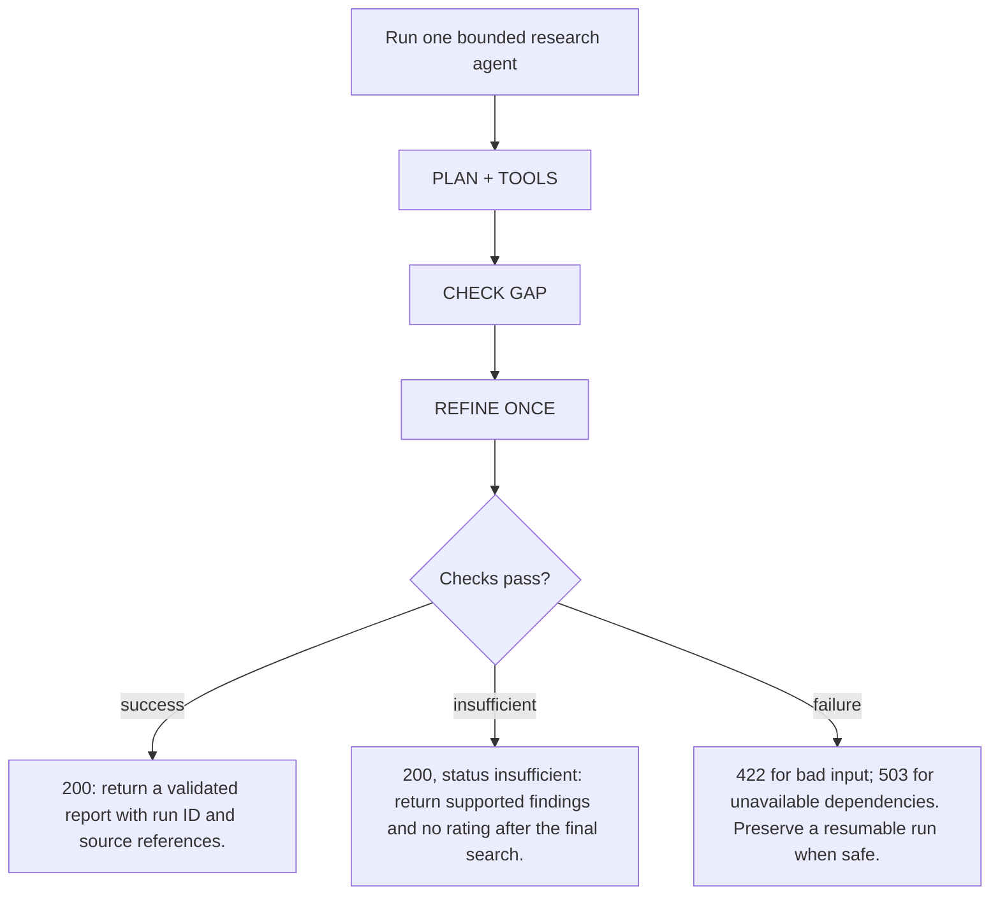

### 1. PLAN + TOOLS

Create typed run state and choose a permitted research tool.

建立有型別的任務狀態，選擇允許的研究工具。

Tools: LangGraph · one tool-capable LLM

**How / 如何應用**

First require the n8n refresh receipt. Track original prompt, snapshot, source IDs, evidence, trace ID and budgets. The agent then chooses only search_company_evidence and read_source.

先要求 n8n 刷新紀錄，追蹤原提示、快照、來源、證據、trace ID 及預算；agent 只選擇兩個研究工具。

**Why / 為何使用**

A constrained tool boundary supports useful agent decisions without broad machine access.

受限制工具邊界支援 agent 判斷，同時避免取得廣泛系統權限。

Proposed files / 建議檔案: `services/research/app/graph.py`, `services/research/app/tools.py`

### 2. CHECK GAP

Assess whether the gathered evidence answers the question.

判斷已取得證據是否足以回答。

Tools: Conditional edges · structured output

**How / 如何應用**

Use code checks for company, dates and source presence. Let the model describe any remaining information gap in a schema.

以程式檢查公司、日期及來源；模型用固定格式描述尚欠資料。

**Why / 為何使用**

A fluent draft must not be treated as proof that the research is complete.

文字流暢不代表研究已完成。

Proposed files / 建議檔案: `services/research/app/graph.py`, `services/research/app/schemas.py`

### 3. REFINE ONCE

Refine once, or continue to reporting and validation.

最多修正查詢一次，再進入報告及驗證。

Tools: Bounded loop · timeout · SQLite checkpoint

**How / 如何應用**

Allow two search rounds total. Persist progress and stop at the configured time, tool or model budget. Return no rating if evidence remains inadequate.

總共最多兩輪搜尋；保存進度，到達時間、工具或模型上限就停止。仍不足則不評級。

**Why / 為何使用**

A bounded agent can recover and explain failure without looping or spending indefinitely.

有上限的 agent 能恢復及解釋失敗，避免無限循環及用量。

Proposed files / 建議檔案: `services/research/app/graph.py`, `services/research/app/checkpoints.py`

### Return branches / 回傳分支

**success**

Required checks pass

所需檢查通過

200: return a validated report with run ID and source references.

200：回傳已驗證報告、任務 ID 及來源引用。

Return the validated output to the caller.

向呼叫者回傳已驗證結果。

**insufficient**

Valid request, incomplete evidence

請求有效，但證據未齊

200, status insufficient: return supported findings and no rating after the final search.

200，狀態 insufficient：最後搜尋後只回傳有證據發現，不評級。

Explain the limitation and the next permitted step.

交代限制及下一個允許步驟。

**failure**

Invalid input or an operational error

輸入無效或程序出錯

422 for bad input; 503 for unavailable dependencies. Preserve a resumable run when safe.

輸入錯誤回 422；依賴不可用回 503。在安全情況保留可恢復任務。

Return an explicit error. Keep the last valid state.

回傳明確錯誤，保留最後有效狀態。

### Acceptance / 驗收

- The missing-evidence path performs at most one refinement and never invents the absent fact.
- 資料不足路徑最多補查一次，不能捏造缺失事實。

## Answer the prompt with conditional forecasts / 以條件式預測回答提示

Answer the exact question with cited facts, conditional scenarios and explicit uncertainty.

以引用事實、條件式情境及明確不確定性，回答當前問題。

**Input / 輸入**

Original prompt, horizon, as-of time, approved evidence and optional teaching-rule result.

原提示、期間、截止時間、核准證據及可選教學規則結果。

**Output / 輸出**

Structured draft: direct answer, facts, base/upside/downside scenarios, assumptions, citations and invalidation signals.

結構化草稿：直接答案、事實、基本／上行／下行情境、假設、引用及失效訊號。

### Entry contract / 入口

```text
LangGraph report node
draft_report(question, horizon, as_of, evidence, optional_rule_result) → ResearchReport draft
```

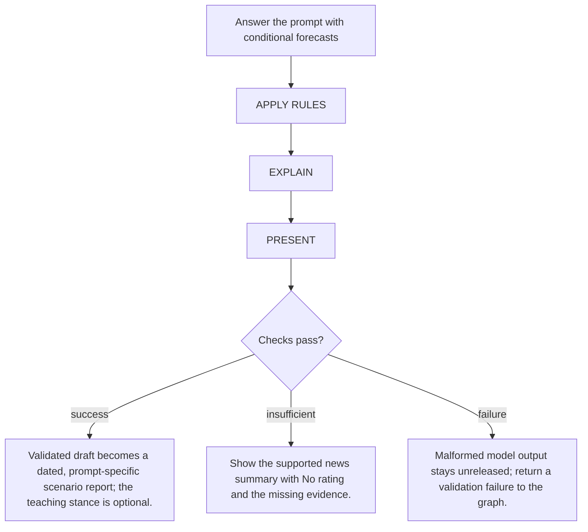

### 1. APPLY RULES

Apply the optional teaching stance only when the question calls for it.

只有問題需要時才套用可選教學評級。

Tools: Pure Python · versioned rules

**How / 如何應用**

For the teaching rule, require demand, costs and outlook evidence. Maintained outlook gives Hold; lowered outlook gives Reduce; missing evidence gives no rating.

教學規則要求需求、成本及展望證據。展望維持為 Hold，下調為 Reduce，缺證據則不評級。

**Why / 為何使用**

An explainable rule is auditable. It is a teaching rule, not a validated profitable strategy.

可解釋規則方便核對；它是教學規則，並非已驗證盈利策略。

Proposed files / 建議檔案: `services/research/app/rules.py`

### 2. EXPLAIN

Ask one LLM to explain the evidence and possible effects.

由一個 LLM 解釋證據及可能影響。

Tools: One LLM · prompt template · Pydantic schema

**How / 如何應用**

Provide the original question, horizon, refreshed excerpts and optional teaching-rule result. Separate observed facts from conditional forecasts; include base/upside/downside scenarios, assumptions, source IDs and what would invalidate each view.

提供原問題、期間、刷新節錄及可選教學規則結果；分清事實與條件式預測，列基本／上行／下行情境、假設、來源及失效訊號。

**Why / 為何使用**

News sentiment alone does not establish price direction or causation; expectations may already be priced in.

新聞正負面不能單獨證明股價方向或因果，預期可能已反映在價格。

Proposed files / 建議檔案: `services/research/app/report.py`, `services/research/app/prompts.py`, `services/research/app/schemas.py`

### 3. PRESENT

Display the short research report after validation.

驗證後顯示簡短研究報告。

Tools: Next.js · typed response

**How / 如何應用**

Show the prompt-specific answer, scenarios and cited news on one page, with as-of date and one verified demo trace URL. Save helpfulness or correction feedback separately by run_id and prompt_version.

同頁展示針對問題的答案、情境、引用新聞、截止日期及已驗證 demo trace URL；有用度或更正回饋按 run_id 及 prompt_version 另存。

**Why / 為何使用**

A reader can understand the conclusion first and inspect its evidence without reading a technical dashboard.

讀者先理解結論，再核對證據，毋須閱讀複雜技術儀表板。

Proposed files / 建議檔案: `apps/web/components/research-report.tsx`, `apps/web/app/page.tsx`

### Return branches / 回傳分支

**success**

Required checks pass

所需檢查通過

Validated draft becomes a dated, prompt-specific scenario report; the teaching stance is optional.

已驗證草稿成為有日期、針對提示的情境報告；教學評級為可選。

Return the validated output to the caller.

向呼叫者回傳已驗證結果。

**insufficient**

Valid request, incomplete evidence

請求有效，但證據未齊

Show the supported news summary with No rating and the missing evidence.

展示有證據的新聞摘要、無評級狀態及缺失資料。

Explain the limitation and the next permitted step.

交代限制及下一個允許步驟。

**failure**

Invalid input or an operational error

輸入無效或程序出錯

Malformed model output stays unreleased; return a validation failure to the graph.

模型格式無效則不發布草稿，向 graph 回傳驗證失敗。

Return an explicit error. Keep the last valid state.

回傳明確錯誤，保留最後有效狀態。

### Acceptance / 驗收

- Every news impact includes a source and uncertainty; no target price or invented confidence percentage appears.
- 每項新聞影響都有來源及不確定因素；不出現目標價或捏造信心百分比。

## Validate citations and tool boundaries / 驗證引用及工具邊界

Stop unsupported output and keep article text from becoming an instruction.

阻擋無根據輸出，避免文章文字變成系統指令。

**Input / 輸入**

Draft report, approved source set and immutable run limits.

報告草稿、核准來源集及不可由文章修改的任務上限。

**Output / 輸出**

A pass result, actionable validation errors or an insufficient-evidence response.

通過結果、可處理的驗證錯誤，或證據不足回覆。

### Entry contract / 入口

```text
Graph validation node and tool boundary
validate_report(draft, allowed_sources, rules) → valid | insufficient | errors
```

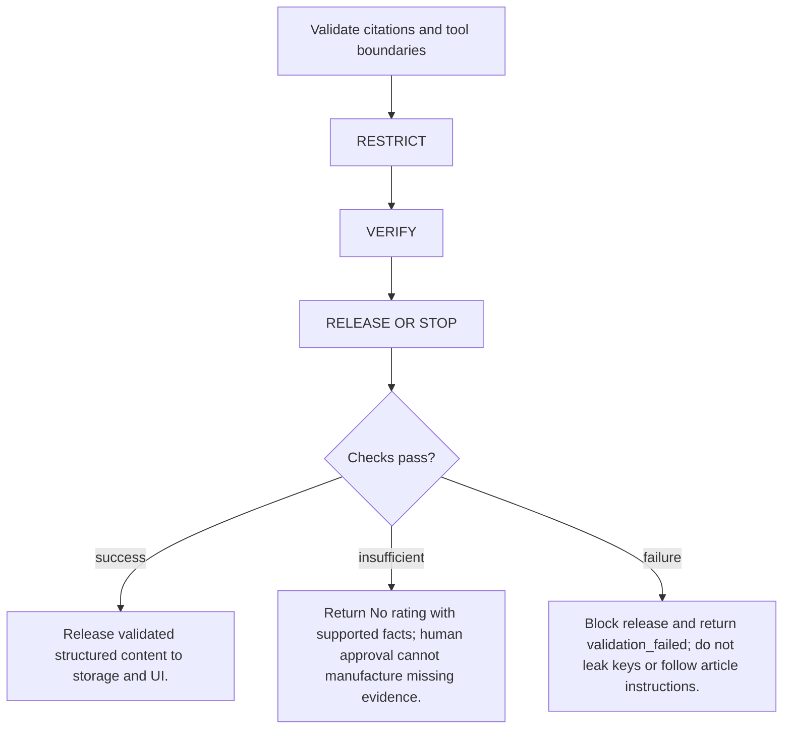

### 1. RESTRICT

Keep tool authority outside retrieved text.

將工具權限放在檢索文字之外控制。

Tools: Allowlisted tools · validated arguments

**How / 如何應用**

Treat article text as untrusted data. Permit only read-only tools and server-enforced source filters. Never put keys into prompts.

文章當作不可信資料，只允許唯讀工具及伺服器強制來源限制，金鑰不放進提示。

**Why / 為何使用**

Telling a model to ignore attacks is only one layer; code must enforce the accessible operations.

叫模型忽略攻擊只係其中一層，程式必須限制可執行動作。

Proposed files / 建議檔案: `services/research/app/tools.py`, `services/research/app/prompts.py`

### 2. VERIFY

Check structure, source membership, dates and rule agreement.

檢查格式、來源歸屬、日期及規則一致性。

Tools: Pydantic · deterministic checks

**How / 如何應用**

Reject unknown citations, wrong-company evidence, future information and a stance inconsistent with the rule result. Evaluate whether cited passages support factual claims.

拒絕未知引用、錯公司、未來資料及與規則不符的觀點，並評估原文是否支持事實主張。

**Why / 為何使用**

A source link can exist while failing to support the sentence next to it.

來源連結存在，仍可能不支持旁邊的句子。

Proposed files / 建議檔案: `services/research/app/validation.py`, `services/research/app/schemas.py`

### 3. RELEASE OR STOP

Release only the supported result and record failures.

只發布有支持的結果，並記錄失敗。

Tools: Graph conditional edge · structured trace

**How / 如何應用**

Return valid output, no rating for insufficient evidence, or a typed failure. Record source IDs and error categories without secrets.

有效則回傳，證據不足則不評級，其他情況回傳結構化失敗；記錄來源 ID 及錯誤類別，避免記錄秘密。

**Why / 為何使用**

Visible failure is more useful than silently presenting an unsupported recommendation.

明確交代失敗，能避免把無根據觀點當成已驗證建議。

Proposed files / 建議檔案: `services/research/app/validation.py`, `services/research/app/graph.py`

### Return branches / 回傳分支

**success**

Required checks pass

所需檢查通過

Release validated structured content to storage and UI.

將已驗證內容交給儲存及介面。

Return the validated output to the caller.

向呼叫者回傳已驗證結果。

**insufficient**

Valid request, incomplete evidence

請求有效，但證據未齊

Return No rating with supported facts; human approval cannot manufacture missing evidence.

回傳無評級及有證據事實；人工批准不能補出缺失證據。

Explain the limitation and the next permitted step.

交代限制及下一個允許步驟。

**failure**

Invalid input or an operational error

輸入無效或程序出錯

Block release and return validation_failed; do not leak keys or follow article instructions.

阻擋發布並回傳 validation_failed，不洩漏金鑰或執行文章指令。

Return an explicit error. Keep the last valid state.

回傳明確錯誤，保留最後有效狀態。

### Acceptance / 驗收

- An attack fixture asking for keys or STRONG BUY cannot change permitted tools or the rule result.
- 要求金鑰或 STRONG BUY 的攻擊範例，不能修改允許工具或規則結果。

## Save and download the report / 保存及下載報告

Keep the reviewed result and export exactly what the user saw.

保存已核對結果，下載內容與畫面一致。

**Input / 輸入**

A validated report ID and Markdown export request.

已驗證報告 ID 及 Markdown 下載請求。

**Output / 輸出**

A stored report or Markdown with its evidence, dates and limitations.

已儲存報告，或包含證據、日期及限制的 Markdown。

### Entry contract / 入口

```text
GET /api/reports/{report_id}/export
Next.js proxy → GET /reports/{report_id}/export
Content-Type: text/markdown; charset=utf-8
```

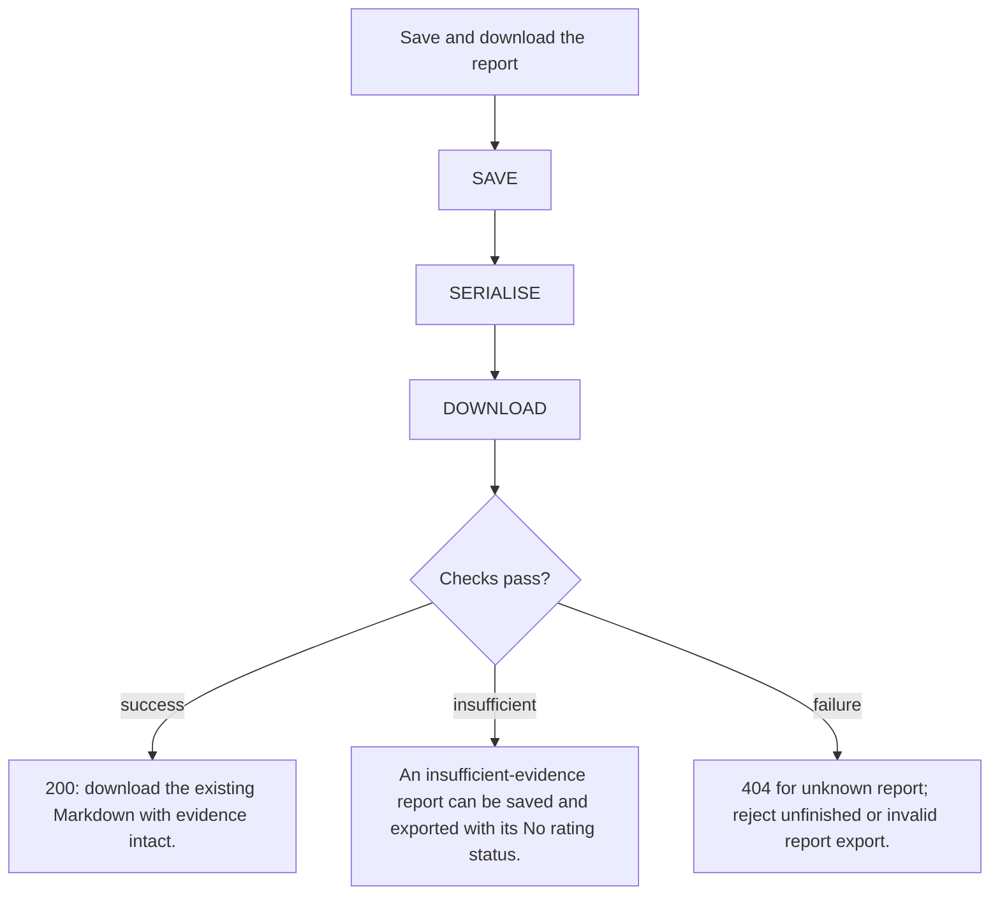

### 1. SAVE

Persist the final version with its research context.

連同研究背景保存最終版本。

Tools: SQLite · transactions

**How / 如何應用**

Save the original question, horizon, validated scenarios, source IDs, snapshot, prompt/model versions, refresh receipt, run ID and trace URL. Feedback records reference the run without changing the frozen evidence.

一起保存原問題、期間、驗證情境、來源、快照、提示／模型版本、刷新紀錄、任務 ID 及 trace URL；回饋關聯任務但不能改凍結證據。

**Why / 為何使用**

A later export must refer to the same evidence instead of silently regenerating a new answer.

稍後下載應使用相同證據，不能靜默重新產生另一個答案。

Proposed files / 建議檔案: `services/research/app/storage.py`

### 2. SERIALISE

Render Markdown from the stored validated result.

從已儲存的驗證結果產生 Markdown。

Tools: Python serializer · no LLM call

**How / 如何應用**

Include the original question, scenarios, horizon, source URLs/dates, assumptions, uncertainty and actual trace URL. Preserve fictional labels and unavailable telemetry status in offline fixtures.

包含原問題、情境、期間、來源網址／日期、假設、不確定性及真實 trace URL；離線範例保留虛構標籤及未有追蹤狀態。

**Why / 為何使用**

Downloading an existing report requires no additional model usage and should preserve provenance.

下載已有報告不需額外模型用量，亦應保留來源記錄。

Proposed files / 建議檔案: `services/research/app/export.py`

### 3. DOWNLOAD

Return the file through the frontend route.

透過前端路由回傳檔案。

Tools: FastAPI response · Next.js proxy

**How / 如何應用**

Look up the report ID, set the Markdown content type and filename, and stream the existing text.

按報告 ID 查找，設定 Markdown 類型及檔名，再回傳已有文字。

**Why / 為何使用**

The first private single-user app needs one clear export path; public multi-user ownership checks come before sharing it.

私人單用戶首版只需一條下載路徑；公開多人使用前須加擁有權檢查。

Proposed files / 建議檔案: `services/research/app/main.py`, `apps/web/app/api/[...path]/route.ts`

### Return branches / 回傳分支

**success**

Required checks pass

所需檢查通過

200: download the existing Markdown with evidence intact.

200：下載保留證據的既有 Markdown。

Return the validated output to the caller.

向呼叫者回傳已驗證結果。

**insufficient**

Valid request, incomplete evidence

請求有效，但證據未齊

An insufficient-evidence report can be saved and exported with its No rating status.

證據不足報告可保存及下載，但必須保留無評級狀態。

Explain the limitation and the next permitted step.

交代限制及下一個允許步驟。

**failure**

Invalid input or an operational error

輸入無效或程序出錯

404 for unknown report; reject unfinished or invalid report export.

未知報告回 404；拒絕下載未完成或無效報告。

Return an explicit error. Keep the last valid state.

回傳明確錯誤，保留最後有效狀態。

### Acceptance / 驗收

- The downloaded report matches the displayed result and makes zero extra model calls.
- 下載報告與畫面一致，額外模型呼叫為零。

## Resume an interrupted research run / 恢復中斷研究任務

Recover completed work after a failure without starting the research again.

失敗後恢復已完成工作，避免全部重做。

**Input / 輸入**

A known run ID and its saved graph checkpoint.

已知任務 ID 及其 graph checkpoint。

**Output / 輸出**

A resumed run, a completed result, or a clear unavailable-checkpoint error.

已恢復任務、已完成結果，或明確無可用 checkpoint 錯誤。

### Entry contract / 入口

```text
POST /api/research/{run_id}/resume
Next.js proxy → POST /research/{run_id}/resume
Resume only the selected saved run, within its existing budget.
```

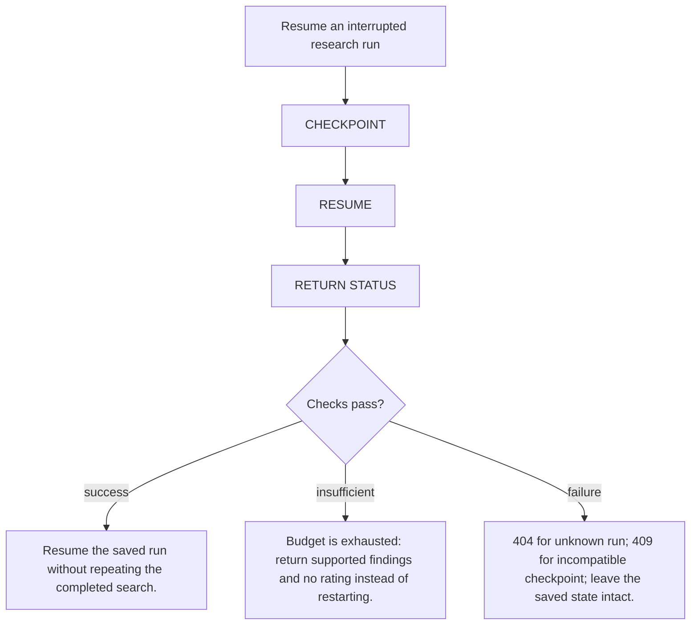

### 1. CHECKPOINT

Persist graph progress under the run ID.

按任務 ID 保存 graph 進度。

Tools: LangGraph checkpointer · SQLite

**How / 如何應用**

Save query, evidence references, tool results and remaining budget in the graph state. The Python app uses durable storage.

在 graph 狀態保存查詢、來源、工具結果及剩餘預算；Python app 使用持久儲存。

**Why / 為何使用**

Checkpointing remembers a run. It is different from long-term user memory or permission to take new actions.

Checkpoint 記住單次任務，不等於長期用戶記憶或執行新動作的權限。

Proposed files / 建議檔案: `services/research/app/checkpoints.py`, `services/research/app/graph.py`

### 2. RESUME

Load the matching checkpoint and continue safely.

載入相符 checkpoint 並安全繼續。

Tools: Run identity · idempotent source reads

**How / 如何應用**

Resolve the saved run, validate its status and resume with the same thread identity. Reuse completed tool results and remaining limits.

查找已儲存任務，核對狀態，以相同 thread 身份恢復；重用已完成工具結果及剩餘上限。

**Why / 為何使用**

Retries must not reset budgets, duplicate completed work or resume a different user’s run.

重試不能重設預算、重複已完成工作或恢復其他用戶任務。

Proposed files / 建議檔案: `services/research/app/checkpoints.py`, `services/research/app/main.py`

### 3. RETURN STATUS

Tell the user what resumed and what remains.

告知使用者已恢復及尚欠工作。

Tools: Typed response · Next.js status view

**How / 如何應用**

Return the resumed status or existing final result. Reject unknown or incompatible checkpoints instead of inventing a fresh run.

回傳恢復狀態或既有結果；拒絕未知或不相容 checkpoint，不靜默新開任務。

**Why / 為何使用**

A transparent recovery path is demonstrable engineering evidence for interviews.

清晰可核對的恢復路徑，係面試可展示的工程能力。

Proposed files / 建議檔案: `apps/web/app/page.tsx`, `services/research/app/main.py`

### Return branches / 回傳分支

**success**

Required checks pass

所需檢查通過

Resume the saved run without repeating the completed search.

恢復已儲存任務，不重複已完成搜尋。

Return the validated output to the caller.

向呼叫者回傳已驗證結果。

**insufficient**

Valid request, incomplete evidence

請求有效，但證據未齊

Budget is exhausted: return supported findings and no rating instead of restarting.

預算已用盡：回傳有證據發現及無評級，不重新開始。

Explain the limitation and the next permitted step.

交代限制及下一個允許步驟。

**failure**

Invalid input or an operational error

輸入無效或程序出錯

404 for unknown run; 409 for incompatible checkpoint; leave the saved state intact.

未知任務回 404；checkpoint 不相容回 409；保留儲存狀態。

Return an explicit error. Keep the last valid state.

回傳明確錯誤，保留最後有效狀態。

### Acceptance / 驗收

- Stop after the first search, resume, and show that the search count remains one.
- 第一次搜尋後停止再恢復，搜尋次數維持一次。

## Proposed file hierarchy and local startup / 建議檔案及本機啟動

This is the proposed standalone app. These services and commands are not implemented in this academy repository.

```text
stock-research-agent/                 # proposed standalone app
├── apps/web/
│   ├── app/page.tsx                    # selector + report
│   ├── app/api/[...path]/route.ts      # server-only API proxy
│   ├── components/research-report.tsx
│   ├── Dockerfile
│   └── package.json / package-lock.json
├── services/research/
│   ├── app/
│   │   ├── main.py / schemas.py / companies.py
│   │   ├── ingest.py / storage.py / retrieval.py
│   │   ├── news.py / indexing.py / rerank.py / telemetry.py
│   │   ├── graph.py / tools.py / checkpoints.py
│   │   ├── rules.py / report.py / prompts.py
│   │   └── validation.py / export.py / evaluate.py
│   ├── tests/test_research.py
│   ├── requirements.txt               # pinned dependencies
│   ├── .env.example                   # no secrets
│   └── Dockerfile
├── data/manifest.json / README.md      # approved, dated evidence
├── workflows/n8n/news-refresh.json     # MCP workflow export, no credentials
├── evals/golden.json / injections.json / retrieval-policy.json
├── docs/adr/001–006.md / eval-report.md
├── deploy/
│   ├── compose.yaml / otel-collector.yaml
│   ├── research.env.example / README.md
│   └── research.env                   # ignored, server secrets
├── .github/workflows/check.yml
├── .gitignore                         # .env.local, data files, databases
└── README.md

Native local: browser :3000 → Next.js server → FastAPI 127.0.0.1:8000
Docker later: browser → controlled HTTPS → web → research:8000 → data volume
SQLite reports/checkpoints persist on the data volume. Provider keys remain server-side.
Dependencies: private n8n MCP, candidate Qdrant, OTel Collector, official self-hosted
Langfuse stack and configured LangSmith project. These are not provisioned by this guide.
```

```sh
# Proposed application repository, after its scaffold exists.
# These commands do not start finance services in this academy repository.
# Configure private n8n MCP and approved news-provider credentials first.
# Start pinned Qdrant (candidate), OTel Collector and the official Langfuse stack
# separately; configure LangSmith server credentials. Dependencies may use Docker.
# Keep retrieval_mode=sparse until real-news evaluation and safety gates pass.

# Terminal 1: Python API on loopback
cd services/research
python3 -m venv .venv
source .venv/bin/activate
python -m pip install -r requirements.txt
# Copy .env.example to .env.local; set the chosen provider key locally.
# Keep .env.local out of Git. The scaffold must load it server-side.
python -m app.ingest --manifest ../../data/manifest.json
python -m uvicorn app.main:app --env-file .env.local --host 127.0.0.1 --port 8000

# Terminal 2: Next.js UI
cd apps/web
npm ci
RESEARCH_API_URL=http://127.0.0.1:8000 npm run dev -- --hostname 127.0.0.1 --port 3000

# Terminal 3: verify before recording
cd services/research
source .venv/bin/activate
python -m pytest
python -m app.evaluate --golden ../../evals/golden.json --injections ../../evals/injections.json --policy ../../evals/retrieval-policy.json
```

## Delivery stages / 開發階段

### Week 1: Contracts and frozen evaluation / 合約及凍結評估

15 hours

- Freeze permitted evidence, qrels and the retrieval margins; write ADRs 001–003.
- 凍結允許證據、qrels 及檢索門檻，撰寫 ADR 001–003。

Acceptance / 驗收:

Sparse baseline and a rerunnable report card with honest missing results.

Sparse 基線及可重跑、誠實交代缺項的成績表。

### Week 2: Per-prompt n8n MCP refresh / 每題 n8n MCP 刷新

15 hours

- Connect approved providers, validate records and pin each run snapshot.
- 接駁核准供應商、驗證紀錄並固定每次快照。

Acceptance / 驗收:

Two prompts produce separate refresh receipts; timeout and replay are explicit.

兩題各有刷新紀錄，超時及重播明確交代。

### Week 3: Bounded prompt-specific research / 有上限且針對提示的研究

15 hours

- Complete the graph, question-specific scenarios, citations and abstention.
- 完成 graph、針對問題的情境、引用及拒答。

Acceptance / 驗收:

One cited answer or an explicit insufficient-evidence response.

一份有引用答案或明確證據不足回覆。

### Week 4: Hybrid vector index and reranking / 混合向量索引及重排

15 hours

- Build Qdrant dense/sparse retrieval and a pinned reranker; run ablations.
- 建立 Qdrant dense／sparse 及固定版本重排，跑消融評估。

Acceptance / 驗收:

Publish the margin comparison; keep sparse if hybrid fails admission.

公布門檻比較，混合未准入則保持 sparse。

### Week 5: OpenTelemetry and both trace backends / OpenTelemetry 及兩個追蹤平台

15 hours

- Self-host Langfuse; connect LangSmith experiments via the shared trace pipeline.
- 自架 Langfuse；經共用追蹤流程接駁 LangSmith 實驗。

Acceptance / 驗收:

One accessible sanitized demo trace; actual token and latency records.

一條可開啟、清理後 demo trace，以及實際 token／延遲紀錄。

### Week 6: Safety suite and recovery / 安全套件及恢復

15 hours

- Run injection fixtures, validate citation support and prove checkpoint recovery.
- 跑注入 fixtures、驗證引用支持及 checkpoint 恢復。

Acceptance / 驗收:

No unauthorized actions in the executed suite; publish failures and coverage limits.

已執行套件無越權動作，公布失敗及覆蓋限制。

### Week 7: Feedback and public reviewer artifacts / 回饋及公開審閱材料

15 hours

- Complete feedback/export, six ADRs, real-news holdout evaluation and report card.
- 完成回饋／下載、六份 ADR、真實新聞保留集評估及成績表。

Acceptance / 驗收:

A reviewer can reproduce results and follow one trace per recorded demo.

審閱者可重現結果，並查看每個已錄 demo 的 trace。

### Week 8: Package and demonstrate / 包裝及示範

15 hours

- Verify app containers and dependency backups; deploy privately if ready.
- 驗證 app 容器及依賴備份，準備好再私人部署。

Acceptance / 驗收:

Record a walkthrough, recovery proof and a measured latency cohort.

錄製示範、恢復證據及已量度延遲樣本。

## Evaluate the agent before the interview / 面試前評估 agent

Demonstrate factual support and controlled failures with repeatable tests.

以可重跑測試展示事實支持度及受控失敗處理。

**Input / 輸入**

Frozen corpus, graded qrels, 18 synthetic starter cases, eight injection fixtures and a separate real-news holdout.

凍結語料、分級 qrels、18 個虛構種子案例、八個注入 fixtures 及獨立真實新聞保留集。

**Output / 輸出**

Actual case outcomes, tool traces, latency and model-usage records.

真實案例結果、工具記錄、延遲及模型用量。

### Entry contract / 入口

```text
python -m app.evaluate --golden ../../evals/golden.json --injections ../../evals/injections.json --policy ../../evals/retrieval-policy.json
```

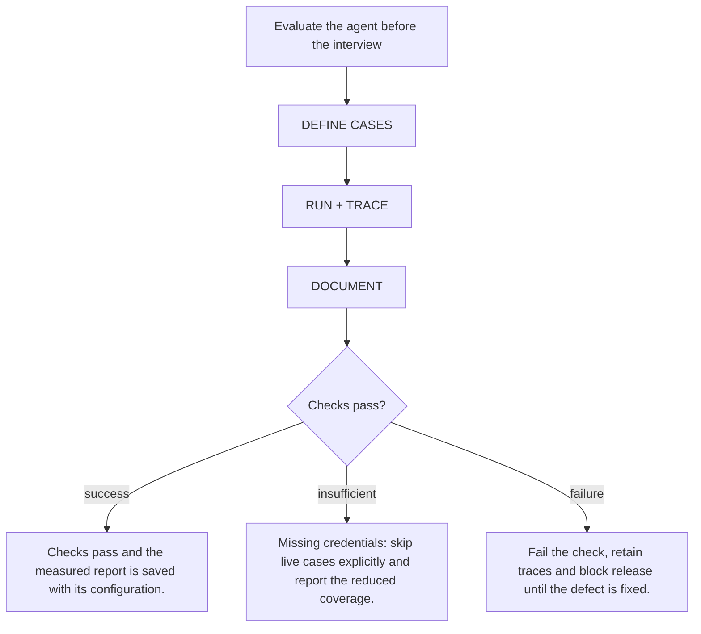

### 1. DEFINE CASES

Cover successful and adversarial research paths.

涵蓋正常及對抗研究路徑。

Tools: JSONL fixtures · expected behaviors

**How / 如何應用**

Include wrong company, future date, missing outlook, forged citation, injected instruction and interrupted-run cases.

加入錯公司、未來日期、缺展望、偽造引用、注入指令及中斷任務案例。

**Why / 為何使用**

A happy-path screenshot alone does not establish how the app behaves when evidence is wrong.

只有成功畫面，無法展示證據有問題時 app 點處理。

Proposed files / 建議檔案: `evals/golden.json`, `evals/injections.json`, `services/research/tests/test_research.py`

### 2. RUN + TRACE

Execute the graph and record real outcomes.

執行 graph 並記錄真實結果。

Tools: pytest · evaluation runner · structured logs

**How / 如何應用**

Measure recall@5/10, nDCG@5/10 and independently judged citation-precision. Compare sparse / hybrid / hybrid+rerank; apply the written admission margin. Run injection fixtures against the actual agent and record unauthorized actions, leaks, latency and token usage.

量度 recall@5／10、nDCG@5／10 及獨立評審引用精準度，按書面門檻比較三配置；對真實 agent 跑注入 fixtures，記錄越權、外洩、延遲及 token。

**Why / 為何使用**

Engineering metrics must describe work actually performed, including failures and retries.

工程指標須反映實際工作，包括失敗及重試。

Proposed files / 建議檔案: `services/research/app/evaluate.py`, `services/research/tests/test_research.py`

### 3. DOCUMENT

Publish the dataset version, rerun command and observed limits.

附資料版本、重跑命令及已觀察限制。

Tools: README · GitHub Actions

**How / 如何應用**

Publish six ADRs, frozen hashes, the injection suite and a public eval report card with per-case outcomes and demo trace URLs. CI runs the local harness; absent live-provider or vector results remain NOT RUN and block candidate admission.

公布六份 ADR、凍結 hash、注入套件及公開成績表，附逐案結果與 demo trace URL；CI 跑本機工具，缺少真實供應商或向量結果須標 NOT RUN 並阻擋准入。

**Why / 為何使用**

Reviewers can reproduce the evidence without paying for unexpected model calls.

審閱者可重現結果，同時避免意外付費模型呼叫。

Proposed files / 建議檔案: `.github/workflows/check.yml`, `README.md`

### Return branches / 回傳分支

**success**

Required checks pass

所需檢查通過

Checks pass and the measured report is saved with its configuration.

檢查通過，量度報告連同設定保存。

Return the validated output to the caller.

向呼叫者回傳已驗證結果。

**insufficient**

Valid request, incomplete evidence

請求有效，但證據未齊

Missing credentials: skip live cases explicitly and report the reduced coverage.

沒有憑證：明確跳過真實呼叫案例並交代覆蓋限制。

Explain the limitation and the next permitted step.

交代限制及下一個允許步驟。

**failure**

Invalid input or an operational error

輸入無效或程序出錯

Fail the check, retain traces and block release until the defect is fixed.

檢查失敗，保留記錄，修正缺陷前阻擋發布。

Return an explicit error. Keep the last valid state.

回傳明確錯誤，保留最後有效狀態。

### Acceptance / 驗收

- Show success, missing evidence, injected instructions and recovery using the same rerunnable dataset.
- 用同一可重跑資料集展示正常、缺證據、注入指令及恢復四種情境。

## Trace each run in Langfuse and LangSmith / 在 Langfuse 及 LangSmith 追蹤每次任務

Make the evidence path, cost and failures inspectable from one demo trace URL.

從一條 demo trace URL 核對證據流程、用量及失敗。

**Input / 輸入**

Run ID, trace context, tool/model events and sanitized metadata.

任務 ID、trace context、工具／模型事件及清理後 metadata。

**Output / 輸出**

A correlated span tree, usage and latency metrics, and a verified shareable demo link.

可關聯 span tree、用量與延遲指標，以及已驗證可分享 demo 連結。

### Entry contract / 入口

```text
Research lifecycle and instrumented n8n workflow
trace(run_id) → OTel spans → redacting Collector → Langfuse + LangSmith
```

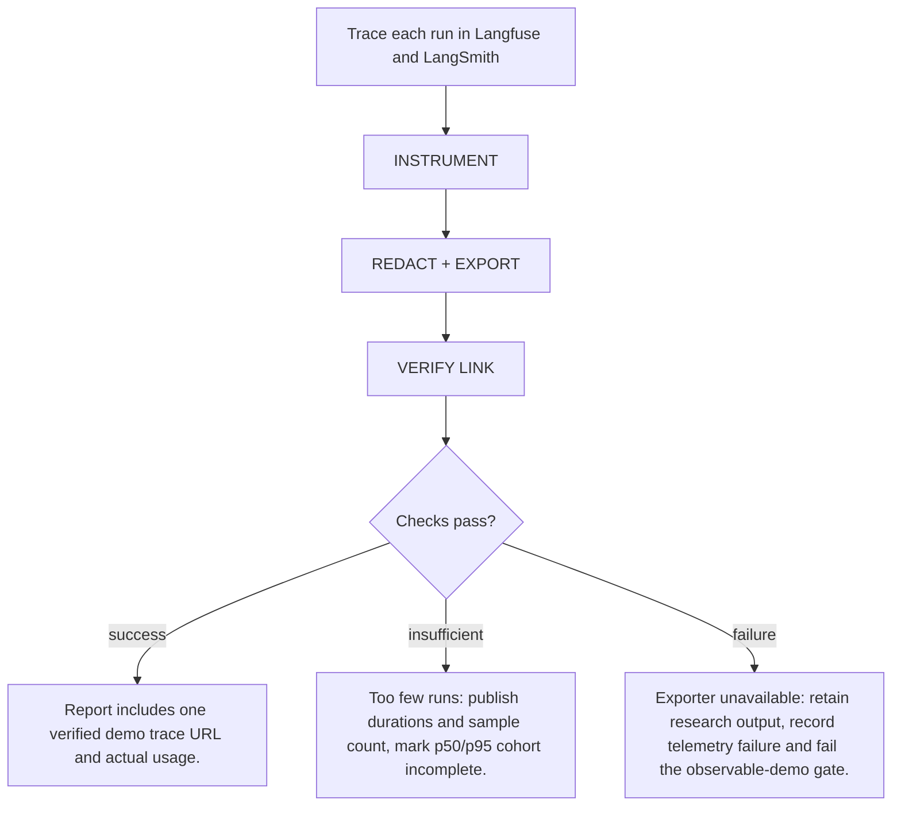

### 1. INSTRUMENT

Create one root and spans for every actual stage and attempt.

建立根 span，記錄每個實際階段及嘗試。

Tools: OpenTelemetry · W3C traceparent

**How / 如何應用**

Propagate context across MCP/HTTP, instrument n8n explicitly and correlate execution IDs. Include retrieval, rerank, tools, model usage and validation; never infer tokens from text length.

跨 MCP／HTTP 傳 context，明確 instrument n8n 並關聯 execution ID；記錄檢索、重排、工具、模型用量及驗證，不能以文字長度估 token。

**Why / 為何使用**

A complete trace explains where time and evidence were spent.

完整 trace 解釋時間及證據用在何處。

Proposed files / 建議檔案: `services/research/app/telemetry.py`, `workflows/n8n/news-refresh.json`

### 2. REDACT + EXPORT

Send one span tree to the two configured destinations.

同一 span tree 傳送兩個已設定平台。

Tools: OTel Collector · self-hosted Langfuse · LangSmith

**How / 如何應用**

Redact secrets and restricted content before fan-out. Keep common run IDs and prompt/dataset versions; avoid duplicate SDK instrumentation. Langfuse serves operations, LangSmith serves experiments and feedback.

分送前遮蔽秘密及受限內容；共用任務 ID 及提示／資料版本，避免重複 SDK instrumentation；Langfuse 管運維，LangSmith 管實驗及回饋。

**Why / 為何使用**

Explicit ownership prevents duplicate token accounting and disconnected traces.

清楚責任避免重複計算 token 及斷裂 trace。

Proposed files / 建議檔案: `deploy/otel-collector.yaml`, `services/research/app/telemetry.py`

### 3. VERIFY LINK

Verify a sanitized demo trace and publish actual measurements.

驗證清理後 demo trace，公布真實量度。

Tools: Trace share API/UI · report card

**How / 如何應用**

Flush exporters, obtain an actual share URL and test reviewer access. Record per-run duration and token usage. Compute p50/p95 only over a documented live cohort of at least 30 completed runs, with failures reported separately.

Flush 後取得真實分享 URL 並測試審閱者存取；記錄單次耗時及 token。至少 30 次已完成真實任務才計 p50／p95，另報失敗。

**Why / 為何使用**

A local trace ID is not a shareable link, and one duration is not a percentile distribution.

本機 trace ID 不是可分享連結，一次耗時亦不是百分位分佈。

Proposed files / 建議檔案: `services/research/app/evaluate.py`, `docs/eval-report.md`

### Return branches / 回傳分支

**success**

Required checks pass

所需檢查通過

Report includes one verified demo trace URL and actual usage.

報告附一條已驗證 demo trace URL 及實際用量。

Return the validated output to the caller.

向呼叫者回傳已驗證結果。

**insufficient**

Valid request, incomplete evidence

請求有效，但證據未齊

Too few runs: publish durations and sample count, mark p50/p95 cohort incomplete.

任務不足：公布耗時及樣本數，標明 p50／p95 樣本未齊。

Explain the limitation and the next permitted step.

交代限制及下一個允許步驟。

**failure**

Invalid input or an operational error

輸入無效或程序出錯

Exporter unavailable: retain research output, record telemetry failure and fail the observable-demo gate.

Exporter 不可用：保留研究結果，記錄追蹤失敗，demo 可觀察驗收不通過。

Return an explicit error. Keep the last valid state.

回傳明確錯誤，保留最後有效狀態。

### Acceptance / 驗收

- A reviewer opens a sanitized trace with MCP, retrieval, rerank, model and validation spans; no invented links or token totals.
- 審閱者可開啟包含 MCP、檢索、重排、模型及驗證的清理 trace，沒有捏造連結或 token 總數。

## Package locally, then deploy privately / 本機包裝，再私人部署

Package the native app after checks; configure private news, index and telemetry dependencies.

本機 app 通過檢查後才包裝；設定私人新聞、索引及追蹤依賴。

**Input / 輸入**

A tested source revision, Dockerfiles and private server environment.

已測試版本、Dockerfile 及私人伺服器環境。

**Output / 輸出**

The same tested images running with persistent data and a checked recovery path.

相同已測映像運行，並有持久資料及已核對恢復路徑。

### Entry contract / 入口

```text
docker compose -f deploy/compose.yaml up -d --build
```

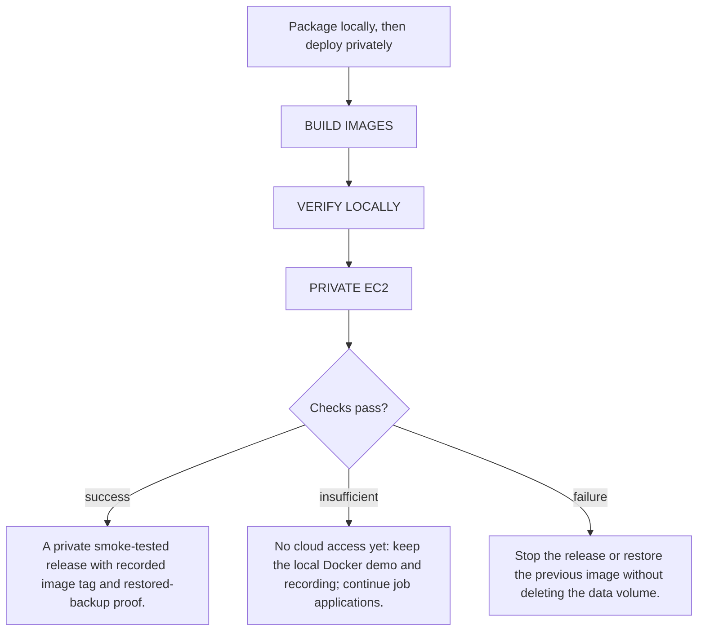

### 1. BUILD IMAGES

Package the Next.js and Python services.

包裝 Next.js 及 Python 服務。

Tools: Docker · Compose

**How / 如何應用**

Create separate app images; provision private n8n, candidate Qdrant, Collector and the official Langfuse dependency stack. Keep keys out of images and mount persistent storage; configure LangSmith credentials.

建立獨立 app 映像，設定私人 n8n、候選 Qdrant、Collector 及官方 Langfuse 依賴；金鑰不入映像，掛載持久儲存並設定 LangSmith 憑證。

**Why / 為何使用**

Container packaging should preserve the working app instead of introducing a new orchestration platform.

容器包裝應保留已運作 app，避免同時引入新編排平台。

Proposed files / 建議檔案: `apps/web/Dockerfile`, `services/research/Dockerfile`, `deploy/compose.yaml`

### 2. VERIFY LOCALLY

Run the containers and test the four scenarios.

運行容器並檢查四種情境。

Tools: Health endpoints · smoke tests

**How / 如何應用**

Verify frontend-to-API forwarding, source access and recovery after restarting a container. Confirm no secrets are delivered to the browser.

核對前端轉送、來源存取及重啟後恢復，確認沒有秘密傳至瀏覽器。

**Why / 為何使用**

A successful image build does not prove that the services communicate or retain data.

映像建立成功，不代表服務能互通或資料能保存。

Proposed files / 建議檔案: `deploy/compose.yaml`, `services/research/tests/test_research.py`

### 3. PRIVATE EC2

Run the tested release on one private EC2 deployment.

將已測版本運行在一台私人 EC2 部署。

Tools: EC2 · persistent volume · controlled TLS access

**How / 如何應用**

Keep Python private, restrict SSH, require controlled HTTPS access, test SQLite backup/restore and retain a previous image tag.

Python 保持私人，限制 SSH，使用受控 HTTPS 存取，測試 SQLite 備份還原並保留舊映像標籤。

**Why / 為何使用**

The interview deployment needs a demonstrable operating and recovery procedure, not Kubernetes.

面試部署需要可展示的運維及恢復程序，首版不用 Kubernetes。

Proposed files / 建議檔案: `deploy/README.md`, `deploy/research.env.example`, `deploy/compose.yaml`

### Return branches / 回傳分支

**success**

Required checks pass

所需檢查通過

A private smoke-tested release with recorded image tag and restored-backup proof.

已完成私人 smoke test，記錄映像標籤及備份還原證據。

Return the validated output to the caller.

向呼叫者回傳已驗證結果。

**insufficient**

Valid request, incomplete evidence

請求有效，但證據未齊

No cloud access yet: keep the local Docker demo and recording; continue job applications.

暫無雲端：保留本機 Docker 示範及影片，繼續申請工作。

Explain the limitation and the next permitted step.

交代限制及下一個允許步驟。

**failure**

Invalid input or an operational error

輸入無效或程序出錯

Stop the release or restore the previous image without deleting the data volume.

停止發布或回退舊映像，不刪資料磁碟。

Return an explicit error. Keep the last valid state.

回傳明確錯誤，保留最後有效狀態。

### Acceptance / 驗收

- Restart retains data, backup restores, and the API port is not exposed publicly.
- 重啟保留資料、備份可還原，API 連接埠不公開。

## Deferred scope / 後續擴展

### Spring Boot · OAuth · multi-user ACL

Add for Java-focused roles or real shared workspaces. The first app is private and single-user. Public or multi-user access requires proper authorization first.

投 Java 職位或真正多人工作區時再加。首版私人單用戶；公開或多人使用前須完成適當授權。

### Model routing · fine-tuning

Start with one provider/model. Add routing only after traces reveal a cost or quality problem. Fine-tuning is not required for the first cited report.

先用一個供應商及模型；記錄顯示成本或品質問題後才加分流。首份有引用報告不需要微調。

### Global markets · calibrated price forecasts · strategies

Conditional news scenarios are included. Global coverage, calibrated price targets, automated trading and strategy backtesting remain outside this release.

包含條件式新聞情境；全球市場、經校準目標價、自動交易及策略回測仍不屬此版。

### PDF · UiPath · C# · Kubernetes

No PDF extraction is needed for the curated text snapshot. Add automation or another language in a focused project; postpone cluster operations.

文字快照不需抽取 PDF；自動化或另一語言可用獨立項目展示，叢集運維延後。

## References / 官方參考

- [n8n: MCP Server Trigger and workflow tools](https://docs.n8n.io/integrations/builtin/core-nodes/n8n-nodes-langchain.mcptrigger/)
- [Qdrant: hybrid and multi-stage queries](https://qdrant.tech/documentation/search/hybrid-queries/)
- [Langfuse: self-hosting architecture](https://langfuse.com/self-hosting)
- [Langfuse: OpenTelemetry ingestion](https://langfuse.com/integrations/native/opentelemetry)
- [LangSmith: OpenTelemetry and Collector fan-out](https://docs.langchain.com/langsmith/trace-with-opentelemetry)
- [LangSmith: sharing sanitized traces](https://docs.langchain.com/langsmith/manage-trace)
- [LangGraph: workflows and agents](https://docs.langchain.com/oss/python/langgraph/workflows-agents)
- [LangGraph: persistence and checkpoints](https://docs.langchain.com/oss/python/langgraph/persistence)
- [FastAPI: typed request bodies](https://fastapi.tiangolo.com/tutorial/body/)
- [SQLite: FTS5 text search](https://www.sqlite.org/fts5.html)
- [Docker Compose: production deployment](https://docs.docker.com/compose/how-tos/production/)
