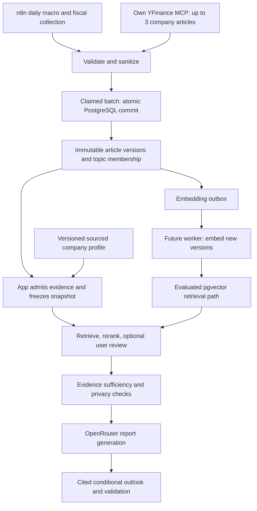

# Daily news and report snapshots

The daily job collects evidence. It does not repeatedly rewrite company background or generate forecasts.

## Evidence versions and deduplication

An article is stored once per normalized content version, regardless of how many batches or topics reference it. A SHA-256 document key uses the canonical URL. Without a URL, the key uses the title, publisher, publication timestamp, and excerpt. A second SHA-256 key includes the normalized article content, so a correction at the same URL creates a new version.

The URL normalizer removes tracking parameters and fragments. It preserves other query parameters. It does not resolve redirects or recognize every syndicated copy. Different URLs can describe the same event. Future event clustering can group those records while retaining separate sources. Missing-URL identity is less reliable than source-issued IDs.

Batch membership references the stored versions. Historical reports must not follow a mutable latest-version pointer. `first_seen_at` records receipt by this collection service, and `publishedAt` remains the source's timestamp. An unavailable publication date stays null and requires the app's dated-evidence policy before admission.

## Embedding starts after commit

`embedding_outbox` queues a version ID once. A future worker reads the corresponding sanitized record, creates chunks, embeds them with a pinned model, and writes the model, chunk, and version IDs to the vector index. No embedding API is called by these exports. The worker must make writes idempotent before marking an outbox row complete.

Your PostgreSQL full-text path can work before embedding is enabled. Hybrid retrieval and HNSW still require the frozen golden-set evaluation and the written improvement margin. Embeddings measure semantic similarity. Reranking measures relevance to a question. Neither is a stock-return forecast.

## Profiles and outlooks use different update rules

Keep sourced company facts in a separate versioned profile. Verify changes against company filings, releases, or other suitable primary sources. Daily macro news can change analysis of the company's exposure without changing those company facts.

The research app admits completed batch versions, chooses the profile version, applies publication and first-seen cutoffs, and freezes a new snapshot manifest for each new research run. Later arrivals belong to another snapshot. Retrieval refinement and interrupted-run resume reuse the original snapshot.

A report can produce conditional outlooks for 30 days, six months, or one year. The horizon is measured from the report's `as_of` date; it is not a filter that discards all older evidence. Financial statements, guidance, and structured economic observations may be required alongside news. Keep facts, assumptions, scenarios, and invalidation signals separate.

Compare report versions by added or corrected evidence, changed assumptions, and unchanged conclusions. Do not feed yesterday's generated outlook back as a primary factual source. A future scheduled daily outlook would be a separately budgeted OpenRouter job. These collection exports contain no LLM calls.

## Privacy, trust and operational boundaries

The normalizer removes recognizable email addresses and masks sequences of 13 to 19 digits before database storage. This is a limited baseline policy, with possible false positives and false negatives. Extend and test it if you need additional PII categories. URLs containing recognized sensitive patterns are discarded. Raw source text may reach the MCP and HTTP nodes before sanitization; workflow success, error, progress, and manual execution saving are disabled in the exports. Also configure instance logs, tracing, reverse-proxy logs, and backups to avoid retaining raw payloads or credential-bearing URLs.

News is untrusted evidence. The collection process executes no instructions from articles, visits no article URLs, and calls no LLM. The app must still enforce permissions, privacy, prompt-injection boundaries, citation support, publication cutoffs, and sufficient evidence before generating a report.

The folder provides working collection logic and database functions, not a deployed finance backend. Embedding consumption, profile maintenance, snapshot admission, MCP exposure of these sub-workflows, OpenTelemetry export, Langfuse/LangSmith integration, and daily report generation are not implemented here. The existing project guides describe those host responsibilities. Workflow names, batch keys and receipts provide correlation fields, but are not a substitute for tracing.
