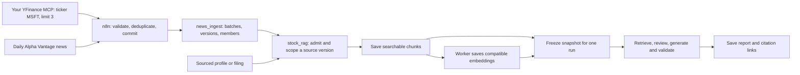

# Set up PostgreSQL for the stock research app

Use this schema with your own YFinance MCP and the existing n8n workflows. n8n saves completed company and shared news batches. The research service admits permitted sources, saves searchable passages, and pins evidence for each report. A worker can add pgvector embeddings after passages are ready.

## 1. Create or select a research database

If your desk already has PostgreSQL, create a dedicated `stock_research` database on that server or use the dedicated research database you already provisioned. Check that the server includes the pgvector extension. The scripts use `public` as the extension schema. If your database already installs `vector` in another schema, adapt the qualified type and operator names before applying the scripts.

For a fresh local installation, use the supplied Compose file. It selects PostgreSQL 17 with pgvector and maps host `127.0.0.1:5433` to container port 5432. Change `STOCK_PG_PORT` in `.env` if 5433 is in use. The volume preserves the database across container restarts. [pgvector Docker installation](https://github.com/pgvector/pgvector#docker)

From the repository root, run:

```sh
cp integrations/stock_research_db/.env.example integrations/stock_research_db/.env
# Set STOCK_ADMIN_PASSWORD in integrations/stock_research_db/.env.
docker compose -f integrations/stock_research_db/compose.yaml up -d --wait
```

Apply the scripts in this order. If the running n8n setup already installed the current staging migration, begin with `stock_research_db/schema.sql`.

```sh
docker compose -f integrations/stock_research_db/compose.yaml exec -T postgres \
  psql -X -v ON_ERROR_STOP=1 -U stock_admin -d stock_research \
  < integrations/n8n_stock_news/schema.sql

docker compose -f integrations/stock_research_db/compose.yaml exec -T postgres \
  psql -X -v ON_ERROR_STOP=1 -U stock_admin -d stock_research \
  < integrations/stock_research_db/schema.sql

docker compose -f integrations/stock_research_db/compose.yaml exec -T postgres \
  psql -X -v ON_ERROR_STOP=1 -U stock_admin -d stock_research \
  < integrations/stock_research_db/roles.sql
```

On an existing server, use your administrator's `psql` connection with `-X -v ON_ERROR_STOP=1 -f path/to/file.sql` for each file. Use the file order above. `roles.sql` assumes the database is named `stock_research` and restricts default connection permissions on it. Review this grant file against existing service accounts before applying it to a database they share.

Open an interactive `psql` session as the admin and set different passwords for the new logins. Supply the resulting credentials through n8n and your server's private configuration. [PostgreSQL role and password reference](https://www.postgresql.org/docs/17/sql-createrole.html)

```sql
\password stock_ingest
\password stock_app
\password stock_embed
```

| Client | Login | Database and permissions |
| --- | --- | --- |
| n8n Postgres nodes | `stock_ingest` | `stock_research`, writes `news_ingest` batches and versions |
| Your research backend | `stock_app` | `stock_research`, reads completed staging data and writes admitted evidence, manifests, and reports |
| Python embedding worker | `stock_embed` | `stock_research`, reads chunks and writes vectors |
| LangGraph AsyncPostgresSaver | Its own login | Separate `stock_checkpoints` database. Run the saver's supported setup during backend implementation. |
| n8n's internal state | Its existing login | Existing n8n metadata database. If provisioning PostgreSQL for n8n itself, create a separate database and login for it. |

In the n8n **Claim batch** and **Commit complete batch** nodes, choose the `stock_ingest` credential. For an app running directly on the host, use `127.0.0.1:5433` with the sample Compose service. For Docker n8n, attach the n8n service to a private network shared with PostgreSQL and use its service name `postgres` on port 5432. If you use Docker Desktop host forwarding instead, test `host.docker.internal:5433` from that container. The host port for your YFinance MCP, 7594 in your notes, is a different service.

When adding LangGraph persistence, run these commands once as the cluster admin in interactive `psql`. The dedicated login owns the checkpoint database so its one-time saver setup can create and migrate its tables. [LangGraph Postgres setup](https://docs.langchain.com/oss/python/langgraph/add-memory#use-in-production)

```sql
CREATE ROLE stock_checkpoint LOGIN;
CREATE DATABASE stock_checkpoints OWNER stock_checkpoint;
REVOKE CONNECT ON DATABASE stock_checkpoints FROM PUBLIC;
\password stock_checkpoint
```

Use the same pattern with a distinct role and database if you move n8n's internal metadata to PostgreSQL. Existing n8n installations can retain their configured metadata store.

## 2. Follow one news item into RAG



| Save location | Content | Identity |
| --- | --- | --- |
| `news_ingest.versions` and `members` | Sanitized provider fields and the batch/topic links. The article body or summary is saved once for a given normalized version. | Content/version hash plus separate membership links |
| `stock_rag.source_versions` and `source_scopes` | Admitted provenance, citation metadata, permissions, and eligible company/shared scope. Curated profile and filing excerpts can be stored directly. | Document key, version key, and privacy policy |
| `stock_rag.chunks` | Exact excerpt, source field, character offsets, ordinal, token count, and full-text index entry | Source version, chunking configuration, field, and ordinal |
| `stock_rag.embeddings` | One 384-dimensional vector for a saved chunk and pinned configuration | `(chunk_id, model_key)` |
| `stock_rag.snapshots` and `snapshot_chunks` | Owner, company, evidence cutoff, exact chunk IDs, and which vectors were ready | One immutable manifest per `run_id` |
| `stock_rag.reports` and `report_citations` | One validated report, horizon, target date, and linked cited chunks | One report per run. Citation foreign keys require snapshot membership. |

### Admit the source

1. Read the n8n receipt's `batch_key` and `version_ids`. Keep coverage/freshness and receipt details with the run. `stock_rag.completed_news` exposes only committed batch membership.
2. Verify permission to use the content, source quality, the URL, the timestamps, and the effective privacy policy. Quarantine records that fail admission. Save a policy/permission reference rather than relying on the presence of a URL.
3. Bind the fields in [save_news_source.sql](save_news_source.sql). Use quality `unknown` when your MCP returned a body-or-summary fallback without a marker. Alpha Vantage summaries can be admitted as `summary` when the feed mapping verifies that.
4. Insert the source's authorized scopes in the same transaction. Map verified `company:MSFT` membership to `MSFT`, for example. Use `SHARED` for approved macro/fiscal evidence. Keep the earliest verified association time in `known_at`; a newly added association must not get the article's older publication date. Scope a company profile to its own company.
5. On replay, find the existing source by `news_version_id` and `privacy_policy_key`, and verify its immutable metadata matches the expected policy. A corrected article at the same URL gets a new source version. Keep old versions for existing snapshots.

For profile and filing material, insert a source with a sourced `curated_text` excerpt, stable document key and version key, dated provenance, and company scope. Review profile updates against suitable primary sources. Daily news supplies context for the next report and company facts follow their own revision history. Store stock prices and numeric fundamentals in structured observation tables if the research service needs them.

### Write the chunks

Read the selected sanitized source field and apply your pinned tokenizer and chunker. The current project example starts with a 320-token window and 48-token overlap. Count the E5 passage prefix and special tokens when checking the model input limit. Proceed article by article. [Project chunking example](../n8n_stock_news/chunk_example.py)

Call [save_chunk.sql](save_chunk.sql) with these bound values, in order:

```text
source_id, chunker_key, source_field, ordinal, char_start, char_end, token_count
```

Use zero-based Unicode code-point offsets with an exclusive end, measured against the exact stored field. Python string offsets work for this purpose. Convert JavaScript UTF-16 offsets before saving. The SQL extracts the excerpt from the stored text and rejects out-of-range offsets. If further redaction is required, pass the content back through a properly versioned sanitation/admission step so citations still match the stored text.

For an identical replay, an insert conflict leaves the original chunk in place. Verify that its range and token count match. Changing chunking or preprocessing requires a new configuration key. Admitting and chunking can complete before embedding. Pending vectors do not prevent sparse retrieval.

### Save embeddings in the worker

Create one `embedding_models` row as the database admin for each reviewed candidate configuration. Use the model name, exact weight/tokenizer revision, and JSON preprocessing parameters that reproduce the inputs. The project's initial 384-dimensional candidate is `intfloat/multilingual-e5-small`. Encode saved chunks with `passage: ` and questions with `query: ` using the matching revision and normalization. [Multilingual E5 model card](https://huggingface.co/intfloat/multilingual-e5-small)

Select a limited batch of eligible chunks missing `(chunk_id, model_key)`. Compute vectors outside the insert transaction, then bind `chunk_id, model_key, embedding` in [save_embedding.sql](save_embedding.sql). For a Postgres driver without a registered pgvector codec, bind the vector text such as `[0.01, ...]` with all 384 finite components. The primary key makes repeated writes converge on one row per chunk/configuration. The vector type checks dimensions and the schema rejects zero-norm embeddings.

The staging outbox can signal new news versions. When scheduling a particular model revision, check the actual missing chunk/model pairs, since existing chunks may also need embeddings under the new configuration. Add worker claim/lease and retry behavior during application implementation. Only mark the relevant scheduled work done after all intended vector writes commit.

### Freeze, retrieve, and save the report

1. After the company refresh, the backend chooses the eligible source versions and chunk configuration. For a historical run use the explicit cutoff; for a current run record the freeze cutoff after refresh. Choose the appropriate profile revision and news batches before freezing.
2. Call `stock_rag.freeze_snapshot(run_id, owner_id, company, as_of, chunker_key, chunk_ids, model_key)` with parameter binding. Supply the authenticated owner from the backend, and use null `model_key` for sparse-only runs. The function checks company/shared scope, publication and first-seen dates, association time, revocations, and chunk configuration. A null publication date cannot enter this starter's dated snapshot. An empty manifest is valid for recording an evidence gap.
3. On resume, read the saved manifest for that owner and run. A conflict on a duplicate freeze call is a signal to load the existing manifest after checking ownership and run identity. A later daily batch, article correction, or completed vector remains available for a new run.
4. Bind `run_id, owner_id, query` in [retrieve_sparse.sql](retrieve_sparse.sql). Sparse stays the default. Evaluate the `simple` text search configuration on your English and Chinese inputs before locking the baseline. For the evaluated candidate, [retrieve_dense.sql](retrieve_dense.sql) binds `run_id, owner_id, query_vector, model_key` and uses exact cosine retrieval over that manifest's ready vectors. Fuse ranks and rerank in the research service. Enable hybrid only after the golden-set gates pass. Evaluate HNSW separately if exact search becomes too expensive. [pgvector search and indexing](https://github.com/pgvector/pgvector#indexing)
5. Finish evidence review, coverage, privacy, and citation checks in the app. Map each verified model citation to the exact chunk ID supplied to the model. Use the current permissions and verify that each material claim is supported by the excerpt. Store the sanitized report JSON and its `report_citations` rows in one transaction.
6. Apply owner and current access checks on every report/evidence read and export. The searchable view drops revoked sources immediately. A stored report can still quote them, so the host must suppress or revalidate affected reports before returning them. Database roles protect services from each other. The backend enforces end-user authorization.

The supplied SQL files use PostgreSQL `$1`-style bind parameters. Execute them through a prepared query in the app. For psycopg, adapt the placeholders to its binding syntax or use a prepared statement; do not interpolate input into SQL text.

## 3. Verify the database path

Run the smoke check from the repository root. It runs the actual staging and RAG SQL against an in-memory PostgreSQL engine with pgvector. It makes no provider, LLM, or embedding-model calls.

```sh
npm install --prefix /tmp/stock-research-db-verify --no-audit --no-fund \
  @electric-sql/pglite@0.5.16 @electric-sql/pglite-pgvector@0.0.17
STOCK_RAG_TEST_DEPS=/tmp/stock-research-db-verify \
  node integrations/stock_research_db/verify.mjs
```

The check covers staging commits, role permissions, deduplication, excerpt extraction, vector dimensions, sparse and exact vector retrieval, frozen readiness, cutoff filtering, revocations, and citation membership. Run a separate connection check against the actual Docker/native database and n8n credentials when installing.

This folder delivers the database and prepared SQL statements. The Cursor plan covers the application and worker that call them, graph checkpoints, review revisions, authenticated API routes, durable call budgets, and evaluation. Use these tables as the starting migration for this database path. The standalone finance and HNSW teaching schemas remain examples. [Cursor build plan](../../docs/CURSOR_STOCK_RESEARCH_BUILD_PLAN.md)
