# Stock research workflow atlas / 股票研究流程圖集

Open `/finance-project/workflows` for the interactive mind map and twelve connected diagrams. These are proposed designs and offline teaching paths, not live service runs. Node names match the technical contracts; edge conditions and explanations are bilingual.

開啟 `/finance-project/workflows` 查看互動心智圖及十二張連線圖。這些是建議設計及離線教學路徑，並非真實服務執行；節點名稱沿用技術合約，條件及解說提供雙語。

Per run: 1 news refresh, 2 searches including failures, 6 source reads, at most 3 LLM calls and the original 60s deadline. No retry or resume resets the budget. Purple = bounded refinement/resume; amber = fallback; red = stop; teal = continue.

## Refine a weak search / 補查不足證據

At most one refined query: two searches total, including failures. Keep the company, original question, snapshot and deadline. If evidence is still weak, return insufficient evidence.

最多一次修正查詢，包含失敗總共兩次搜尋。保留公司、原問題、快照及時限；仍不足就回傳證據不足。

## Fall back after a component failure / 元件失敗時回退

Use working sparse evidence when the vector/reranker path fails. Stay inside the same budget. If sparse also fails, report unavailable; an outage is not “no news”.

向量／重排路徑失敗時用仍可用的 sparse，維持原預算。Sparse 亦失敗就回服務不可用；故障不等於「沒有新聞」。

## Resume an interrupted run / 恢復中斷任務

Authenticate the owner, reload the checkpoint and continue at the next unfinished node. Reuse completed results and idempotency keys. Keep counters and the original deadline; expiry needs a new request.

驗證擁有者、載入 checkpoint，從下一個未完成節點繼續。重用已完成結果及冪等鍵；保留計數及原時限，過期後須新請求。

## Stop when a retry would be misleading / 不能靠重試解決就停止

Irrelevant prompts, failed authorization and invalid citations do not trigger automatic retries. There is one news refresh per new accepted prompt, and no automatic draft-repair loop in this design.

不相關問題、授權失敗及無效引用不會自動重試。每個新接納問題只刷新新聞一次；此設計沒有自動修補草稿迴圈。

## One question → one evidence-backed report / 一條問題 → 一份有證據報告

[English SVG](finance-diagrams/overall-en.svg) · [繁體中文 SVG](finance-diagrams/overall-zh.svg)

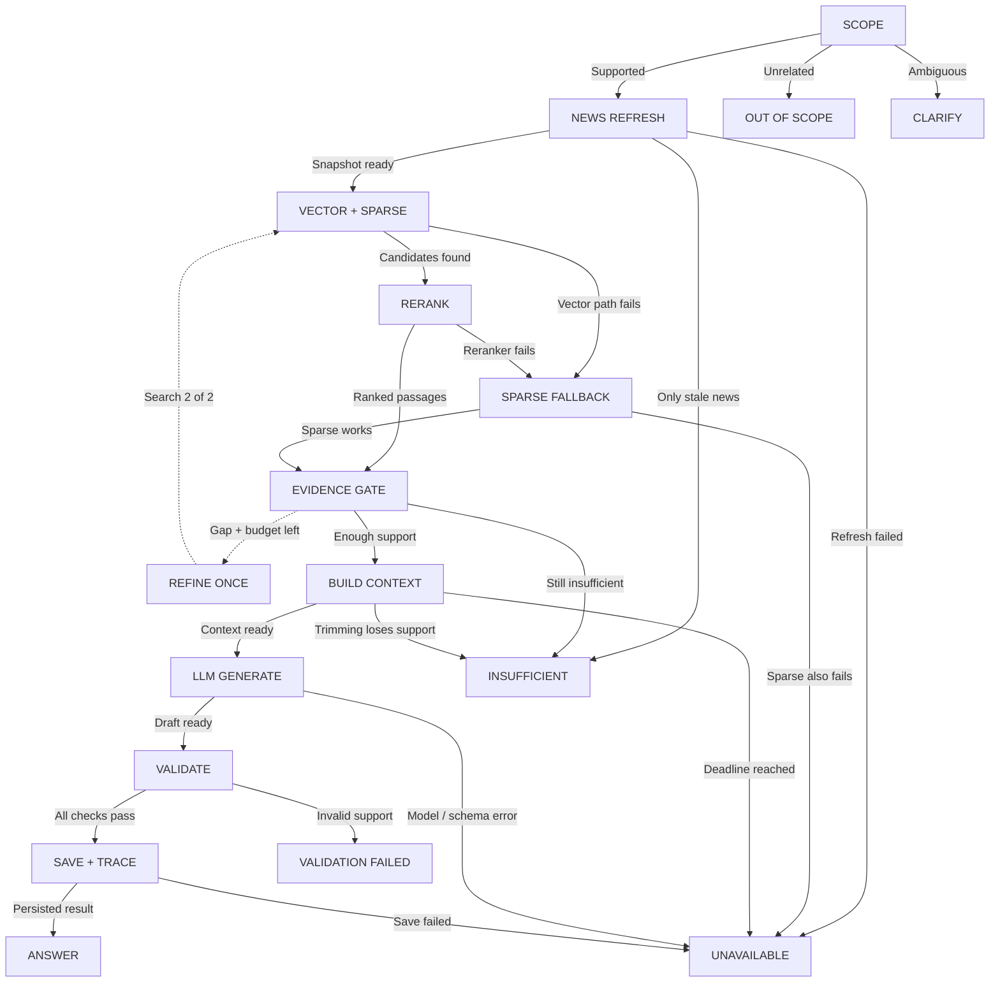

- **scope → refresh** — Supported / 範圍符合
  n8n refreshes approved feeds. For this walkthrough, assume the returned news is already chunked and indexed. Pin the snapshot and both publication/first-seen cutoff filters.
  n8n 刷新核准新聞；此流程假設回傳新聞已切段及索引。固定快照及發布／首次取得截止條件。

- **scope → clarify** — Ambiguous / 不明確
  Ask which supported company or horizon the user means. A clarified submission starts a new validated request.
  問清楚支援公司或研究期間；澄清後提交為新的已驗證請求。

- **scope → irrelevant** — Unrelated / 不相關
  Explain that the app researches supported companies and provide an example. No news, retrieval or report-generation calls.
  交代 app 研究支援公司並給問題例子；不呼叫新聞、檢索或報告生成。

- **refresh → retrieve** — Snapshot ready / 快照就緒
  Embed the query with the indexed embedding model. Search the admitted vector index and sparse branch using identical filters, fuse and deduplicate. Sparse remains default until admission passes.
  使用索引相同 embedding 模型轉換查詢，以相同條件搜尋已准入向量及 sparse，融合去重；准入前預設 sparse。

- **refresh → insufficient** — Only stale news / 只有過期新聞
  Explain exactly what evidence is missing. Show supported facts and a useful next question; do not generate a forecast from the model’s memory.
  說明缺少哪項證據，展示有支持事實及有用下一題；不能靠模型記憶補預測。

- **refresh → unavailable** — Refresh failed / 刷新失敗
  Show the actual operational failure and safe retry option. Do not reset budgets on resume or claim that no relevant news exists.
  展示實際運作失敗及安全重試選項；恢復不能重設預算，亦不能聲稱沒有相關新聞。

- **retrieve → rerank** — Candidates found / 已取得候選
  A cross-encoder scores each query–passage pair. The new order improves context selection; its score is not a probability or a sufficiency verdict.
  Cross-encoder 評分每對問題與原文，重排以改善上下文選擇；分數不是機率或證據充分判斷。

- **retrieve → fallback** — Vector path fails / 向量路徑失敗
  Use the working sparse path within the original deadline. If sparse also fails, stop as unavailable; never present a tool outage as zero search hits.
  在原時限內使用可用 sparse；兩者皆失敗則回服務不可用，不能將工具中斷當零搜尋結果。

- **rerank → gate** — Ranked passages / 已排序原文
  Check passage relevance, freshness, attribution and coverage of the exact question. Keep opposing evidence. Calibrate any score threshold on development data; count and similarity alone cannot establish support.
  檢查原文相關性、新鮮度、來源及當前問題覆蓋，保留反方證據；分數門檻用開發集校準，數量或相似度本身不足證明支持。

- **rerank → fallback** — Reranker fails / 重排失敗
  Use the working sparse path within the original deadline. If sparse also fails, stop as unavailable; never present a tool outage as zero search hits.
  在原時限內使用可用 sparse；兩者皆失敗則回服務不可用，不能將工具中斷當零搜尋結果。

- **fallback → gate** — Sparse works / Sparse 可用
  Check passage relevance, freshness, attribution and coverage of the exact question. Keep opposing evidence. Calibrate any score threshold on development data; count and similarity alone cannot establish support.
  檢查原文相關性、新鮮度、來源及當前問題覆蓋，保留反方證據；分數門檻用開發集校準，數量或相似度本身不足證明支持。

- **fallback → unavailable** — Sparse also fails / Sparse 亦失敗
  Show the actual operational failure and safe retry option. Do not reset budgets on resume or claim that no relevant news exists.
  展示實際運作失敗及安全重試選項；恢復不能重設預算，亦不能聲稱沒有相關新聞。

- **gate → refine** — Gap + budget left / 有缺口＋餘額
  Target the missing facet without changing the company or question. Retrieval increments attempts, including failed attempts; allow only two search rounds total.
  針對缺少面向補查，不改公司或原問題；檢索次數包含失敗嘗試，總共只准兩輪。

- **refine → retrieve** — Search 2 of 2 / 第 2／2 次搜尋
  Embed the query with the indexed embedding model. Search the admitted vector index and sparse branch using identical filters, fuse and deduplicate. Sparse remains default until admission passes.
  使用索引相同 embedding 模型轉換查詢，以相同條件搜尋已准入向量及 sparse，融合去重；准入前預設 sparse。

- **gate → insufficient** — Still insufficient / 仍不足
  Explain exactly what evidence is missing. Show supported facts and a useful next question; do not generate a forecast from the model’s memory.
  說明缺少哪項證據，展示有支持事實及有用下一題；不能靠模型記憶補預測。

- **gate → context** — Enough support / 支持足夠
  Fetch original excerpts, deduplicate by story, preserve dates/IDs, and retain conflicting evidence. Reserve tokens for policy, question and output. Recheck coverage after trimming; if a required facet was removed, return insufficient.
  讀原文、按新聞去重、保留日期／ID 及矛盾；預留規則、問題及輸出 token。裁剪後重查覆蓋，若刪掉必要面向就回證據不足。

- **context → insufficient** — Trimming loses support / 裁剪後支持不足
  Explain exactly what evidence is missing. Show supported facts and a useful next question; do not generate a forecast from the model’s memory.
  說明缺少哪項證據，展示有支持事實及有用下一題；不能靠模型記憶補預測。

- **context → generate** — Context ready / 上下文就緒
  Supply excerpts as untrusted data, never as system messages. Require a direct answer, facts, conditional scenarios, assumptions and invalidation signals. Provider/schema failure is an error, not a prediction.
  節錄只作不可信資料，不放 system 訊息；要求直接答案、事實、條件式情境、假設及失效訊號。供應商／格式失敗是錯誤，不是預測。

- **context → unavailable** — Deadline reached / 到達時限
  Show the actual operational failure and safe retry option. Do not reset budgets on resume or claim that no relevant news exists.
  展示實際運作失敗及安全重試選項；恢復不能重設預算，亦不能聲稱沒有相關新聞。

- **generate → validate** — Draft ready / 草稿就緒
  Check schema, citation membership, company/time and claim support. No guessed URLs or unsupported factual claims. Invalid output is withheld rather than sent to the reader.
  核對 schema、引用集合、公司／時間及主張支持；不猜 URL 或輸出無根據事實；無效草稿不發布。

- **generate → unavailable** — Model / schema error / 模型／格式錯誤
  Show the actual operational failure and safe retry option. Do not reset budgets on resume or claim that no relevant news exists.
  展示實際運作失敗及安全重試選項；恢復不能重設預算，亦不能聲稱沒有相關新聞。

- **validate → blocked** — Invalid support / 支持無效
  Record why release was blocked. This bounded design does not add an unbudgeted repair loop.
  記錄阻擋發布原因；此有上限設計不新增無預算修正迴圈。

- **validate → save** — All checks pass / 檢查通過
  Persist the exact answer and source references. Flush sanitized traces to Langfuse/LangSmith; telemetry failure leaves the answer available but fails the observable-demo gate. Feedback is stored separately.
  保存完整答案及引用；清理 traces 後送 Langfuse／LangSmith。追蹤失敗保留答案但 demo 驗收不通過；回饋另存。

- **save → answer** — Persisted result / 已保存結果
  Return the question-specific answer, uncertainty, sources, dates and trace status. Download reuses this saved result.
  回傳針對問題答案、不確定性、來源、日期及 trace 狀態；下載重用此結果。

- **save → unavailable** — Save failed / 保存失敗
  Show the actual operational failure and safe retry option. Do not reset budgets on resume or claim that no relevant news exists.
  展示實際運作失敗及安全重試選項；恢復不能重設預算，亦不能聲稱沒有相關新聞。

## Choose a supported company / 選擇支援公司

[English SVG](finance-diagrams/company-en.svg) · [繁體中文 SVG](finance-diagrams/company-zh.svg)

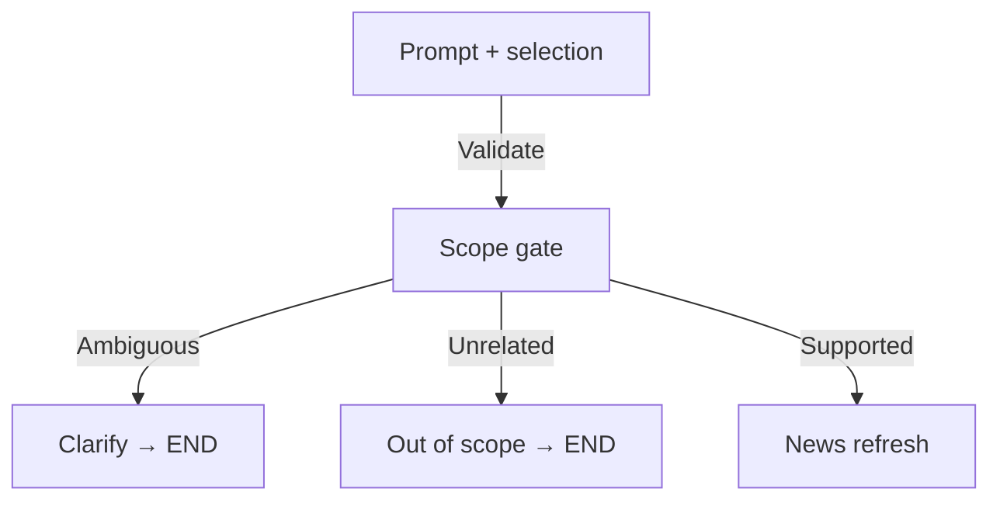

- **Prompt + selection → Scope gate** — Validate / 驗證
  Validate company, horizon and question intent. Handoff: Original question + canonical company + horizon
  驗證公司、期間及問題意圖。 交接資料：原問題＋標準公司＋期間

- **Scope gate → Clarify → END** — Ambiguous / 不明確
  Company or intent is ambiguous. Handoff: One clarification question; no news/retrieval calls
  公司或意圖不明確。 交接資料：一個澄清問題；不呼叫新聞或檢索

- **Scope gate → Out of scope → END** — Unrelated / 不相關
  Clearly unrelated or unsupported company. Handoff: Explain scope and show a supported example prompt
  明顯無關或公司未支援。 交接資料：交代範圍並提供支援問題例子

- **Scope gate → News refresh** — Supported / 範圍符合
  Supported company research question. Handoff: Validated ResearchRequest; unknown coverage may be refreshed
  支援公司研究問題。 交接資料：已驗證 ResearchRequest；未知覆蓋可刷新

## Refresh news through n8n MCP for every prompt / 每題經 n8n MCP 刷新新聞

[English SVG](finance-diagrams/sources-en.svg) · [繁體中文 SVG](finance-diagrams/sources-zh.svg)

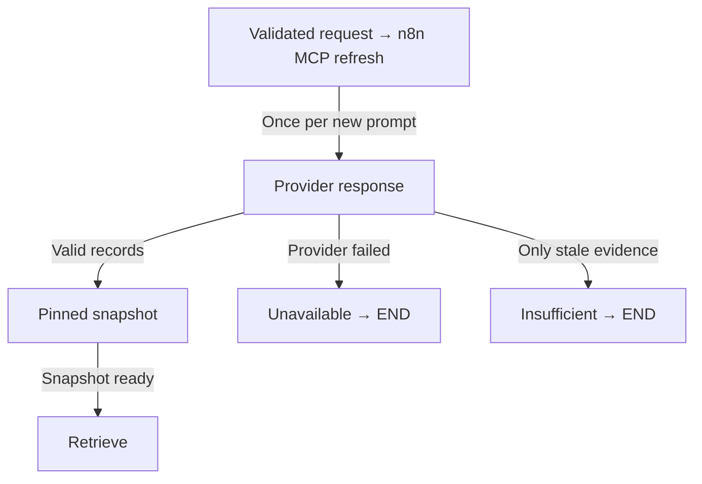

- **Validated request → n8n MCP refresh → Provider response** — Once per new prompt / 每新問題一次
  Every new accepted prompt; resume reuses its receipt. Handoff: company + query + run_id + cutoff
  每個新接納提示；恢復時重用紀錄。 交接資料：公司＋查詢＋任務 ID＋截止點

- **Provider response → Pinned snapshot** — Valid records / 有效記錄
  Normalize and index records with dates, permitted text and valid identity. Handoff: source_id/chunk_id, URL, published_at, first_seen_at, content hash
  驗證日期、允許節錄及身份，再正規化及索引。 交接資料：來源／切段 ID、URL、發布／首次取得時間及內容 hash

- **Provider response → Unavailable → END** — Provider failed / 供應商失敗
  Refresh failed; do not treat an outage as zero relevant news. Handoff: Provider status and typed error; no current prediction
  刷新失敗；不能把故障當成沒有相關新聞。 交接資料：供應商狀態及結構化錯誤；不作當前預測

- **Provider response → Insufficient → END** — Only stale evidence / 只有過期證據
  The refresh completed but only stale evidence remains. Handoff: Freshness gap and dated supported facts; no current prediction
  刷新完成，但只有過期證據。 交接資料：新鮮度缺口及有日期支持事實；不作當前預測

- **Pinned snapshot → Retrieve** — Snapshot ready / 快照就緒
  Store and index acknowledgements agree on snapshot_id. Handoff: Immutable snapshot_id + allowed source IDs
  儲存及索引確認相同 snapshot_id。 交接資料：不可變 snapshot_id＋允許來源 ID

## Retrieve, fuse and rerank evidence / 檢索、融合及重排證據

[English SVG](finance-diagrams/retrieval-en.svg) · [繁體中文 SVG](finance-diagrams/retrieval-zh.svg)

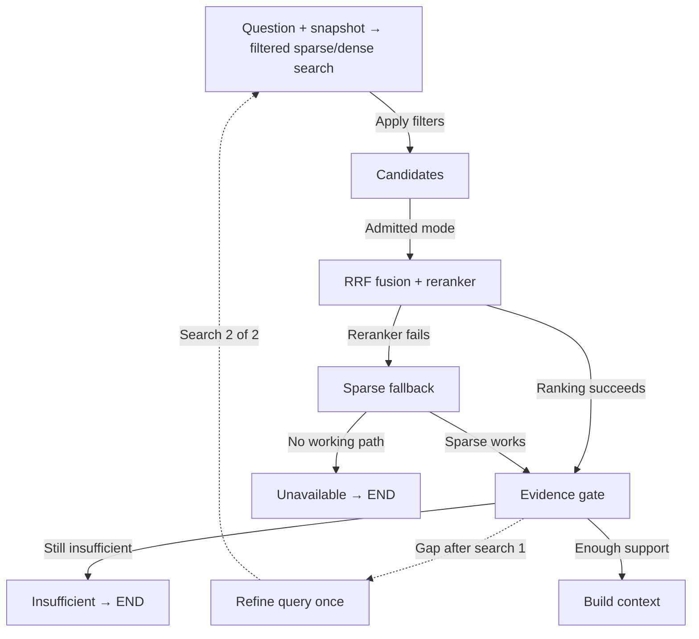

- **Question + snapshot → filtered sparse/dense search → Candidates** — Apply filters / 套用篩選
  Company, permissions and both timestamps pass. Handoff: 20 candidates per branch: chunk IDs + passages + original ranks
  公司、權限及兩個時間戳符合。 交接資料：每分支 20 候選：切段 ID＋原文＋初始排序

- **Candidates → RRF fusion + reranker** — Admitted mode / 已准入模式
  Hybrid admission passed; otherwise use sparse. Handoff: Deduplicated top 20 → cross-encoder top 10
  混合准入已通過；否則用 sparse。 交接資料：去重前 20 → cross-encoder 前 10

- **RRF fusion + reranker → Evidence gate** — Ranking succeeds / 排序成功
  Ranking succeeds using the admitted mode. Handoff: Ranked passages and actual mode
  使用已准入模式成功排序。 交接資料：已排序原文及實際模式

- **RRF fusion + reranker → Sparse fallback** — Reranker fails / 重排失敗
  Reranker fails while a working sparse path remains within the deadline. Handoff: Original question and snapshot; no fabricated scores
  重排失敗，但時限內 sparse 仍可用。 交接資料：原問題及快照；不捏造分數

- **Sparse fallback → Evidence gate** — Sparse works / Sparse 可用
  Use the working sparse result within the original budget. Handoff: Passages + fallback_reason
  原預算內使用可用 sparse 結果。 交接資料：原文＋回退原因

- **Sparse fallback → Unavailable → END** — No working path / 沒有可用路徑
  Sparse also fails or the deadline expires. Handoff: Dependency error, not an empty evidence claim
  Sparse 亦失敗或已超時。 交接資料：依賴錯誤，不聲稱沒有證據

- **Evidence gate → Refine query once** — Gap after search 1 / 首次搜尋有缺口
  First search lacks coverage and the original budget remains. Handoff: Missing facets; preserve company, cutoff and snapshot
  首次搜尋覆蓋不足，原預算仍有餘額。 交接資料：缺失面向；保留公司、截止及快照

- **Refine query once → Question + snapshot → filtered sparse/dense search** — Search 2 of 2 / 第 2／2 次搜尋
  Search again with a narrower query; at most two searches total, including failed attempts. Handoff: Same snapshot, new query, retained search counter
  收窄查詢再搜尋；包含失敗嘗試總共最多兩次。 交接資料：相同快照、新查詢、保留搜尋計數

- **Evidence gate → Insufficient → END** — Still insufficient / 仍不足
  The second search still lacks support, or no refinement budget remains. Handoff: Missing facets; no forecast
  第二次搜尋仍不足，或沒有補查預算。 交接資料：缺失面向；不作預測

- **Evidence gate → Build context** — Enough support / 支持足夠
  Relevant, current passages cover the question. Handoff: At most 6 excerpts, stable citation IDs and provenance
  相關且當前原文足以覆蓋問題。 交接資料：最多 6 節錄、穩定引用 ID 及來源記錄

## Run one bounded research agent / 運行一個有上限的研究 agent

[English SVG](finance-diagrams/research-en.svg) · [繁體中文 SVG](finance-diagrams/research-zh.svg)

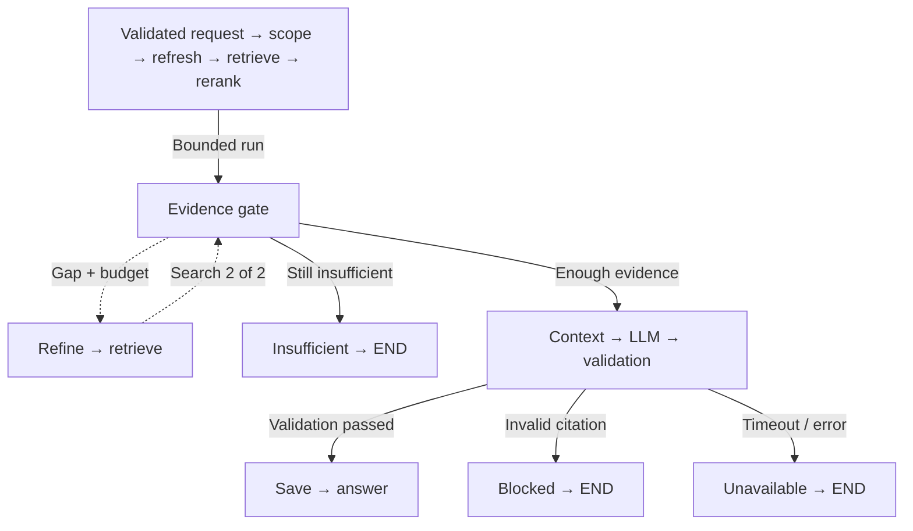

- **Validated request → scope → refresh → retrieve → rerank → Evidence gate** — Bounded run / 有限次執行
  Code owns mandatory ordering and budgets. Handoff: Typed state, original prompt, snapshot, attempts, deadline, trace_id
  程式控制必需次序及預算。 交接資料：型別狀態、原提示、快照、次數、時限及 trace_id

- **Evidence gate → Refine → retrieve** — Gap + budget / 缺口＋有預算
  First attempt only, and budget remains. Handoff: Refined query; same original question and snapshot
  只限首次嘗試，而且仍有預算。 交接資料：修正查詢；相同原問題及快照

- **Refine → retrieve → Evidence gate** — Search 2 of 2 / 第 2／2 次搜尋
  Recheck the second retrieval with the same filters. Handoff: Updated evidence; attempts = 2
  以相同條件重新檢查第二輪檢索。 交接資料：更新證據；次數 = 2

- **Evidence gate → Insufficient → END** — Still insufficient / 仍不足
  Second attempt fails to cover the question. Handoff: Supported facts + missing facets; no forecast
  第二次仍未覆蓋問題。 交接資料：有支持事實＋缺失面向；不作預測

- **Evidence gate → Context → LLM → validation** — Enough evidence / 證據足夠
  All required facets have support; conflicts are retained. Handoff: Prompt-specific draft with citations and conditional scenarios
  所有所需面向有支持，矛盾證據保留。 交接資料：針對提示的草稿、引用及條件式情境

- **Context → LLM → validation → Save → answer** — Validation passed / 驗證通過
  Validation passes within the budget. Handoff: Validated cited answer
  預算內通過驗證。 交接資料：已驗證引用答案

- **Context → LLM → validation → Blocked → END** — Invalid citation / 引用無效
  Citation or support validation fails. Handoff: Withheld draft and validation errors
  引用或支持驗證失敗。 交接資料：不發布草稿及驗證錯誤

- **Context → LLM → validation → Unavailable → END** — Timeout / error / 超時／錯誤
  Deadline, call limit or dependency failure. Handoff: Typed error + resumable checkpoint when safe
  超時、超額或依賴失敗。 交接資料：結構化錯誤＋安全時可恢復 checkpoint

## Answer the prompt with conditional forecasts / 以條件式預測回答提示

[English SVG](finance-diagrams/report-en.svg) · [繁體中文 SVG](finance-diagrams/report-zh.svg)

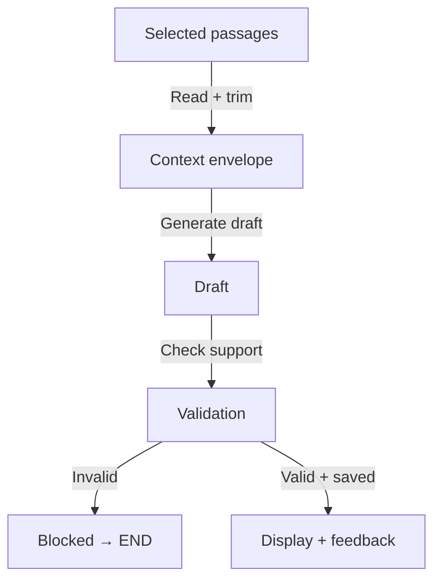

- **Selected passages → Context envelope** — Read + trim / 讀取＋裁剪
  Deduplicate, read original excerpts and enforce token budget. Handoff: Question, horizon, as_of, evidence[], missing_facets[], conflicts[]
  去重、讀原文並限制 token。 交接資料：問題、期間、截止、證據、缺失面向及矛盾

- **Context envelope → Draft** — Generate draft / 生成草稿
  System policy and user question stay separate from untrusted excerpts. Handoff: Direct answer + observed facts + conditional scenarios + citation IDs
  系統規則及使用者問題與不可信原文分開。 交接資料：直接答案＋觀察事實＋條件式情境＋引用 ID

- **Draft → Validation** — Check support / 核對支持
  Require claim support; a reranker score is not confidence. Handoff: Draft only; never stream an unvalidated recommendation
  要求主張支持；重排分數不是信心。 交接資料：只產生草稿；不串流未驗證建議

- **Validation → Blocked → END** — Invalid / 無效
  Unknown citation or unsupported factual claim. Handoff: Do not release draft
  未知引用或無支持事實。 交接資料：不發布草稿

- **Validation → Display + feedback** — Valid + saved / 有效＋已存
  Persist before exposing the final answer. Handoff: Report ID, trace URL/status; separate feedback linked to run_id
  先保存，再顯示最終答案。 交接資料：報告 ID、trace URL／狀態；回饋另存並連結 run_id

## Validate citations and tool boundaries / 驗證引用及工具邊界

[English SVG](finance-diagrams/validation-en.svg) · [繁體中文 SVG](finance-diagrams/validation-zh.svg)

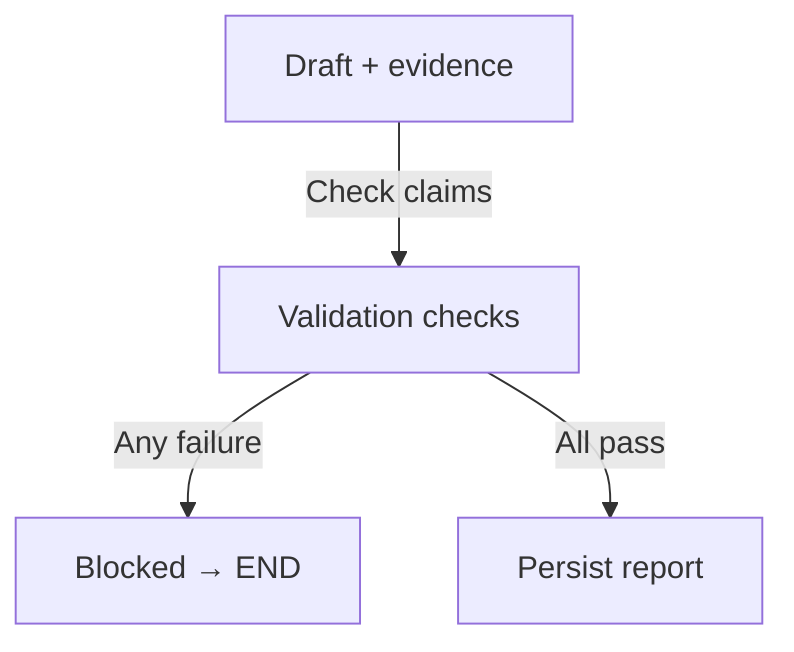

- **Draft + evidence → Validation checks** — Check claims / 核對主張
  Ignore embedded instructions; check IDs, dates, company, coverage and factual support. Handoff: Validation errors or a validated report
  忽略內嵌指令，檢查 ID、日期、公司、覆蓋及事實支持。 交接資料：驗證錯誤或已驗證報告

- **Validation checks → Blocked → END** — Any failure / 任一失敗
  A required validation fails. Handoff: validation_failed; no draft publication
  必要驗證失敗。 交接資料：validation_failed；不發布草稿

- **Validation checks → Persist report** — All pass / 全部通過
  Every material factual claim has excerpt support. Handoff: Validated result and source references
  所有重要事實主張有原文支持。 交接資料：已驗證結果及來源引用

## Save and download the report / 保存及下載報告

[English SVG](finance-diagrams/export-en.svg) · [繁體中文 SVG](finance-diagrams/export-zh.svg)

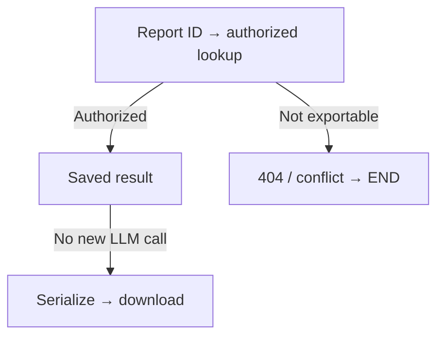

- **Report ID → authorized lookup → Saved result** — Authorized / 有權限
  Caller owns the report; ID exists. Handoff: Saved question, answer, sources, dates, trace status
  呼叫者擁有報告且 ID 存在。 交接資料：已存問題、答案、來源、日期及 trace 狀態

- **Report ID → authorized lookup → 404 / conflict → END** — Not exportable / 不能匯出
  No exportable validated record exists. Handoff: Typed error; no regeneration
  沒有可下載的已驗證紀錄。 交接資料：結構化錯誤；不重新生成

- **Saved result → Serialize → download** — No new LLM call / 不再呼叫 LLM
  Include insufficient status and fictional labels where applicable. Handoff: Markdown identical to displayed report; zero LLM calls
  適用時保留證據不足狀態及虛構標籤。 交接資料：與畫面相同 Markdown；零 LLM 呼叫

## Resume an interrupted research run / 恢復中斷研究任務

[English SVG](finance-diagrams/recovery-en.svg) · [繁體中文 SVG](finance-diagrams/recovery-zh.svg)

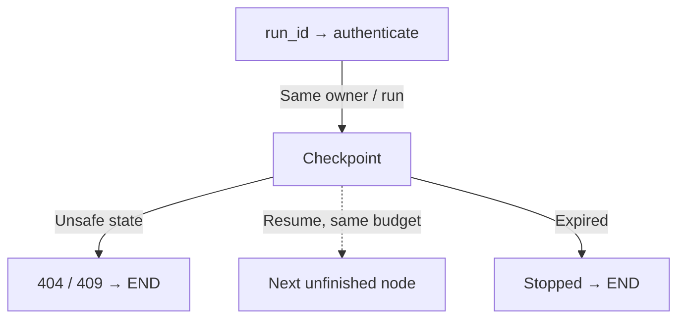

- **run_id → authenticate → Checkpoint** — Same owner / run / 相同擁有者／任務
  Resolve the same thread and original request. Handoff: Saved snapshot, completed node results, attempts and remaining budget
  解析相同 thread 及原請求。 交接資料：快照、已完成結果、次數及剩餘預算

- **Checkpoint → 404 / 409 → END** — Unsafe state / 狀態不安全
  Cannot safely resume the saved state. Handoff: Keep saved state; explain recovery failure
  無法安全恢復儲存狀態。 交接資料：保留狀態並交代恢復失敗

- **Checkpoint → Next unfinished node** — Resume, same budget / 原預算恢復
  Deadline remains; replayed effects use idempotency keys. Handoff: Same refresh receipt and search count; no budget reset
  未超時；重播副作用使用冪等鍵。 交接資料：相同刷新紀錄及搜尋次數；不重設預算

- **Checkpoint → Stopped → END** — Expired / 已過期
  A later fresh prompt requires a new run. Handoff: Supported partial findings and explicit expiry
  稍後新研究須建立新任務。 交接資料：有支持的部分發現及明確過期狀態

## Evaluate the agent before the interview / 面試前評估 agent

[English SVG](finance-diagrams/evaluation-en.svg) · [繁體中文 SVG](finance-diagrams/evaluation-zh.svg)

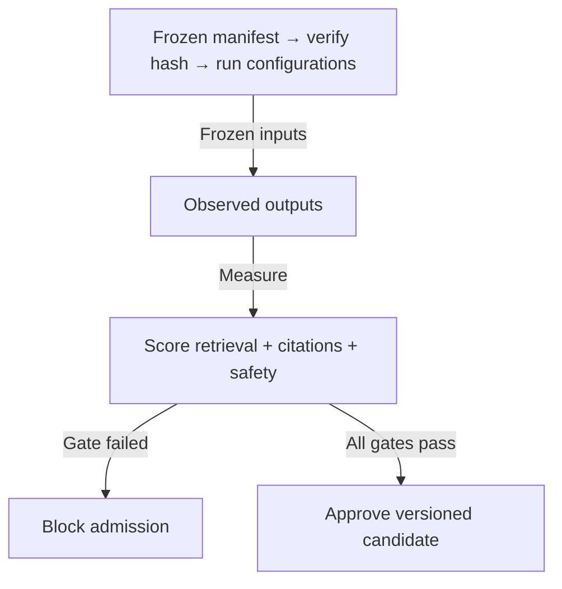

- **Frozen manifest → verify hash → run configurations → Observed outputs** — Frozen inputs / 凍結輸入
  Corpus, qrels and policy match the reviewed version. Handoff: Sparse, hybrid and reranked rankings on identical prompts
  語料、qrels 及政策符合已核對版本。 交接資料：相同提示的 sparse、混合及重排排序

- **Observed outputs → Score retrieval + citations + safety** — Measure / 量度
  Use actual outcomes and independently judged support. Handoff: recall/nDCG, citation precision, abstentions, injection outcomes
  使用實際結果及獨立支持度判斷。 交接資料：recall／nDCG、引用精準度、拒答及注入結果

- **Score retrieval + citations + safety → Block admission** — Gate failed / 未過門檻
  Synthetic-only, live checks missing or thresholds fail. Handoff: Sparse remains active; NOT RUN stays visible
  只有虛構測試、缺真實檢查或未達門檻。 交接資料：維持 sparse；明示 NOT RUN

- **Score retrieval + citations + safety → Approve versioned candidate** — All gates pass / 全部通過
  Real-news holdout, safety and tracing also pass. Handoff: Approved retrieval version + public report card
  真實新聞保留集、安全及追蹤亦通過。 交接資料：核准檢索版本＋公開成績表

## Trace each run in Langfuse and LangSmith / 在 Langfuse 及 LangSmith 追蹤每次任務

[English SVG](finance-diagrams/observability-en.svg) · [繁體中文 SVG](finance-diagrams/observability-zh.svg)

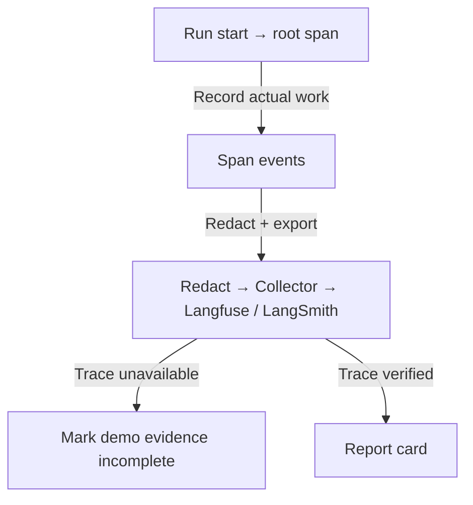

- **Run start → root span → Span events** — Record actual work / 記錄實際工作
  Propagate context into MCP and provider attempts. Handoff: trace_id, run_id, parent spans, errors and actual usage
  Context 傳入 MCP 及供應商嘗試。 交接資料：trace_id、run_id、父 spans、錯誤及實際用量

- **Span events → Redact → Collector → Langfuse / LangSmith** — Redact + export / 去敏感資料＋匯出
  Keep one instrumentation tree; do not double-count tokens. Handoff: Sanitized operational traces and experiment feedback
  保留一組 instrumentation；不重複計 token。 交接資料：清理後運行 traces 及實驗回饋

- **Redact → Collector → Langfuse / LangSmith → Mark demo evidence incomplete** — Trace unavailable / Trace 不可用
  Trace cannot be flushed or opened by a reviewer. Handoff: Preserved answer + unavailable trace status
  Trace 不能 flush 或審閱者無法開啟。 交接資料：保留答案＋trace 不可用狀態

- **Redact → Collector → Langfuse / LangSmith → Report card** — Trace verified / Trace 已核對
  At least 30 completed runs for latency percentiles. Handoff: One actual URL per demo; cohort p50/p95 with failures
  延遲百分位至少需要 30 次已完成任務。 交接資料：每 demo 一個實際 URL；樣本 p50／p95 及失敗數

## Package locally, then deploy privately / 本機包裝，再私人部署

[English SVG](finance-diagrams/deployment-en.svg) · [繁體中文 SVG](finance-diagrams/deployment-zh.svg)

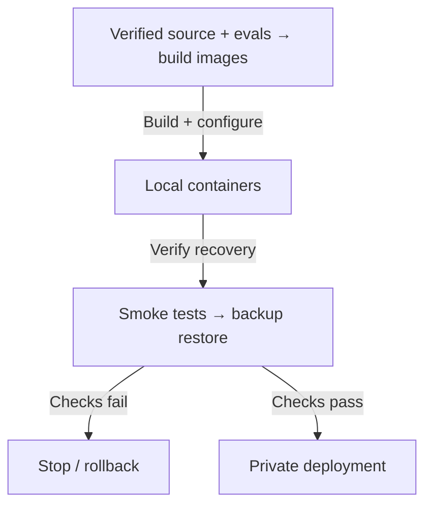

- **Verified source + evals → build images → Local containers** — Build + configure / 建置＋設定
  Configure private n8n, Qdrant and telemetry endpoints. Handoff: Versioned images and server-only configuration
  設定私人 n8n、Qdrant 及追蹤端點。 交接資料：版本化映像及只供伺服器設定

- **Local containers → Smoke tests → backup restore** — Verify recovery / 驗證恢復
  Exercise normal, insufficient, irrelevant and outage paths. Handoff: Health, routing, persistence and recovery evidence
  測試正常、資料不足、無關及中斷路徑。 交接資料：健康、路由、持久性及恢復證據

- **Smoke tests → backup restore → Stop / rollback** — Checks fail / 檢查失敗
  Retain the last valid image and persistent data. Handoff: Failure reason and recovery action
  保留最後有效映像及持久資料。 交接資料：失敗原因及恢復動作

- **Smoke tests → backup restore → Private deployment** — Checks pass / 檢查通過
  Access control and backups verified. Handoff: Release ID + reproducible demo and trace URL
  已驗證訪問控制及備份。 交接資料：發布 ID＋可重現 demo 及 trace URL
